# 库存报表

<cite>
**本文引用的文件**   
- [ReportController.cs](file://EquipmentIMS.Web/Controllers/ReportController.cs)
- [Inventory.cshtml](file://EquipmentIMS.Web/Views/Report/Inventory.cshtml)
- [ReportService.cs](file://EquipmentIMS.BLL/Services/ReportService.cs)
- [IReportService.cs](file://EquipmentIMS.BLL/Interfaces/IReportService.cs)
- [StockService.cs](file://EquipmentIMS.BLL/Services/StockService.cs)
- [IStockService.cs](file://EquipmentIMS.BLL/Interfaces/IStockService.cs)
- [StockRepository.cs](file://EquipmentIMS.DAL/Repositories/StockRepository.cs)
- [IStockRepository.cs](file://EquipmentIMS.DAL/Interfaces/IStockRepository.cs)
- [StockTransactionRepository.cs](file://EquipmentIMS.DAL/Repositories/StockTransactionRepository.cs)
- [IStockTransactionRepository.cs](file://EquipmentIMS.DAL/Interfaces/IStockTransactionRepository.cs)
- [AppDbContext.cs](file://EquipmentIMS.DAL/AppDbContext.cs)
- [BaseProductStock.cs](file://EquipmentIMS.Models/Entities/BaseProductStock.cs)
- [InvStockTransaction.cs](file://EquipmentIMS.Models/Entities/InvStockTransaction.cs)
- [InvStockAlert.cs](file://EquipmentIMS.Models/Entities/InvStockAlert.cs)
- [ReportInventoryDtos.cs](file://EquipmentIMS.Models/DTOs/Reports/ReportInventoryDtos.cs)
- [PagedResult.cs](file://EquipmentIMS.Models/DTOs/PagedResult.cs)
- [StockQueryDto.cs](file://EquipmentIMS.Models/DTOs/StockQueryDto.cs)
- [StockListDto.cs](file://EquipmentIMS.Models/DTOs/StockListDto.cs)
- [StockAlertDto.cs](file://EquipmentIMS.Models/DTOs/StockAlertDto.cs)
- [StockTransactionDto.cs](file://EquipmentIMS.Models/DTOs/StockTransactionDto.cs)
- [StockTransactionQueryDto.cs](file://EquipmentIMS.Models/DTOs/StockTransactionQueryDto.cs)
- [ExportBackgroundService.cs](file://EquipmentIMS.Web/BackgroundServices/ExportBackgroundService.cs)
- [ReportExportBackgroundService.cs](file://EquipmentIMS.Web/BackgroundServices/ReportExportBackgroundService.cs)
- [ReportExportTaskQueue.cs](file://EquipmentIMS.BLL/Services/ReportExportTaskQueue.cs)
- [MemoryCacheService.cs](file://EquipmentIMS.BLL/Services/MemoryCacheService.cs)
- [ICacheService.cs](file://EquipmentIMS.BLL/Interfaces/ICacheService.cs)
- [ExcelExportHelper.cs](file://EquipmentIMS.Web/Helpers/ExcelExportHelper.cs)
</cite>

## 目录
1. [简介](#简介)
2. [项目结构](#项目结构)
3. [核心组件](#核心组件)
4. [架构总览](#架构总览)
5. [详细组件分析](#详细组件分析)
6. [依赖关系分析](#依赖关系分析)
7. [性能考虑](#性能考虑)
8. [故障排查指南](#故障排查指南)
9. [结论](#结论)
10. [附录](#附录)

## 简介
本技术文档围绕“库存报表”功能，系统性阐述库存统计、库存周转率分析、库存预警报表等核心能力；说明多维度库存数据查询、库存变动趋势分析与库存成本核算的实现思路；描述数据源整合、实时数据更新机制与性能优化策略；覆盖库存异常检测、呆滞物料分析与库存健康度评估；并提供自定义库存指标配置、报表模板管理与批量导出能力的实现要点。同时给出大数据量场景下的分页查询、缓存策略与异步生成机制的设计与实践建议。

## 项目结构
库存报表相关代码分布在 Web 层（控制器与视图）、BLL 层（服务与任务队列）、DAL 层（仓储与上下文）以及 Models 层（实体、DTO、分页模型）。整体采用分层架构与依赖注入模式，通过仓储访问数据库，服务编排业务逻辑，控制器暴露 API，后台服务处理耗时任务。

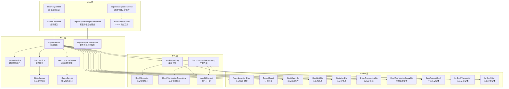

图表来源
- [ReportController.cs](file://EquipmentIMS.Web/Controllers/ReportController.cs)
- [Inventory.cshtml](file://EquipmentIMS.Web/Views/Report/Inventory.cshtml)
- [ReportService.cs](file://EquipmentIMS.BLL/Services/ReportService.cs)
- [IReportService.cs](file://EquipmentIMS.BLL/Interfaces/IReportService.cs)
- [StockService.cs](file://EquipmentIMS.BLL/Services/StockService.cs)
- [IStockService.cs](file://EquipmentIMS.BLL/Interfaces/IStockService.cs)
- [StockRepository.cs](file://EquipmentIMS.DAL/Repositories/StockRepository.cs)
- [IStockRepository.cs](file://EquipmentIMS.DAL/Interfaces/IStockRepository.cs)
- [StockTransactionRepository.cs](file://EquipmentIMS.DAL/Repositories/StockTransactionRepository.cs)
- [IStockTransactionRepository.cs](file://EquipmentIMS.DAL/Interfaces/IStockTransactionRepository.cs)
- [AppDbContext.cs](file://EquipmentIMS.DAL/AppDbContext.cs)
- [ReportInventoryDtos.cs](file://EquipmentIMS.Models/DTOs/Reports/ReportInventoryDtos.cs)
- [PagedResult.cs](file://EquipmentIMS.Models/DTOs/PagedResult.cs)
- [StockQueryDto.cs](file://EquipmentIMS.Models/DTOs/StockQueryDto.cs)
- [StockListDto.cs](file://EquipmentIMS.Models/DTOs/StockListDto.cs)
- [StockAlertDto.cs](file://EquipmentIMS.Models/DTOs/StockAlertDto.cs)
- [StockTransactionDto.cs](file://EquipmentIMS.Models/DTOs/StockTransactionDto.cs)
- [StockTransactionQueryDto.cs](file://EquipmentIMS.Models/DTOs/StockTransactionQueryDto.cs)
- [ExportBackgroundService.cs](file://EquipmentIMS.Web/BackgroundServices/ExportBackgroundService.cs)
- [ReportExportBackgroundService.cs](file://EquipmentIMS.Web/BackgroundServices/ReportExportBackgroundService.cs)
- [ReportExportTaskQueue.cs](file://EquipmentIMS.BLL/Services/ReportExportTaskQueue.cs)
- [MemoryCacheService.cs](file://EquipmentIMS.BLL/Services/MemoryCacheService.cs)
- [ICacheService.cs](file://EquipmentIMS.BLL/Interfaces/ICacheService.cs)
- [ExcelExportHelper.cs](file://EquipmentIMS.Web/Helpers/ExcelExportHelper.cs)
- [BaseProductStock.cs](file://EquipmentIMS.Models/Entities/BaseProductStock.cs)
- [InvStockTransaction.cs](file://EquipmentIMS.Models/Entities/InvStockTransaction.cs)
- [InvStockAlert.cs](file://EquipmentIMS.Models/Entities/InvStockAlert.cs)

章节来源
- [ReportController.cs](file://EquipmentIMS.Web/Controllers/ReportController.cs)
- [ReportService.cs](file://EquipmentIMS.BLL/Services/ReportService.cs)
- [StockRepository.cs](file://EquipmentIMS.DAL/Repositories/StockRepository.cs)
- [StockTransactionRepository.cs](file://EquipmentIMS.DAL/Repositories/StockTransactionRepository.cs)
- [AppDbContext.cs](file://EquipmentIMS.DAL/AppDbContext.cs)
- [ReportInventoryDtos.cs](file://EquipmentIMS.Models/DTOs/Reports/ReportInventoryDtos.cs)
- [PagedResult.cs](file://EquipmentIMS.Models/DTOs/PagedResult.cs)
- [StockQueryDto.cs](file://EquipmentIMS.Models/DTOs/StockQueryDto.cs)
- [StockListDto.cs](file://EquipmentIMS.Models/DTOs/StockListDto.cs)
- [StockAlertDto.cs](file://EquipmentIMS.Models/DTOs/StockAlertDto.cs)
- [StockTransactionDto.cs](file://EquipmentIMS.Models/DTOs/StockTransactionDto.cs)
- [StockTransactionQueryDto.cs](file://EquipmentIMS.Models/DTOs/StockTransactionQueryDto.cs)
- [ExportBackgroundService.cs](file://EquipmentIMS.Web/BackgroundServices/ExportBackgroundService.cs)
- [ReportExportBackgroundService.cs](file://EquipmentIMS.Web/BackgroundServices/ReportExportBackgroundService.cs)
- [ReportExportTaskQueue.cs](file://EquipmentIMS.BLL/Services/ReportExportTaskQueue.cs)
- [MemoryCacheService.cs](file://EquipmentIMS.BLL/Services/MemoryCacheService.cs)
- [ICacheService.cs](file://EquipmentIMS.BLL/Interfaces/ICacheService.cs)
- [ExcelExportHelper.cs](file://EquipmentIMS.Web/Helpers/ExcelExportHelper.cs)
- [BaseProductStock.cs](file://EquipmentIMS.Models/Entities/BaseProductStock.cs)
- [InvStockTransaction.cs](file://EquipmentIMS.Models/Entities/InvStockTransaction.cs)
- [InvStockAlert.cs](file://EquipmentIMS.Models/Entities/InvStockAlert.cs)

## 核心组件
- 报表控制器：提供库存报表的查询、导出与任务提交接口，接收前端请求并调用报表服务。
- 报表服务：聚合库存与交易数据，计算库存统计、周转率、预警与健康度指标，支持分页与缓存。
- 库存服务：封装库存基础操作与汇总计算，为报表服务提供统一的数据访问入口。
- 仓储层：分别负责库存快照与交易流水的查询与过滤，基于 EF 上下文执行 SQL。
- 后台服务与任务队列：处理报表导出的异步任务，避免阻塞主线程。
- 缓存服务：对热点报表数据进行短期缓存，降低重复查询压力。
- 导出工具：将报表数据序列化为 Excel 文件，供下载或批量导出。

章节来源
- [ReportController.cs](file://EquipmentIMS.Web/Controllers/ReportController.cs)
- [ReportService.cs](file://EquipmentIMS.BLL/Services/ReportService.cs)
- [StockService.cs](file://EquipmentIMS.BLL/Services/StockService.cs)
- [StockRepository.cs](file://EquipmentIMS.DAL/Repositories/StockRepository.cs)
- [StockTransactionRepository.cs](file://EquipmentIMS.DAL/Repositories/StockTransactionRepository.cs)
- [ReportExportBackgroundService.cs](file://EquipmentIMS.Web/BackgroundServices/ReportExportBackgroundService.cs)
- [ReportExportTaskQueue.cs](file://EquipmentIMS.BLL/Services/ReportExportTaskQueue.cs)
- [MemoryCacheService.cs](file://EquipmentIMS.BLL/Services/MemoryCacheService.cs)
- [ExcelExportHelper.cs](file://EquipmentIMS.Web/Helpers/ExcelExportHelper.cs)

## 架构总览
库存报表的整体流程从控制器开始，进入报表服务进行数据聚合与指标计算，必要时调用库存服务与仓储层获取明细与汇总数据，并通过缓存提升性能。对于大批量导出，使用后台服务与任务队列异步处理，最终由导出工具生成文件。

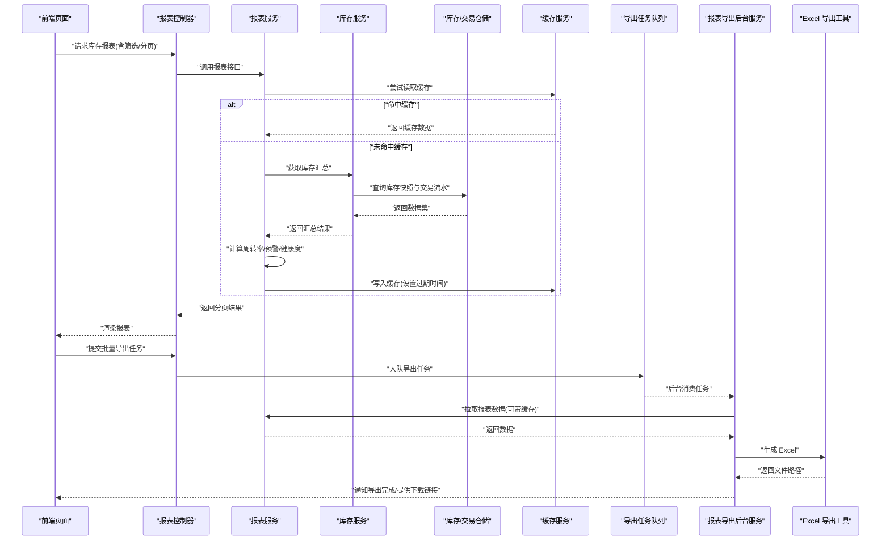

图表来源
- [ReportController.cs](file://EquipmentIMS.Web/Controllers/ReportController.cs)
- [ReportService.cs](file://EquipmentIMS.BLL/Services/ReportService.cs)
- [StockService.cs](file://EquipmentIMS.BLL/Services/StockService.cs)
- [StockRepository.cs](file://EquipmentIMS.DAL/Repositories/StockRepository.cs)
- [StockTransactionRepository.cs](file://EquipmentIMS.DAL/Repositories/StockTransactionRepository.cs)
- [MemoryCacheService.cs](file://EquipmentIMS.BLL/Services/MemoryCacheService.cs)
- [ReportExportTaskQueue.cs](file://EquipmentIMS.BLL/Services/ReportExportTaskQueue.cs)
- [ReportExportBackgroundService.cs](file://EquipmentIMS.Web/BackgroundServices/ReportExportBackgroundService.cs)
- [ExcelExportHelper.cs](file://EquipmentIMS.Web/Helpers/ExcelExportHelper.cs)

## 详细组件分析

### 库存统计与多维查询
- 维度支持：仓库、品类、供应商、客户、时间范围、产品编码/名称等。
- 查询入口：控制器接收查询条件 DTO，服务层组合库存快照与交易流水，按维度分组汇总。
- 分页：使用分页结果 DTO 承载总数与当前页数据，避免一次性加载全表。
- 缓存键：以查询条件哈希作为缓存键，减少重复计算。

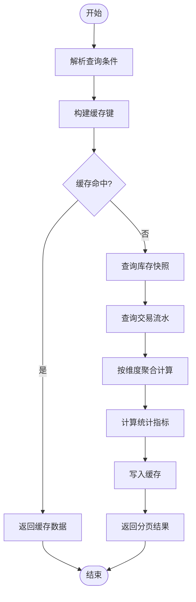

图表来源
- [ReportController.cs](file://EquipmentIMS.Web/Controllers/ReportController.cs)
- [ReportService.cs](file://EquipmentIMS.BLL/Services/ReportService.cs)
- [StockRepository.cs](file://EquipmentIMS.DAL/Repositories/StockRepository.cs)
- [StockTransactionRepository.cs](file://EquipmentIMS.DAL/Repositories/StockTransactionRepository.cs)
- [MemoryCacheService.cs](file://EquipmentIMS.BLL/Services/MemoryCacheService.cs)
- [PagedResult.cs](file://EquipmentIMS.Models/DTOs/PagedResult.cs)
- [StockQueryDto.cs](file://EquipmentIMS.Models/DTOs/StockQueryDto.cs)
- [StockListDto.cs](file://EquipmentIMS.Models/DTOs/StockListDto.cs)

章节来源
- [ReportController.cs](file://EquipmentIMS.Web/Controllers/ReportController.cs)
- [ReportService.cs](file://EquipmentIMS.BLL/Services/ReportService.cs)
- [StockRepository.cs](file://EquipmentIMS.DAL/Repositories/StockRepository.cs)
- [StockTransactionRepository.cs](file://EquipmentIMS.DAL/Repositories/StockTransactionRepository.cs)
- [MemoryCacheService.cs](file://EquipmentIMS.BLL/Services/MemoryCacheService.cs)
- [PagedResult.cs](file://EquipmentIMS.Models/DTOs/PagedResult.cs)
- [StockQueryDto.cs](file://EquipmentIMS.Models/DTOs/StockQueryDto.cs)
- [StockListDto.cs](file://EquipmentIMS.Models/DTOs/StockListDto.cs)

### 库存周转率分析
- 指标定义：通常以“期间出库总量/平均库存”衡量周转效率，可按仓库、品类、时间粒度输出。
- 数据来源：交易流水中的出库记录与库存快照的期初/期末数量。
- 计算步骤：
  - 聚合各维度期间出库量
  - 计算平均库存（期初+期末）/2 或使用更精细的时间加权
  - 得出周转率并排序展示
- 可视化：前端结合图表库呈现趋势与对比。

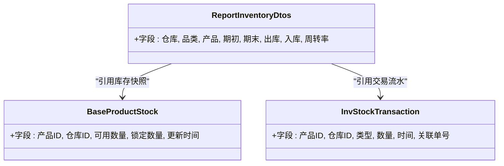

图表来源
- [ReportInventoryDtos.cs](file://EquipmentIMS.Models/DTOs/Reports/ReportInventoryDtos.cs)
- [BaseProductStock.cs](file://EquipmentIMS.Models/Entities/BaseProductStock.cs)
- [InvStockTransaction.cs](file://EquipmentIMS.Models/Entities/InvStockTransaction.cs)

章节来源
- [ReportService.cs](file://EquipmentIMS.BLL/Services/ReportService.cs)
- [ReportInventoryDtos.cs](file://EquipmentIMS.Models/DTOs/Reports/ReportInventoryDtos.cs)
- [BaseProductStock.cs](file://EquipmentIMS.Models/Entities/BaseProductStock.cs)
- [InvStockTransaction.cs](file://EquipmentIMS.Models/Entities/InvStockTransaction.cs)

### 库存预警报表
- 预警规则：低于安全库存、高于上限、超期未动、批次过期等。
- 数据源：库存快照与安全阈值配置（可通过系统配置扩展），结合交易历史判断呆滞。
- 输出：预警级别、受影响产品、仓库、建议动作（补货/调拨/清理）。

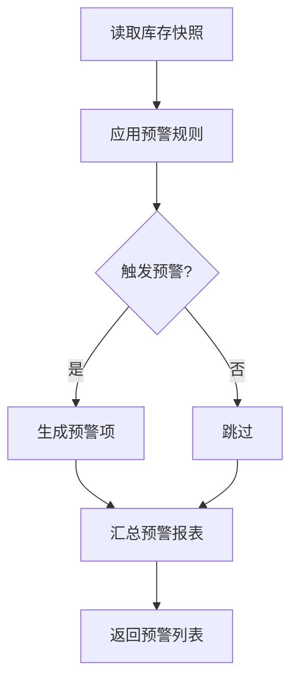

图表来源
- [StockAlertDto.cs](file://EquipmentIMS.Models/DTOs/StockAlertDto.cs)
- [InvStockAlert.cs](file://EquipmentIMS.Models/Entities/InvStockAlert.cs)
- [StockRepository.cs](file://EquipmentIMS.DAL/Repositories/StockRepository.cs)
- [ReportService.cs](file://EquipmentIMS.BLL/Services/ReportService.cs)

章节来源
- [StockAlertDto.cs](file://EquipmentIMS.Models/DTOs/StockAlertDto.cs)
- [InvStockAlert.cs](file://EquipmentIMS.Models/Entities/InvStockAlert.cs)
- [StockRepository.cs](file://EquipmentIMS.DAL/Repositories/StockRepository.cs)
- [ReportService.cs](file://EquipmentIMS.BLL/Services/ReportService.cs)

### 库存变动趋势分析
- 时间窗口：日/周/月等多粒度趋势。
- 数据聚合：按时间与维度聚合入库、出库、净变化。
- 异常检测：波动阈值、突增突降标记。

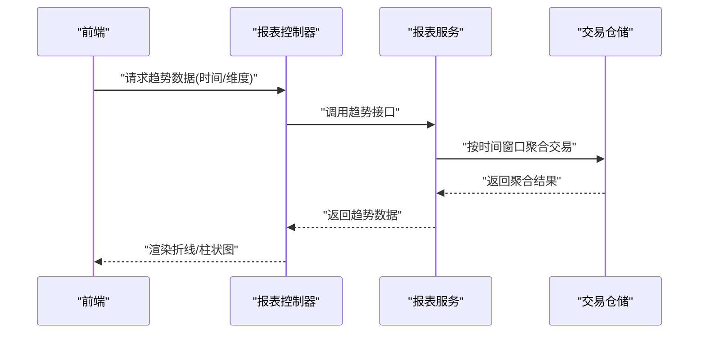

图表来源
- [ReportController.cs](file://EquipmentIMS.Web/Controllers/ReportController.cs)
- [ReportService.cs](file://EquipmentIMS.BLL/Services/ReportService.cs)
- [StockTransactionRepository.cs](file://EquipmentIMS.DAL/Repositories/StockTransactionRepository.cs)
- [StockTransactionDto.cs](file://EquipmentIMS.Models/DTOs/StockTransactionDto.cs)
- [StockTransactionQueryDto.cs](file://EquipmentIMS.Models/DTOs/StockTransactionQueryDto.cs)

章节来源
- [ReportController.cs](file://EquipmentIMS.Web/Controllers/ReportController.cs)
- [ReportService.cs](file://EquipmentIMS.BLL/Services/ReportService.cs)
- [StockTransactionRepository.cs](file://EquipmentIMS.DAL/Repositories/StockTransactionRepository.cs)
- [StockTransactionDto.cs](file://EquipmentIMS.Models/DTOs/StockTransactionDto.cs)
- [StockTransactionQueryDto.cs](file://EquipmentIMS.Models/DTOs/StockTransactionQueryDto.cs)

### 库存成本核算
- 成本口径：移动加权平均、先进先出等（根据业务配置选择）。
- 数据来源：交易流水中的单价与数量，库存快照用于期末结存。
- 输出：单位成本、库存金额、累计成本差异。

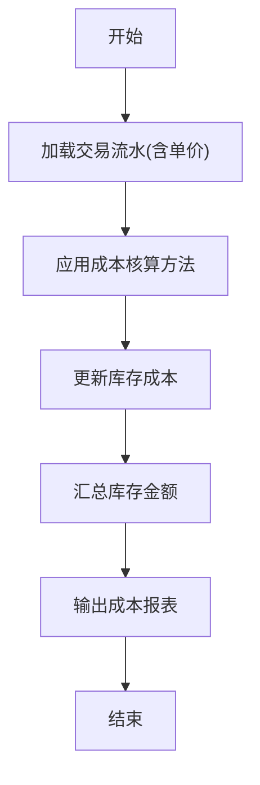

图表来源
- [ReportService.cs](file://EquipmentIMS.BLL/Services/ReportService.cs)
- [StockTransactionRepository.cs](file://EquipmentIMS.DAL/Repositories/StockTransactionRepository.cs)
- [BaseProductStock.cs](file://EquipmentIMS.Models/Entities/BaseProductStock.cs)

章节来源
- [ReportService.cs](file://EquipmentIMS.BLL/Services/ReportService.cs)
- [StockTransactionRepository.cs](file://EquipmentIMS.DAL/Repositories/StockTransactionRepository.cs)
- [BaseProductStock.cs](file://EquipmentIMS.Models/Entities/BaseProductStock.cs)

### 库存异常检测与呆滞物料分析
- 异常检测：负库存、数量不一致、频繁出入库异常。
- 呆滞分析：长周期无交易、超过阈值未动。
- 健康度评估：综合周转率、预警比例、呆滞占比等指标打分。

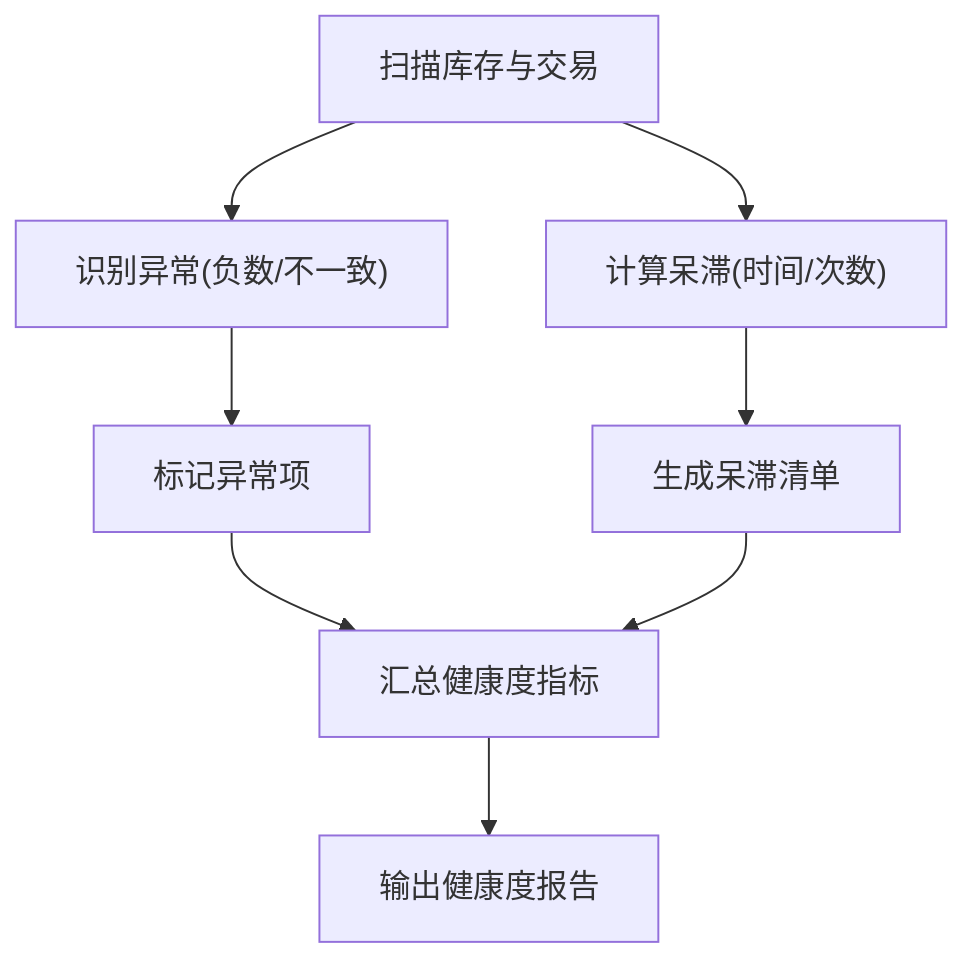

图表来源
- [StockRepository.cs](file://EquipmentIMS.DAL/Repositories/StockRepository.cs)
- [StockTransactionRepository.cs](file://EquipmentIMS.DAL/Repositories/StockTransactionRepository.cs)
- [ReportService.cs](file://EquipmentIMS.BLL/Services/ReportService.cs)

章节来源
- [StockRepository.cs](file://EquipmentIMS.DAL/Repositories/StockRepository.cs)
- [StockTransactionRepository.cs](file://EquipmentIMS.DAL/Repositories/StockTransactionRepository.cs)
- [ReportService.cs](file://EquipmentIMS.BLL/Services/ReportService.cs)

### 自定义库存指标配置与报表模板管理
- 指标配置：通过系统配置或扩展表维护指标公式、权重与阈值。
- 模板管理：预置常用报表模板（如月度库存汇总、周转率排行、预警清单），支持用户自定义保存与复用。
- 动态计算：报表服务根据模板参数动态组装查询与计算逻辑。

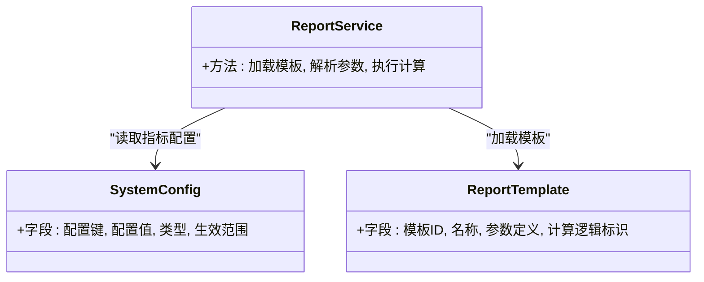

图表来源
- [ReportService.cs](file://EquipmentIMS.BLL/Services/ReportService.cs)
- [SysConfigConfiguration.cs](file://EquipmentIMS.DAL/Configurations/SysConfigConfiguration.cs)

章节来源
- [ReportService.cs](file://EquipmentIMS.BLL/Services/ReportService.cs)
- [SysConfigConfiguration.cs](file://EquipmentIMS.DAL/Configurations/SysConfigConfiguration.cs)

### 批量导出与异步生成机制
- 任务入队：控制器接收导出请求后，将任务加入队列。
- 后台消费：后台服务从队列取出任务，调用报表服务生成数据。
- 文件生成：导出工具将数据写入 Excel，返回文件路径或流。
- 状态反馈：前端轮询或 WebSocket 通知导出完成。

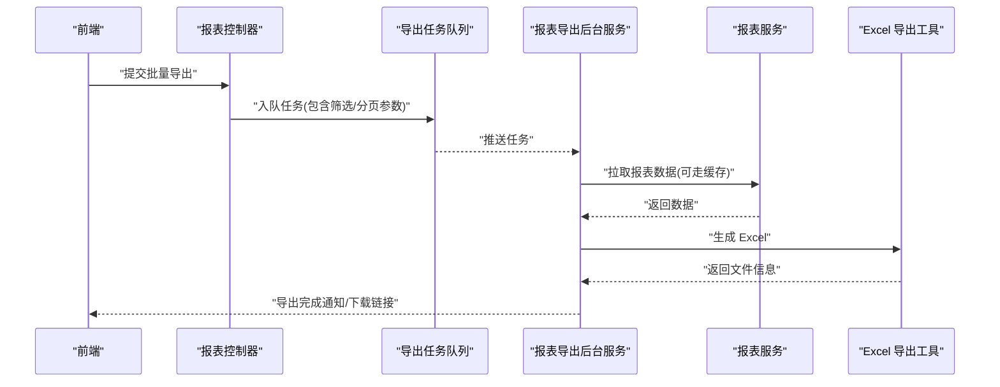

图表来源
- [ReportController.cs](file://EquipmentIMS.Web/Controllers/ReportController.cs)
- [ReportExportTaskQueue.cs](file://EquipmentIMS.BLL/Services/ReportExportTaskQueue.cs)
- [ReportExportBackgroundService.cs](file://EquipmentIMS.Web/BackgroundServices/ReportExportBackgroundService.cs)
- [ReportService.cs](file://EquipmentIMS.BLL/Services/ReportService.cs)
- [ExcelExportHelper.cs](file://EquipmentIMS.Web/Helpers/ExcelExportHelper.cs)

章节来源
- [ReportController.cs](file://EquipmentIMS.Web/Controllers/ReportController.cs)
- [ReportExportTaskQueue.cs](file://EquipmentIMS.BLL/Services/ReportExportTaskQueue.cs)
- [ReportExportBackgroundService.cs](file://EquipmentIMS.Web/BackgroundServices/ReportExportBackgroundService.cs)
- [ReportService.cs](file://EquipmentIMS.BLL/Services/ReportService.cs)
- [ExcelExportHelper.cs](file://EquipmentIMS.Web/Helpers/ExcelExportHelper.cs)

## 依赖关系分析
- 控制器依赖报表服务，报表服务依赖库存服务与仓储层，仓储层依赖 EF 上下文。
- 缓存服务被报表服务使用以提升性能。
- 导出任务队列与后台服务解耦导出流程，避免阻塞主线程。
- DTO 与实体在报表服务中进行映射与转换。

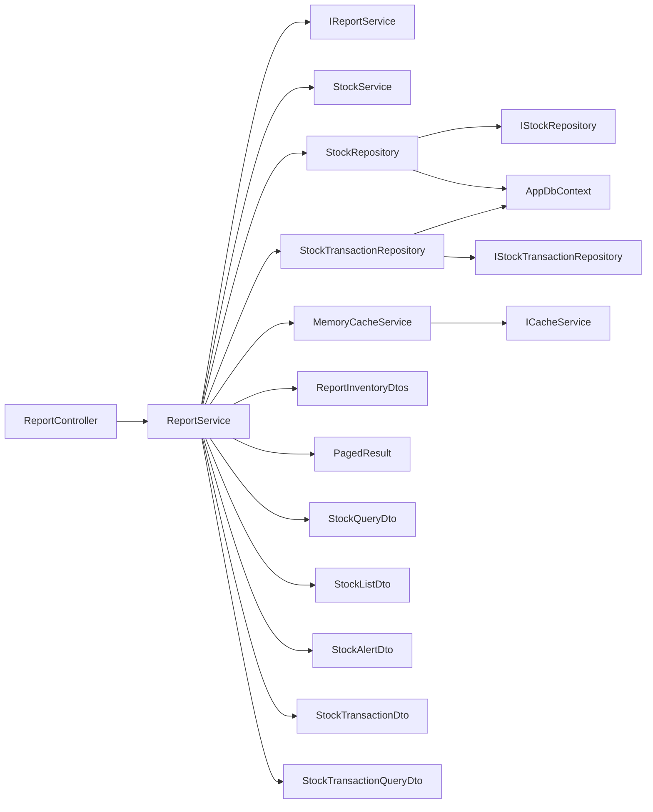

图表来源
- [ReportController.cs](file://EquipmentIMS.Web/Controllers/ReportController.cs)
- [ReportService.cs](file://EquipmentIMS.BLL/Services/ReportService.cs)
- [IReportService.cs](file://EquipmentIMS.BLL/Interfaces/IReportService.cs)
- [StockService.cs](file://EquipmentIMS.BLL/Services/StockService.cs)
- [IStockService.cs](file://EquipmentIMS.BLL/Interfaces/IStockService.cs)
- [StockRepository.cs](file://EquipmentIMS.DAL/Repositories/StockRepository.cs)
- [IStockRepository.cs](file://EquipmentIMS.DAL/Interfaces/IStockRepository.cs)
- [StockTransactionRepository.cs](file://EquipmentIMS.DAL/Repositories/StockTransactionRepository.cs)
- [IStockTransactionRepository.cs](file://EquipmentIMS.DAL/Interfaces/IStockTransactionRepository.cs)
- [AppDbContext.cs](file://EquipmentIMS.DAL/AppDbContext.cs)
- [ReportInventoryDtos.cs](file://EquipmentIMS.Models/DTOs/Reports/ReportInventoryDtos.cs)
- [PagedResult.cs](file://EquipmentIMS.Models/DTOs/PagedResult.cs)
- [StockQueryDto.cs](file://EquipmentIMS.Models/DTOs/StockQueryDto.cs)
- [StockListDto.cs](file://EquipmentIMS.Models/DTOs/StockListDto.cs)
- [StockAlertDto.cs](file://EquipmentIMS.Models/DTOs/StockAlertDto.cs)
- [StockTransactionDto.cs](file://EquipmentIMS.Models/DTOs/StockTransactionDto.cs)
- [StockTransactionQueryDto.cs](file://EquipmentIMS.Models/DTOs/StockTransactionQueryDto.cs)

章节来源
- [ReportController.cs](file://EquipmentIMS.Web/Controllers/ReportController.cs)
- [ReportService.cs](file://EquipmentIMS.BLL/Services/ReportService.cs)
- [StockRepository.cs](file://EquipmentIMS.DAL/Repositories/StockRepository.cs)
- [StockTransactionRepository.cs](file://EquipmentIMS.DAL/Repositories/StockTransactionRepository.cs)
- [AppDbContext.cs](file://EquipmentIMS.DAL/AppDbContext.cs)
- [ReportInventoryDtos.cs](file://EquipmentIMS.Models/DTOs/Reports/ReportInventoryDtos.cs)
- [PagedResult.cs](file://EquipmentIMS.Models/DTOs/PagedResult.cs)
- [StockQueryDto.cs](file://EquipmentIMS.Models/DTOs/StockQueryDto.cs)
- [StockListDto.cs](file://EquipmentIMS.Models/DTOs/StockListDto.cs)
- [StockAlertDto.cs](file://EquipmentIMS.Models/DTOs/StockAlertDto.cs)
- [StockTransactionDto.cs](file://EquipmentIMS.Models/DTOs/StockTransactionDto.cs)
- [StockTransactionQueryDto.cs](file://EquipmentIMS.Models/DTOs/StockTransactionQueryDto.cs)

## 性能考虑
- 分页查询：始终使用分页 DTO 限制单次返回数据量，避免大结果集拖慢响应。
- 缓存策略：对热点报表数据设置合理过期时间，使用查询条件哈希作为缓存键。
- 索引优化：在仓储层确保常用筛选字段（仓库、品类、时间、产品）具备合适索引。
- 异步导出：将耗时导出放入后台任务队列，避免阻塞主线程。
- 聚合下推：尽量在数据库层完成聚合与过滤，减少内存计算开销。
- 连接池与超时：合理配置 EF 连接池与查询超时，防止长时间占用资源。

[本节为通用性能指导，不直接分析具体文件]

## 故障排查指南
- 报表数据不一致：检查库存快照与交易流水的一致性，确认事务边界与并发更新。
- 缓存失效问题：核对缓存键是否包含所有筛选维度，检查过期策略是否过短。
- 导出失败：查看后台服务日志，确认任务队列是否正常消费，导出工具是否正确写入文件。
- 性能退化：分析仓储层 SQL 执行计划，确认索引是否命中，是否存在 N+1 查询。
- 预警误报：校验预警阈值与规则配置，检查时间窗口与呆滞判定逻辑。

章节来源
- [ReportService.cs](file://EquipmentIMS.BLL/Services/ReportService.cs)
- [StockRepository.cs](file://EquipmentIMS.DAL/Repositories/StockRepository.cs)
- [StockTransactionRepository.cs](file://EquipmentIMS.DAL/Repositories/StockTransactionRepository.cs)
- [ReportExportBackgroundService.cs](file://EquipmentIMS.Web/BackgroundServices/ReportExportBackgroundService.cs)
- [ReportExportTaskQueue.cs](file://EquipmentIMS.BLL/Services/ReportExportTaskQueue.cs)
- [MemoryCacheService.cs](file://EquipmentIMS.BLL/Services/MemoryCacheService.cs)

## 结论
库存报表模块通过分层架构与依赖注入实现了高内聚、低耦合的设计。报表服务聚合库存快照与交易流水，提供统计、周转率、预警与健康度等核心指标；仓储层基于 EF 高效查询；缓存与异步导出显著提升用户体验与系统稳定性。建议在后续迭代中完善指标配置化与模板管理，持续优化索引与聚合下推，进一步提升大数据量场景的性能与可扩展性。

[本节为总结性内容，不直接分析具体文件]

## 附录
- 前端页面：库存报表页面位于 Views/Report/Inventory.cshtml，负责渲染图表与交互。
- 控制器：ReportController 提供报表相关 API。
- 服务与仓储：ReportService、StockService、StockRepository、StockTransactionRepository 为核心实现。
- 模型与 DTO：ReportInventoryDtos、PagedResult、StockQueryDto、StockListDto、StockAlertDto、StockTransactionDto、StockTransactionQueryDto 等。
- 后台与导出：ReportExportBackgroundService、ReportExportTaskQueue、ExcelExportHelper。

章节来源
- [Inventory.cshtml](file://EquipmentIMS.Web/Views/Report/Inventory.cshtml)
- [ReportController.cs](file://EquipmentIMS.Web/Controllers/ReportController.cs)
- [ReportService.cs](file://EquipmentIMS.BLL/Services/ReportService.cs)
- [StockService.cs](file://EquipmentIMS.BLL/Services/StockService.cs)
- [StockRepository.cs](file://EquipmentIMS.DAL/Repositories/StockRepository.cs)
- [StockTransactionRepository.cs](file://EquipmentIMS.DAL/Repositories/StockTransactionRepository.cs)
- [ReportInventoryDtos.cs](file://EquipmentIMS.Models/DTOs/Reports/ReportInventoryDtos.cs)
- [PagedResult.cs](file://EquipmentIMS.Models/DTOs/PagedResult.cs)
- [StockQueryDto.cs](file://EquipmentIMS.Models/DTOs/StockQueryDto.cs)
- [StockListDto.cs](file://EquipmentIMS.Models/DTOs/StockListDto.cs)
- [StockAlertDto.cs](file://EquipmentIMS.Models/DTOs/StockAlertDto.cs)
- [StockTransactionDto.cs](file://EquipmentIMS.Models/DTOs/StockTransactionDto.cs)
- [StockTransactionQueryDto.cs](file://EquipmentIMS.Models/DTOs/StockTransactionQueryDto.cs)
- [ReportExportBackgroundService.cs](file://EquipmentIMS.Web/BackgroundServices/ReportExportBackgroundService.cs)
- [ReportExportTaskQueue.cs](file://EquipmentIMS.BLL/Services/ReportExportTaskQueue.cs)
- [ExcelExportHelper.cs](file://EquipmentIMS.Web/Helpers/ExcelExportHelper.cs)