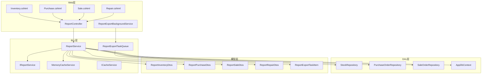
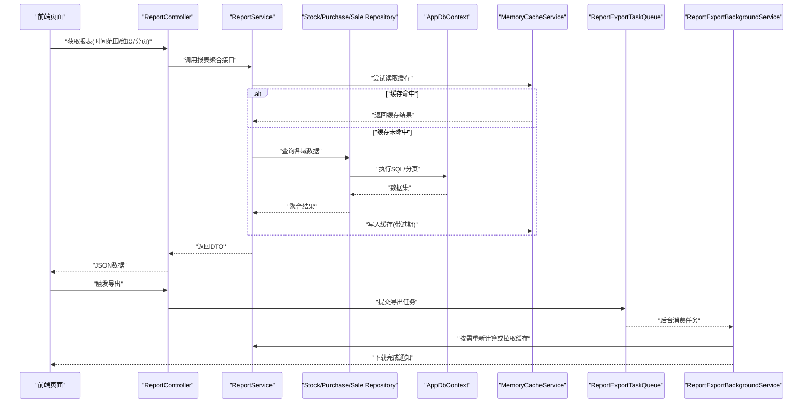
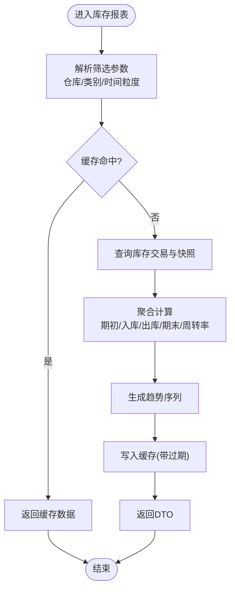
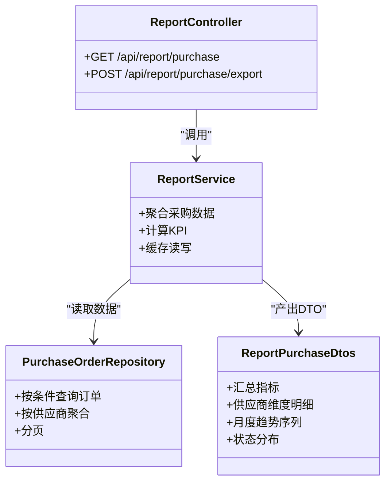
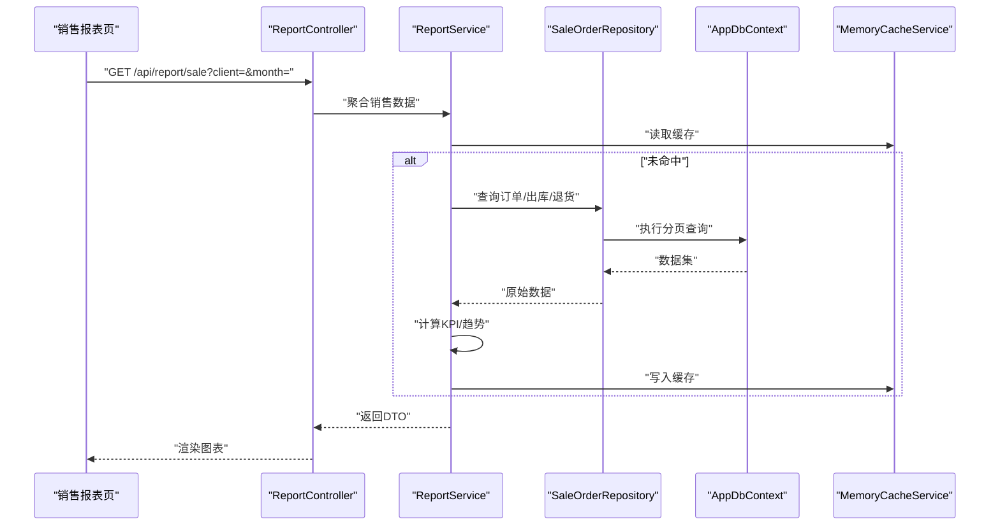
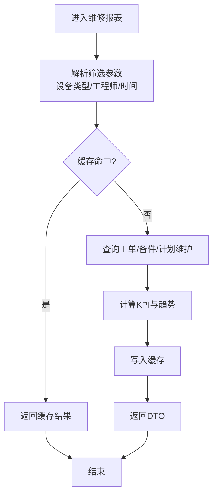
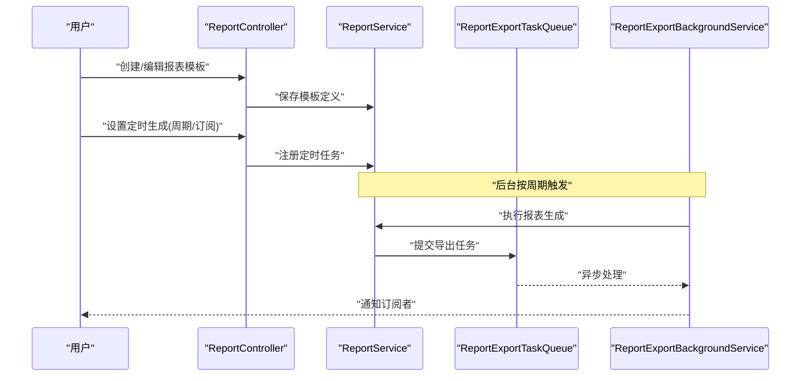
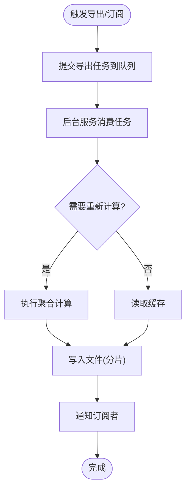
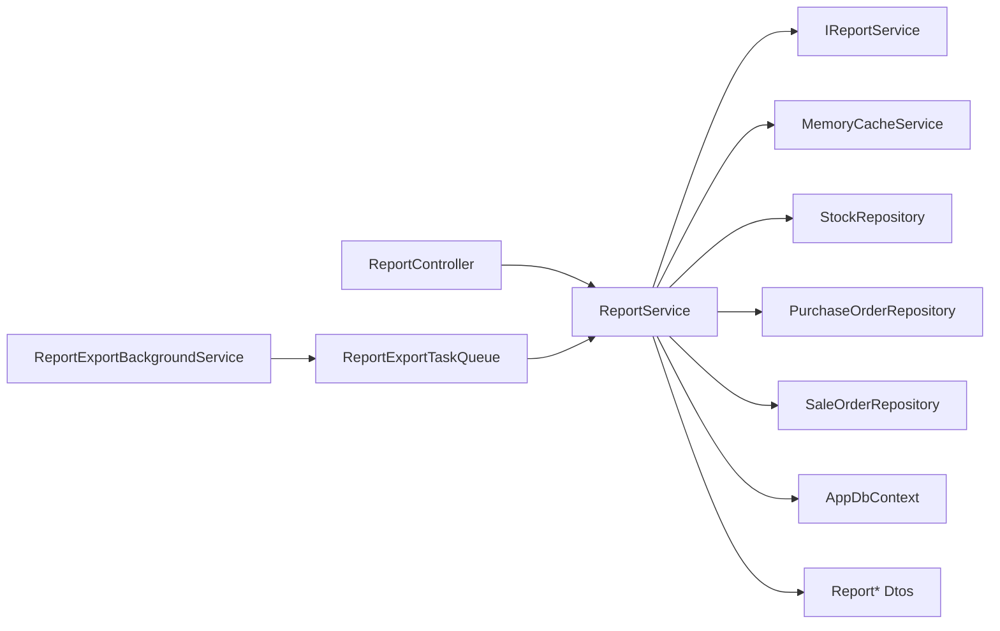

# 报表分析

<cite>
**本文引用的文件**   
- [ReportController.cs](file://EquipmentIMS.Web/Controllers/ReportController.cs)
- [ReportService.cs](file://EquipmentIMS.BLL/Services/ReportService.cs)
- [IReportService.cs](file://EquipmentIMS.BLL/Interfaces/IReportService.cs)
- [ReportInventoryDtos.cs](file://EquipmentIMS.Models/DTOs/Reports/ReportInventoryDtos.cs)
- [ReportPurchaseDtos.cs](file://EquipmentIMS.Models/DTOs/Reports/ReportPurchaseDtos.cs)
- [ReportSaleDtos.cs](file://EquipmentIMS.Models/DTOs/Reports/ReportSaleDtos.cs)
- [ReportRepairDtos.cs](file://EquipmentIMS.Models/DTOs/Reports/ReportRepairDtos.cs)
- [ReportExportTaskItem.cs](file://EquipmentIMS.Models/DTOs/Reports/ReportExportTaskItem.cs)
- [ReportExportBackgroundService.cs](file://EquipmentIMS.Web/BackgroundServices/ReportExportBackgroundService.cs)
- [ReportExportTaskQueue.cs](file://EquipmentIMS.BLL/Services/ReportExportTaskQueue.cs)
- [MemoryCacheService.cs](file://EquipmentIMS.BLL/Services/MemoryCacheService.cs)
- [ICacheService.cs](file://EquipmentIMS.BLL/Interfaces/ICacheService.cs)
- [StockRepository.cs](file://EquipmentIMS.DAL/Repositories/StockRepository.cs)
- [PurchaseOrderRepository.cs](file://EquipmentIMS.DAL/Repositories/PurchaseOrderRepository.cs)
- [SaleOrderRepository.cs](file://EquipmentIMS.DAL/Repositories/SaleOrderRepository.cs)
- [AppDbContext.cs](file://EquipmentIMS.DAL/AppDbContext.cs)
- [Inventory.cshtml](file://EquipmentIMS.Web/Views/Report/Inventory.cshtml)
- [Purchase.cshtml](file://EquipmentIMS.Web/Views/Report/Purchase.cshtml)
- [Sale.cshtml](file://EquipmentIMS.Web/Views/Report/Sale.cshtml)
- [Repair.cshtml](file://EquipmentIMS.Web/Views/Report/Repair.cshtml)
</cite>

## 目录
1. [简介](#简介)
2. [项目结构](#项目结构)
3. [核心组件](#核心组件)
4. [架构总览](#架构总览)
5. [详细组件分析](#详细组件分析)
6. [依赖关系分析](#依赖关系分析)
7. [性能考虑](#性能考虑)
8. [故障排查指南](#故障排查指南)
9. [结论](#结论)
10. [附录](#附录)

## 简介
本模块为设备库存管理系统的“报表分析”能力提供统一的数据聚合、多维统计、趋势分析与可视化展示，覆盖库存、采购、销售、维修四大业务域。系统支持自定义报表创建与模板管理、定时生成与异步导出、订阅与智能预警推送，并提供KPI指标监控、业务洞察与决策支持。针对大数据量场景，采用分层缓存、分页与增量计算策略，保障高吞吐与低延迟。

## 项目结构
报表分析在Web层通过控制器暴露API，BLL层实现领域服务与任务队列，DAL层通过仓储访问数据库实体，Models层定义报表DTO与导出任务项，后台服务负责定时任务与异步导出，前端视图集成图表渲染。

图示来源
- [ReportController.cs](file://EquipmentIMS.Web/Controllers/ReportController.cs)
- [ReportService.cs](file://EquipmentIMS.BLL/Services/ReportService.cs)
- [IReportService.cs](file://EquipmentIMS.BLL/Interfaces/IReportService.cs)
- [MemoryCacheService.cs](file://EquipmentIMS.BLL/Services/MemoryCacheService.cs)
- [ICacheService.cs](file://EquipmentIMS.BLL/Interfaces/ICacheService.cs)
- [StockRepository.cs](file://EquipmentIMS.DAL/Repositories/StockRepository.cs)
- [PurchaseOrderRepository.cs](file://EquipmentIMS.DAL/Repositories/PurchaseOrderRepository.cs)
- [SaleOrderRepository.cs](file://EquipmentIMS.DAL/Repositories/SaleOrderRepository.cs)
- [AppDbContext.cs](file://EquipmentIMS.DAL/AppDbContext.cs)
- [ReportInventoryDtos.cs](file://EquipmentIMS.Models/DTOs/Reports/ReportInventoryDtos.cs)
- [ReportPurchaseDtos.cs](file://EquipmentIMS.Models/DTOs/Reports/ReportPurchaseDtos.cs)
- [ReportSaleDtos.cs](file://EquipmentIMS.Models/DTOs/Reports/ReportSaleDtos.cs)
- [ReportRepairDtos.cs](file://EquipmentIMS.Models/DTOs/Reports/ReportRepairDtos.cs)
- [ReportExportTaskItem.cs](file://EquipmentIMS.Models/DTOs/Reports/ReportExportTaskItem.cs)
- [ReportExportBackgroundService.cs](file://EquipmentIMS.Web/BackgroundServices/ReportExportBackgroundService.cs)
- [ReportExportTaskQueue.cs](file://EquipmentIMS.BLL/Services/ReportExportTaskQueue.cs)
- [Inventory.cshtml](file://EquipmentIMS.Web/Views/Report/Inventory.cshtml)
- [Purchase.cshtml](file://EquipmentIMS.Web/Views/Report/Purchase.cshtml)
- [Sale.cshtml](file://EquipmentIMS.Web/Views/Report/Sale.cshtml)
- [Repair.cshtml](file://EquipmentIMS.Web/Views/Report/Repair.cshtml)

章节来源
- [ReportController.cs](file://EquipmentIMS.Web/Controllers/ReportController.cs)
- [ReportService.cs](file://EquipmentIMS.BLL/Services/ReportService.cs)
- [IReportService.cs](file://EquipmentIMS.BLL/Interfaces/IReportService.cs)
- [ReportInventoryDtos.cs](file://EquipmentIMS.Models/DTOs/Reports/ReportInventoryDtos.cs)
- [ReportPurchaseDtos.cs](file://EquipmentIMS.Models/DTOs/Reports/ReportPurchaseDtos.cs)
- [ReportSaleDtos.cs](file://EquipmentIMS.Models/DTOs/Reports/ReportSaleDtos.cs)
- [ReportRepairDtos.cs](file://EquipmentIMS.Models/DTOs/Reports/ReportRepairDtos.cs)
- [ReportExportTaskItem.cs](file://EquipmentIMS.Models/DTOs/Reports/ReportExportTaskItem.cs)
- [ReportExportBackgroundService.cs](file://EquipmentIMS.Web/BackgroundServices/ReportExportBackgroundService.cs)
- [ReportExportTaskQueue.cs](file://EquipmentIMS.BLL/Services/ReportExportTaskQueue.cs)
- [MemoryCacheService.cs](file://EquipmentIMS.BLL/Services/MemoryCacheService.cs)
- [ICacheService.cs](file://EquipmentIMS.BLL/Interfaces/ICacheService.cs)
- [StockRepository.cs](file://EquipmentIMS.DAL/Repositories/StockRepository.cs)
- [PurchaseOrderRepository.cs](file://EquipmentIMS.DAL/Repositories/PurchaseOrderRepository.cs)
- [SaleOrderRepository.cs](file://EquipmentIMS.DAL/Repositories/SaleOrderRepository.cs)
- [AppDbContext.cs](file://EquipmentIMS.DAL/AppDbContext.cs)
- [Inventory.cshtml](file://EquipmentIMS.Web/Views/Report/Inventory.cshtml)
- [Purchase.cshtml](file://EquipmentIMS.Web/Views/Report/Purchase.cshtml)
- [Sale.cshtml](file://EquipmentIMS.Web/Views/Report/Sale.cshtml)
- [Repair.cshtml](file://EquipmentIMS.Web/Views/Report/Repair.cshtml)

## 核心组件
- 报表控制器：对外暴露库存、采购、销售、维修等报表查询与导出接口，接收时间范围、维度筛选、分页参数，返回聚合数据与图表所需序列。
- 报表服务：封装跨域聚合逻辑，组合库存、采购、销售、维修数据源，输出标准化DTO；提供缓存命中与失效控制；协调导出任务入队。
- 报表DTO：按业务域划分的数据传输对象，包含汇总指标、明细列表、趋势序列、分组维度等字段。
- 导出任务队列与后台服务：将耗时导出任务异步化，支持批量写入Excel/CSV，避免阻塞请求线程。
- 缓存服务：基于内存的键值缓存，用于热点报表结果与KPI指标的短期缓存，降低数据库压力。
- 仓储与上下文：面向各业务域的仓储实现与EF Core上下文，提供高效查询与分页能力。

章节来源
- [ReportController.cs](file://EquipmentIMS.Web/Controllers/ReportController.cs)
- [ReportService.cs](file://EquipmentIMS.BLL/Services/ReportService.cs)
- [IReportService.cs](file://EquipmentIMS.BLL/Interfaces/IReportService.cs)
- [ReportInventoryDtos.cs](file://EquipmentIMS.Models/DTOs/Reports/ReportInventoryDtos.cs)
- [ReportPurchaseDtos.cs](file://EquipmentIMS.Models/DTOs/Reports/ReportPurchaseDtos.cs)
- [ReportSaleDtos.cs](file://EquipmentIMS.Models/DTOs/Reports/ReportSaleDtos.cs)
- [ReportRepairDtos.cs](file://EquipmentIMS.Models/DTOs/Reports/ReportRepairDtos.cs)
- [ReportExportTaskItem.cs](file://EquipmentIMS.Models/DTOs/Reports/ReportExportTaskItem.cs)
- [ReportExportBackgroundService.cs](file://EquipmentIMS.Web/BackgroundServices/ReportExportBackgroundService.cs)
- [ReportExportTaskQueue.cs](file://EquipmentIMS.BLL/Services/ReportExportTaskQueue.cs)
- [MemoryCacheService.cs](file://EquipmentIMS.BLL/Services/MemoryCacheService.cs)
- [ICacheService.cs](file://EquipmentIMS.BLL/Interfaces/ICacheService.cs)
- [StockRepository.cs](file://EquipmentIMS.DAL/Repositories/StockRepository.cs)
- [PurchaseOrderRepository.cs](file://EquipmentIMS.DAL/Repositories/PurchaseOrderRepository.cs)
- [SaleOrderRepository.cs](file://EquipmentIMS.DAL/Repositories/SaleOrderRepository.cs)
- [AppDbContext.cs](file://EquipmentIMS.DAL/AppDbContext.cs)

## 架构总览
报表分析遵循分层架构：Web控制器负责路由与参数校验，BLL服务负责聚合与缓存，DAL仓储负责数据访问，后台服务负责异步导出与定时任务。

图示来源
- [ReportController.cs](file://EquipmentIMS.Web/Controllers/ReportController.cs)
- [ReportService.cs](file://EquipmentIMS.BLL/Services/ReportService.cs)
- [StockRepository.cs](file://EquipmentIMS.DAL/Repositories/StockRepository.cs)
- [PurchaseOrderRepository.cs](file://EquipmentIMS.DAL/Repositories/PurchaseOrderRepository.cs)
- [SaleOrderRepository.cs](file://EquipmentIMS.DAL/Repositories/SaleOrderRepository.cs)
- [AppDbContext.cs](file://EquipmentIMS.DAL/AppDbContext.cs)
- [MemoryCacheService.cs](file://EquipmentIMS.BLL/Services/MemoryCacheService.cs)
- [ReportExportTaskQueue.cs](file://EquipmentIMS.BLL/Services/ReportExportTaskQueue.cs)
- [ReportExportBackgroundService.cs](file://EquipmentIMS.Web/BackgroundServices/ReportExportBackgroundService.cs)

## 详细组件分析

### 库存报表
- 功能特性
  - 多维度统计：仓库、产品类别、供应商、时间粒度（日/周/月）。
  - 关键指标：期初库存、入库量、出库量、期末库存、周转率、呆滞占比。
  - 趋势分析：库存水位曲线、出入库波动、异常波动检测。
  - 可视化：柱状图、折线图、堆叠面积图、热力图。
- 数据流
  - 控制器接收筛选条件，服务层聚合库存交易与当前库存快照，输出DTO供前端渲染。
- 缓存策略
  - 对热点仓库/日期区间进行短TTL缓存，变更事件触发失效。
- 导出与订阅
  - 支持Excel导出与定时生成，订阅者可在指定周期收到报表链接。
- KPI与预警
  - 低库存预警、超储预警、周转率阈值告警，结合通知服务推送。

图示来源
- [ReportController.cs](file://EquipmentIMS.Web/Controllers/ReportController.cs)
- [ReportService.cs](file://EquipmentIMS.BLL/Services/ReportService.cs)
- [StockRepository.cs](file://EquipmentIMS.DAL/Repositories/StockRepository.cs)
- [AppDbContext.cs](file://EquipmentIMS.DAL/AppDbContext.cs)
- [MemoryCacheService.cs](file://EquipmentIMS.BLL/Services/MemoryCacheService.cs)
- [ReportInventoryDtos.cs](file://EquipmentIMS.Models/DTOs/Reports/ReportInventoryDtos.cs)
- [Inventory.cshtml](file://EquipmentIMS.Web/Views/Report/Inventory.cshtml)

章节来源
- [ReportController.cs](file://EquipmentIMS.Web/Controllers/ReportController.cs)
- [ReportService.cs](file://EquipmentIMS.BLL/Services/ReportService.cs)
- [StockRepository.cs](file://EquipmentIMS.DAL/Repositories/StockRepository.cs)
- [AppDbContext.cs](file://EquipmentIMS.DAL/AppDbContext.cs)
- [MemoryCacheService.cs](file://EquipmentIMS.BLL/Services/MemoryCacheService.cs)
- [ReportInventoryDtos.cs](file://EquipmentIMS.Models/DTOs/Reports/ReportInventoryDtos.cs)
- [Inventory.cshtml](file://EquipmentIMS.Web/Views/Report/Inventory.cshtml)

### 采购报表
- 功能特性
  - 多维度统计：供应商、物料类别、采购单状态、时间粒度。
  - 关键指标：采购金额、到货率、准时交付率、退货率、单价趋势。
  - 趋势分析：月度采购额、供应商贡献度、价格波动。
  - 可视化：饼图、折线、双轴图。
- 数据流
  - 控制器接收筛选条件，服务层聚合采购订单、入库明细、退货明细，输出DTO。
- 缓存策略
  - 对供应商+月份维度的聚合结果进行缓存，订单状态变更时失效。
- 导出与订阅
  - 支持按供应商导出、按月汇总导出；订阅者可配置邮件/站内信推送。
- KPI与预警
  - 到货延迟预警、退货率超标预警、价格异常波动预警。

图示来源
- [ReportController.cs](file://EquipmentIMS.Web/Controllers/ReportController.cs)
- [ReportService.cs](file://EquipmentIMS.BLL/Services/ReportService.cs)
- [PurchaseOrderRepository.cs](file://EquipmentIMS.DAL/Repositories/PurchaseOrderRepository.cs)
- [ReportPurchaseDtos.cs](file://EquipmentIMS.Models/DTOs/Reports/ReportPurchaseDtos.cs)
- [Purchase.cshtml](file://EquipmentIMS.Web/Views/Report/Purchase.cshtml)

章节来源
- [ReportController.cs](file://EquipmentIMS.Web/Controllers/ReportController.cs)
- [ReportService.cs](file://EquipmentIMS.BLL/Services/ReportService.cs)
- [PurchaseOrderRepository.cs](file://EquipmentIMS.DAL/Repositories/PurchaseOrderRepository.cs)
- [ReportPurchaseDtos.cs](file://EquipmentIMS.Models/DTOs/Reports/ReportPurchaseDtos.cs)
- [Purchase.cshtml](file://EquipmentIMS.Web/Views/Report/Purchase.cshtml)

### 销售报表
- 功能特性
  - 多维度统计：客户、产品类别、销售渠道、时间粒度。
  - 关键指标：销售额、毛利率、回款率、客单价、复购率。
  - 趋势分析：月度销售曲线、品类贡献、区域分布。
  - 可视化：漏斗图、雷达图、地图。
- 数据流
  - 控制器接收筛选条件，服务层聚合销售订单、出库明细、退货明细，输出DTO。
- 缓存策略
  - 对客户+月份维度的聚合结果进行缓存，出库/退货变更时失效。
- 导出与订阅
  - 支持按客户导出、按渠道汇总导出；订阅者可配置周报/月报推送。
- KPI与预警
  - 回款逾期预警、毛利低于阈值预警、销量骤降预警。

图示来源
- [ReportController.cs](file://EquipmentIMS.Web/Controllers/ReportController.cs)
- [ReportService.cs](file://EquipmentIMS.BLL/Services/ReportService.cs)
- [SaleOrderRepository.cs](file://EquipmentIMS.DAL/Repositories/SaleOrderRepository.cs)
- [AppDbContext.cs](file://EquipmentIMS.DAL/AppDbContext.cs)
- [MemoryCacheService.cs](file://EquipmentIMS.BLL/Services/MemoryCacheService.cs)
- [ReportSaleDtos.cs](file://EquipmentIMS.Models/DTOs/Reports/ReportSaleDtos.cs)
- [Sale.cshtml](file://EquipmentIMS.Web/Views/Report/Sale.cshtml)

章节来源
- [ReportController.cs](file://EquipmentIMS.Web/Controllers/ReportController.cs)
- [ReportService.cs](file://EquipmentIMS.BLL/Services/ReportService.cs)
- [SaleOrderRepository.cs](file://EquipmentIMS.DAL/Repositories/SaleOrderRepository.cs)
- [AppDbContext.cs](file://EquipmentIMS.DAL/AppDbContext.cs)
- [MemoryCacheService.cs](file://EquipmentIMS.BLL/Services/MemoryCacheService.cs)
- [ReportSaleDtos.cs](file://EquipmentIMS.Models/DTOs/Reports/ReportSaleDtos.cs)
- [Sale.cshtml](file://EquipmentIMS.Web/Views/Report/Sale.cshtml)

### 维修报表
- 功能特性
  - 多维度统计：设备类型、维修类型、工程师、时间粒度。
  - 关键指标：工单数、平均修复时长、一次修复率、备件消耗成本、停机时长。
  - 趋势分析：月度工单趋势、故障类型分布、备件使用趋势。
  - 可视化：甘特图、桑基图、散点图。
- 数据流
  - 控制器接收筛选条件，服务层聚合维修工单、备件使用、计划维护记录，输出DTO。
- 缓存策略
  - 对设备类型+月份维度的聚合结果进行缓存，工单状态变更时失效。
- 导出与订阅
  - 支持按设备类型导出、按工程师绩效导出；订阅者可配置日报推送。
- KPI与预警
  - 超时工单预警、备件缺货预警、重复故障预警。

图示来源
- [ReportController.cs](file://EquipmentIMS.Web/Controllers/ReportController.cs)
- [ReportService.cs](file://EquipmentIMS.BLL/Services/ReportService.cs)
- [ReportRepairDtos.cs](file://EquipmentIMS.Models/DTOs/Reports/ReportRepairDtos.cs)
- [Repair.cshtml](file://EquipmentIMS.Web/Views/Report/Repair.cshtml)

章节来源
- [ReportController.cs](file://EquipmentIMS.Web/Controllers/ReportController.cs)
- [ReportService.cs](file://EquipmentIMS.BLL/Services/ReportService.cs)
- [ReportRepairDtos.cs](file://EquipmentIMS.Models/DTOs/Reports/ReportRepairDtos.cs)
- [Repair.cshtml](file://EquipmentIMS.Web/Views/Report/Repair.cshtml)

### 自定义报表与模板管理
- 自定义报表
  - 用户可定义维度（如仓库/供应商/客户）、度量（数量/金额/比率）、过滤条件与排序规则。
  - 系统保存报表定义，支持版本管理与权限控制。
- 模板管理
  - 内置常用模板（库存周转、采购交期、销售毛利、维修效率），支持复制与二次编辑。
  - 模板元数据包含图表类型、布局、刷新频率、订阅目标。
- 定时生成机制
  - 基于后台服务周期性执行报表生成任务，支持按分钟/小时/天/周/月调度。
  - 生成完成后落盘并更新索引，订阅者自动获取最新链接。

图示来源
- [ReportController.cs](file://EquipmentIMS.Web/Controllers/ReportController.cs)
- [ReportService.cs](file://EquipmentIMS.BLL/Services/ReportService.cs)
- [ReportExportTaskQueue.cs](file://EquipmentIMS.BLL/Services/ReportExportTaskQueue.cs)
- [ReportExportBackgroundService.cs](file://EquipmentIMS.Web/BackgroundServices/ReportExportBackgroundService.cs)

章节来源
- [ReportController.cs](file://EquipmentIMS.Web/Controllers/ReportController.cs)
- [ReportService.cs](file://EquipmentIMS.BLL/Services/ReportService.cs)
- [ReportExportTaskQueue.cs](file://EquipmentIMS.BLL/Services/ReportExportTaskQueue.cs)
- [ReportExportBackgroundService.cs](file://EquipmentIMS.Web/BackgroundServices/ReportExportBackgroundService.cs)

### 数据导出、订阅与智能预警
- 数据导出
  - 支持Excel/CSV格式，按维度分页写入，避免一次性加载导致内存溢出。
  - 导出任务入队，后台服务串行或并行处理，失败重试与日志记录。
- 订阅机制
  - 订阅者可选择接收方式（站内信/邮件），订阅内容包含报表摘要与下载链接。
  - 订阅配置支持多目标、去重与退订。
- 智能预警推送
  - 基于KPI阈值与趋势异常检测，触发预警规则，推送至订阅者。
  - 预警级别分级（提示/警告/严重），支持降噪与合并。

图示来源
- [ReportExportTaskQueue.cs](file://EquipmentIMS.BLL/Services/ReportExportTaskQueue.cs)
- [ReportExportBackgroundService.cs](file://EquipmentIMS.Web/BackgroundServices/ReportExportBackgroundService.cs)
- [ReportExportTaskItem.cs](file://EquipmentIMS.Models/DTOs/Reports/ReportExportTaskItem.cs)
- [ReportService.cs](file://EquipmentIMS.BLL/Services/ReportService.cs)
- [MemoryCacheService.cs](file://EquipmentIMS.BLL/Services/MemoryCacheService.cs)

章节来源
- [ReportExportTaskQueue.cs](file://EquipmentIMS.BLL/Services/ReportExportTaskQueue.cs)
- [ReportExportBackgroundService.cs](file://EquipmentIMS.Web/BackgroundServices/ReportExportBackgroundService.cs)
- [ReportExportTaskItem.cs](file://EquipmentIMS.Models/DTOs/Reports/ReportExportTaskItem.cs)
- [ReportService.cs](file://EquipmentIMS.BLL/Services/ReportService.cs)
- [MemoryCacheService.cs](file://EquipmentIMS.BLL/Services/MemoryCacheService.cs)

### KPI指标监控与业务洞察
- KPI监控
  - 库存：周转率、呆滞占比、安全库存覆盖率。
  - 采购：到货率、准时交付率、退货率、单价趋势。
  - 销售：销售额、毛利率、回款率、客单价、复购率。
  - 维修：平均修复时长、一次修复率、备件消耗成本、停机时长。
- 业务洞察
  - 异常检测：同比/环比突变、季节性识别、离群点发现。
  - 归因分析：维度下钻（仓库→类别→SKU；供应商→物料→批次）。
  - 决策支持：补货建议、供应商优选、促销效果评估、维修资源排班优化。

章节来源
- [ReportInventoryDtos.cs](file://EquipmentIMS.Models/DTOs/Reports/ReportInventoryDtos.cs)
- [ReportPurchaseDtos.cs](file://EquipmentIMS.Models/DTOs/Reports/ReportPurchaseDtos.cs)
- [ReportSaleDtos.cs](file://EquipmentIMS.Models/DTOs/Reports/ReportSaleDtos.cs)
- [ReportRepairDtos.cs](file://EquipmentIMS.Models/DTOs/Reports/ReportRepairDtos.cs)
- [ReportService.cs](file://EquipmentIMS.BLL/Services/ReportService.cs)

## 依赖关系分析
- 组件耦合
  - 控制器仅依赖服务接口，便于替换实现与测试。
  - 服务依赖仓储与缓存，职责清晰，内聚度高。
- 外部依赖
  - EF Core上下文提供数据访问抽象，仓储实现具体查询逻辑。
  - 内存缓存服务提供高性能读路径，配合失效策略保证一致性。
- 潜在循环依赖
  - 当前分层明确，未见循环引用；如需扩展，应保持单向依赖。

图示来源
- [ReportController.cs](file://EquipmentIMS.Web/Controllers/ReportController.cs)
- [ReportService.cs](file://EquipmentIMS.BLL/Services/ReportService.cs)
- [IReportService.cs](file://EquipmentIMS.BLL/Interfaces/IReportService.cs)
- [MemoryCacheService.cs](file://EquipmentIMS.BLL/Services/MemoryCacheService.cs)
- [StockRepository.cs](file://EquipmentIMS.DAL/Repositories/StockRepository.cs)
- [PurchaseOrderRepository.cs](file://EquipmentIMS.DAL/Repositories/PurchaseOrderRepository.cs)
- [SaleOrderRepository.cs](file://EquipmentIMS.DAL/Repositories/SaleOrderRepository.cs)
- [AppDbContext.cs](file://EquipmentIMS.DAL/AppDbContext.cs)
- [ReportInventoryDtos.cs](file://EquipmentIMS.Models/DTOs/Reports/ReportInventoryDtos.cs)
- [ReportPurchaseDtos.cs](file://EquipmentIMS.Models/DTOs/Reports/ReportPurchaseDtos.cs)
- [ReportSaleDtos.cs](file://EquipmentIMS.Models/DTOs/Reports/ReportSaleDtos.cs)
- [ReportRepairDtos.cs](file://EquipmentIMS.Models/DTOs/Reports/ReportRepairDtos.cs)
- [ReportExportBackgroundService.cs](file://EquipmentIMS.Web/BackgroundServices/ReportExportBackgroundService.cs)
- [ReportExportTaskQueue.cs](file://EquipmentIMS.BLL/Services/ReportExportTaskQueue.cs)

章节来源
- [ReportController.cs](file://EquipmentIMS.Web/Controllers/ReportController.cs)
- [ReportService.cs](file://EquipmentIMS.BLL/Services/ReportService.cs)
- [IReportService.cs](file://EquipmentIMS.BLL/Interfaces/IReportService.cs)
- [MemoryCacheService.cs](file://EquipmentIMS.BLL/Services/MemoryCacheService.cs)
- [StockRepository.cs](file://EquipmentIMS.DAL/Repositories/StockRepository.cs)
- [PurchaseOrderRepository.cs](file://EquipmentIMS.DAL/Repositories/PurchaseOrderRepository.cs)
- [SaleOrderRepository.cs](file://EquipmentIMS.DAL/Repositories/SaleOrderRepository.cs)
- [AppDbContext.cs](file://EquipmentIMS.DAL/AppDbContext.cs)
- [ReportInventoryDtos.cs](file://EquipmentIMS.Models/DTOs/Reports/ReportInventoryDtos.cs)
- [ReportPurchaseDtos.cs](file://EquipmentIMS.Models/DTOs/Reports/ReportPurchaseDtos.cs)
- [ReportSaleDtos.cs](file://EquipmentIMS.Models/DTOs/Reports/ReportSaleDtos.cs)
- [ReportRepairDtos.cs](file://EquipmentIMS.Models/DTOs/Reports/ReportRepairDtos.cs)
- [ReportExportBackgroundService.cs](file://EquipmentIMS.Web/BackgroundServices/ReportExportBackgroundService.cs)
- [ReportExportTaskQueue.cs](file://EquipmentIMS.BLL/Services/ReportExportTaskQueue.cs)

## 性能考虑
- 缓存策略
  - 热点维度（仓库/供应商/客户+时间粒度）短TTL缓存，减少重复计算。
  - 缓存键包含筛选条件哈希，确保隔离性。
- 分页与增量
  - 大数据集采用分页查询与增量聚合，避免全表扫描。
  - 导出分片写入，限制单次内存占用。
- 并发与背压
  - 导出任务队列限流，防止雪崩；失败重试与死信队列保障可靠性。
- 索引与查询优化
  - 建议在时间戳、仓库ID、供应商ID、客户ID等高频过滤列建立索引。
  - 聚合查询尽量在数据库侧完成，减少数据传输。
- 前端渲染优化
  - 大数据量图表采用抽样与懒加载，提升交互体验。

[本节为通用性能指导，不直接分析具体文件]

## 故障排查指南
- 常见问题
  - 报表数据不一致：检查缓存失效时机与数据变更事件是否及时触发。
  - 导出超时：确认队列容量与后台服务并发度，必要时扩容或调整批大小。
  - 图表渲染缓慢：启用分页与抽样，减少前端数据量。
- 定位方法
  - 查看后台服务日志与任务队列状态，确认任务执行进度与错误信息。
  - 检查缓存命中率与过期策略，必要时手动清理热点键。
  - 审查数据库慢查询日志，优化索引与SQL。

章节来源
- [ReportExportBackgroundService.cs](file://EquipmentIMS.Web/BackgroundServices/ReportExportBackgroundService.cs)
- [ReportExportTaskQueue.cs](file://EquipmentIMS.BLL/Services/ReportExportTaskQueue.cs)
- [MemoryCacheService.cs](file://EquipmentIMS.BLL/Services/MemoryCacheService.cs)
- [ReportService.cs](file://EquipmentIMS.BLL/Services/ReportService.cs)

## 结论
报表分析模块以分层架构为基础，围绕库存、采购、销售、维修四大业务域提供统一的多维统计、趋势分析与可视化能力。通过缓存、分页、异步导出与订阅机制，系统在大数据量场景下保持良好性能与用户体验。KPI监控与智能预警进一步增强了业务洞察与决策支持能力。后续可继续完善模板市场、指标血缘与更丰富的异常检测算法，以提升整体智能化水平。

[本节为总结性内容，不直接分析具体文件]

## 附录
- 术语说明
  - KPI：关键绩效指标，用于衡量业务健康度。
  - 订阅：用户选择定期接收报表摘要与下载链接的服务。
  - 智能预警：基于阈值与趋势异常的自动化告警机制。
- 参考视图
  - 库存报表页面：[Inventory.cshtml](file://EquipmentIMS.Web/Views/Report/Inventory.cshtml)
  - 采购报表页面：[Purchase.cshtml](file://EquipmentIMS.Web/Views/Report/Purchase.cshtml)
  - 销售报表页面：[Sale.cshtml](file://EquipmentIMS.Web/Views/Report/Sale.cshtml)
  - 维修报表页面：[Repair.cshtml](file://EquipmentIMS.Web/Views/Report/Repair.cshtml)

章节来源
- [Inventory.cshtml](file://EquipmentIMS.Web/Views/Report/Inventory.cshtml)
- [Purchase.cshtml](file://EquipmentIMS.Web/Views/Report/Purchase.cshtml)
- [Sale.cshtml](file://EquipmentIMS.Web/Views/Report/Sale.cshtml)
- [Repair.cshtml](file://EquipmentIMS.Web/Views/Report/Repair.cshtml)