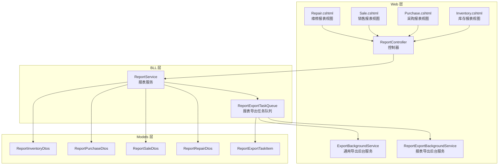
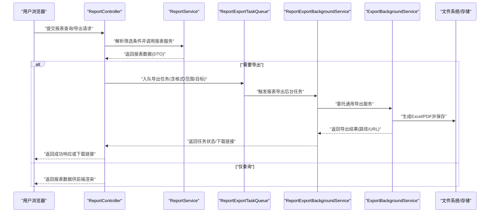
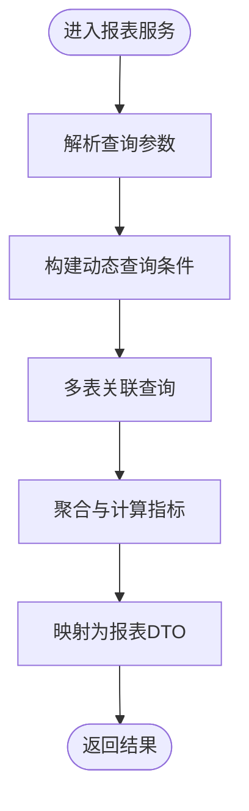
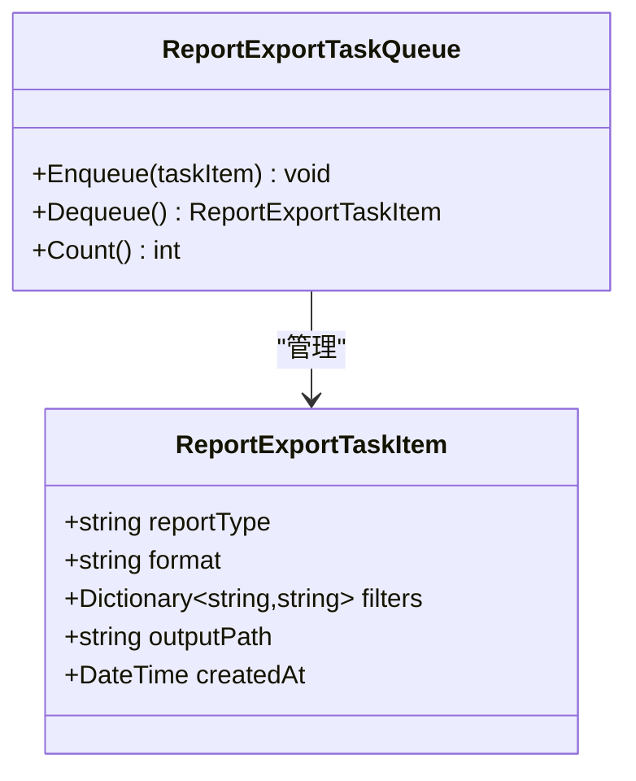
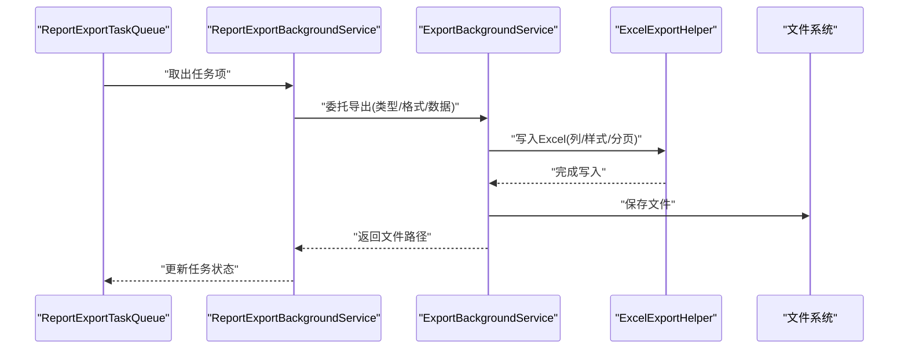
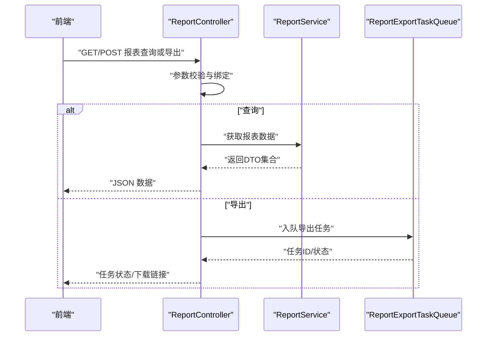
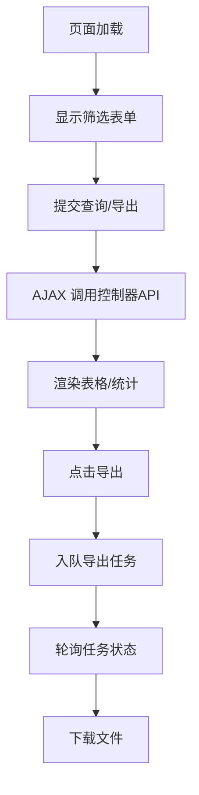
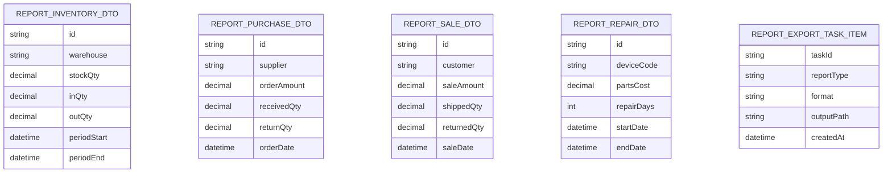
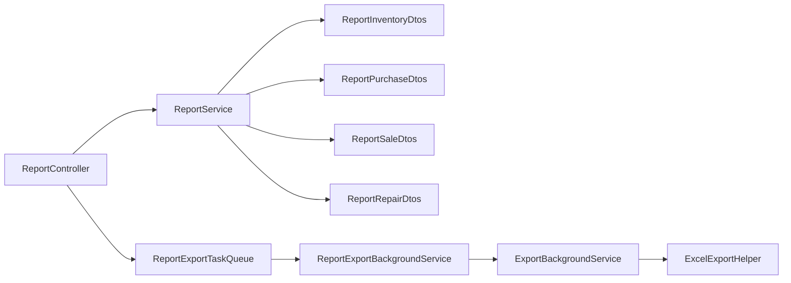

# 报表定制与扩展

<cite>
**本文引用的文件**   
- [ReportService.cs](file://EquipmentIMS.BLL/Services/ReportService.cs)
- [IReportService.cs](file://EquipmentIMS.BLL/Interfaces/IReportService.cs)
- [ReportExportTaskQueue.cs](file://EquipmentIMS.BLL/Services/ReportExportTaskQueue.cs)
- [ExportBackgroundService.cs](file://EquipmentIMS.Web/BackgroundServices/ExportBackgroundService.cs)
- [ReportExportBackgroundService.cs](file://EquipmentIMS.Web/BackgroundServices/ReportExportBackgroundService.cs)
- [ReportController.cs](file://EquipmentIMS.Web/Controllers/ReportController.cs)
- [ExcelExportHelper.cs](file://EquipmentIMS.Web/Helpers/ExcelExportHelper.cs)
- [ReportInventoryDtos.cs](file://EquipmentIMS.Models/DTOs/Reports/ReportInventoryDtos.cs)
- [ReportPurchaseDtos.cs](file://EquipmentIMS.Models/DTOs/Reports/ReportPurchaseDtos.cs)
- [ReportSaleDtos.cs](file://EquipmentIMS.Models/DTOs/Reports/ReportSaleDtos.cs)
- [ReportRepairDtos.cs](file://EquipmentIMS.Models/DTOs/Reports/ReportRepairDtos.cs)
- [ReportExportTaskItem.cs](file://EquipmentIMS.Models/DTOs/Reports/ReportExportTaskItem.cs)
- [Inventory.cshtml](file://EquipmentIMS.Web/Views/Report/Inventory.cshtml)
- [Purchase.cshtml](file://EquipmentIMS.Web/Views/Report/Purchase.cshtml)
- [Sale.cshtml](file://EquipmentIMS.Web/Views/Report/Sale.cshtml)
- [Repair.cshtml](file://EquipmentIMS.Web/Views/Report/Repair.cshtml)
- [Program.cs](file://EquipmentIMS.Web/Program.cs)
- [appsettings.json](file://EquipmentIMS.Web/appsettings.json)
</cite>

## 目录
1. [简介](#简介)
2. [项目结构](#项目结构)
3. [核心组件](#核心组件)
4. [架构总览](#架构总览)
5. [详细组件分析](#详细组件分析)
6. [依赖关系分析](#依赖关系分析)
7. [性能考虑](#性能考虑)
8. [故障排查指南](#故障排查指南)
9. [结论](#结论)
10. [附录](#附录)

## 简介
本技术文档围绕“报表定制与扩展”主题，系统阐述自定义报表模板设计、动态查询条件构建、报表布局配置、数据源灵活配置、多表关联查询与数据转换映射、导出（Excel/PDF）与批量导出机制、订阅服务与定时任务调度、邮件推送、权限控制、用户个性化设置、版本管理以及性能优化策略与大数据量处理方案。文档面向具备不同技术背景的读者，既提供高层概览，也深入到代码级实现细节与可视化图示。

## 项目结构
本项目采用分层架构：Web 层负责接口与视图展示；BLL 层封装业务逻辑与后台任务队列；Models 层定义 DTO、实体与枚举；DAL 层负责数据访问与持久化。报表相关能力横跨 Web、BLL、Models 三层，并通过后台服务与队列进行异步处理。

图表来源
- [ReportController.cs](file://EquipmentIMS.Web/Controllers/ReportController.cs)
- [Inventory.cshtml](file://EquipmentIMS.Web/Views/Report/Inventory.cshtml)
- [Purchase.cshtml](file://EquipmentIMS.Web/Views/Report/Purchase.cshtml)
- [Sale.cshtml](file://EquipmentIMS.Web/Views/Report/Sale.cshtml)
- [Repair.cshtml](file://EquipmentIMS.Web/Views/Report/Repair.cshtml)
- [ReportService.cs](file://EquipmentIMS.BLL/Services/ReportService.cs)
- [ReportExportTaskQueue.cs](file://EquipmentIMS.BLL/Services/ReportExportTaskQueue.cs)
- [ExportBackgroundService.cs](file://EquipmentIMS.Web/BackgroundServices/ExportBackgroundService.cs)
- [ReportExportBackgroundService.cs](file://EquipmentIMS.Web/BackgroundServices/ReportExportBackgroundService.cs)
- [ReportInventoryDtos.cs](file://EquipmentIMS.Models/DTOs/Reports/ReportInventoryDtos.cs)
- [ReportPurchaseDtos.cs](file://EquipmentIMS.Models/DTOs/Reports/ReportPurchaseDtos.cs)
- [ReportSaleDtos.cs](file://EquipmentIMS.Models/DTOs/Reports/ReportSaleDtos.cs)
- [ReportRepairDtos.cs](file://EquipmentIMS.Models/DTOs/Reports/ReportRepairDtos.cs)
- [ReportExportTaskItem.cs](file://EquipmentIMS.Models/DTOs/Reports/ReportExportTaskItem.cs)

章节来源
- [ReportController.cs](file://EquipmentIMS.Web/Controllers/ReportController.cs)
- [ReportService.cs](file://EquipmentIMS.BLL/Services/ReportService.cs)
- [ReportExportTaskQueue.cs](file://EquipmentIMS.BLL/Services/ReportExportTaskQueue.cs)
- [ExportBackgroundService.cs](file://EquipmentIMS.Web/BackgroundServices/ExportBackgroundService.cs)
- [ReportExportBackgroundService.cs](file://EquipmentIMS.Web/BackgroundServices/ReportExportBackgroundService.cs)
- [ReportInventoryDtos.cs](file://EquipmentIMS.Models/DTOs/Reports/ReportInventoryDtos.cs)
- [ReportPurchaseDtos.cs](file://EquipmentIMS.Models/DTOs/Reports/ReportPurchaseDtos.cs)
- [ReportSaleDtos.cs](file://EquipmentIMS.Models/DTOs/Reports/ReportSaleDtos.cs)
- [ReportRepairDtos.cs](file://EquipmentIMS.Models/DTOs/Reports/ReportRepairDtos.cs)
- [ReportExportTaskItem.cs](file://EquipmentIMS.Models/DTOs/Reports/ReportExportTaskItem.cs)

## 核心组件
- 报表服务（ReportService）：聚合各业务域的数据查询与汇总，输出标准化报表 DTO，支持分页、排序与过滤参数。
- 报表导出任务队列（ReportExportTaskQueue）：将导出请求入队，交由后台服务消费，避免同步阻塞。
- 后台服务（ExportBackgroundService / ReportExportBackgroundService）：执行实际的导出工作，生成 Excel/PDF 并落盘或返回下载流。
- 控制器（ReportController）：暴露报表查询与导出 API，接收前端筛选条件并调用服务层。
- 报表 DTO（Report*Dto）：统一的数据传输模型，屏蔽底层实体差异，便于模板渲染与导出。
- 视图（Inventory/Purchase/Sale/Repair.cshtml）：提供报表页面交互、筛选表单与结果展示。

章节来源
- [ReportService.cs](file://EquipmentIMS.BLL/Services/ReportService.cs)
- [ReportExportTaskQueue.cs](file://EquipmentIMS.BLL/Services/ReportExportTaskQueue.cs)
- [ExportBackgroundService.cs](file://EquipmentIMS.Web/BackgroundServices/ExportBackgroundService.cs)
- [ReportExportBackgroundService.cs](file://EquipmentIMS.Web/BackgroundServices/ReportExportBackgroundService.cs)
- [ReportController.cs](file://EquipmentIMS.Web/Controllers/ReportController.cs)
- [ReportInventoryDtos.cs](file://EquipmentIMS.Models/DTOs/Reports/ReportInventoryDtos.cs)
- [ReportPurchaseDtos.cs](file://EquipmentIMS.Models/DTOs/Reports/ReportPurchaseDtos.cs)
- [ReportSaleDtos.cs](file://EquipmentIMS.Models/DTOs/Reports/ReportSaleDtos.cs)
- [ReportRepairDtos.cs](file://EquipmentIMS.Models/DTOs/Reports/ReportRepairDtos.cs)
- [Inventory.cshtml](file://EquipmentIMS.Web/Views/Report/Inventory.cshtml)
- [Purchase.cshtml](file://EquipmentIMS.Web/Views/Report/Purchase.cshtml)
- [Sale.cshtml](file://EquipmentIMS.Web/Views/Report/Sale.cshtml)
- [Repair.cshtml](file://EquipmentIMS.Web/Views/Report/Repair.cshtml)

## 架构总览
下图展示了从前端到后端再到后台导出的完整链路，包括动态查询、数据转换、导出任务与后台执行。

图表来源
- [ReportController.cs](file://EquipmentIMS.Web/Controllers/ReportController.cs)
- [ReportService.cs](file://EquipmentIMS.BLL/Services/ReportService.cs)
- [ReportExportTaskQueue.cs](file://EquipmentIMS.BLL/Services/ReportExportTaskQueue.cs)
- [ReportExportBackgroundService.cs](file://EquipmentIMS.Web/BackgroundServices/ReportExportBackgroundService.cs)
- [ExportBackgroundService.cs](file://EquipmentIMS.Web/BackgroundServices/ExportBackgroundService.cs)

## 详细组件分析

### 报表服务（ReportService）
职责与要点
- 聚合库存、采购、销售、维修等域的数据，按统一 DTO 输出。
- 支持分页、排序、过滤参数，适配复杂查询场景。
- 为导出提供稳定数据结构，降低模板与导出引擎耦合度。

关键流程
- 接收查询参数（时间范围、仓库、供应商/客户、产品类别等）。
- 组合多表关联查询，计算汇总指标。
- 转换为报表 DTO，返回给控制器或后台任务。

图表来源
- [ReportService.cs](file://EquipmentIMS.BLL/Services/ReportService.cs)
- [ReportInventoryDtos.cs](file://EquipmentIMS.Models/DTOs/Reports/ReportInventoryDtos.cs)
- [ReportPurchaseDtos.cs](file://EquipmentIMS.Models/DTOs/Reports/ReportPurchaseDtos.cs)
- [ReportSaleDtos.cs](file://EquipmentIMS.Models/DTOs/Reports/ReportSaleDtos.cs)
- [ReportRepairDtos.cs](file://EquipmentIMS.Models/DTOs/Reports/ReportRepairDtos.cs)

章节来源
- [ReportService.cs](file://EquipmentIMS.BLL/Services/ReportService.cs)
- [ReportInventoryDtos.cs](file://EquipmentIMS.Models/DTOs/Reports/ReportInventoryDtos.cs)
- [ReportPurchaseDtos.cs](file://EquipmentIMS.Models/DTOs/Reports/ReportPurchaseDtos.cs)
- [ReportSaleDtos.cs](file://EquipmentIMS.Models/DTOs/Reports/ReportSaleDtos.cs)
- [ReportRepairDtos.cs](file://EquipmentIMS.Models/DTOs/Reports/ReportRepairDtos.cs)

### 报表导出任务队列（ReportExportTaskQueue）
职责与要点
- 将导出请求抽象为任务项（包含报表类型、格式、筛选条件、目标路径等）。
- 提供线程安全的入队操作，解耦控制器与导出执行。
- 与后台服务协作，确保高并发下的稳定性与可恢复性。

图表来源
- [ReportExportTaskQueue.cs](file://EquipmentIMS.BLL/Services/ReportExportTaskQueue.cs)
- [ReportExportTaskItem.cs](file://EquipmentIMS.Models/DTOs/Reports/ReportExportTaskItem.cs)

章节来源
- [ReportExportTaskQueue.cs](file://EquipmentIMS.BLL/Services/ReportExportTaskQueue.cs)
- [ReportExportTaskItem.cs](file://EquipmentIMS.Models/DTOs/Reports/ReportExportTaskItem.cs)

### 后台导出服务（ReportExportBackgroundService / ExportBackgroundService）
职责与要点
- 消费导出任务，调用具体导出器生成 Excel/PDF。
- 支持批量导出（一次任务包含多个子任务），提升吞吐。
- 记录导出日志，失败重试与告警。

图表来源
- [ReportExportBackgroundService.cs](file://EquipmentIMS.Web/BackgroundServices/ReportExportBackgroundService.cs)
- [ExportBackgroundService.cs](file://EquipmentIMS.Web/BackgroundServices/ExportBackgroundService.cs)
- [ExcelExportHelper.cs](file://EquipmentIMS.Web/Helpers/ExcelExportHelper.cs)

章节来源
- [ReportExportBackgroundService.cs](file://EquipmentIMS.Web/BackgroundServices/ReportExportBackgroundService.cs)
- [ExportBackgroundService.cs](file://EquipmentIMS.Web/BackgroundServices/ExportBackgroundService.cs)
- [ExcelExportHelper.cs](file://EquipmentIMS.Web/Helpers/ExcelExportHelper.cs)

### 控制器（ReportController）
职责与要点
- 暴露报表查询与导出 API。
- 校验输入参数，组装查询条件，调用服务层。
- 对导出任务进行入队并返回任务状态或下载链接。

图表来源
- [ReportController.cs](file://EquipmentIMS.Web/Controllers/ReportController.cs)
- [ReportService.cs](file://EquipmentIMS.BLL/Services/ReportService.cs)
- [ReportExportTaskQueue.cs](file://EquipmentIMS.BLL/Services/ReportExportTaskQueue.cs)

章节来源
- [ReportController.cs](file://EquipmentIMS.Web/Controllers/ReportController.cs)
- [ReportService.cs](file://EquipmentIMS.BLL/Services/ReportService.cs)
- [ReportExportTaskQueue.cs](file://EquipmentIMS.BLL/Services/ReportExportTaskQueue.cs)

### 视图与模板（Inventory/Purchase/Sale/Repair.cshtml）
职责与要点
- 提供筛选表单（日期范围、仓库、供应商/客户、品类等）。
- 通过 AJAX 调用控制器接口，渲染表格与统计卡片。
- 支持导出按钮，触发后台导出任务并轮询结果。

图表来源
- [Inventory.cshtml](file://EquipmentIMS.Web/Views/Report/Inventory.cshtml)
- [Purchase.cshtml](file://EquipmentIMS.Web/Views/Report/Purchase.cshtml)
- [Sale.cshtml](file://EquipmentIMS.Web/Views/Report/Sale.cshtml)
- [Repair.cshtml](file://EquipmentIMS.Web/Views/Report/Repair.cshtml)
- [ReportController.cs](file://EquipmentIMS.Web/Controllers/ReportController.cs)

章节来源
- [Inventory.cshtml](file://EquipmentIMS.Web/Views/Report/Inventory.cshtml)
- [Purchase.cshtml](file://EquipmentIMS.Web/Views/Report/Purchase.cshtml)
- [Sale.cshtml](file://EquipmentIMS.Web/Views/Report/Sale.cshtml)
- [Repair.cshtml](file://EquipmentIMS.Web/Views/Report/Repair.cshtml)
- [ReportController.cs](file://EquipmentIMS.Web/Controllers/ReportController.cs)

### 数据模型（报表 DTO）
- 库存报表 DTO：用于库存维度汇总、出入库明细、当前库存等。
- 采购报表 DTO：采购订单、入库单、退货等维度的聚合。
- 销售报表 DTO：销售订单、出库单、退货等维度的聚合。
- 维修报表 DTO：维修工单、备件消耗、设备档案等维度的聚合。
- 导出任务项：描述导出任务的元数据与参数。

图表来源
- [ReportInventoryDtos.cs](file://EquipmentIMS.Models/DTOs/Reports/ReportInventoryDtos.cs)
- [ReportPurchaseDtos.cs](file://EquipmentIMS.Models/DTOs/Reports/ReportPurchaseDtos.cs)
- [ReportSaleDtos.cs](file://EquipmentIMS.Models/DTOs/Reports/ReportSaleDtos.cs)
- [ReportRepairDtos.cs](file://EquipmentIMS.Models/DTOs/Reports/ReportRepairDtos.cs)
- [ReportExportTaskItem.cs](file://EquipmentIMS.Models/DTOs/Reports/ReportExportTaskItem.cs)

章节来源
- [ReportInventoryDtos.cs](file://EquipmentIMS.Models/DTOs/Reports/ReportInventoryDtos.cs)
- [ReportPurchaseDtos.cs](file://EquipmentIMS.Models/DTOs/Reports/ReportPurchaseDtos.cs)
- [ReportSaleDtos.cs](file://EquipmentIMS.Models/DTOs/Reports/ReportSaleDtos.cs)
- [ReportRepairDtos.cs](file://EquipmentIMS.Models/DTOs/Reports/ReportRepairDtos.cs)
- [ReportExportTaskItem.cs](file://EquipmentIMS.Models/DTOs/Reports/ReportExportTaskItem.cs)

## 依赖关系分析
- 控制器依赖报表服务与导出任务队列。
- 报表服务依赖各域 DTO 以输出统一结构。
- 导出任务队列依赖后台服务进行实际导出。
- 导出辅助工具（ExcelExportHelper）被后台服务使用。

图表来源
- [ReportController.cs](file://EquipmentIMS.Web/Controllers/ReportController.cs)
- [ReportService.cs](file://EquipmentIMS.BLL/Services/ReportService.cs)
- [ReportExportTaskQueue.cs](file://EquipmentIMS.BLL/Services/ReportExportTaskQueue.cs)
- [ReportExportBackgroundService.cs](file://EquipmentIMS.Web/BackgroundServices/ReportExportBackgroundService.cs)
- [ExportBackgroundService.cs](file://EquipmentIMS.Web/BackgroundServices/ExportBackgroundService.cs)
- [ExcelExportHelper.cs](file://EquipmentIMS.Web/Helpers/ExcelExportHelper.cs)
- [ReportInventoryDtos.cs](file://EquipmentIMS.Models/DTOs/Reports/ReportInventoryDtos.cs)
- [ReportPurchaseDtos.cs](file://EquipmentIMS.Models/DTOs/Reports/ReportPurchaseDtos.cs)
- [ReportSaleDtos.cs](file://EquipmentIMS.Models/DTOs/Reports/ReportSaleDtos.cs)
- [ReportRepairDtos.cs](file://EquipmentIMS.Models/DTOs/Reports/ReportRepairDtos.cs)

章节来源
- [ReportController.cs](file://EquipmentIMS.Web/Controllers/ReportController.cs)
- [ReportService.cs](file://EquipmentIMS.BLL/Services/ReportService.cs)
- [ReportExportTaskQueue.cs](file://EquipmentIMS.BLL/Services/ReportExportTaskQueue.cs)
- [ReportExportBackgroundService.cs](file://EquipmentIMS.Web/BackgroundServices/ReportExportBackgroundService.cs)
- [ExportBackgroundService.cs](file://EquipmentIMS.Web/BackgroundServices/ExportBackgroundService.cs)
- [ExcelExportHelper.cs](file://EquipmentIMS.Web/Helpers/ExcelExportHelper.cs)
- [ReportInventoryDtos.cs](file://EquipmentIMS.Models/DTOs/Reports/ReportInventoryDtos.cs)
- [ReportPurchaseDtos.cs](file://EquipmentIMS.Models/DTOs/Reports/ReportPurchaseDtos.cs)
- [ReportSaleDtos.cs](file://EquipmentIMS.Models/DTOs/Reports/ReportSaleDtos.cs)
- [ReportRepairDtos.cs](file://EquipmentIMS.Models/DTOs/Reports/ReportRepairDtos.cs)

## 性能考虑
- 分页与游标：在大数据量场景下优先使用分页与基于键的游标查询，减少内存占用与网络传输。
- 索引优化：针对常用筛选字段（时间、仓库、供应商/客户、品类）建立复合索引，提高查询效率。
- 延迟加载与投影：仅选择必要字段，避免全表扫描与多余连接。
- 批处理导出：将大批量导出拆分为多个子任务并行处理，限制单次内存峰值。
- 缓存热点数据：对字典类数据（仓库、供应商、品类）进行短期缓存，降低重复查询开销。
- 异步与背压：导出任务入队后由后台服务限流消费，避免雪崩。
- 资源回收：及时释放临时文件与流对象，避免句柄泄漏。

[本节为通用指导，不直接分析具体文件]

## 故障排查指南
- 导出失败
  - 检查导出任务队列是否积压，确认后台服务是否运行。
  - 查看导出日志与异常堆栈，定位是数据问题还是模板/导出器问题。
- 超时与卡顿
  - 调整分页大小与查询范围，增加数据库索引。
  - 启用异步导出，避免同步阻塞。
- 权限与认证
  - 确认控制器是否受权限过滤器保护，用户角色是否具备报表访问权限。
- 配置错误
  - 核对 appsettings.json 中的导出路径、邮件服务器、任务队列配置是否正确。

章节来源
- [ReportExportTaskQueue.cs](file://EquipmentIMS.BLL/Services/ReportExportTaskQueue.cs)
- [ReportExportBackgroundService.cs](file://EquipmentIMS.Web/BackgroundServices/ReportExportBackgroundService.cs)
- [ExportBackgroundService.cs](file://EquipmentIMS.Web/BackgroundServices/ExportBackgroundService.cs)
- [ReportController.cs](file://EquipmentIMS.Web/Controllers/ReportController.cs)
- [appsettings.json](file://EquipmentIMS.Web/appsettings.json)

## 结论
本系统在报表定制与扩展方面提供了清晰的分层设计与可扩展的导出机制。通过统一的报表 DTO、任务队列与后台服务，实现了查询与导出的解耦与高可用。结合索引优化、分页与异步处理，可在大数据量场景下保持良好性能。后续可进一步引入模板引擎与 PDF 导出增强、订阅与定时任务、权限与个性化配置等能力，以满足更复杂的业务需求。

[本节为总结，不直接分析具体文件]

## 附录

### 自定义报表模板设计建议
- 模板维度：行维度（如仓库/供应商/客户）、列维度（如月份/季度）、指标（数量/金额/比率）。
- 模板参数：时间范围、组织单元、币种、汇率、语言。
- 模板版本：通过版本号管理变更，支持灰度发布与回滚。

### 动态查询条件构建
- 条件树：支持 AND/OR 组合、范围查询、模糊匹配、枚举过滤。
- 安全校验：白名单字段、长度与格式校验、SQL 注入防护。
- 性能提示：将高频条件推至数据库侧过滤，避免客户端过滤。

### 报表布局配置
- 布局元素：标题、页眉页脚、表格、图表、签名区。
- 样式规范：字体、字号、对齐、边框、颜色主题。
- 响应式：移动端预览与打印适配。

### 数据源灵活配置
- 数据源类型：关系型数据库、视图、物化视图、外部 API。
- 连接管理：连接池、读写分离、故障转移。
- 元数据：字段映射、数据类型、默认值、约束。

### 多表关联查询与数据转换映射
- 关联策略：内连接/左连接、延迟加载、分片查询。
- 映射规则：字段别名、单位换算、编码翻译、空值处理。
- 一致性：事务边界、幂等性、去重策略。

### 导出功能（Excel/PDF）与批量导出
- Excel：列宽自适应、冻结首行、合并单元格、公式与样式。
- PDF：矢量图、水印、加密、分页与页码。
- 批量导出：任务拆分、进度反馈、断点续传、失败重试。

### 订阅服务、定时任务与邮件推送
- 订阅：用户订阅报表，指定周期与收件人。
- 定时：基于计划任务或消息队列驱动。
- 邮件：模板化内容、附件、失败重试与告警。

### 权限控制、用户个性化与版本管理
- 权限：基于角色的访问控制（RBAC），细粒度到报表与字段。
- 个性化：默认筛选、布局偏好、导出格式偏好。
- 版本：语义化版本、变更记录、兼容性检查。

### 性能优化与大数据量处理
- 查询优化：覆盖索引、分区表、物化视图。
- 内存管理：流式读取、分批处理、对象池。
- 监控：慢查询日志、导出耗时、队列深度与成功率。

[本节为概念性说明，不直接分析具体文件]