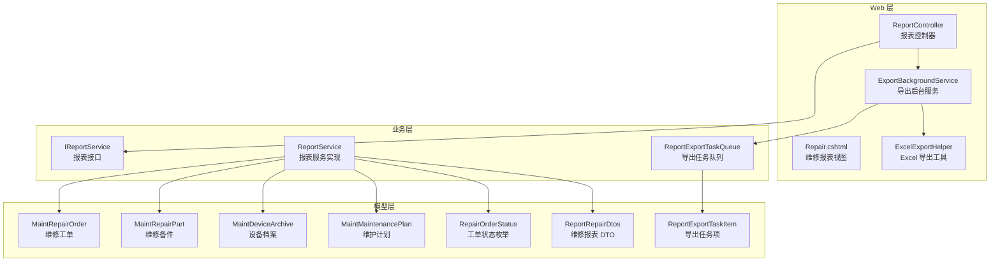
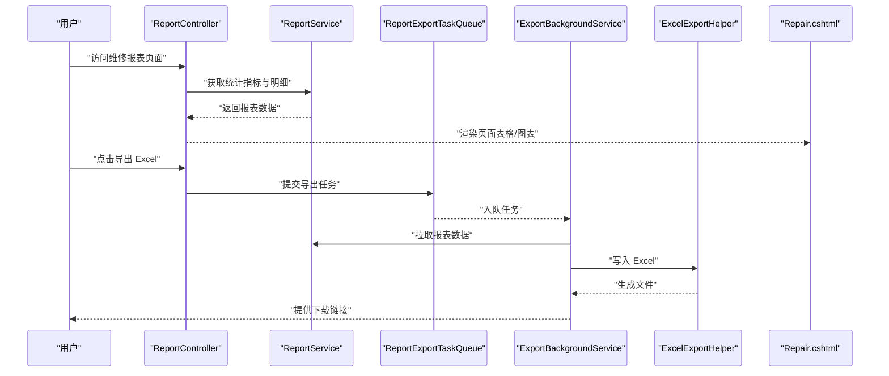
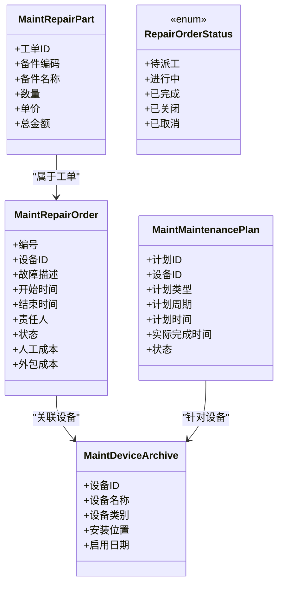
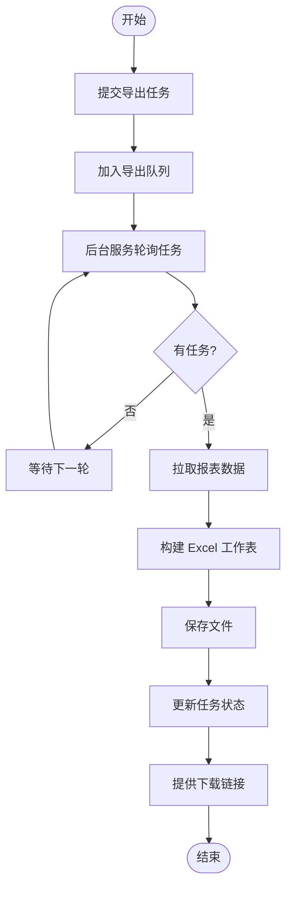
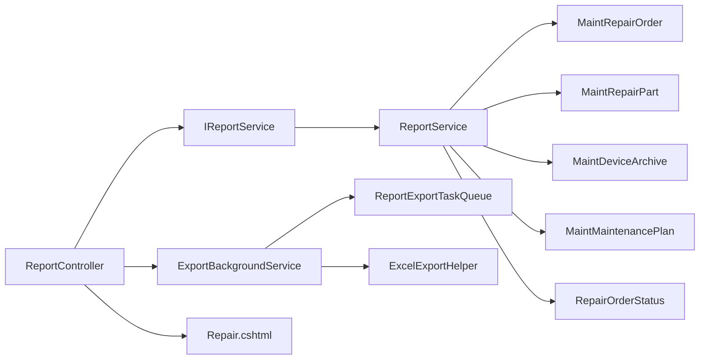

# 维修报表

<cite>
**本文引用的文件**   
- [ReportService.cs](file://EquipmentIMS.BLL/Services/ReportService.cs)
- [IReportService.cs](file://EquipmentIMS.BLL/Interfaces/IReportService.cs)
- [ReportController.cs](file://EquipmentIMS.Web/Controllers/ReportController.cs)
- [Repair.cshtml](file://EquipmentIMS.Web/Views/Report/Repair.cshtml)
- [ReportRepairDtos.cs](file://EquipmentIMS.Models/DTOs/Reports/ReportRepairDtos.cs)
- [MaintRepairOrder.cs](file://EquipmentIMS.Models/Entities/MaintRepairOrder.cs)
- [MaintRepairPart.cs](file://EquipmentIMS.Models/Entities/MaintRepairPart.cs)
- [MaintDeviceArchive.cs](file://EquipmentIMS.Models/Entities/MaintDeviceArchive.cs)
- [MaintMaintenancePlan.cs](file://EquipmentIMS.Models/Entities/MaintMaintenancePlan.cs)
- [RepairOrderStatus.cs](file://EquipmentIMS.Models/Enums/RepairOrderStatus.cs)
- [ExportBackgroundService.cs](file://EquipmentIMS.Web/BackgroundServices/ExportBackgroundService.cs)
- [ReportExportTaskQueue.cs](file://EquipmentIMS.BLL/Services/ReportExportTaskQueue.cs)
- [ReportExportTaskItem.cs](file://EquipmentIMS.Models/DTOs/Reports/ReportExportTaskItem.cs)
- [ExcelExportHelper.cs](file://EquipmentIMS.Web/Helpers/ExcelExportHelper.cs)
</cite>

## 目录
1. [简介](#简介)
2. [项目结构](#项目结构)
3. [核心组件](#核心组件)
4. [架构总览](#架构总览)
5. [详细组件分析](#详细组件分析)
6. [依赖关系分析](#依赖关系分析)
7. [性能考虑](#性能考虑)
8. [故障排查指南](#故障排查指南)
9. [结论](#结论)
10. [附录](#附录)

## 简介
本技术文档围绕“维修报表”功能，系统阐述设备故障统计、维修成本分析、维护计划执行率等核心能力；深入说明设备可靠性分析（MTBF/MTTR）、维修工单效率评估、设备分类统计、故障模式分析、备件消耗追踪；并覆盖维修人员绩效评估、维修质量分析、预防性维护效果评估、维修费用预算管理、维修历史追溯与设备健康度评分。同时给出统计分析算法要点、报表可视化展示方案与移动端查看支持建议。

## 项目结构
维修报表在分层架构中分布于以下层次：
- Web 层：控制器与视图负责请求路由、参数校验、数据渲染与导出入口。
- 业务层：服务实现聚合多实体数据，完成指标计算、分组统计与结果组装。
- 模型层：定义维修相关实体、枚举与报表 DTO，支撑查询与输出。
- 后台任务：异步导出报表为 Excel，提升交互体验。

图表来源
- [ReportController.cs](file://EquipmentIMS.Web/Controllers/ReportController.cs)
- [Repair.cshtml](file://EquipmentIMS.Web/Views/Report/Repair.cshtml)
- [ExportBackgroundService.cs](file://EquipmentIMS.Web/BackgroundServices/ExportBackgroundService.cs)
- [ExcelExportHelper.cs](file://EquipmentIMS.Web/Helpers/ExcelExportHelper.cs)
- [IReportService.cs](file://EquipmentIMS.BLL/Interfaces/IReportService.cs)
- [ReportService.cs](file://EquipmentIMS.BLL/Services/ReportService.cs)
- [ReportExportTaskQueue.cs](file://EquipmentIMS.BLL/Services/ReportExportTaskQueue.cs)
- [ReportRepairDtos.cs](file://EquipmentIMS.Models/DTOs/Reports/ReportRepairDtos.cs)
- [MaintRepairOrder.cs](file://EquipmentIMS.Models/Entities/MaintRepairOrder.cs)
- [MaintRepairPart.cs](file://EquipmentIMS.Models/Entities/MaintRepairPart.cs)
- [MaintDeviceArchive.cs](file://EquipmentIMS.Models/Entities/MaintDeviceArchive.cs)
- [MaintMaintenancePlan.cs](file://EquipmentIMS.Models/Entities/MaintMaintenancePlan.cs)
- [RepairOrderStatus.cs](file://EquipmentIMS.Models/Enums/RepairOrderStatus.cs)
- [ReportExportTaskItem.cs](file://EquipmentIMS.Models/DTOs/Reports/ReportExportTaskItem.cs)

章节来源
- [ReportController.cs](file://EquipmentIMS.Web/Controllers/ReportController.cs)
- [ReportService.cs](file://EquipmentIMS.BLL/Services/ReportService.cs)
- [IReportService.cs](file://EquipmentIMS.BLL/Interfaces/IReportService.cs)
- [ReportRepairDtos.cs](file://EquipmentIMS.Models/DTOs/Reports/ReportRepairDtos.cs)
- [MaintRepairOrder.cs](file://EquipmentIMS.Models/Entities/MaintRepairOrder.cs)
- [MaintRepairPart.cs](file://EquipmentIMS.Models/Entities/MaintRepairPart.cs)
- [MaintDeviceArchive.cs](file://EquipmentIMS.Models/Entities/MaintDeviceArchive.cs)
- [MaintMaintenancePlan.cs](file://EquipmentIMS.Models/Entities/MaintMaintenancePlan.cs)
- [RepairOrderStatus.cs](file://EquipmentIMS.Models/Enums/RepairOrderStatus.cs)
- [ExportBackgroundService.cs](file://EquipmentIMS.Web/BackgroundServices/ExportBackgroundService.cs)
- [ReportExportTaskQueue.cs](file://EquipmentIMS.BLL/Services/ReportExportTaskQueue.cs)
- [ReportExportTaskItem.cs](file://EquipmentIMS.Models/DTOs/Reports/ReportExportTaskItem.cs)
- [ExcelExportHelper.cs](file://EquipmentIMS.Web/Helpers/ExcelExportHelper.cs)

## 核心组件
- 报表控制器：提供维修报表的查询、筛选与导出入口，接收时间范围、设备类别、工单状态等条件，返回聚合后的统计结果或触发异步导出。
- 报表服务：封装维修相关的统计与指标计算逻辑，包括故障频次、停机时长、维修成本、备件消耗、维护计划执行率、MTBF/MTTR、工单效率、人员绩效、质量指标与健康度评分等。
- 报表 DTO：定义维修报表的数据传输结构，用于前后端数据交换与导出模板映射。
- 导出后台服务与任务队列：将耗时导出操作放入后台队列，避免阻塞请求；完成后生成 Excel 并提供下载。
- 视图页面：以表格与图表形式呈现关键指标，支持分页、筛选与移动端适配。

章节来源
- [ReportController.cs](file://EquipmentIMS.Web/Controllers/ReportController.cs)
- [ReportService.cs](file://EquipmentIMS.BLL/Services/ReportService.cs)
- [IReportService.cs](file://EquipmentIMS.BLL/Interfaces/IReportService.cs)
- [ReportRepairDtos.cs](file://EquipmentIMS.Models/DTOs/Reports/ReportRepairDtos.cs)
- [ExportBackgroundService.cs](file://EquipmentIMS.Web/BackgroundServices/ExportBackgroundService.cs)
- [ReportExportTaskQueue.cs](file://EquipmentIMS.BLL/Services/ReportExportTaskQueue.cs)
- [Repair.cshtml](file://EquipmentIMS.Web/Views/Report/Repair.cshtml)

## 架构总览
维修报表采用“控制器—服务—实体/DTO—后台任务”的分层设计，确保职责清晰、可测试性与可扩展性良好。

图表来源
- [ReportController.cs](file://EquipmentIMS.Web/Controllers/ReportController.cs)
- [ReportService.cs](file://EquipmentIMS.BLL/Services/ReportService.cs)
- [ReportExportTaskQueue.cs](file://EquipmentIMS.BLL/Services/ReportExportTaskQueue.cs)
- [ExportBackgroundService.cs](file://EquipmentIMS.Web/BackgroundServices/ExportBackgroundService.cs)
- [ExcelExportHelper.cs](file://EquipmentIMS.Web/Helpers/ExcelExportHelper.cs)
- [Repair.cshtml](file://EquipmentIMS.Web/Views/Report/Repair.cshtml)

## 详细组件分析

### 报表控制器（ReportController）
- 职责：处理维修报表的 HTTP 请求，解析查询参数（时间范围、设备类别、工单状态、责任人等），调用报表服务获取数据，返回 JSON 或直接渲染视图。
- 关键点：
  - 参数校验与默认值设置，保障查询稳定性。
  - 对大数据量导出走后台任务，避免超时。
  - 权限控制与审计日志接入点（由全局过滤器统一处理）。

章节来源
- [ReportController.cs](file://EquipmentIMS.Web/Controllers/ReportController.cs)

### 报表服务（ReportService）
- 职责：实现维修报表的核心统计与指标计算，汇总维修工单、备件消耗、维护计划执行情况，输出结构化 DTO。
- 主要能力：
  - 设备故障统计：按设备/类别/时间维度统计故障次数、首次故障时间、重复故障率。
  - 维修成本分析：人工工时、备件成本、外包费用等合计与趋势。
  - 维护计划执行率：计划数量、实际完成数量、延期与取消比例。
  - 设备可靠性分析：MTBF（平均故障间隔时间）、MTTR（平均修复时间）计算。
  - 维修工单效率评估：从报修到关闭的平均时长、按时关闭率、返修率。
  - 设备分类统计：按类别汇总故障与成本分布。
  - 故障模式分析：基于故障原因/类型进行帕累托分析。
  - 备件消耗追踪：按备件编码/名称统计领用数量与金额。
  - 维修人员绩效评估：人均处理工单数、平均处理时长、一次修复成功率。
  - 维修质量分析：返修率、缺陷复发率、质量评分。
  - 预防性维护效果评估：PM 实施后故障下降幅度、停机减少比例。
  - 维修费用预算管理：预算 vs 实际支出对比与偏差分析。
  - 维修历史追溯：按设备/工单维度的全生命周期记录。
  - 设备健康度评分：综合故障频率、停机时长、维修成本、质量指标加权评分。
- 数据结构与复杂度：
  - 输入：时间窗口、过滤条件、分页参数。
  - 中间过程：多表关联、分组聚合、排序与去重。
  - 输出：DTO 集合与汇总指标。
  - 典型复杂度：O(N log N) 排序与 O(N) 聚合，N 为参与计算的工单/备件记录数。
- 优化机会：
  - 使用数据库侧聚合与索引优化（时间、设备ID、状态字段）。
  - 缓存热点指标（如近 7 天故障统计）。
  - 分批计算与流式输出以降低内存峰值。

章节来源
- [ReportService.cs](file://EquipmentIMS.BLL/Services/ReportService.cs)
- [IReportService.cs](file://EquipmentIMS.BLL/Interfaces/IReportService.cs)

### 报表 DTO（ReportRepairDtos）
- 职责：定义维修报表的数据传输结构，包含汇总指标、明细列表、图表数据等。
- 设计要点：
  - 扁平化结构便于前端直接绑定表格与图表。
  - 明确数值精度与单位（元、小时、百分比）。
  - 扩展字段预留，支持后续新增指标。

章节来源
- [ReportRepairDtos.cs](file://EquipmentIMS.Models/DTOs/Reports/ReportRepairDtos.cs)

### 实体与枚举（维修域）
- 维修工单（MaintRepairOrder）：记录报修、派工、处理、验收、关闭等全流程信息，含状态、时间戳、责任人、成本等。
- 维修备件（MaintRepairPart）：记录备件领用、替换、退回等信息，关联工单与库存。
- 设备档案（MaintDeviceArchive）：设备基础信息与分类，作为故障与成本归集维度。
- 维护计划（MaintMaintenancePlan）：预防性维护计划与执行记录，用于计算执行率与效果评估。
- 工单状态（RepairOrderStatus）：定义工单生命周期状态，支撑流程与统计。

图表来源
- [MaintRepairOrder.cs](file://EquipmentIMS.Models/Entities/MaintRepairOrder.cs)
- [MaintRepairPart.cs](file://EquipmentIMS.Models/Entities/MaintRepairPart.cs)
- [MaintDeviceArchive.cs](file://EquipmentIMS.Models/Entities/MaintDeviceArchive.cs)
- [MaintMaintenancePlan.cs](file://EquipmentIMS.Models/Entities/MaintMaintenancePlan.cs)
- [RepairOrderStatus.cs](file://EquipmentIMS.Models/Enums/RepairOrderStatus.cs)

### 导出后台服务与任务队列
- 导出任务队列：接收导出请求，持久化任务项，交由后台服务消费。
- 导出后台服务：定时轮询任务队列，拉取报表数据，调用 Excel 导出工具生成文件，更新任务状态并提供下载链接。
- Excel 导出工具：根据 DTO 结构生成工作表，支持样式与合并单元格。

图表来源
- [ReportExportTaskQueue.cs](file://EquipmentIMS.BLL/Services/ReportExportTaskQueue.cs)
- [ExportBackgroundService.cs](file://EquipmentIMS.Web/BackgroundServices/ExportBackgroundService.cs)
- [ExcelExportHelper.cs](file://EquipmentIMS.Web/Helpers/ExcelExportHelper.cs)
- [ReportExportTaskItem.cs](file://EquipmentIMS.Models/DTOs/Reports/ReportExportTaskItem.cs)

章节来源
- [ReportExportTaskQueue.cs](file://EquipmentIMS.BLL/Services/ReportExportTaskQueue.cs)
- [ExportBackgroundService.cs](file://EquipmentIMS.Web/BackgroundServices/ExportBackgroundService.cs)
- [ExcelExportHelper.cs](file://EquipmentIMS.Web/Helpers/ExcelExportHelper.cs)
- [ReportExportTaskItem.cs](file://EquipmentIMS.Models/DTOs/Reports/ReportExportTaskItem.cs)

### 视图与可视化（Repair.cshtml）
- 职责：渲染维修报表页面，展示关键指标、明细表格与图表。
- 可视化建议：
  - 折线图：故障趋势、成本趋势、执行率趋势。
  - 柱状图：设备类别故障分布、备件消耗排行。
  - 饼图：故障模式占比、工单状态分布。
  - 雷达图：设备健康度多维度评分。
- 移动端支持：
  - 响应式布局与滚动表格。
  - 图表自适应缩放与触摸交互。
  - 导出文件通过浏览器下载，无需额外插件。

章节来源
- [Repair.cshtml](file://EquipmentIMS.Web/Views/Report/Repair.cshtml)

## 依赖关系分析
- 控制器依赖报表服务接口，解耦具体实现，便于单元测试与替换。
- 报表服务依赖维修域实体与枚举，进行数据聚合与指标计算。
- 导出模块依赖任务队列与 Excel 工具，形成异步导出链路。
- 视图依赖控制器返回的数据结构，保持前后端契约稳定。

图表来源
- [ReportController.cs](file://EquipmentIMS.Web/Controllers/ReportController.cs)
- [IReportService.cs](file://EquipmentIMS.BLL/Interfaces/IReportService.cs)
- [ReportService.cs](file://EquipmentIMS.BLL/Services/ReportService.cs)
- [MaintRepairOrder.cs](file://EquipmentIMS.Models/Entities/MaintRepairOrder.cs)
- [MaintRepairPart.cs](file://EquipmentIMS.Models/Entities/MaintRepairPart.cs)
- [MaintDeviceArchive.cs](file://EquipmentIMS.Models/Entities/MaintDeviceArchive.cs)
- [MaintMaintenancePlan.cs](file://EquipmentIMS.Models/Entities/MaintMaintenancePlan.cs)
- [RepairOrderStatus.cs](file://EquipmentIMS.Models/Enums/RepairOrderStatus.cs)
- [ExportBackgroundService.cs](file://EquipmentIMS.Web/BackgroundServices/ExportBackgroundService.cs)
- [ReportExportTaskQueue.cs](file://EquipmentIMS.BLL/Services/ReportExportTaskQueue.cs)
- [ExcelExportHelper.cs](file://EquipmentIMS.Web/Helpers/ExcelExportHelper.cs)
- [Repair.cshtml](file://EquipmentIMS.Web/Views/Report/Repair.cshtml)

## 性能考虑
- 查询优化：
  - 在时间、设备ID、状态字段建立合适索引，减少扫描。
  - 使用数据库侧 GROUP BY、SUM、COUNT 聚合，降低应用层计算压力。
- 缓存策略：
  - 对高频指标（如近 7 天故障统计）引入短期缓存，减轻数据库负载。
- 异步导出：
  - 大报表导出走后台任务，避免请求超时与资源占用。
- 分页与增量：
  - 明细列表分页加载，按需拉取；导出时支持分片生成。
- 内存管理：
  - 流式写入 Excel，避免一次性加载全部数据到内存。

[本节为通用性能指导，不直接分析具体文件]

## 故障排查指南
- 导出失败：
  - 检查导出任务队列是否积压，后台服务是否正常轮询。
  - 确认 Excel 导出工具路径与权限。
- 指标异常：
  - 核对时间范围与过滤条件是否正确传递。
  - 验证工单状态枚举与数据一致性。
- 性能问题：
  - 观察数据库慢查询日志，补充缺失索引。
  - 增加缓存命中率监控与告警。

章节来源
- [ReportExportTaskQueue.cs](file://EquipmentIMS.BLL/Services/ReportExportTaskQueue.cs)
- [ExportBackgroundService.cs](file://EquipmentIMS.Web/BackgroundServices/ExportBackgroundService.cs)
- [ExcelExportHelper.cs](file://EquipmentIMS.Web/Helpers/ExcelExportHelper.cs)

## 结论
维修报表通过清晰的层次设计与完善的指标体系，全面覆盖设备故障统计、维修成本分析、维护计划执行率、可靠性分析与工单效率评估等关键场景。借助异步导出与可视化展示，既满足管理层决策需求，也兼顾一线运维人员的日常使用。未来可在指标库扩展、移动端深度适配与智能预警方面持续演进。

[本节为总结性内容，不直接分析具体文件]

## 附录

### 指标计算方法要点
- MTBF（平均故障间隔时间）：
  - 公式：总运行时长 / 故障次数
  - 适用：同一设备或同类设备在指定时间窗口的可靠性评估。
- MTTR（平均修复时间）：
  - 公式：总修复时长 / 故障次数
  - 适用：衡量维修效率与响应速度。
- 维护计划执行率：
  - 公式：实际完成计划数 / 计划总数 × 100%
  - 结合延期与取消比例进行质量评估。
- 工单效率：
  - 平均处理时长、按时关闭率、返修率。
- 设备健康度评分：
  - 多维加权：故障频率、停机时长、维修成本、质量指标等。

[本节为概念性说明，不直接分析具体文件]