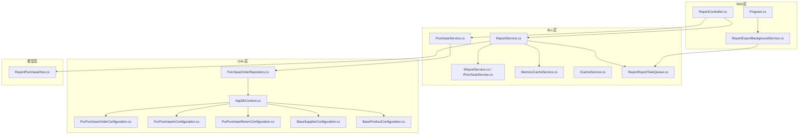
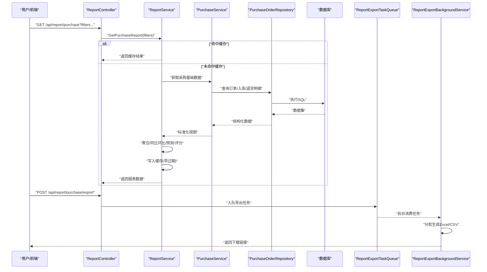
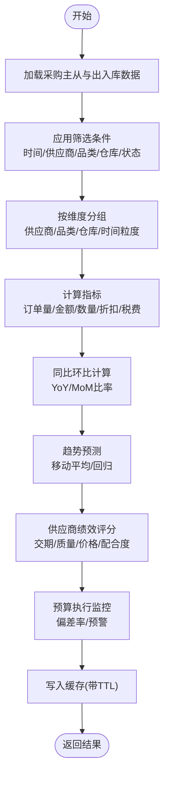
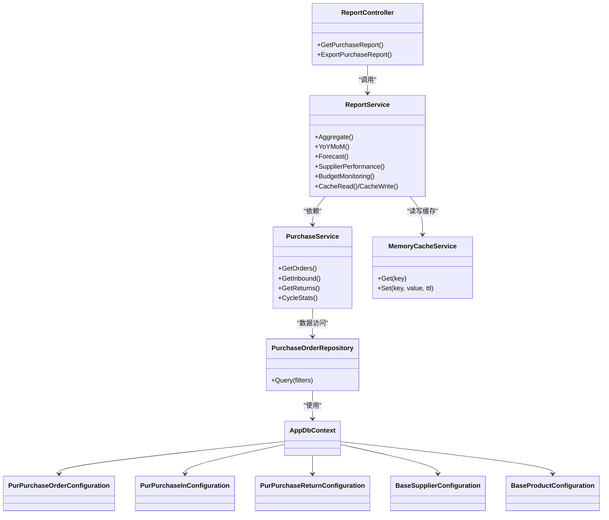

# 采购报表

<cite>
**本文引用的文件**   
- [ReportService.cs](file://EquipmentIMS.BLL/Services/ReportService.cs)
- [PurchaseService.cs](file://EquipmentIMS.BLL/Services/PurchaseService.cs)
- [IPurchaseService.cs](file://EquipmentIMS.BLL/Interfaces/IPurchaseService.cs)
- [IReportService.cs](file://EquipmentIMS.BLL/Interfaces/IReportService.cs)
- [MemoryCacheService.cs](file://EquipmentIMS.BLL/Services/MemoryCacheService.cs)
- [ICacheService.cs](file://EquipmentIMS.BLL/Interfaces/ICacheService.cs)
- [ReportExportTaskQueue.cs](file://EquipmentIMS.BLL/Services/ReportExportTaskQueue.cs)
- [ReportExportBackgroundService.cs](file://EquipmentIMS.Web/BackgroundServices/ReportExportBackgroundService.cs)
- [ReportController.cs](file://EquipmentIMS.Web/Controllers/ReportController.cs)
- [ReportPurchaseDtos.cs](file://EquipmentIMS.Models/DTOs/Reports/ReportPurchaseDtos.cs)
- [PurPurchaseOrderConfiguration.cs](file://EquipmentIMS.DAL/Configurations/PurPurchaseOrderConfiguration.cs)
- [PurPurchaseInConfiguration.cs](file://EquipmentIMS.DAL/Configurations/PurPurchaseInConfiguration.cs)
- [PurPurchaseReturnConfiguration.cs](file://EquipmentIMS.DAL/Configurations/PurPurchaseReturnConfiguration.cs)
- [BaseSupplierConfiguration.cs](file://EquipmentIMS.DAL/Configurations/BaseSupplierConfiguration.cs)
- [BaseProductConfiguration.cs](file://EquipmentIMS.DAL/Configurations/BaseProductConfiguration.cs)
- [PurchaseOrderRepository.cs](file://EquipmentIMS.DAL/Repositories/PurchaseOrderRepository.cs)
- [AppDbContext.cs](file://EquipmentIMS.DAL/AppDbContext.cs)
- [Program.cs](file://EquipmentIMS.Web/Program.cs)
</cite>

## 目录
1. [简介](#简介)
2. [项目结构](#项目结构)
3. [核心组件](#核心组件)
4. [架构总览](#架构总览)
5. [详细组件分析](#详细组件分析)
6. [依赖关系分析](#依赖关系分析)
7. [性能考虑](#性能考虑)
8. [故障排查指南](#故障排查指南)
9. [结论](#结论)
10. [附录](#附录)

## 简介
本技术文档围绕“采购报表”功能，系统阐述采购订单统计、供应商绩效分析、采购成本分析等核心能力；深入说明采购流程跟踪、采购周期分析与预算执行监控的实现思路；对数据聚合算法、同比环比分析、趋势预测方法进行梳理；给出供应商评估模型、价格波动分析与效率指标计算方案；并覆盖自定义筛选、多维度钻取与智能预警推送。同时提供复杂查询优化、缓存策略与定时生成机制的落地建议。

## 项目结构
采购报表相关代码采用分层架构：Web层暴露控制器接口，BLL层实现业务逻辑与报表聚合，DAL层通过实体配置与仓储访问数据库，后台服务负责导出任务与定时生成，模型层定义DTO与实体映射。

图表来源
- [ReportController.cs](file://EquipmentIMS.Web/Controllers/ReportController.cs)
- [ReportService.cs](file://EquipmentIMS.BLL/Services/ReportService.cs)
- [PurchaseService.cs](file://EquipmentIMS.BLL/Services/PurchaseService.cs)
- [MemoryCacheService.cs](file://EquipmentIMS.BLL/Services/MemoryCacheService.cs)
- [ReportExportTaskQueue.cs](file://EquipmentIMS.BLL/Services/ReportExportTaskQueue.cs)
- [ReportExportBackgroundService.cs](file://EquipmentIMS.Web/BackgroundServices/ReportExportBackgroundService.cs)
- [Program.cs](file://EquipmentIMS.Web/Program.cs)
- [PurchaseOrderRepository.cs](file://EquipmentIMS.DAL/Repositories/PurchaseOrderRepository.cs)
- [AppDbContext.cs](file://EquipmentIMS.DAL/AppDbContext.cs)
- [PurPurchaseOrderConfiguration.cs](file://EquipmentIMS.DAL/Configurations/PurPurchaseOrderConfiguration.cs)
- [PurPurchaseInConfiguration.cs](file://EquipmentIMS.DAL/Configurations/PurPurchaseInConfiguration.cs)
- [PurPurchaseReturnConfiguration.cs](file://EquipmentIMS.DAL/Configurations/PurPurchaseReturnConfiguration.cs)
- [BaseSupplierConfiguration.cs](file://EquipmentIMS.DAL/Configurations/BaseSupplierConfiguration.cs)
- [BaseProductConfiguration.cs](file://EquipmentIMS.DAL/Configurations/BaseProductConfiguration.cs)
- [ReportPurchaseDtos.cs](file://EquipmentIMS.Models/DTOs/Reports/ReportPurchaseDtos.cs)

章节来源
- [ReportController.cs](file://EquipmentIMS.Web/Controllers/ReportController.cs)
- [ReportService.cs](file://EquipmentIMS.BLL/Services/ReportService.cs)
- [PurchaseService.cs](file://EquipmentIMS.BLL/Services/PurchaseService.cs)
- [MemoryCacheService.cs](file://EquipmentIMS.BLL/Services/MemoryCacheService.cs)
- [ReportExportTaskQueue.cs](file://EquipmentIMS.BLL/Services/ReportExportTaskQueue.cs)
- [ReportExportBackgroundService.cs](file://EquipmentIMS.Web/BackgroundServices/ReportExportBackgroundService.cs)
- [Program.cs](file://EquipmentIMS.Web/Program.cs)
- [PurchaseOrderRepository.cs](file://EquipmentIMS.DAL/Repositories/PurchaseOrderRepository.cs)
- [AppDbContext.cs](file://EquipmentIMS.DAL/AppDbContext.cs)
- [PurPurchaseOrderConfiguration.cs](file://EquipmentIMS.DAL/Configurations/PurPurchaseOrderConfiguration.cs)
- [PurPurchaseInConfiguration.cs](file://EquipmentIMS.DAL/Configurations/PurPurchaseInConfiguration.cs)
- [PurPurchaseReturnConfiguration.cs](file://EquipmentIMS.DAL/Configurations/PurPurchaseReturnConfiguration.cs)
- [BaseSupplierConfiguration.cs](file://EquipmentIMS.DAL/Configurations/BaseSupplierConfiguration.cs)
- [BaseProductConfiguration.cs](file://EquipmentIMS.DAL/Configurations/BaseProductConfiguration.cs)
- [ReportPurchaseDtos.cs](file://EquipmentIMS.Models/DTOs/Reports/ReportPurchaseDtos.cs)

## 核心组件
- 报表控制器（ReportController）：对外提供采购报表查询、导出与定时任务触发入口，接收筛选条件并返回分页或汇总结果。
- 报表服务（ReportService）：聚合采购订单、入库、退货等多源数据，完成同比环比、趋势预测、供应商绩效与成本分析等计算。
- 采购服务（PurchaseService）：封装采购主从表、状态流转、周期统计等基础业务能力，为报表提供标准化数据视图。
- 缓存服务（MemoryCacheService）：提供内存级缓存读写，用于热点报表数据的短期缓存与失效控制。
- 导出任务队列（ReportExportTaskQueue）：将大型报表导出转为异步任务，避免阻塞请求线程。
- 后台服务（ReportExportBackgroundService）：消费导出任务队列，按批次写入Excel/CSV并持久化下载链接。
- 仓储与上下文（PurchaseOrderRepository、AppDbContext）：基于EF Core进行数据访问，结合实体配置构建高效查询。
- 模型与DTO（ReportPurchaseDtos）：定义报表输入输出契约，承载筛选参数与结果集结构。

章节来源
- [ReportController.cs](file://EquipmentIMS.Web/Controllers/ReportController.cs)
- [ReportService.cs](file://EquipmentIMS.BLL/Services/ReportService.cs)
- [PurchaseService.cs](file://EquipmentIMS.BLL/Services/PurchaseService.cs)
- [MemoryCacheService.cs](file://EquipmentIMS.BLL/Services/MemoryCacheService.cs)
- [ReportExportTaskQueue.cs](file://EquipmentIMS.BLL/Services/ReportExportTaskQueue.cs)
- [ReportExportBackgroundService.cs](file://EquipmentIMS.Web/BackgroundServices/ReportExportBackgroundService.cs)
- [PurchaseOrderRepository.cs](file://EquipmentIMS.DAL/Repositories/PurchaseOrderRepository.cs)
- [AppDbContext.cs](file://EquipmentIMS.DAL/AppDbContext.cs)
- [ReportPurchaseDtos.cs](file://EquipmentIMS.Models/DTOs/Reports/ReportPurchaseDtos.cs)

## 架构总览
采购报表整体遵循“控制器→服务→仓储→数据库”的分层调用链，并通过缓存与后台任务提升吞吐与稳定性。

图表来源
- [ReportController.cs](file://EquipmentIMS.Web/Controllers/ReportController.cs)
- [ReportService.cs](file://EquipmentIMS.BLL/Services/ReportService.cs)
- [PurchaseService.cs](file://EquipmentIMS.BLL/Services/PurchaseService.cs)
- [PurchaseOrderRepository.cs](file://EquipmentIMS.DAL/Repositories/PurchaseOrderRepository.cs)
- [ReportExportTaskQueue.cs](file://EquipmentIMS.BLL/Services/ReportExportTaskQueue.cs)
- [ReportExportBackgroundService.cs](file://EquipmentIMS.Web/BackgroundServices/ReportExportBackgroundService.cs)

## 详细组件分析

### 报表控制器（ReportController）
- 职责：接收采购报表查询与导出请求，校验筛选参数，转发至服务层，处理分页与异常。
- 关键能力：
  - 多条件筛选：时间范围、供应商、产品类别、仓库、订单状态、金额区间等。
  - 分页与排序：支持按日期、金额、数量等维度排序。
  - 导出入口：将导出请求入队，立即返回任务ID，后续轮询下载链接。
- 交互要点：
  - 读取DTO中的筛选字段，构造统一查询上下文。
  - 根据响应大小选择同步返回或异步导出。

章节来源
- [ReportController.cs](file://EquipmentIMS.Web/Controllers/ReportController.cs)
- [ReportPurchaseDtos.cs](file://EquipmentIMS.Models/DTOs/Reports/ReportPurchaseDtos.cs)

### 报表服务（ReportService）
- 职责：实现采购报表的核心聚合与分析逻辑，包括订单统计、供应商绩效、成本分析、周期与预算监控、同比环比与趋势预测。
- 核心算法与流程：
  - 数据聚合：按供应商、产品、仓库、时间粒度（日/周/月/季/年）分组汇总订单量、金额、数量、折扣、税费等。
  - 同比环比：以选定时间窗口为基准，计算YoY与MoM比率，支持平滑处理与缺失期填充。
  - 趋势预测：基于历史序列使用移动平均或简单回归进行短期预测，输出置信区间。
  - 供应商绩效：综合交期达成率、质量合格率、价格竞争力、配合度等维度加权评分。
  - 成本分析：按品类/供应商/仓库维度归集直接材料、物流、关税、损耗等成本项，计算毛利率与单位成本。
  - 预算执行：对比实际支出与预算计划，计算偏差率与预警阈值。
  - 缓存策略：对热点聚合结果设置TTL，键包含筛选指纹，避免重复计算。
- 错误处理：
  - 对空数据集、除零、负数金额等边界情况做防御性处理。
  - 记录关键步骤日志，便于定位慢查询与异常分支。

章节来源
- [ReportService.cs](file://EquipmentIMS.BLL/Services/ReportService.cs)
- [ICacheService.cs](file://EquipmentIMS.BLL/Interfaces/ICacheService.cs)
- [MemoryCacheService.cs](file://EquipmentIMS.BLL/Services/MemoryCacheService.cs)

### 采购服务（PurchaseService）
- 职责：提供采购域的基础数据视图与流程信息，支撑报表的数据准备。
- 关键能力：
  - 采购订单生命周期：创建、审批、发货、收货、入库、退货、关闭等状态流转。
  - 周期统计：从下单到入库的天数分布、平均周期、超期比例。
  - 供应商主数据与产品主数据关联：确保报表维度一致性与准确性。
- 与仓储协作：
  - 通过仓储接口批量拉取订单、入库、退货明细，减少往返次数。
  - 在必要时应用服务端过滤与投影，降低网络传输开销。

章节来源
- [PurchaseService.cs](file://EquipmentIMS.BLL/Services/PurchaseService.cs)
- [IPurchaseService.cs](file://EquipmentIMS.BLL/Interfaces/IPurchaseService.cs)
- [PurchaseOrderRepository.cs](file://EquipmentIMS.DAL/Repositories/PurchaseOrderRepository.cs)

### 缓存服务（MemoryCacheService）
- 职责：提供轻量级内存缓存，服务于热点报表数据。
- 特性：
  - 键设计：包含筛选条件哈希与时间粒度，保证隔离性。
  - 过期策略：可配置绝对过期与滑动过期，兼顾新鲜度与命中率。
  - 并发安全：内部加锁或原子操作，避免重复计算风暴。
- 适用场景：
  - 高频访问的汇总类报表（如月度供应商排名、品类成本占比）。
  - 导出前的预览数据。

章节来源
- [MemoryCacheService.cs](file://EquipmentIMS.BLL/Services/MemoryCacheService.cs)
- [ICacheService.cs](file://EquipmentIMS.BLL/Interfaces/ICacheService.cs)

### 导出任务队列与后台服务
- 职责：将大型报表导出转为异步任务，避免长时间占用请求线程。
- 流程：
  - 控制器接收导出请求，生成任务ID并回写队列。
  - 后台服务消费任务，分块读取数据，流式写入Excel/CSV。
  - 完成后更新任务状态并提供下载链接。
- 可靠性：
  - 失败重试与幂等处理，防止重复生成。
  - 进度回调与超时清理，保障资源回收。

章节来源
- [ReportExportTaskQueue.cs](file://EquipmentIMS.BLL/Services/ReportExportTaskQueue.cs)
- [ReportExportBackgroundService.cs](file://EquipmentIMS.Web/BackgroundServices/ReportExportBackgroundService.cs)
- [Program.cs](file://EquipmentIMS.Web/Program.cs)

### 数据模型与实体配置
- 采购订单、入库、退货与供应商、产品等实体的配置定义了表结构、索引与关系，直接影响查询性能与报表准确性。
- 关键字段与关系：
  - 订单主从表：订单头与明细一对多，便于按SKU维度统计。
  - 入库与退货：与订单明细关联，形成闭环统计。
  - 供应商与产品：作为维度表参与多维分析。
- 性能建议：
  - 针对常用筛选列建立复合索引（如供应商+时间、品类+仓库）。
  - 使用投影与只读视图减少数据传输。

章节来源
- [PurPurchaseOrderConfiguration.cs](file://EquipmentIMS.DAL/Configurations/PurPurchaseOrderConfiguration.cs)
- [PurPurchaseInConfiguration.cs](file://EquipmentIMS.DAL/Configurations/PurPurchaseInConfiguration.cs)
- [PurPurchaseReturnConfiguration.cs](file://EquipmentIMS.DAL/Configurations/PurPurchaseReturnConfiguration.cs)
- [BaseSupplierConfiguration.cs](file://EquipmentIMS.DAL/Configurations/BaseSupplierConfiguration.cs)
- [BaseProductConfiguration.cs](file://EquipmentIMS.DAL/Configurations/BaseProductConfiguration.cs)
- [AppDbContext.cs](file://EquipmentIMS.DAL/AppDbContext.cs)

### 数据聚合与计算流程图

图表来源
- [ReportService.cs](file://EquipmentIMS.BLL/Services/ReportService.cs)
- [PurchaseService.cs](file://EquipmentIMS.BLL/Services/PurchaseService.cs)
- [MemoryCacheService.cs](file://EquipmentIMS.BLL/Services/MemoryCacheService.cs)

## 依赖关系分析
- 控制器依赖服务接口，服务依赖仓储与缓存，仓储依赖上下文与实体配置，形成清晰单向依赖。
- 后台服务与队列解耦，提高可扩展性与容错性。
- 潜在风险：
  - 若缓存键设计不当可能导致命中率低或脏读。
  - 大查询未加索引会导致慢响应。
  - 导出任务堆积需关注队列容量与消费者并行度。

图表来源
- [ReportController.cs](file://EquipmentIMS.Web/Controllers/ReportController.cs)
- [ReportService.cs](file://EquipmentIMS.BLL/Services/ReportService.cs)
- [PurchaseService.cs](file://EquipmentIMS.BLL/Services/PurchaseService.cs)
- [MemoryCacheService.cs](file://EquipmentIMS.BLL/Services/MemoryCacheService.cs)
- [PurchaseOrderRepository.cs](file://EquipmentIMS.DAL/Repositories/PurchaseOrderRepository.cs)
- [AppDbContext.cs](file://EquipmentIMS.DAL/AppDbContext.cs)
- [PurPurchaseOrderConfiguration.cs](file://EquipmentIMS.DAL/Configurations/PurPurchaseOrderConfiguration.cs)
- [PurPurchaseInConfiguration.cs](file://EquipmentIMS.DAL/Configurations/PurPurchaseInConfiguration.cs)
- [PurPurchaseReturnConfiguration.cs](file://EquipmentIMS.DAL/Configurations/PurPurchaseReturnConfiguration.cs)
- [BaseSupplierConfiguration.cs](file://EquipmentIMS.DAL/Configurations/BaseSupplierConfiguration.cs)
- [BaseProductConfiguration.cs](file://EquipmentIMS.DAL/Configurations/BaseProductConfiguration.cs)

## 性能考虑
- 查询优化
  - 在服务端尽早过滤与投影，减少数据传输。
  - 为常用筛选列建立复合索引，避免全表扫描。
  - 使用分页与游标式遍历，避免一次性加载海量明细。
- 缓存策略
  - 热点聚合结果设置合理TTL，结合滑动过期提升命中率。
  - 键包含筛选指纹与时间粒度，避免跨维度污染。
  - 预热策略：在高峰前预计算常见维度组合。
- 导出优化
  - 流式写入，避免内存峰值过高。
  - 分片并行生成，限制并发度防止IO瓶颈。
  - 失败重试与断点续传，提升鲁棒性。
- 预测与计算
  - 对长序列使用增量计算与滚动窗口，降低CPU消耗。
  - 对缺失期采用插值或默认值填充，避免异常波动。

[本节为通用性能指导，不直接分析具体文件]

## 故障排查指南
- 常见问题
  - 报表结果为空：检查筛选条件是否过严、数据是否存在、缓存键是否正确。
  - 响应缓慢：查看慢查询日志、确认索引是否生效、是否命中缓存。
  - 导出失败：检查队列积压、磁盘空间、临时目录权限。
- 定位手段
  - 在关键节点添加日志，记录输入参数、耗时与中间结果摘要。
  - 使用分布式追踪或链路ID关联请求与后台任务。
  - 对缓存命中率与过期事件进行监控告警。

章节来源
- [ReportService.cs](file://EquipmentIMS.BLL/Services/ReportService.cs)
- [ReportExportBackgroundService.cs](file://EquipmentIMS.Web/BackgroundServices/ReportExportBackgroundService.cs)
- [MemoryCacheService.cs](file://EquipmentIMS.BLL/Services/MemoryCacheService.cs)

## 结论
采购报表模块通过分层架构与缓存、异步导出等手段，实现了高可用与高性能的数据聚合与分析。供应商绩效、成本分析与预算监控提供了管理决策的关键视角；同比环比与趋势预测增强了前瞻性。建议在后续迭代中完善索引与视图、引入更稳健的缓存与消息队列、扩展更多预测模型与可视化能力。

[本节为总结性内容，不直接分析具体文件]

## 附录

### 供应商评估模型（建议）
- 维度与权重
  - 交期达成率（权重较高）
  - 质量合格率（次品率/返工率）
  - 价格竞争力（同品类均价偏离度）
  - 配合度（沟通响应、退换货处理时效）
- 评分方法
  - 各维度归一化后加权求和，输出百分制得分。
  - 动态调整权重以适应不同业务阶段。
- 应用
  - 供应商分级与配额分配。
  - 合同续签与淘汰依据。

[本节为概念性内容，不直接分析具体文件]

### 采购价格波动分析（建议）
- 指标
  - 单价标准差与变异系数
  - 价格趋势斜率与拐点检测
  - 异常波动阈值与告警
- 方法
  - 按供应商×品类×时间粒度聚合单价序列。
  - 使用移动平均与Z-Score识别异常。
  - 输出波动热力图与预警清单。

[本节为概念性内容，不直接分析具体文件]

### 采购效率指标（建议）
- 指标
  - 平均采购周期（下单至入库）
  - 超期订单比例
  - 订单一次通过率
  - 人均处理单量
- 方法
  - 基于订单状态时间戳计算周期分布。
  - 结合人员与班次数据进行效率归因。

[本节为概念性内容，不直接分析具体文件]

### 自定义筛选与多维钻取（建议）
- 筛选条件
  - 时间范围、供应商、产品类别、仓库、订单状态、金额区间、币种、税率等。
- 钻取路径
  - 公司→部门→品类→供应商→SKU→订单行。
  - 支持点击下钻与面包屑导航。
- 实现要点
  - 统一筛选上下文对象，前后端共享契约。
  - 后端按维度生成树形结构，前端按需加载子节点。

[本节为概念性内容，不直接分析具体文件]

### 智能预警推送（建议）
- 规则
  - 预算超支、交期延迟、价格异常、库存联动缺货风险。
- 渠道
  - 站内通知、邮件、企业微信/钉钉机器人。
- 机制
  - 定时任务扫描指标阈值，生成预警事件。
  - 去重与合并，避免告警风暴。

[本节为概念性内容，不直接分析具体文件]

### 报表定时生成机制（建议）
- 调度
  - 使用后台服务周期性触发，支持Cron表达式。
- 批处理
  - 按时间窗口切分任务，避免单次负载过大。
- 存储
  - 生成结果落盘或对象存储，保留版本与审计。

章节来源
- [ReportExportBackgroundService.cs](file://EquipmentIMS.Web/BackgroundServices/ReportExportBackgroundService.cs)
- [Program.cs](file://EquipmentIMS.Web/Program.cs)