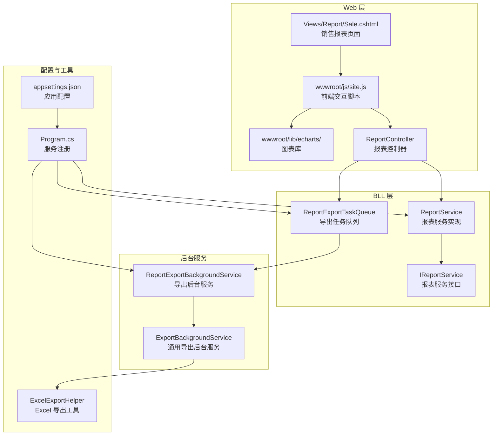
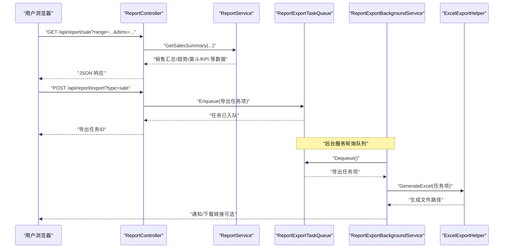
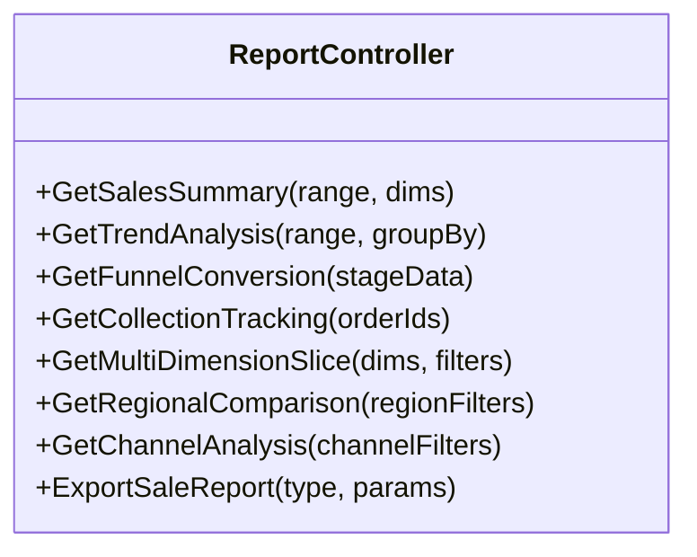
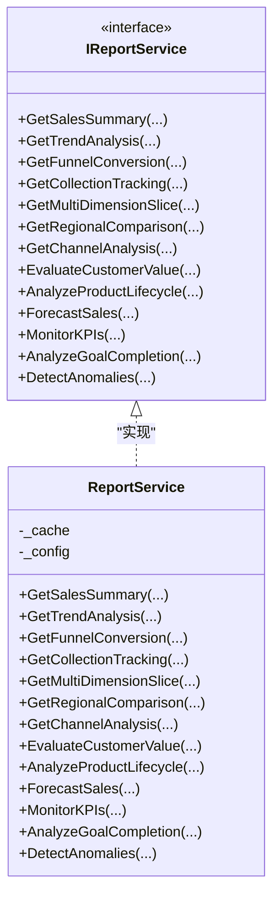
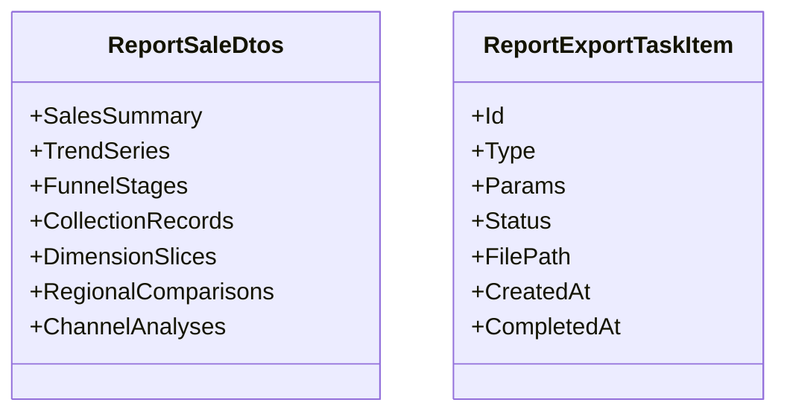
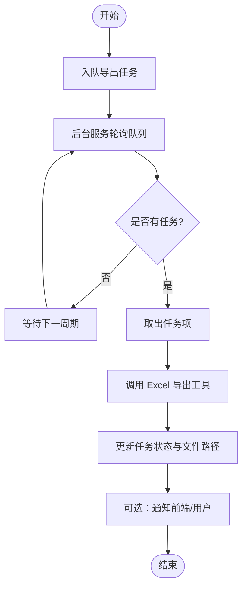
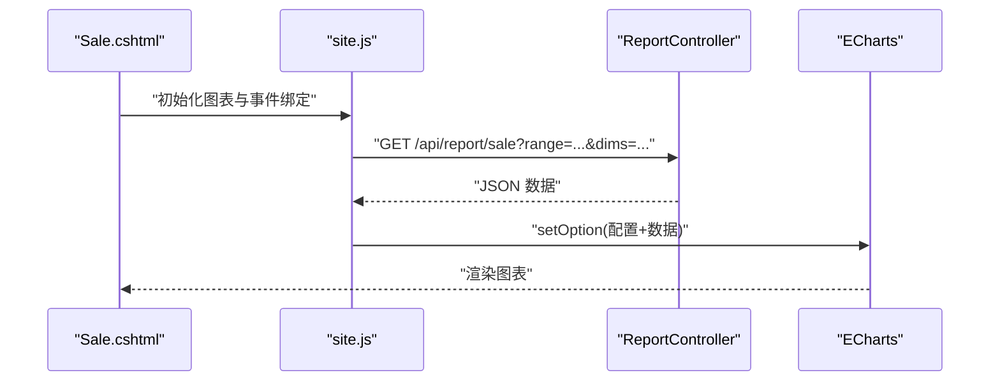
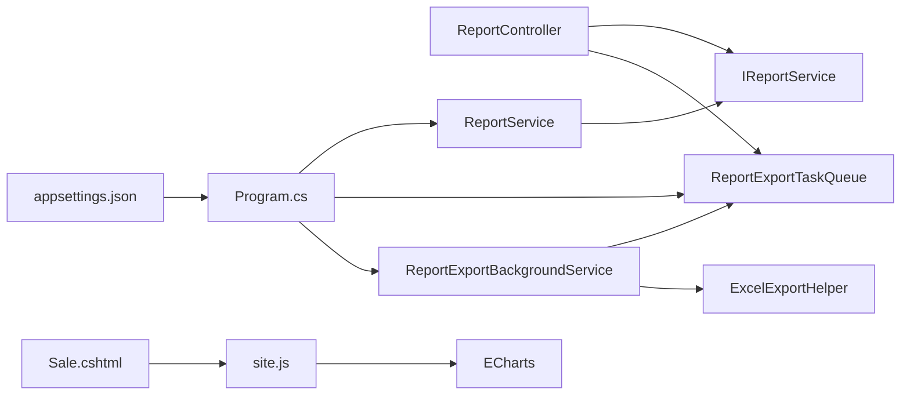

# 销售报表

<cite>
**本文引用的文件**   
- [ReportController.cs](file://EquipmentIMS.Web/Controllers/ReportController.cs)
- [ReportService.cs](file://EquipmentIMS.BLL/Services/ReportService.cs)
- [IReportService.cs](file://EquipmentIMS.BLL/Interfaces/IReportService.cs)
- [ReportSaleDtos.cs](file://EquipmentIMS.Models/DTOs/Reports/ReportSaleDtos.cs)
- [ReportExportTaskItem.cs](file://EquipmentIMS.Models/DTOs/Reports/ReportExportTaskItem.cs)
- [ReportExportBackgroundService.cs](file://EquipmentIMS.Web/BackgroundServices/ReportExportBackgroundService.cs)
- [ExportBackgroundService.cs](file://EquipmentIMS.Web/BackgroundServices/ExportBackgroundService.cs)
- [ReportExportTaskQueue.cs](file://EquipmentIMS.BLL/Services/ReportExportTaskQueue.cs)
- [ExcelExportHelper.cs](file://EquipmentIMS.Web/Helpers/ExcelExportHelper.cs)
- [Program.cs](file://EquipmentIMS.Web/Program.cs)
- [appsettings.json](file://EquipmentIMS.Web/appsettings.json)
- [Sale.cshtml](file://EquipmentIMS.Web/Views/Report/Sale.cshtml)
- [site.js](file://EquipmentIMS.Web/wwwroot/js/site.js)
- [ECharts 库](file://EquipmentIMS.Web/wwwroot/lib/echarts/)
</cite>

## 目录
1. [简介](#简介)
2. [项目结构](#项目结构)
3. [核心组件](#核心组件)
4. [架构总览](#架构总览)
5. [详细组件分析](#详细组件分析)
6. [依赖关系分析](#依赖关系分析)
7. [性能与高并发优化](#性能与高并发优化)
8. [故障排查指南](#故障排查指南)
9. [结论](#结论)
10. [附录](#附录)

## 简介
本技术文档围绕“销售报表”功能，系统化阐述销售业绩统计、客户贡献分析、产品销量排行、销售趋势分析、销售漏斗转化率、销售回款跟踪、多维度数据切片、区域销售对比、销售渠道分析、客户价值评估、产品生命周期分析、销售预测模型、KPI指标监控、目标完成度分析与异常检测等能力。同时覆盖高并发场景下的报表生成优化、数据实时更新与移动端适配展示策略。

## 项目结构
销售报表在 Web 层通过控制器暴露接口，业务层提供计算与分析服务，后台任务队列异步处理导出，视图层使用 ECharts 进行可视化呈现。

**图示来源** 
- [ReportController.cs](file://EquipmentIMS.Web/Controllers/ReportController.cs)
- [ReportService.cs](file://EquipmentIMS.BLL/Services/ReportService.cs)
- [IReportService.cs](file://EquipmentIMS.BLL/Interfaces/IReportService.cs)
- [ReportExportTaskQueue.cs](file://EquipmentIMS.BLL/Services/ReportExportTaskQueue.cs)
- [ReportExportBackgroundService.cs](file://EquipmentIMS.Web/BackgroundServices/ReportExportBackgroundService.cs)
- [ExportBackgroundService.cs](file://EquipmentIMS.Web/BackgroundServices/ExportBackgroundService.cs)
- [ExcelExportHelper.cs](file://EquipmentIMS.Web/Helpers/ExcelExportHelper.cs)
- [Program.cs](file://EquipmentIMS.Web/Program.cs)
- [appsettings.json](file://EquipmentIMS.Web/appsettings.json)
- [Sale.cshtml](file://EquipmentIMS.Web/Views/Report/Sale.cshtml)
- [site.js](file://EquipmentIMS.Web/wwwroot/js/site.js)
- [ECharts 库](file://EquipmentIMS.Web/wwwroot/lib/echarts/)

**章节来源**
- [ReportController.cs](file://EquipmentIMS.Web/Controllers/ReportController.cs)
- [ReportService.cs](file://EquipmentIMS.BLL/Services/ReportService.cs)
- [IReportService.cs](file://EquipmentIMS.BLL/Interfaces/IReportService.cs)
- [ReportExportTaskQueue.cs](file://EquipmentIMS.BLL/Services/ReportExportTaskQueue.cs)
- [ReportExportBackgroundService.cs](file://EquipmentIMS.Web/BackgroundServices/ReportExportBackgroundService.cs)
- [ExportBackgroundService.cs](file://EquipmentIMS.Web/BackgroundServices/ExportBackgroundService.cs)
- [ExcelExportHelper.cs](file://EquipmentIMS.Web/Helpers/ExcelExportHelper.cs)
- [Program.cs](file://EquipmentIMS.Web/Program.cs)
- [appsettings.json](file://EquipmentIMS.Web/appsettings.json)
- [Sale.cshtml](file://EquipmentIMS.Web/Views/Report/Sale.cshtml)
- [site.js](file://EquipmentIMS.Web/wwwroot/js/site.js)
- [ECharts 库](file://EquipmentIMS.Web/wwwroot/lib/echarts/)

## 核心组件
- 报表控制器：提供销售报表查询与导出入口，接收时间范围、维度筛选参数，返回聚合结果或触发异步导出任务。
- 报表服务：封装销售统计、趋势分析、漏斗转化、回款跟踪、多维切片、区域对比、渠道分析、客户价值评估、产品生命周期、预测模型、KPI 监控、目标完成度与异常检测等业务逻辑。
- 导出任务队列与后台服务：将耗时导出任务入队，由后台服务消费并调用 Excel 导出工具生成文件。
- 视图与前端：销售报表页面加载 ECharts，通过脚本发起请求并渲染图表；支持移动端自适应布局。

**章节来源**
- [ReportController.cs](file://EquipmentIMS.Web/Controllers/ReportController.cs)
- [ReportService.cs](file://EquipmentIMS.BLL/Services/ReportService.cs)
- [IReportService.cs](file://EquipmentIMS.BLL/Interfaces/IReportService.cs)
- [ReportExportTaskQueue.cs](file://EquipmentIMS.BLL/Services/ReportExportTaskQueue.cs)
- [ReportExportBackgroundService.cs](file://EquipmentIMS.Web/BackgroundServices/ReportExportBackgroundService.cs)
- [ExportBackgroundService.cs](file://EquipmentIMS.Web/BackgroundServices/ExportBackgroundService.cs)
- [ExcelExportHelper.cs](file://EquipmentIMS.Web/Helpers/ExcelExportHelper.cs)
- [Sale.cshtml](file://EquipmentIMS.Web/Views/Report/Sale.cshtml)
- [site.js](file://EquipmentIMS.Web/wwwroot/js/site.js)

## 架构总览
销售报表采用分层架构：Web 控制器负责路由与参数校验，BLL 服务负责聚合计算与模型构建，后台任务队列解耦导出流程，视图层借助 ECharts 完成可视化。

**图示来源**
- [ReportController.cs](file://EquipmentIMS.Web/Controllers/ReportController.cs)
- [ReportService.cs](file://EquipmentIMS.BLL/Services/ReportService.cs)
- [ReportExportTaskQueue.cs](file://EquipmentIMS.BLL/Services/ReportExportTaskQueue.cs)
- [ReportExportBackgroundService.cs](file://EquipmentIMS.Web/BackgroundServices/ReportExportBackgroundService.cs)
- [ExcelExportHelper.cs](file://EquipmentIMS.Web/Helpers/ExcelExportHelper.cs)

## 详细组件分析

### 销售报表控制器
- 职责：定义销售报表相关 API，包括销售汇总、趋势、漏斗、回款、多维切片、区域对比、渠道分析、导出等。
- 输入：时间范围、维度筛选（如区域、渠道）、分页与排序参数。
- 输出：结构化 JSON 数据或导出任务标识。
- 错误处理：统一异常包装，返回标准响应体。

**图示来源**
- [ReportController.cs](file://EquipmentIMS.Web/Controllers/ReportController.cs)

**章节来源**
- [ReportController.cs](file://EquipmentIMS.Web/Controllers/ReportController.cs)

### 销售报表服务（接口与实现）
- 接口：定义销售报表能力契约，便于替换实现与单元测试。
- 实现：聚合销售订单、出库、退货、回款等数据，计算 KPI、趋势、漏斗、回款跟踪、多维切片、区域对比、渠道分析、客户价值评估、产品生命周期、预测模型、目标完成度与异常检测。

**图示来源**
- [IReportService.cs](file://EquipmentIMS.BLL/Interfaces/IReportService.cs)
- [ReportService.cs](file://EquipmentIMS.BLL/Services/ReportService.cs)

**章节来源**
- [IReportService.cs](file://EquipmentIMS.BLL/Interfaces/IReportService.cs)
- [ReportService.cs](file://EquipmentIMS.BLL/Services/ReportService.cs)

### 销售报表 DTO 与导出任务项
- 销售报表 DTO：承载销售汇总、趋势、漏斗、回款、多维切片、区域对比、渠道分析等数据结构。
- 导出任务项：描述导出类型、参数、状态、文件路径等信息，供后台服务消费。

**图示来源**
- [ReportSaleDtos.cs](file://EquipmentIMS.Models/DTOs/Reports/ReportSaleDtos.cs)
- [ReportExportTaskItem.cs](file://EquipmentIMS.Models/DTOs/Reports/ReportExportTaskItem.cs)

**章节来源**
- [ReportSaleDtos.cs](file://EquipmentIMS.Models/DTOs/Reports/ReportSaleDtos.cs)
- [ReportExportTaskItem.cs](file://EquipmentIMS.Models/DTOs/Reports/ReportExportTaskItem.cs)

### 导出任务队列与后台服务
- 任务队列：内存或持久化队列，提供入队、出队、状态管理。
- 后台服务：定时轮询队列，执行导出任务，调用 Excel 导出工具生成文件，更新任务状态。

**图示来源**
- [ReportExportTaskQueue.cs](file://EquipmentIMS.BLL/Services/ReportExportTaskQueue.cs)
- [ReportExportBackgroundService.cs](file://EquipmentIMS.Web/BackgroundServices/ReportExportBackgroundService.cs)
- [ExportBackgroundService.cs](file://EquipmentIMS.Web/BackgroundServices/ExportBackgroundService.cs)
- [ExcelExportHelper.cs](file://EquipmentIMS.Web/Helpers/ExcelExportHelper.cs)

**章节来源**
- [ReportExportTaskQueue.cs](file://EquipmentIMS.BLL/Services/ReportExportTaskQueue.cs)
- [ReportExportBackgroundService.cs](file://EquipmentIMS.Web/BackgroundServices/ReportExportBackgroundService.cs)
- [ExportBackgroundService.cs](file://EquipmentIMS.Web/BackgroundServices/ExportBackgroundService.cs)
- [ExcelExportHelper.cs](file://EquipmentIMS.Web/Helpers/ExcelExportHelper.cs)

### 视图与前端可视化
- 销售报表页面：加载 ECharts 库，渲染销售趋势、漏斗、区域对比、渠道分析等图表。
- 前端脚本：发起 API 请求，解析 JSON，动态更新图表配置与数据；支持移动端自适应布局。

**图示来源**
- [Sale.cshtml](file://EquipmentIMS.Web/Views/Report/Sale.cshtml)
- [site.js](file://EquipmentIMS.Web/wwwroot/js/site.js)
- [ECharts 库](file://EquipmentIMS.Web/wwwroot/lib/echarts/)

**章节来源**
- [Sale.cshtml](file://EquipmentIMS.Web/Views/Report/Sale.cshtml)
- [site.js](file://EquipmentIMS.Web/wwwroot/js/site.js)
- [ECharts 库](file://EquipmentIMS.Web/wwwroot/lib/echarts/)

## 依赖关系分析
- 控制器依赖服务接口，服务实现可被替换，利于测试与扩展。
- 导出流程通过队列与后台服务解耦，避免阻塞主线程。
- 前端依赖 ECharts 进行可视化，脚本与页面分离，便于维护。

**图示来源**
- [ReportController.cs](file://EquipmentIMS.Web/Controllers/ReportController.cs)
- [IReportService.cs](file://EquipmentIMS.BLL/Interfaces/IReportService.cs)
- [ReportService.cs](file://EquipmentIMS.BLL/Services/ReportService.cs)
- [ReportExportTaskQueue.cs](file://EquipmentIMS.BLL/Services/ReportExportTaskQueue.cs)
- [ReportExportBackgroundService.cs](file://EquipmentIMS.Web/BackgroundServices/ReportExportBackgroundService.cs)
- [ExcelExportHelper.cs](file://EquipmentIMS.Web/Helpers/ExcelExportHelper.cs)
- [Sale.cshtml](file://EquipmentIMS.Web/Views/Report/Sale.cshtml)
- [site.js](file://EquipmentIMS.Web/wwwroot/js/site.js)
- [ECharts 库](file://EquipmentIMS.Web/wwwroot/lib/echarts/)
- [Program.cs](file://EquipmentIMS.Web/Program.cs)
- [appsettings.json](file://EquipmentIMS.Web/appsettings.json)

**章节来源**
- [Program.cs](file://EquipmentIMS.Web/Program.cs)
- [appsettings.json](file://EquipmentIMS.Web/appsettings.json)

## 性能与高并发优化
- 缓存策略：对热点销售汇总与趋势数据进行缓存，减少重复计算与数据库压力。
- 异步导出：通过任务队列与后台服务异步处理导出，避免阻塞请求线程。
- 分页与增量：大数据量查询采用分页与增量拉取，降低单次负载。
- 连接池与索引：合理配置数据库连接池，为常用查询字段建立索引，提升聚合效率。
- 实时性：结合消息推送或短轮询机制，实现关键指标的准实时更新。
- 移动端适配：ECharts 启用自适应布局，按需加载图表模块，减少首屏体积。

[本节为通用性能建议，不直接分析具体文件]

## 故障排查指南
- 导出失败：检查任务队列是否可用、后台服务是否运行、Excel 导出工具权限与路径是否正确。
- 数据不一致：核对时间范围与维度筛选参数，确认缓存失效策略与数据源一致性。
- 图表不显示：检查前端脚本是否正确发起请求、JSON 结构是否符合预期、ECharts 版本兼容性。
- 性能问题：关注慢查询日志、CPU/内存占用、队列积压情况，必要时扩容或优化 SQL。

**章节来源**
- [ReportExportTaskQueue.cs](file://EquipmentIMS.BLL/Services/ReportExportTaskQueue.cs)
- [ReportExportBackgroundService.cs](file://EquipmentIMS.Web/BackgroundServices/ReportExportBackgroundService.cs)
- [ExcelExportHelper.cs](file://EquipmentIMS.Web/Helpers/ExcelExportHelper.cs)
- [site.js](file://EquipmentIMS.Web/wwwroot/js/site.js)

## 结论
销售报表功能以分层架构为基础，通过控制器与服务解耦、队列与后台服务异步导出、ECharts 可视化呈现，实现了从基础统计到高级分析的完整能力。在高并发场景下，结合缓存、分页、索引与异步处理，可有效保障性能与用户体验。后续可进一步引入更丰富的预测模型与异常检测算法，持续完善销售决策支持体系。

[本节为总结性内容，不直接分析具体文件]

## 附录
- 配置项参考：查看应用配置文件中的服务注册与导出相关设置。
- 前端资源：ECharts 库位于 wwwroot/lib/echarts，确保版本兼容与按需加载。

**章节来源**
- [appsettings.json](file://EquipmentIMS.Web/appsettings.json)
- [ECharts 库](file://EquipmentIMS.Web/wwwroot/lib/echarts/)