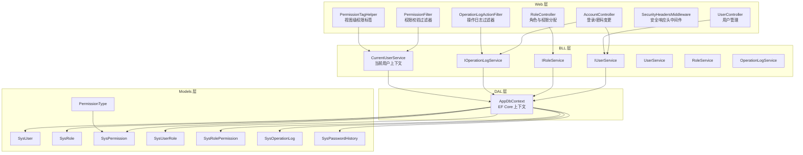
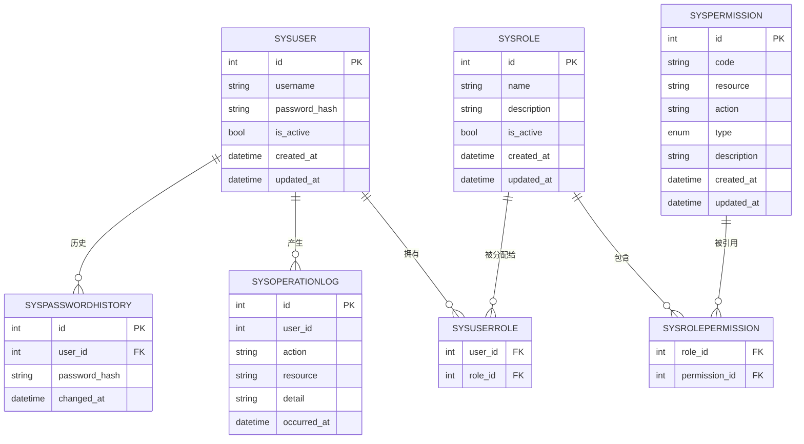
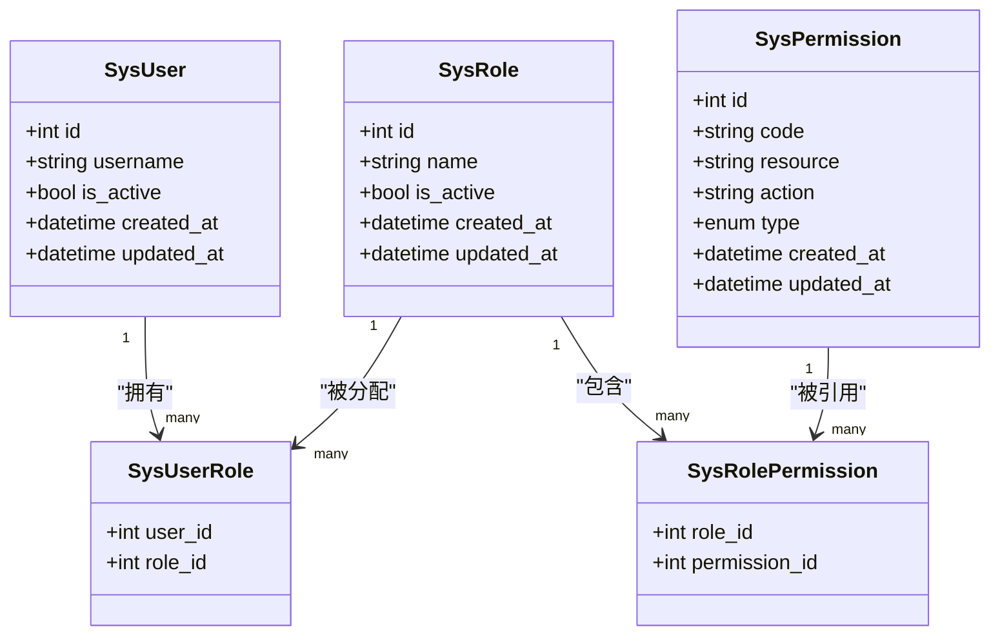
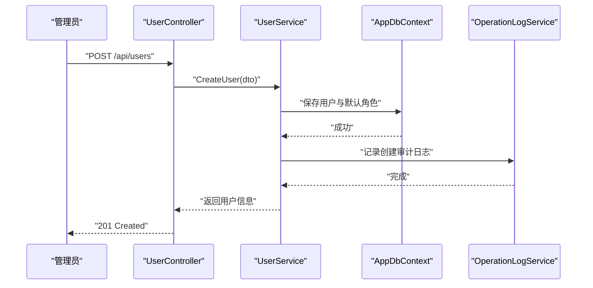
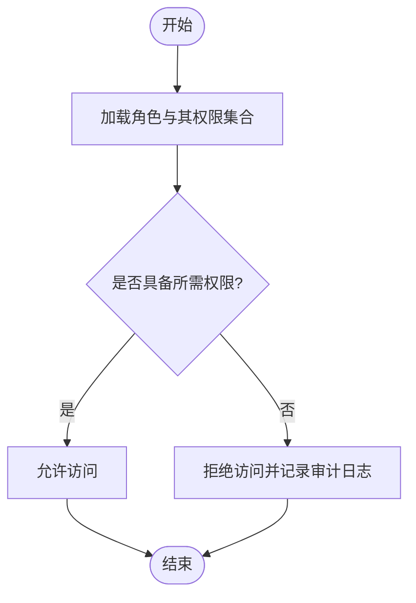
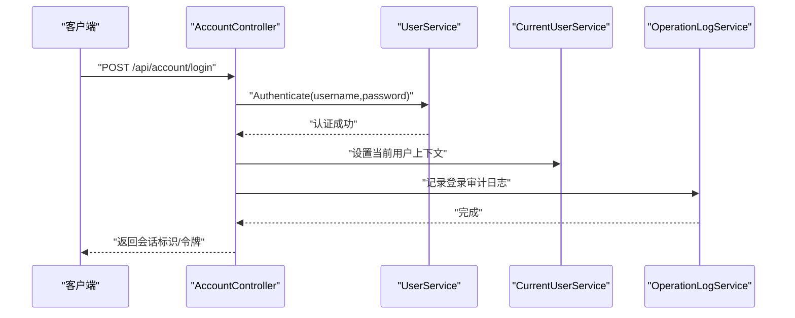
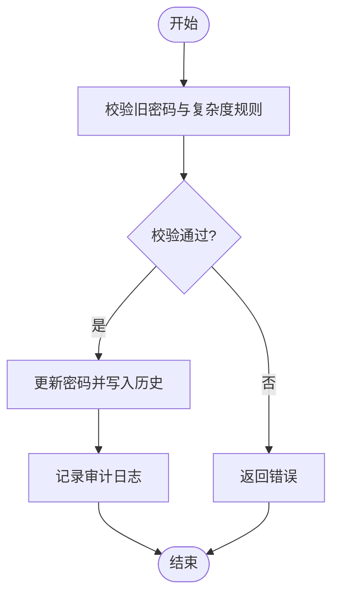
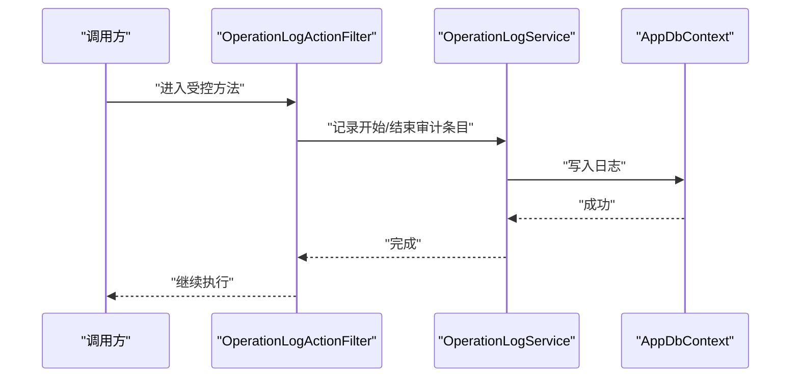
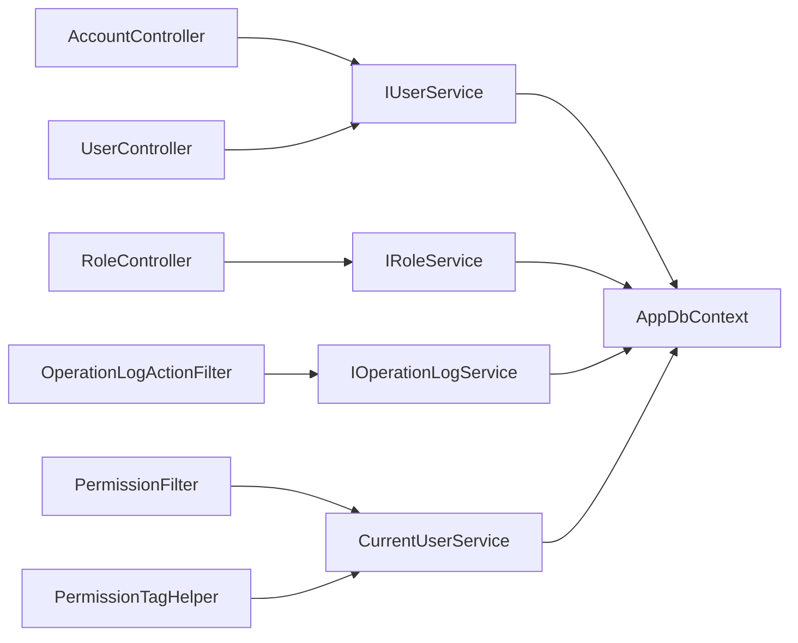

# 权限管理

<cite>
**本文引用的文件**   
- [Program.cs](file://EquipmentIMS.Web/Program.cs)
- [AccountController.cs](file://EquipmentIMS.Web/Controllers/AccountController.cs)
- [UserController.cs](file://EquipmentIMS.Web/Controllers/UserController.cs)
- [RoleController.cs](file://EquipmentIMS.Web/Controllers/RoleController.cs)
- [PermissionFilter.cs](file://EquipmentIMS.Web/Filters/PermissionFilter.cs)
- [OperationLogActionFilter.cs](file://EquipmentIMS.Web/Filters/OperationLogActionFilter.cs)
- [SecurityHeadersMiddleware.cs](file://EquipmentIMS.Web/Filters/SecurityHeadersMiddleware.cs)
- [PermissionTagHelper.cs](file://EquipmentIMS.Web/Extensions/PermissionTagHelper.cs)
- [LoginViewModel.cs](file://EquipmentIMS.Web/Models/LoginViewModel.cs)
- [ChangePasswordViewModel.cs](file://EquipmentIMS.Web/Models/ChangePasswordViewModel.cs)
- [IUserService.cs](file://EquipmentIMS.BLL/Interfaces/IUserService.cs)
- [IRoleService.cs](file://EquipmentIMS.BLL/Interfaces/IRoleService.cs)
- [IOperationLogService.cs](file://EquipmentIMS.BLL/Interfaces/IOperationLogService.cs)
- [CurrentUserService.cs](file://EquipmentIMS.BLL/Services/CurrentUserService.cs)
- [UserService.cs](file://EquipmentIMS.BLL/Services/UserService.cs)
- [RoleService.cs](file://EquipmentIMS.BLL/Services/RoleService.cs)
- [OperationLogService.cs](file://EquipmentIMS.BLL/Services/OperationLogService.cs)
- [SysUser.cs](file://EquipmentIMS.Models/Entities/SysUser.cs)
- [SysRole.cs](file://EquipmentIMS.Models/Entities/SysRole.cs)
- [SysPermission.cs](file://EquipmentIMS.Models/Entities/SysPermission.cs)
- [SysUserRole.cs](file://EquipmentIMS.Models/Entities/SysUserRole.cs)
- [SysRolePermission.cs](file://EquipmentIMS.Models/Entities/SysRolePermission.cs)
- [SysOperationLog.cs](file://EquipmentIMS.Models/Entities/SysOperationLog.cs)
- [SysPasswordHistory.cs](file://EquipmentIMS.Models/Entities/SysPasswordHistory.cs)
- [PermissionType.cs](file://EquipmentIMS.Models/Enums/PermissionType.cs)
- [AppDbContext.cs](file://EquipmentIMS.DAL/AppDbContext.cs)
</cite>

## 目录
1. [简介](#简介)
2. [项目结构](#项目结构)
3. [核心组件](#核心组件)
4. [架构总览](#架构总览)
5. [详细组件分析](#详细组件分析)
6. [依赖关系分析](#依赖关系分析)
7. [性能考虑](#性能考虑)
8. [故障排查指南](#故障排查指南)
9. [结论](#结论)
10. [附录](#附录)

## 简介
本文件面向“权限管理”模块，系统性阐述基于角色的访问控制（RBAC）模型的设计与实现，覆盖用户管理、角色管理、权限分配、动态授权、操作审计日志、安全事件监控与合规性报告、会话管理与登录认证策略等关键能力。文档以代码仓库为依据，提供分层职责说明、数据模型关系、关键流程时序图与类图，帮助读者快速理解并扩展系统的安全与权限能力。

## 项目结构
权限相关功能采用典型分层架构：Web 层负责请求接入与安全过滤；BLL 层封装业务逻辑与服务编排；DAL 层通过 EF Core 进行数据持久化；Models 层定义实体、DTO、枚举与异常。

图表来源
- [Program.cs](file://EquipmentIMS.Web/Program.cs)
- [AccountController.cs](file://EquipmentIMS.Web/Controllers/AccountController.cs)
- [UserController.cs](file://EquipmentIMS.Web/Controllers/UserController.cs)
- [RoleController.cs](file://EquipmentIMS.Web/Controllers/RoleController.cs)
- [PermissionFilter.cs](file://EquipmentIMS.Web/Filters/PermissionFilter.cs)
- [OperationLogActionFilter.cs](file://EquipmentIMS.Web/Filters/OperationLogActionFilter.cs)
- [SecurityHeadersMiddleware.cs](file://EquipmentIMS.Web/Filters/SecurityHeadersMiddleware.cs)
- [PermissionTagHelper.cs](file://EquipmentIMS.Web/Extensions/PermissionTagHelper.cs)
- [IUserService.cs](file://EquipmentIMS.BLL/Interfaces/IUserService.cs)
- [IRoleService.cs](file://EquipmentIMS.BLL/Interfaces/IRoleService.cs)
- [IOperationLogService.cs](file://EquipmentIMS.BLL/Interfaces/IOperationLogService.cs)
- [CurrentUserService.cs](file://EquipmentIMS.BLL/Services/CurrentUserService.cs)
- [UserService.cs](file://EquipmentIMS.BLL/Services/UserService.cs)
- [RoleService.cs](file://EquipmentIMS.BLL/Services/RoleService.cs)
- [OperationLogService.cs](file://EquipmentIMS.BLL/Services/OperationLogService.cs)
- [AppDbContext.cs](file://EquipmentIMS.DAL/AppDbContext.cs)
- [SysUser.cs](file://EquipmentIMS.Models/Entities/SysUser.cs)
- [SysRole.cs](file://EquipmentIMS.Models/Entities/SysRole.cs)
- [SysPermission.cs](file://EquipmentIMS.Models/Entities/SysPermission.cs)
- [SysUserRole.cs](file://EquipmentIMS.Models/Entities/SysUserRole.cs)
- [SysRolePermission.cs](file://EquipmentIMS.Models/Entities/SysRolePermission.cs)
- [SysOperationLog.cs](file://EquipmentIMS.Models/Entities/SysOperationLog.cs)
- [SysPasswordHistory.cs](file://EquipmentIMS.Models/Entities/SysPasswordHistory.cs)
- [PermissionType.cs](file://EquipmentIMS.Models/Enums/PermissionType.cs)

章节来源
- [Program.cs](file://EquipmentIMS.Web/Program.cs)
- [AppDbContext.cs](file://EquipmentIMS.DAL/AppDbContext.cs)

## 核心组件
- 控制器层
  - 账户控制器：处理登录、登出、密码修改等认证相关接口。
  - 用户控制器：提供用户的创建、编辑、启用/禁用、角色分配等管理接口。
  - 角色控制器：提供角色的增删改查及角色-权限的精细化分配接口。
- 过滤器与中间件
  - 权限过滤器：在请求进入控制器前校验当前用户对目标资源的权限。
  - 操作日志过滤器：自动记录关键操作的审计日志。
  - 安全响应头中间件：统一注入安全相关的 HTTP 响应头。
- 服务层
  - 用户服务：封装用户生命周期、密码策略、角色绑定等业务逻辑。
  - 角色服务：封装角色与权限的关联维护、权限聚合计算等逻辑。
  - 操作日志服务：统一写入审计日志，支持查询与导出。
  - 当前用户服务：从会话/令牌中解析当前用户身份与权限集合。
- 数据模型
  - 用户、角色、权限、用户-角色、角色-权限、操作日志、密码历史等实体。
  - 权限类型枚举用于区分资源与动作维度。

章节来源
- [AccountController.cs](file://EquipmentIMS.Web/Controllers/AccountController.cs)
- [UserController.cs](file://EquipmentIMS.Web/Controllers/UserController.cs)
- [RoleController.cs](file://EquipmentIMS.Web/Controllers/RoleController.cs)
- [PermissionFilter.cs](file://EquipmentIMS.Web/Filters/PermissionFilter.cs)
- [OperationLogActionFilter.cs](file://EquipmentIMS.Web/Filters/OperationLogActionFilter.cs)
- [SecurityHeadersMiddleware.cs](file://EquipmentIMS.Web/Filters/SecurityHeadersMiddleware.cs)
- [IUserService.cs](file://EquipmentIMS.BLL/Interfaces/IUserService.cs)
- [IRoleService.cs](file://EquipmentIMS.BLL/Interfaces/IRoleService.cs)
- [IOperationLogService.cs](file://EquipmentIMS.BLL/Interfaces/IOperationLogService.cs)
- [CurrentUserService.cs](file://EquipmentIMS.BLL/Services/CurrentUserService.cs)
- [SysUser.cs](file://EquipmentIMS.Models/Entities/SysUser.cs)
- [SysRole.cs](file://EquipmentIMS.Models/Entities/SysRole.cs)
- [SysPermission.cs](file://EquipmentIMS.Models/Entities/SysPermission.cs)
- [SysUserRole.cs](file://EquipmentIMS.Models/Entities/SysUserRole.cs)
- [SysRolePermission.cs](file://EquipmentIMS.Models/Entities/SysRolePermission.cs)
- [SysOperationLog.cs](file://EquipmentIMS.Models/Entities/SysOperationLog.cs)
- [SysPasswordHistory.cs](file://EquipmentIMS.Models/Entities/SysPasswordHistory.cs)
- [PermissionType.cs](file://EquipmentIMS.Models/Enums/PermissionType.cs)

## 架构总览
下图展示 RBAC 模型的核心实体关系与数据流向。用户通过角色获得权限，权限由资源与动作组合构成；操作日志记录关键行为，密码历史保障口令安全策略。

图表来源
- [SysUser.cs](file://EquipmentIMS.Models/Entities/SysUser.cs)
- [SysRole.cs](file://EquipmentIMS.Models/Entities/SysRole.cs)
- [SysPermission.cs](file://EquipmentIMS.Models/Entities/SysPermission.cs)
- [SysUserRole.cs](file://EquipmentIMS.Models/Entities/SysUserRole.cs)
- [SysRolePermission.cs](file://EquipmentIMS.Models/Entities/SysRolePermission.cs)
- [SysOperationLog.cs](file://EquipmentIMS.Models/Entities/SysOperationLog.cs)
- [SysPasswordHistory.cs](file://EquipmentIMS.Models/Entities/SysPasswordHistory.cs)
- [PermissionType.cs](file://EquipmentIMS.Models/Enums/PermissionType.cs)

## 详细组件分析

### 基于角色的访问控制（RBAC）设计与实现
- 模型设计
  - 用户-角色多对多：通过中间表建立用户与角色的关联。
  - 角色-权限多对多：通过中间表建立角色与权限的关联。
  - 权限抽象为资源+动作+类型的三元组，便于细粒度控制。
- 运行时决策
  - 当前用户服务在鉴权时加载用户的所有角色及其权限集合，供过滤器与视图标签使用。
  - 权限过滤器依据请求元数据与目标权限码判定是否放行。
- 动态授权
  - 角色-权限可在运行时调整，无需重启服务即可生效。
  - 建议结合缓存提升高频鉴权性能（见“性能考虑”）。

图表来源
- [SysUser.cs](file://EquipmentIMS.Models/Entities/SysUser.cs)
- [SysRole.cs](file://EquipmentIMS.Models/Entities/SysRole.cs)
- [SysPermission.cs](file://EquipmentIMS.Models/Entities/SysPermission.cs)
- [SysUserRole.cs](file://EquipmentIMS.Models/Entities/SysUserRole.cs)
- [SysRolePermission.cs](file://EquipmentIMS.Models/Entities/SysRolePermission.cs)

章节来源
- [SysUser.cs](file://EquipmentIMS.Models/Entities/SysUser.cs)
- [SysRole.cs](file://EquipmentIMS.Models/Entities/SysRole.cs)
- [SysPermission.cs](file://EquipmentIMS.Models/Entities/SysPermission.cs)
- [SysUserRole.cs](file://EquipmentIMS.Models/Entities/SysUserRole.cs)
- [SysRolePermission.cs](file://EquipmentIMS.Models/Entities/SysRolePermission.cs)
- [PermissionType.cs](file://EquipmentIMS.Models/Enums/PermissionType.cs)

### 用户管理：创建、激活、禁用与密码管理
- 用户生命周期
  - 创建：校验唯一性与基础约束，生成初始密码或强制首次登录修改。
  - 激活/禁用：控制 is_active 标志，影响登录与后续鉴权。
  - 删除：软删除或物理删除需遵循最小权限原则。
- 密码策略
  - 密码历史：禁止重复使用最近若干次密码。
  - 复杂度与过期策略：可通过配置项驱动（建议在系统配置中集中管理）。
- 变更审计
  - 所有用户状态与密码变更均记录操作日志，便于追溯。

图表来源
- [UserController.cs](file://EquipmentIMS.Web/Controllers/UserController.cs)
- [UserService.cs](file://EquipmentIMS.BLL/Services/UserService.cs)
- [AppDbContext.cs](file://EquipmentIMS.DAL/AppDbContext.cs)
- [OperationLogService.cs](file://EquipmentIMS.BLL/Services/OperationLogService.cs)

章节来源
- [UserController.cs](file://EquipmentIMS.Web/Controllers/UserController.cs)
- [UserService.cs](file://EquipmentIMS.BLL/Services/UserService.cs)
- [SysUser.cs](file://EquipmentIMS.Models/Entities/SysUser.cs)
- [SysPasswordHistory.cs](file://EquipmentIMS.Models/Entities/SysPasswordHistory.cs)
- [SysOperationLog.cs](file://EquipmentIMS.Models/Entities/SysOperationLog.cs)

### 角色与权限管理：精细化控制与动态授权
- 角色管理
  - 增删改查：支持描述、状态控制与时间戳。
  - 批量分配：将多个权限一次性授予角色。
- 权限模型
  - 资源-动作-类型三元组，支持菜单、按钮、API 等多维控制。
  - 权限类型枚举用于区分不同语义域。
- 动态授权
  - 调整角色-权限后，下次鉴权即生效；可结合缓存加速。
  - 视图层通过权限标签辅助器按权限渲染 UI。

图表来源
- [RoleService.cs](file://EquipmentIMS.BLL/Services/RoleService.cs)
- [PermissionFilter.cs](file://EquipmentIMS.Web/Filters/PermissionFilter.cs)
- [PermissionTagHelper.cs](file://EquipmentIMS.Web/Extensions/PermissionTagHelper.cs)
- [SysRolePermission.cs](file://EquipmentIMS.Models/Entities/SysRolePermission.cs)
- [SysPermission.cs](file://EquipmentIMS.Models/Entities/SysPermission.cs)

章节来源
- [RoleController.cs](file://EquipmentIMS.Web/Controllers/RoleController.cs)
- [RoleService.cs](file://EquipmentIMS.BLL/Services/RoleService.cs)
- [PermissionFilter.cs](file://EquipmentIMS.Web/Filters/PermissionFilter.cs)
- [PermissionTagHelper.cs](file://EquipmentIMS.Web/Extensions/PermissionTagHelper.cs)
- [SysRole.cs](file://EquipmentIMS.Models/Entities/SysRole.cs)
- [SysPermission.cs](file://EquipmentIMS.Models/Entities/SysPermission.cs)
- [SysRolePermission.cs](file://EquipmentIMS.Models/Entities/SysRolePermission.cs)
- [PermissionType.cs](file://EquipmentIMS.Models/Enums/PermissionType.cs)

### 登录认证与会话管理
- 登录流程
  - 输入用户名与密码，服务端校验用户存在且激活，验证密码哈希。
  - 成功后建立会话（或签发令牌），并将用户上下文注入到当前用户服务。
- 会话策略
  - 建议启用固定超时、空闲超时与并发会话限制。
  - 敏感操作要求二次确认或重新认证。
- 多因素认证（可选扩展）
  - 可在登录成功后增加短信/邮箱验证码或TOTP校验步骤。
  - 通过过滤器或服务编排插入额外校验阶段。

图表来源
- [AccountController.cs](file://EquipmentIMS.Web/Controllers/AccountController.cs)
- [UserService.cs](file://EquipmentIMS.BLL/Services/UserService.cs)
- [CurrentUserService.cs](file://EquipmentIMS.BLL/Services/CurrentUserService.cs)
- [OperationLogService.cs](file://EquipmentIMS.BLL/Services/OperationLogService.cs)

章节来源
- [AccountController.cs](file://EquipmentIMS.Web/Controllers/AccountController.cs)
- [LoginViewModel.cs](file://EquipmentIMS.Web/Models/LoginViewModel.cs)
- [CurrentUserService.cs](file://EquipmentIMS.BLL/Services/CurrentUserService.cs)
- [SysUser.cs](file://EquipmentIMS.Models/Entities/SysUser.cs)
- [SysOperationLog.cs](file://EquipmentIMS.Models/Entities/SysOperationLog.cs)

### 密码管理：修改与历史记录
- 修改密码
  - 支持用户自助修改与管理员重置。
  - 强制首次登录修改与复杂度校验。
- 密码历史
  - 记录最近若干次密码哈希，防止循环复用。
- 审计与告警
  - 密码变更写入操作日志，必要时触发告警。

图表来源
- [ChangePasswordViewModel.cs](file://EquipmentIMS.Web/Models/ChangePasswordViewModel.cs)
- [UserService.cs](file://EquipmentIMS.BLL/Services/UserService.cs)
- [SysPasswordHistory.cs](file://EquipmentIMS.Models/Entities/SysPasswordHistory.cs)
- [SysOperationLog.cs](file://EquipmentIMS.Models/Entities/SysOperationLog.cs)

章节来源
- [ChangePasswordViewModel.cs](file://EquipmentIMS.Web/Models/ChangePasswordViewModel.cs)
- [UserService.cs](file://EquipmentIMS.BLL/Services/UserService.cs)
- [SysPasswordHistory.cs](file://EquipmentIMS.Models/Entities/SysPasswordHistory.cs)
- [SysOperationLog.cs](file://EquipmentIMS.Models/Entities/SysOperationLog.cs)

### 操作审计日志、安全事件监控与合规性报告
- 审计日志
  - 通过全局过滤器自动捕获关键操作（如用户/角色/权限变更、登录登出）。
  - 记录用户、动作、资源、详情与时间戳。
- 安全事件监控
  - 针对失败登录、权限拒绝、异常抛出等事件进行统计与告警。
- 合规性报告
  - 支持按时间范围、用户、资源维度导出审计报表，满足内审与外审需求。

图表来源
- [OperationLogActionFilter.cs](file://EquipmentIMS.Web/Filters/OperationLogActionFilter.cs)
- [OperationLogService.cs](file://EquipmentIMS.BLL/Services/OperationLogService.cs)
- [SysOperationLog.cs](file://EquipmentIMS.Models/Entities/SysOperationLog.cs)
- [AppDbContext.cs](file://EquipmentIMS.DAL/AppDbContext.cs)

章节来源
- [OperationLogActionFilter.cs](file://EquipmentIMS.Web/Filters/OperationLogActionFilter.cs)
- [OperationLogService.cs](file://EquipmentIMS.BLL/Services/OperationLogService.cs)
- [SysOperationLog.cs](file://EquipmentIMS.Models/Entities/SysOperationLog.cs)

### 视图级权限控制与前端联动
- 权限标签辅助器
  - 在视图中根据当前用户权限决定是否渲染某区块或按钮。
- 前后端协同
  - 后端返回用户权限集合，前端据此动态隐藏/显示元素，减少越权风险。

章节来源
- [PermissionTagHelper.cs](file://EquipmentIMS.Web/Extensions/PermissionTagHelper.cs)
- [CurrentUserService.cs](file://EquipmentIMS.BLL/Services/CurrentUserService.cs)

## 依赖关系分析
- 控制器依赖服务接口，服务依赖数据上下文，形成清晰的单向依赖链。
- 过滤器与中间件横切关注点，不侵入业务逻辑。
- 当前用户服务贯穿鉴权链路，为过滤器与视图提供身份与权限上下文。

图表来源
- [AccountController.cs](file://EquipmentIMS.Web/Controllers/AccountController.cs)
- [UserController.cs](file://EquipmentIMS.Web/Controllers/UserController.cs)
- [RoleController.cs](file://EquipmentIMS.Web/Controllers/RoleController.cs)
- [PermissionFilter.cs](file://EquipmentIMS.Web/Filters/PermissionFilter.cs)
- [OperationLogActionFilter.cs](file://EquipmentIMS.Web/Filters/OperationLogActionFilter.cs)
- [PermissionTagHelper.cs](file://EquipmentIMS.Web/Extensions/PermissionTagHelper.cs)
- [IUserService.cs](file://EquipmentIMS.BLL/Interfaces/IUserService.cs)
- [IRoleService.cs](file://EquipmentIMS.BLL/Interfaces/IRoleService.cs)
- [IOperationLogService.cs](file://EquipmentIMS.BLL/Interfaces/IOperationLogService.cs)
- [CurrentUserService.cs](file://EquipmentIMS.BLL/Services/CurrentUserService.cs)
- [AppDbContext.cs](file://EquipmentIMS.DAL/AppDbContext.cs)

章节来源
- [Program.cs](file://EquipmentIMS.Web/Program.cs)
- [AppDbContext.cs](file://EquipmentIMS.DAL/AppDbContext.cs)

## 性能考虑
- 鉴权缓存
  - 将用户-角色-权限聚合结果缓存至内存或分布式缓存，降低数据库压力。
  - 在角色/权限变更时主动失效相关缓存键。
- 分页与索引
  - 用户、角色、权限列表采用分页查询；为常用筛选字段建立索引。
- 异步审计
  - 审计日志写入可采用异步队列，避免阻塞主流程。
- 连接池与超时
  - 合理配置 EF Core 连接池大小与命令超时，避免雪崩。

[本节为通用指导，不直接分析具体文件]

## 故障排查指南
- 登录失败
  - 检查用户是否存在且处于激活状态；核对密码哈希与复杂度策略。
  - 查看登录审计日志与失败计数，定位异常来源。
- 权限不足
  - 确认用户是否已分配相应角色；核查角色-权限映射是否正确。
  - 检查权限过滤器匹配的资源与动作是否与路由一致。
- 审计缺失
  - 确认全局过滤器已注册；检查日志写入是否成功。
- 会话问题
  - 检查会话配置（超时、Cookie 安全属性）与跨域设置。

章节来源
- [OperationLogActionFilter.cs](file://EquipmentIMS.Web/Filters/OperationLogActionFilter.cs)
- [PermissionFilter.cs](file://EquipmentIMS.Web/Filters/PermissionFilter.cs)
- [SysOperationLog.cs](file://EquipmentIMS.Models/Entities/SysOperationLog.cs)
- [SysUser.cs](file://EquipmentIMS.Models/Entities/SysUser.cs)

## 结论
本权限管理模块以 RBAC 为核心，围绕用户、角色、权限三要素构建细粒度访问控制体系。通过过滤器与中间件实现横切鉴权与审计，配合当前用户服务与视图标签，达成前后端一致的权限体验。建议在生产环境引入鉴权缓存与异步审计，进一步提升性能与稳定性，并完善多因素认证与合规报表以满足更严格的安全与监管要求。

## 附录
- 术语
  - RBAC：基于角色的访问控制
  - DTO：数据传输对象
  - EF Core：Entity Framework Core 数据访问框架
- 参考路径
  - 控制器：Controllers/*
  - 过滤器与中间件：Filters/*
  - 服务接口与实现：BLL/Interfaces/*, BLL/Services/*
  - 实体与枚举：Models/Entities/*, Models/Enums/*
  - 数据上下文：DAL/AppDbContext.cs