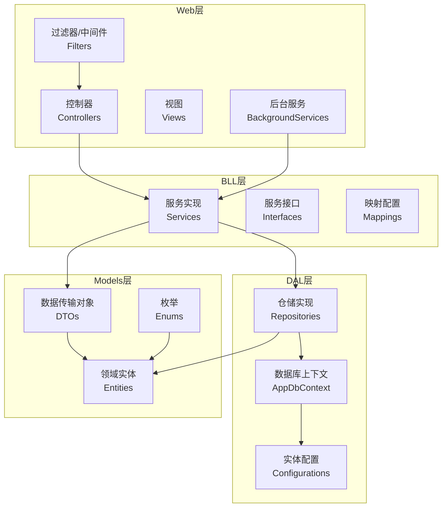
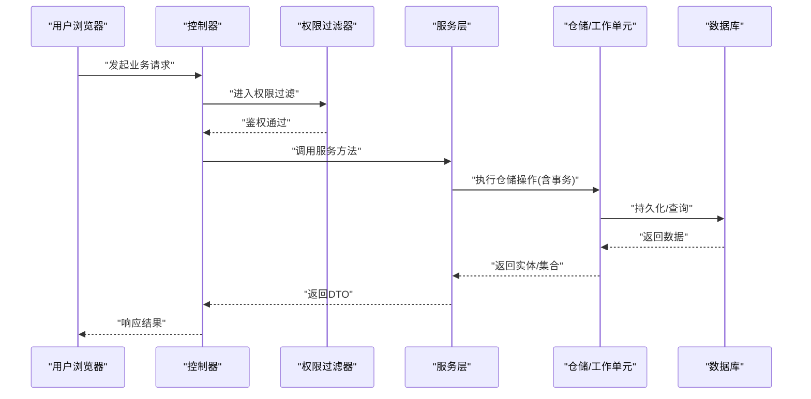
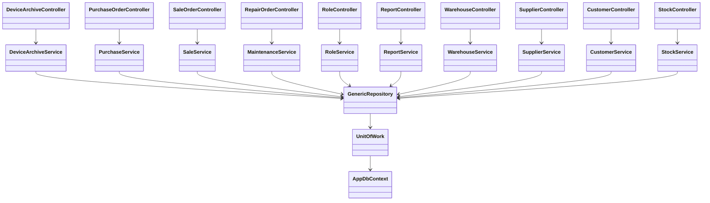

# 核心功能特性

<cite>
**本文引用的文件**   
- [Program.cs](file://EquipmentIMS.Web/Program.cs)
- [PermissionFilter.cs](file://EquipmentIMS.Web/Filters/PermissionFilter.cs)
- [OperationLogActionFilter.cs](file://EquipmentIMS.Web/Filters/OperationLogActionFilter.cs)
- [GlobalExceptionMiddleware.cs](file://EquipmentIMS.Web/Filters/GlobalExceptionMiddleware.cs)
- [DeviceArchiveController.cs](file://EquipmentIMS.Web/Controllers/DeviceArchiveController.cs)
- [StockController.cs](file://EquipmentIMS.Web/Controllers/StockController.cs)
- [PurchaseOrderController.cs](file://EquipmentIMS.Web/Controllers/PurchaseOrderController.cs)
- [SaleOrderController.cs](file://EquipmentIMS.Web/Controllers/SaleOrderController.cs)
- [RepairOrderController.cs](file://EquipmentIMS.Web/Controllers/RepairOrderController.cs)
- [RoleController.cs](file://EquipmentIMS.Web/Controllers/RoleController.cs)
- [ReportController.cs](file://EquipmentIMS.Web/Controllers/ReportController.cs)
- [WarehouseController.cs](file://EquipmentIMS.Web/Controllers/WarehouseController.cs)
- [SupplierController.cs](file://EquipmentIMS.Web/Controllers/SupplierController.cs)
- [CustomerController.cs](file://EquipmentIMS.Web/Controllers/CustomerController.cs)
- [DeviceArchiveService.cs](file://EquipmentIMS.BLL/Services/DeviceArchiveService.cs)
- [StockService.cs](file://EquipmentIMS.BLL/Services/StockService.cs)
- [PurchaseService.cs](file://EquipmentIMS.BLL/Services/PurchaseService.cs)
- [SaleService.cs](file://EquipmentIMS.BLL/Services/SaleService.cs)
- [MaintenanceService.cs](file://EquipmentIMS.BLL/Services/MaintenanceService.cs)
- [RoleService.cs](file://EquipmentIMS.BLL/Services/RoleService.cs)
- [ReportService.cs](file://EquipmentIMS.BLL/Services/ReportService.cs)
- [WarehouseService.cs](file://EquipmentIMS.BLL/Services/WarehouseService.cs)
- [SupplierService.cs](file://EquipmentIMS.BLL/Services/SupplierService.cs)
- [CustomerService.cs](file://EquipmentIMS.BLL/Services/CustomerService.cs)
- [AppDbContext.cs](file://EquipmentIMS.DAL/AppDbContext.cs)
- [GenericRepository.cs](file://EquipmentIMS.DAL/Repositories/GenericRepository.cs)
- [UnitOfWork.cs](file://EquipmentIMS.DAL/Repositories/UnitOfWork.cs)
- [IRepository.cs](file://EquipmentIMS.DAL/Interfaces/IRepository.cs)
- [IUnitOfWork.cs](file://EquipmentIMS.DAL/Interfaces/IUnitOfWork.cs)
- [BaseProductConfiguration.cs](file://EquipmentIMS.DAL/Configurations/BaseProductConfiguration.cs)
- [PurPurchaseOrderConfiguration.cs](file://EquipmentIMS.DAL/Configurations/PurPurchaseOrderConfiguration.cs)
- [SaleSaleOrderConfiguration.cs](file://EquipmentIMS.DAL/Configurations/SaleSaleOrderConfiguration.cs)
- [MaintDeviceArchiveConfiguration.cs](file://EquipmentIMS.DAL/Configurations/MaintDeviceArchiveConfiguration.cs)
- [SysUserConfiguration.cs](file://EquipmentIMS.DAL/Configurations/SysUserConfiguration.cs)
- [SysRoleConfiguration.cs](file://EquipmentIMS.DAL/Configurations/SysRoleConfiguration.cs)
- [SysPermissionConfiguration.cs](file://EquipmentIMS.DAL/Configurations/SysPermissionConfiguration.cs)
- [InvStockTransactionConfiguration.cs](file://EquipmentIMS.DAL/Configurations/InvStockTransactionConfiguration.cs)
- [BaseWarehouseConfiguration.cs](file://EquipmentIMS.DAL/Configurations/BaseWarehouseConfiguration.cs)
- [BaseSupplierConfiguration.cs](file://EquipmentIMS.DAL/Configurations/BaseSupplierConfiguration.cs)
- [BaseCustomerConfiguration.cs](file://EquipmentIMS.DAL/Configurations/BaseCustomerConfiguration.cs)
- [DeviceArchiveDto.cs](file://EquipmentIMS.Models/DTOs/DeviceArchiveDto.cs)
- [StockListDto.cs](file://EquipmentIMS.Models/DTOs/StockListDto.cs)
- [PurchaseOrderDto.cs](file://EquipmentIMS.Models/DTOs/PurchaseOrderDto.cs)
- [SaleOrderDto.cs](file://EquipmentIMS.Models/DTOs/SaleOrderDto.cs)
- [RepairOrderDto.cs](file://EquipmentIMS.Models/DTOs/RepairOrderDto.cs)
- [RoleDto.cs](file://EquipmentIMS.Models/DTOs/RoleDto.cs)
- [ReportInventoryDtos.cs](file://EquipmentIMS.Models/DTOs/Reports/ReportInventoryDtos.cs)
- [ReportPurchaseDtos.cs](file://EquipmentIMS.Models/DTOs/Reports/ReportPurchaseDtos.cs)
- [ReportSaleDtos.cs](file://EquipmentIMS.Models/DTOs/Reports/ReportSaleDtos.cs)
- [ReportRepairDtos.cs](file://EquipmentIMS.Models/DTOs/Reports/ReportRepairDtos.cs)
- [WarehouseDto.cs](file://EquipmentIMS.Models/DTOs/WarehouseDto.cs)
- [SupplierDto.cs](file://EquipmentIMS.Models/DTOs/SupplierDto.cs)
- [CustomerDto.cs](file://EquipmentIMS.Models/DTOs/CustomerDto.cs)
- [DeviceStatus.cs](file://EquipmentIMS.Models/Enums/DeviceStatus.cs)
- [PurchaseOrderStatus.cs](file://EquipmentIMS.Models/Enums/PurchaseOrderStatus.cs)
- [SaleOrderStatus.cs](file://EquipmentIMS.Models/Enums/SaleOrderStatus.cs)
- [RepairOrderStatus.cs](file://EquipmentIMS.Models/Enums/RepairOrderStatus.cs)
- [TransactionType.cs](file://EquipmentIMS.Models/Enums/TransactionType.cs)
- [TransferStatus.cs](file://EquipmentIMS.Models/Enums/TransferStatus.cs)
- [StockCheckStatus.cs](file://EquipmentIMS.Models/Enums/StockCheckStatus.cs)
- [NotificationType.cs](file://EquipmentIMS.Models/Enums/NotificationType.cs)
- [AlertLevel.cs](file://EquipmentIMS.Models/Enums/AlertLevel.cs)
- [ExportBackgroundService.cs](file://EquipmentIMS.Web/BackgroundServices/ExportBackgroundService.cs)
- [ReportExportBackgroundService.cs](file://EquipmentIMS.Web/BackgroundServices/ReportExportBackgroundService.cs)
- [StockAlertBackgroundService.cs](file://EquipmentIMS.Web/BackgroundServices/StockAlertBackgroundService.cs)
- [MaintenanceReminderBackgroundService.cs](file://EquipmentIMS.Web/BackgroundServices/MaintenanceReminderBackgroundService.cs)
</cite>

## 目录
1. [简介](#简介)
2. [项目结构](#项目结构)
3. [核心组件](#核心组件)
4. [架构总览](#架构总览)
5. [详细组件分析](#详细组件分析)
6. [依赖关系分析](#依赖关系分析)
7. [性能考虑](#性能考虑)
8. [故障排查指南](#故障排查指南)
9. [结论](#结论)
10. [附录](#附录)

## 简介
THMS（设备库存管理系统）围绕“设备档案—库存—采购—销售—维护”的主业务闭环，结合权限、报表、仓库、供应商与客户等支撑模块，提供端到端的企业级管理能力。系统采用分层架构与领域驱动思想，通过控制器暴露API，服务层封装业务规则，仓储层统一数据访问，实体与配置定义领域模型，枚举规范状态流转，后台任务支撑异步导出、库存预警与维护提醒等能力。

本文件面向产品人员与用户培训，聚焦十大核心模块的功能特性、业务流程与界面要点，并给出对比表与价值说明，帮助快速理解系统完整性与关联性。

## 项目结构
系统按Web层、BLL服务层、DAL数据访问层与Models领域模型组织：
- Web层：控制器、过滤器、中间件、视图、后台服务
- BLL层：接口与服务实现、映射、扩展
- DAL层：EF Core上下文、通用仓储、工作单元、实体配置
- Models层：DTO、实体、枚举、异常

图表来源
- [Program.cs](file://EquipmentIMS.Web/Program.cs)
- [AppDbContext.cs](file://EquipmentIMS.DAL/AppDbContext.cs)
- [GenericRepository.cs](file://EquipmentIMS.DAL/Repositories/GenericRepository.cs)
- [UnitOfWork.cs](file://EquipmentIMS.DAL/Repositories/UnitOfWork.cs)

章节来源
- [Program.cs](file://EquipmentIMS.Web/Program.cs)
- [AppDbContext.cs](file://EquipmentIMS.DAL/AppDbContext.cs)

## 核心组件
- 控制器层：为每个业务域提供REST风格接口，负责请求校验、参数绑定、调用服务层、返回结果与错误处理。
- 服务层：承载核心业务逻辑，编排跨实体的事务性操作，协调仓储与外部依赖，输出DTO。
- 仓储与工作单元：基于EF Core的通用仓储与工作单元模式，提供统一的CRUD与查询能力，确保事务一致性。
- 实体与配置：以EF Core Fluent API进行强类型映射，保证领域模型与数据库结构一致。
- 过滤器与中间件：权限过滤、操作日志记录、全局异常处理与安全头注入。
- 后台服务：异步导出、报表导出、库存预警、维护提醒等定时或队列任务。

章节来源
- [PermissionFilter.cs](file://EquipmentIMS.Web/Filters/PermissionFilter.cs)
- [OperationLogActionFilter.cs](file://EquipmentIMS.Web/Filters/OperationLogActionFilter.cs)
- [GlobalExceptionMiddleware.cs](file://EquipmentIMS.Web/Filters/GlobalExceptionMiddleware.cs)
- [GenericRepository.cs](file://EquipmentIMS.DAL/Repositories/GenericRepository.cs)
- [UnitOfWork.cs](file://EquipmentIMS.DAL/Repositories/UnitOfWork.cs)
- [ExportBackgroundService.cs](file://EquipmentIMS.Web/BackgroundServices/ExportBackgroundService.cs)
- [ReportExportBackgroundService.cs](file://EquipmentIMS.Web/BackgroundServices/ReportExportBackgroundService.cs)
- [StockAlertBackgroundService.cs](file://EquipmentIMS.Web/BackgroundServices/StockAlertBackgroundService.cs)
- [MaintenanceReminderBackgroundService.cs](file://EquipmentIMS.Web/BackgroundServices/MaintenanceReminderBackgroundService.cs)

## 架构总览
系统遵循“控制器→服务→仓储→数据库”的分层调用链，并通过过滤器与中间件横切关注点（权限、日志、异常）贯穿全链路。

图表来源
- [PermissionFilter.cs](file://EquipmentIMS.Web/Filters/PermissionFilter.cs)
- [DeviceArchiveController.cs](file://EquipmentIMS.Web/Controllers/DeviceArchiveController.cs)
- [DeviceArchiveService.cs](file://EquipmentIMS.BLL/Services/DeviceArchiveService.cs)
- [GenericRepository.cs](file://EquipmentIMS.DAL/Repositories/GenericRepository.cs)
- [UnitOfWork.cs](file://EquipmentIMS.DAL/Repositories/UnitOfWork.cs)
- [AppDbContext.cs](file://EquipmentIMS.DAL/AppDbContext.cs)

## 详细组件分析

### 设备档案管理
- 主要功能点
  - 设备基础信息维护（编码、名称、规格型号、品牌、序列号、分类、存放位置等）
  - 设备生命周期状态管理（启用、停用、报废等）
  - 设备详情查看与变更记录追踪
- 业务流程
  - 新增/编辑设备档案 → 校验与保存 → 生成唯一编码（可选）→ 通知相关方（可选）
  - 变更状态时触发库存联动（如入库/出库标记）
- 用户界面
  - 列表页：分页、筛选、排序、批量操作
  - 创建/编辑页：表单校验、附件上传（如有）
  - 详情页：基本信息、关联交易、维护记录摘要
- 关键实现路径
  - 控制器：[DeviceArchiveController.cs](file://EquipmentIMS.Web/Controllers/DeviceArchiveController.cs)
  - 服务：[DeviceArchiveService.cs](file://EquipmentIMS.BLL/Services/DeviceArchiveService.cs)
  - DTO：[DeviceArchiveDto.cs](file://EquipmentIMS.Models/DTOs/DeviceArchiveDto.cs)
  - 实体配置：[MaintDeviceArchiveConfiguration.cs](file://EquipmentIMS.DAL/Configurations/MaintDeviceArchiveConfiguration.cs)
  - 状态枚举：[DeviceStatus.cs](file://EquipmentIMS.Models/Enums/DeviceStatus.cs)

章节来源
- [DeviceArchiveController.cs](file://EquipmentIMS.Web/Controllers/DeviceArchiveController.cs)
- [DeviceArchiveService.cs](file://EquipmentIMS.BLL/Services/DeviceArchiveService.cs)
- [DeviceArchiveDto.cs](file://EquipmentIMS.Models/DTOs/DeviceArchiveDto.cs)
- [MaintDeviceArchiveConfiguration.cs](file://EquipmentIMS.DAL/Configurations/MaintDeviceArchiveConfiguration.cs)
- [DeviceStatus.cs](file://EquipmentIMS.Models/Enums/DeviceStatus.cs)

### 库存管理
- 主要功能点
  - 库存台账与实时库存查询
  - 初始库存导入
  - 库存盘点（差异记录、审核）
  - 库存流水（出入库、调拨、报损等）
  - 库存预警（低库存、超储）
- 业务流程
  - 入库/出库/调拨/盘点 → 生成库存流水 → 更新库存数量 → 触发预警（若低于阈值）
- 用户界面
  - 库存总览：汇总指标、预警列表
  - 库存明细：多条件检索、导出
  - 盘点作业：创建盘点单、录入差异、审核生效
- 关键实现路径
  - 控制器：[StockController.cs](file://EquipmentIMS.Web/Controllers/StockController.cs)
  - 服务：[StockService.cs](file://EquipmentIMS.BLL/Services/StockService.cs)
  - DTO：[StockListDto.cs](file://EquipmentIMS.Models/DTOs/StockListDto.cs)
  - 实体配置：[InvStockTransactionConfiguration.cs](file://EquipmentIMS.DAL/Configurations/InvStockTransactionConfiguration.cs)
  - 状态/类型枚举：[TransactionType.cs](file://EquipmentIMS.Models/Enums/TransactionType.cs)、[StockCheckStatus.cs](file://EquipmentIMS.Models/Enums/StockCheckStatus.cs)
  - 后台任务：[StockAlertBackgroundService.cs](file://EquipmentIMS.Web/BackgroundServices/StockAlertBackgroundService.cs)

章节来源
- [StockController.cs](file://EquipmentIMS.Web/Controllers/StockController.cs)
- [StockService.cs](file://EquipmentIMS.BLL/Services/StockService.cs)
- [StockListDto.cs](file://EquipmentIMS.Models/DTOs/StockListDto.cs)
- [InvStockTransactionConfiguration.cs](file://EquipmentIMS.DAL/Configurations/InvStockTransactionConfiguration.cs)
- [TransactionType.cs](file://EquipmentIMS.Models/Enums/TransactionType.cs)
- [StockCheckStatus.cs](file://EquipmentIMS.Models/Enums/StockCheckStatus.cs)
- [StockAlertBackgroundService.cs](file://EquipmentIMS.Web/BackgroundServices/StockAlertBackgroundService.cs)

### 采购管理
- 主要功能点
  - 采购订单创建、审批、下达
  - 采购入库与退货
  - 供应商对账与结算准备
- 业务流程
  - 创建采购订单 → 选择供应商与物料 → 审批通过后入库 → 自动生成库存流水与应付准备
  - 退货流程逆向冲销库存与订单行
- 用户界面
  - 订单列表：状态筛选、打印、导出
  - 订单详情：行项目、价格、税率、备注
  - 入库/退货：扫码或批量导入
- 关键实现路径
  - 控制器：[PurchaseOrderController.cs](file://EquipmentIMS.Web/Controllers/PurchaseOrderController.cs)
  - 服务：[PurchaseService.cs](file://EquipmentIMS.BLL/Services/PurchaseService.cs)
  - DTO：[PurchaseOrderDto.cs](file://EquipmentIMS.Models/DTOs/PurchaseOrderDto.cs)
  - 实体配置：[PurPurchaseOrderConfiguration.cs](file://EquipmentIMS.DAL/Configurations/PurPurchaseOrderConfiguration.cs)
  - 状态枚举：[PurchaseOrderStatus.cs](file://EquipmentIMS.Models/Enums/PurchaseOrderStatus.cs)

章节来源
- [PurchaseOrderController.cs](file://EquipmentIMS.Web/Controllers/PurchaseOrderController.cs)
- [PurchaseService.cs](file://EquipmentIMS.BLL/Services/PurchaseService.cs)
- [PurchaseOrderDto.cs](file://EquipmentIMS.Models/DTOs/PurchaseOrderDto.cs)
- [PurPurchaseOrderConfiguration.cs](file://EquipmentIMS.DAL/Configurations/PurPurchaseOrderConfiguration.cs)
- [PurchaseOrderStatus.cs](file://EquipmentIMS.Models/Enums/PurchaseOrderStatus.cs)

### 销售管理
- 主要功能点
  - 销售订单创建、确认、发货
  - 销售出库与退货
  - 客户价格策略与折扣
- 业务流程
  - 创建销售订单 → 信用/库存检查 → 发货出库 → 生成应收准备
  - 退货流程逆向冲销库存与订单行
- 用户界面
  - 订单列表：状态、客户、金额筛选
  - 订单详情：行项目、价格、折扣、物流信息
  - 出库/退货：批次/序列号管理（如有）
- 关键实现路径
  - 控制器：[SaleOrderController.cs](file://EquipmentIMS.Web/Controllers/SaleOrderController.cs)
  - 服务：[SaleService.cs](file://EquipmentIMS.BLL/Services/SaleService.cs)
  - DTO：[SaleOrderDto.cs](file://EquipmentIMS.Models/DTOs/SaleOrderDto.cs)
  - 实体配置：[SaleSaleOrderConfiguration.cs](file://EquipmentIMS.DAL/Configurations/SaleSaleOrderConfiguration.cs)
  - 状态枚举：[SaleOrderStatus.cs](file://EquipmentIMS.Models/Enums/SaleOrderStatus.cs)

章节来源
- [SaleOrderController.cs](file://EquipmentIMS.Web/Controllers/SaleOrderController.cs)
- [SaleService.cs](file://EquipmentIMS.BLL/Services/SaleService.cs)
- [SaleOrderDto.cs](file://EquipmentIMS.Models/DTOs/SaleOrderDto.cs)
- [SaleSaleOrderConfiguration.cs](file://EquipmentIMS.DAL/Configurations/SaleSaleOrderConfiguration.cs)
- [SaleOrderStatus.cs](file://EquipmentIMS.Models/Enums/SaleOrderStatus.cs)

### 维护管理
- 主要功能点
  - 维修工单创建、派工、处理、验收
  - 维护计划与周期保养
  - 备件消耗与成本归集
- 业务流程
  - 报修/计划触发 → 创建维修工单 → 派工与领料 → 处理完成与验收 → 归档
- 用户界面
  - 工单看板：待派、进行中、已完成
  - 工单详情：步骤、工时、备件、费用
  - 维护计划：周期、提醒、历史执行
- 关键实现路径
  - 控制器：[RepairOrderController.cs](file://EquipmentIMS.Web/Controllers/RepairOrderController.cs)
  - 服务：[MaintenanceService.cs](file://EquipmentIMS.BLL/Services/MaintenanceService.cs)
  - DTO：[RepairOrderDto.cs](file://EquipmentIMS.Models/DTOs/RepairOrderDto.cs)
  - 状态枚举：[RepairOrderStatus.cs](file://EquipmentIMS.Models/Enums/RepairOrderStatus.cs)
  - 后台任务：[MaintenanceReminderBackgroundService.cs](file://EquipmentIMS.Web/BackgroundServices/MaintenanceReminderBackgroundService.cs)

章节来源
- [RepairOrderController.cs](file://EquipmentIMS.Web/Controllers/RepairOrderController.cs)
- [MaintenanceService.cs](file://EquipmentIMS.BLL/Services/MaintenanceService.cs)
- [RepairOrderDto.cs](file://EquipmentIMS.Models/DTOs/RepairOrderDto.cs)
- [RepairOrderStatus.cs](file://EquipmentIMS.Models/Enums/RepairOrderStatus.cs)
- [MaintenanceReminderBackgroundService.cs](file://EquipmentIMS.Web/BackgroundServices/MaintenanceReminderBackgroundService.cs)

### 权限管理
- 主要功能点
  - 用户、角色、权限的增删改查
  - 角色-权限分配与用户-角色分配
  - 菜单与按钮级权限控制
- 业务流程
  - 管理员创建角色与权限 → 分配给用户 → 登录时加载权限树 → 页面与接口受控
- 用户界面
  - 用户管理：创建、编辑、禁用、重置密码
  - 角色管理：权限勾选、批量授权
  - 菜单管理：动态渲染导航与按钮
- 关键实现路径
  - 控制器：[RoleController.cs](file://EquipmentIMS.Web/Controllers/RoleController.cs)
  - 服务：[RoleService.cs](file://EquipmentIMS.BLL/Services/RoleService.cs)
  - DTO：[RoleDto.cs](file://EquipmentIMS.Models/DTOs/RoleDto.cs)
  - 实体配置：[SysUserConfiguration.cs](file://EquipmentIMS.DAL/Configurations/SysUserConfiguration.cs)、[SysRoleConfiguration.cs](file://EquipmentIMS.DAL/Configurations/SysRoleConfiguration.cs)、[SysPermissionConfiguration.cs](file://EquipmentIMS.DAL/Configurations/SysPermissionConfiguration.cs)
  - 权限过滤：[PermissionFilter.cs](file://EquipmentIMS.Web/Filters/PermissionFilter.cs)

章节来源
- [RoleController.cs](file://EquipmentIMS.Web/Controllers/RoleController.cs)
- [RoleService.cs](file://EquipmentIMS.BLL/Services/RoleService.cs)
- [RoleDto.cs](file://EquipmentIMS.Models/DTOs/RoleDto.cs)
- [SysUserConfiguration.cs](file://EquipmentIMS.DAL/Configurations/SysUserConfiguration.cs)
- [SysRoleConfiguration.cs](file://EquipmentIMS.DAL/Configurations/SysRoleConfiguration.cs)
- [SysPermissionConfiguration.cs](file://EquipmentIMS.DAL/Configurations/SysPermissionConfiguration.cs)
- [PermissionFilter.cs](file://EquipmentIMS.Web/Filters/PermissionFilter.cs)

### 报表分析
- 主要功能点
  - 库存报表：结存、周转、预警统计
  - 采购报表：订单趋势、到货率、退货率
  - 销售报表：收入、毛利、客户贡献
  - 维修报表：工单量、平均修复时长、备件消耗
  - 异步导出：Excel/CSV大报表后台生成
- 业务流程
  - 选择报表与筛选条件 → 提交导出任务 → 后台生成文件 → 下载或推送通知
- 用户界面
  - 报表中心：卡片式入口、筛选器、图表预览
  - 导出任务：进度条、失败重试、历史记录
- 关键实现路径
  - 控制器：[ReportController.cs](file://EquipmentIMS.Web/Controllers/ReportController.cs)
  - 服务：[ReportService.cs](file://EquipmentIMS.BLL/Services/ReportService.cs)
  - DTO：[ReportInventoryDtos.cs](file://EquipmentIMS.Models/DTOs/Reports/ReportInventoryDtos.cs)、[ReportPurchaseDtos.cs](file://EquipmentIMS.Models/DTOs/Reports/ReportPurchaseDtos.cs)、[ReportSaleDtos.cs](file://EquipmentIMS.Models/DTOs/Reports/ReportSaleDtos.cs)、[ReportRepairDtos.cs](file://EquipmentIMS.Models/DTOs/Reports/ReportRepairDtos.cs)
  - 后台任务：[ReportExportBackgroundService.cs](file://EquipmentIMS.Web/BackgroundServices/ReportExportBackgroundService.cs)

章节来源
- [ReportController.cs](file://EquipmentIMS.Web/Controllers/ReportController.cs)
- [ReportService.cs](file://EquipmentIMS.BLL/Services/ReportService.cs)
- [ReportInventoryDtos.cs](file://EquipmentIMS.Models/DTOs/Reports/ReportInventoryDtos.cs)
- [ReportPurchaseDtos.cs](file://EquipmentIMS.Models/DTOs/Reports/ReportPurchaseDtos.cs)
- [ReportSaleDtos.cs](file://EquipmentIMS.Models/DTOs/Reports/ReportSaleDtos.cs)
- [ReportRepairDtos.cs](file://EquipmentIMS.Models/DTOs/Reports/ReportRepairDtos.cs)
- [ReportExportBackgroundService.cs](file://EquipmentIMS.Web/BackgroundServices/ReportExportBackgroundService.cs)

### 仓库管理
- 主要功能点
  - 仓库与库位管理
  - 库存调拨（跨仓转移）
  - 仓库维度库存与交易统计
- 业务流程
  - 创建调拨单 → 选择源仓/目标仓与物料 → 审核生效 → 分别扣减源仓、增加目标仓库存
- 用户界面
  - 仓库列表：基本信息、容量、负责人
  - 调拨单：行项目、在途跟踪、签收确认
- 关键实现路径
  - 控制器：[WarehouseController.cs](file://EquipmentIMS.Web/Controllers/WarehouseController.cs)
  - 服务：[WarehouseService.cs](file://EquipmentIMS.BLL/Services/WarehouseService.cs)
  - DTO：[WarehouseDto.cs](file://EquipmentIMS.Models/DTOs/WarehouseDto.cs)
  - 实体配置：[BaseWarehouseConfiguration.cs](file://EquipmentIMS.DAL/Configurations/BaseWarehouseConfiguration.cs)
  - 状态枚举：[TransferStatus.cs](file://EquipmentIMS.Models/Enums/TransferStatus.cs)

章节来源
- [WarehouseController.cs](file://EquipmentIMS.Web/Controllers/WarehouseController.cs)
- [WarehouseService.cs](file://EquipmentIMS.BLL/Services/WarehouseService.cs)
- [WarehouseDto.cs](file://EquipmentIMS.Models/DTOs/WarehouseDto.cs)
- [BaseWarehouseConfiguration.cs](file://EquipmentIMS.DAL/Configurations/BaseWarehouseConfiguration.cs)
- [TransferStatus.cs](file://EquipmentIMS.Models/Enums/TransferStatus.cs)

### 供应商管理
- 主要功能点
  - 供应商档案维护（资质、联系人、结算方式）
  - 供应商评估与黑白名单
  - 与采购订单、入库、退货关联
- 业务流程
  - 新增/编辑供应商 → 审核生效 → 作为采购下单主体 → 结算与对账
- 用户界面
  - 供应商列表：搜索、筛选、详情
  - 供应商详情：合同、绩效、历史交易
- 关键实现路径
  - 控制器：[SupplierController.cs](file://EquipmentIMS.Web/Controllers/SupplierController.cs)
  - 服务：[SupplierService.cs](file://EquipmentIMS.BLL/Services/SupplierService.cs)
  - DTO：[SupplierDto.cs](file://EquipmentIMS.Models/DTOs/SupplierDto.cs)
  - 实体配置：[BaseSupplierConfiguration.cs](file://EquipmentIMS.DAL/Configurations/BaseSupplierConfiguration.cs)

章节来源
- [SupplierController.cs](file://EquipmentIMS.Web/Controllers/SupplierController.cs)
- [SupplierService.cs](file://EquipmentIMS.BLL/Services/SupplierService.cs)
- [SupplierDto.cs](file://EquipmentIMS.Models/DTOs/SupplierDto.cs)
- [BaseSupplierConfiguration.cs](file://EquipmentIMS.DAL/Configurations/BaseSupplierConfiguration.cs)

### 客户管理
- 主要功能点
  - 客户档案维护（资质、联系人、开票信息）
  - 客户价格策略与折扣等级
  - 与销售订单、出库、退货关联
- 业务流程
  - 新增/编辑客户 → 设置价格策略 → 销售下单引用 → 回款与对账
- 用户界面
  - 客户列表：搜索、筛选、详情
  - 客户详情：价格表、历史订单、应收概览
- 关键实现路径
  - 控制器：[CustomerController.cs](file://EquipmentIMS.Web/Controllers/CustomerController.cs)
  - 服务：[CustomerService.cs](file://EquipmentIMS.BLL/Services/CustomerService.cs)
  - DTO：[CustomerDto.cs](file://EquipmentIMS.Models/DTOs/CustomerDto.cs)
  - 实体配置：[BaseCustomerConfiguration.cs](file://EquipmentIMS.DAL/Configurations/BaseCustomerConfiguration.cs)

章节来源
- [CustomerController.cs](file://EquipmentIMS.Web/Controllers/CustomerController.cs)
- [CustomerService.cs](file://EquipmentIMS.BLL/Services/CustomerService.cs)
- [CustomerDto.cs](file://EquipmentIMS.Models/DTOs/CustomerDto.cs)
- [BaseCustomerConfiguration.cs](file://EquipmentIMS.DAL/Configurations/BaseCustomerConfiguration.cs)

### 功能特性对比表
- 设备档案管理
  - 核心价值：建立设备主数据，贯通库存、维护、报表
  - 关键能力：编码规则、状态机、变更记录
  - 典型用户：设备管理员、仓库员、维护工程师
- 库存管理
  - 核心价值：实时可视、可追溯、防呆防错
  - 关键能力：台账、流水、盘点、预警
  - 典型用户：仓管员、财务、运营
- 采购管理
  - 核心价值：降本增效、合规可控
  - 关键能力：订单、入库、退货、供应商协同
  - 典型用户：采购员、仓管、财务
- 销售管理
  - 核心价值：提升交付效率、增强客户体验
  - 关键能力：订单、出库、退货、价格策略
  - 典型用户：销售员、仓管、财务
- 维护管理
  - 核心价值：降低停机时间、延长资产寿命
  - 关键能力：工单、计划、备件、成本
  - 典型用户：维护工程师、设备管理员
- 权限管理
  - 核心价值：安全合规、最小权限原则
  - 关键能力：RBAC、菜单/按钮级控制
  - 典型用户：系统管理员、审计
- 报表分析
  - 核心价值：数据驱动决策
  - 关键能力：多维统计、可视化、异步导出
  - 典型用户：管理层、运营、财务
- 仓库管理
  - 核心价值：优化空间与流转效率
  - 关键能力：多仓、调拨、库位
  - 典型用户：仓管、调度
- 供应商管理
  - 核心价值：供应链稳定与质量保障
  - 关键能力：档案、评估、准入
  - 典型用户：采购、质量
- 客户管理
  - 核心价值：提升成交与复购
  - 关键能力：档案、价格策略、信用
  - 典型用户：销售、客服、财务

[本节为概念性总结，不直接分析具体文件]

## 依赖关系分析
- 控制器到服务：每个业务域控制器依赖对应服务接口实现，解耦UI与业务
- 服务到仓储：服务通过仓储接口访问数据，使用工作单元保证事务边界
- 仓储到上下文：通用仓储基于EF Core上下文，统一CRUD与查询
- 实体配置：Fluent API集中配置，避免散落在实体类中
- 过滤器与中间件：权限过滤与操作日志贯穿控制器；全局异常中间件统一错误处理
- 后台服务：独立于请求线程，处理耗时任务（导出、预警、提醒）

图表来源
- [DeviceArchiveController.cs](file://EquipmentIMS.Web/Controllers/DeviceArchiveController.cs)
- [PurchaseOrderController.cs](file://EquipmentIMS.Web/Controllers/PurchaseOrderController.cs)
- [SaleOrderController.cs](file://EquipmentIMS.Web/Controllers/SaleOrderController.cs)
- [RepairOrderController.cs](file://EquipmentIMS.Web/Controllers/RepairOrderController.cs)
- [RoleController.cs](file://EquipmentIMS.Web/Controllers/RoleController.cs)
- [ReportController.cs](file://EquipmentIMS.Web/Controllers/ReportController.cs)
- [WarehouseController.cs](file://EquipmentIMS.Web/Controllers/WarehouseController.cs)
- [SupplierController.cs](file://EquipmentIMS.Web/Controllers/SupplierController.cs)
- [CustomerController.cs](file://EquipmentIMS.Web/Controllers/CustomerController.cs)
- [StockController.cs](file://EquipmentIMS.Web/Controllers/StockController.cs)
- [DeviceArchiveService.cs](file://EquipmentIMS.BLL/Services/DeviceArchiveService.cs)
- [PurchaseService.cs](file://EquipmentIMS.BLL/Services/PurchaseService.cs)
- [SaleService.cs](file://EquipmentIMS.BLL/Services/SaleService.cs)
- [MaintenanceService.cs](file://EquipmentIMS.BLL/Services/MaintenanceService.cs)
- [RoleService.cs](file://EquipmentIMS.BLL/Services/RoleService.cs)
- [ReportService.cs](file://EquipmentIMS.BLL/Services/ReportService.cs)
- [WarehouseService.cs](file://EquipmentIMS.BLL/Services/WarehouseService.cs)
- [SupplierService.cs](file://EquipmentIMS.BLL/Services/SupplierService.cs)
- [CustomerService.cs](file://EquipmentIMS.BLL/Services/CustomerService.cs)
- [StockService.cs](file://EquipmentIMS.BLL/Services/StockService.cs)
- [GenericRepository.cs](file://EquipmentIMS.DAL/Repositories/GenericRepository.cs)
- [UnitOfWork.cs](file://EquipmentIMS.DAL/Repositories/UnitOfWork.cs)
- [AppDbContext.cs](file://EquipmentIMS.DAL/AppDbContext.cs)

章节来源
- [GenericRepository.cs](file://EquipmentIMS.DAL/Repositories/GenericRepository.cs)
- [UnitOfWork.cs](file://EquipmentIMS.DAL/Repositories/UnitOfWork.cs)
- [AppDbContext.cs](file://EquipmentIMS.DAL/AppDbContext.cs)

## 性能考虑
- 分页与索引：列表查询应使用分页与必要索引，减少网络传输与数据库压力
- 异步导出：大批量报表与导出走后台任务，避免阻塞请求线程
- 缓存策略：字典型数据（分类、仓库、供应商）可考虑内存缓存
- 事务边界：服务层聚合多个仓储操作时使用工作单元，减少锁竞争
- 批量操作：入库/出库/调拨支持批量导入，降低交互次数

[本节为通用建议，不直接分析具体文件]

## 故障排查指南
- 权限问题
  - 现象：页面空白或按钮不可用
  - 排查：检查角色-权限分配、用户-角色分配、菜单可见性
  - 参考：[PermissionFilter.cs](file://EquipmentIMS.Web/Filters/PermissionFilter.cs)
- 操作日志缺失
  - 现象：关键操作无记录
  - 排查：确认操作日志过滤器是否注册、日志级别配置
  - 参考：[OperationLogActionFilter.cs](file://EquipmentIMS.Web/Filters/OperationLogActionFilter.cs)
- 全局异常未捕获
  - 现象：前端收到500且无友好提示
  - 排查：检查全局异常中间件注册顺序与返回格式
  - 参考：[GlobalExceptionMiddleware.cs](file://EquipmentIMS.Web/Filters/GlobalExceptionMiddleware.cs)
- 库存不一致
  - 现象：库存与流水不符
  - 排查：核对事务边界、并发冲突、盘点差异处理
  - 参考：[StockService.cs](file://EquipmentIMS.BLL/Services/StockService.cs)、[GenericRepository.cs](file://EquipmentIMS.DAL/Repositories/GenericRepository.cs)
- 导出失败
  - 现象：导出任务长时间未完成或失败
  - 排查：检查后台服务运行状态、队列堆积、磁盘空间
  - 参考：[ReportExportBackgroundService.cs](file://EquipmentIMS.Web/BackgroundServices/ReportExportBackgroundService.cs)、[ExportBackgroundService.cs](file://EquipmentIMS.Web/BackgroundServices/ExportBackgroundService.cs)

章节来源
- [PermissionFilter.cs](file://EquipmentIMS.Web/Filters/PermissionFilter.cs)
- [OperationLogActionFilter.cs](file://EquipmentIMS.Web/Filters/OperationLogActionFilter.cs)
- [GlobalExceptionMiddleware.cs](file://EquipmentIMS.Web/Filters/GlobalExceptionMiddleware.cs)
- [StockService.cs](file://EquipmentIMS.BLL/Services/StockService.cs)
- [GenericRepository.cs](file://EquipmentIMS.DAL/Repositories/GenericRepository.cs)
- [ReportExportBackgroundService.cs](file://EquipmentIMS.Web/BackgroundServices/ReportExportBackgroundService.cs)
- [ExportBackgroundService.cs](file://EquipmentIMS.Web/BackgroundServices/ExportBackgroundService.cs)

## 结论
THMS以清晰的层次架构与完善的领域模型，将设备档案、库存、采购、销售、维护五大核心业务与权限、报表、仓库、供应商、客户九大支撑模块有机整合。通过统一的权限与日志、健壮的事务与异常处理、以及异步后台任务，系统在易用性、稳定性与可扩展性方面具备良好基础，适合企业级设备与库存一体化管理场景。

[本节为总结性内容，不直接分析具体文件]

## 附录
- 术语说明
  - 设备档案：设备的唯一标识与属性集合
  - 库存流水：反映库存变动的明细记录
  - 工单：维护与维修任务的载体
  - 权限树：菜单与按钮的层级化权限结构
- 常见操作流程
  - 采购入库：创建订单→审批→入库→库存增加→应付准备
  - 销售出库：创建订单→信用/库存检查→发货→库存减少→应收准备
  - 库存盘点：创建盘点单→录入差异→审核→库存调整

[本节为补充说明，不直接分析具体文件]