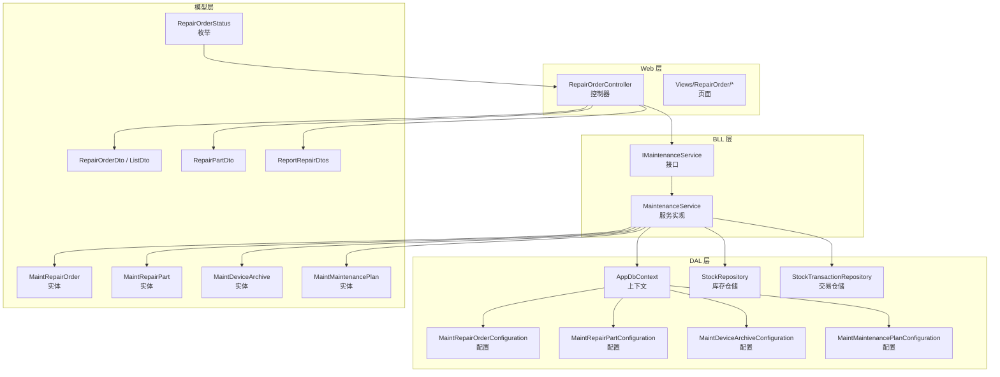
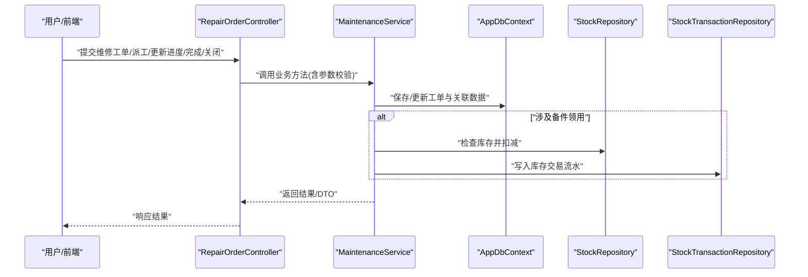
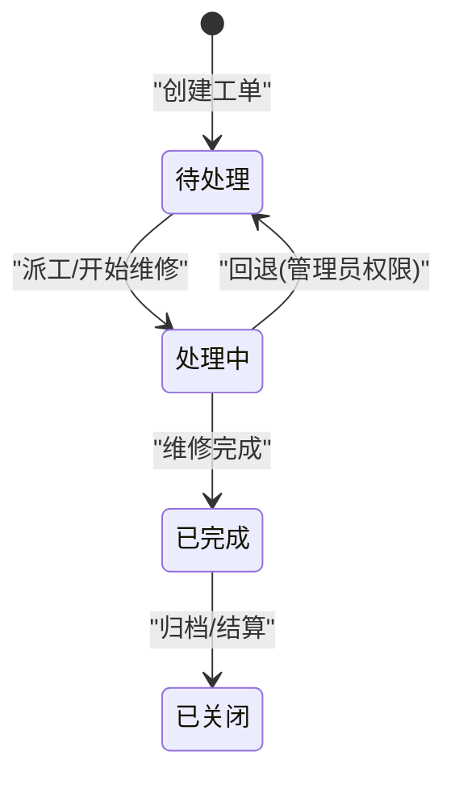
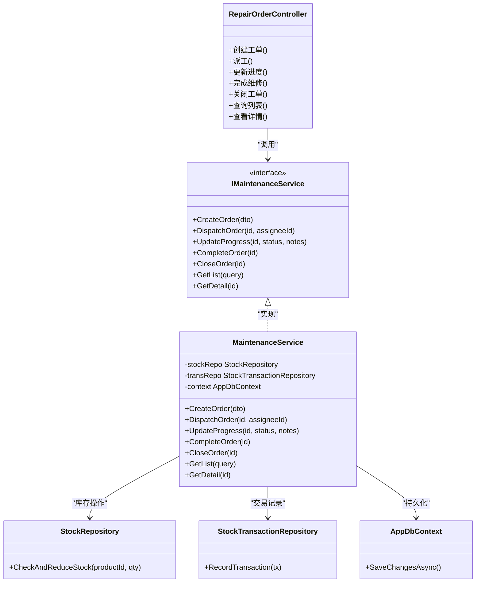
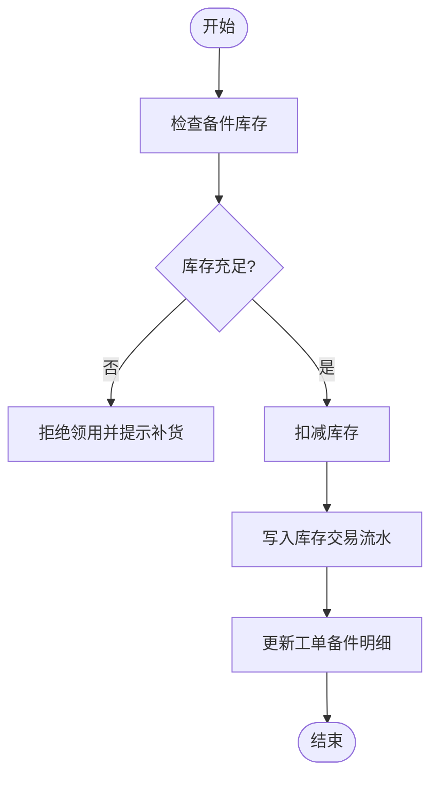
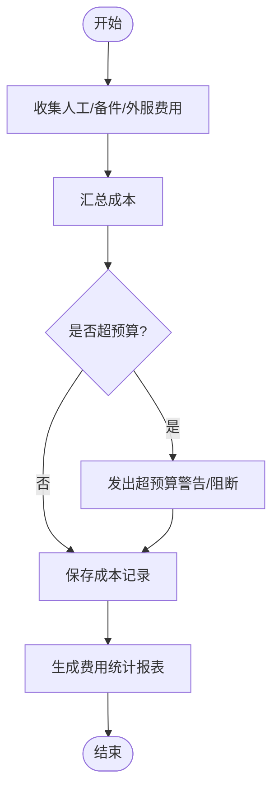
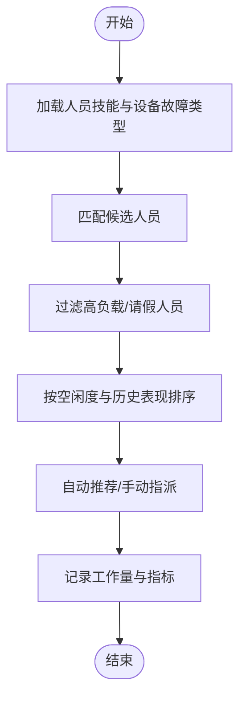
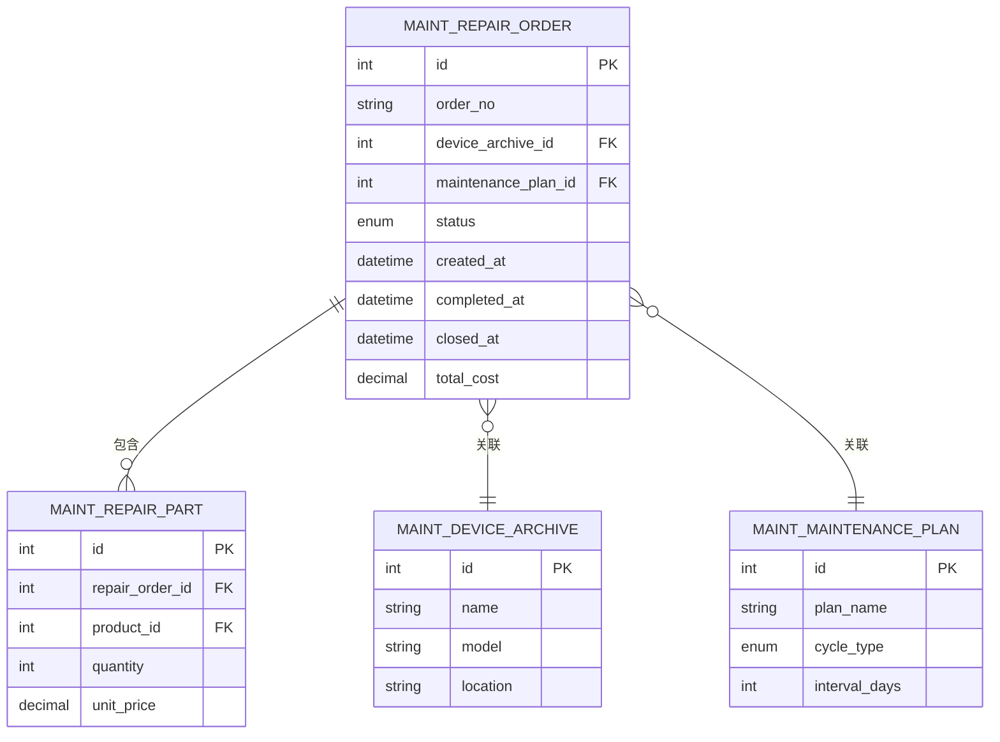
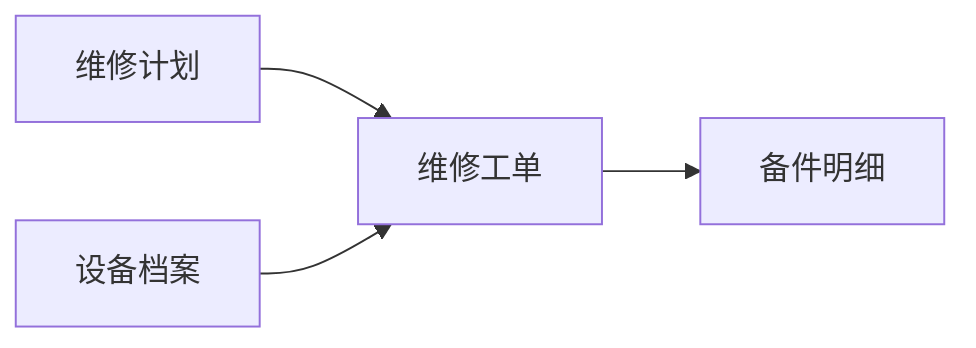
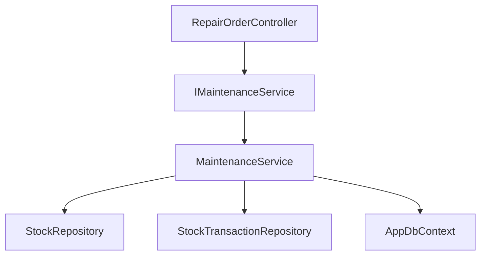

# 维修工单管理

<cite>
**本文引用的文件**   
- [RepairOrderController.cs](file://EquipmentIMS.Web/Controllers/RepairOrderController.cs)
- [MaintenanceService.cs](file://EquipmentIMS.BLL/Services/MaintenanceService.cs)
- [IMaintenanceService.cs](file://EquipmentIMS.BLL/Interfaces/IMaintenanceService.cs)
- [MaintRepairOrderConfiguration.cs](file://EquipmentIMS.DAL/Configurations/MaintRepairOrderConfiguration.cs)
- [MaintRepairPartConfiguration.cs](file://EquipmentIMS.DAL/Configurations/MaintRepairPartConfiguration.cs)
- [MaintDeviceArchiveConfiguration.cs](file://EquipmentIMS.DAL/Configurations/MaintDeviceArchiveConfiguration.cs)
- [MaintMaintenancePlanConfiguration.cs](file://EquipmentIMS.DAL/Configurations/MaintMaintenancePlanConfiguration.cs)
- [MaintRepairOrder.cs](file://EquipmentIMS.Models/Entities/MaintRepairOrder.cs)
- [MaintRepairPart.cs](file://EquipmentIMS.Models/Entities/MaintRepairPart.cs)
- [MaintDeviceArchive.cs](file://EquipmentIMS.Models/Entities/MaintDeviceArchive.cs)
- [MaintMaintenancePlan.cs](file://EquipmentIMS.Models/Entities/MaintMaintenancePlan.cs)
- [RepairOrderStatus.cs](file://EquipmentIMS.Models/Enums/RepairOrderStatus.cs)
- [RepairOrderDto.cs](file://EquipmentIMS.Models/DTOs/RepairOrderDto.cs)
- [RepairOrderListDto.cs](file://EquipmentIMS.Models/DTOs/RepairOrderListDto.cs)
- [RepairPartDto.cs](file://EquipmentIMS.Models/DTOs/RepairPartDto.cs)
- [ReportRepairDtos.cs](file://EquipmentIMS.Models/DTOs/Reports/ReportRepairDtos.cs)
- [StockRepository.cs](file://EquipmentIMS.DAL/Repositories/StockRepository.cs)
- [IStockRepository.cs](file://EquipmentIMS.DAL/Interfaces/IStockRepository.cs)
- [StockTransactionRepository.cs](file://EquipmentIMS.DAL/Repositories/StockTransactionRepository.cs)
- [IStockTransactionRepository.cs](file://EquipmentIMS.DAL/Interfaces/IStockTransactionRepository.cs)
- [AppDbContext.cs](file://EquipmentIMS.DAL/AppDbContext.cs)
- [GlobalExceptionMiddleware.cs](file://EquipmentIMS.Web/Filters/GlobalExceptionMiddleware.cs)
- [OperationLogActionFilter.cs](file://EquipmentIMS.Web/Filters/OperationLogActionFilter.cs)
- [SysOperationLog.cs](file://EquipmentIMS.Models/Entities/SysOperationLog.cs)
</cite>

## 目录
1. [简介](#简介)
2. [项目结构](#项目结构)
3. [核心组件](#核心组件)
4. [架构总览](#架构总览)
5. [详细组件分析](#详细组件分析)
6. [依赖关系分析](#依赖关系分析)
7. [性能考虑](#性能考虑)
8. [故障排查指南](#故障排查指南)
9. [结论](#结论)
10. [附录](#附录)

## 简介
本技术文档围绕“维修工单管理”功能，系统阐述从故障报修、工单创建、人员分配、备件领用、维修执行到完成关闭的全生命周期流程。重点说明：
- 工单状态流转机制（待处理、处理中、已完成、已关闭）与变更规则
- 维修人员分配策略、工作量统计与技能匹配思路
- 维修备件的需求预测、库存扣减与使用追踪
- 维修成本计算、费用统计与预算控制
- 维修历史记录查询、故障模式分析与效率评估
- 与维修计划、设备档案的关联关系及数据一致性保证

## 项目结构
维修工单相关代码采用分层架构：Web 层提供控制器与视图；BLL 层实现业务服务；DAL 层负责仓储与实体映射；Models 层定义实体、枚举与 DTO。

图表来源
- [RepairOrderController.cs](file://EquipmentIMS.Web/Controllers/RepairOrderController.cs)
- [IMaintenanceService.cs](file://EquipmentIMS.BLL/Interfaces/IMaintenanceService.cs)
- [MaintenanceService.cs](file://EquipmentIMS.BLL/Services/MaintenanceService.cs)
- [AppDbContext.cs](file://EquipmentIMS.DAL/AppDbContext.cs)
- [StockRepository.cs](file://EquipmentIMS.DAL/Repositories/StockRepository.cs)
- [StockTransactionRepository.cs](file://EquipmentIMS.DAL/Repositories/StockTransactionRepository.cs)
- [MaintRepairOrderConfiguration.cs](file://EquipmentIMS.DAL/Configurations/MaintRepairOrderConfiguration.cs)
- [MaintRepairPartConfiguration.cs](file://EquipmentIMS.DAL/Configurations/MaintRepairPartConfiguration.cs)
- [MaintDeviceArchiveConfiguration.cs](file://EquipmentIMS.DAL/Configurations/MaintDeviceArchiveConfiguration.cs)
- [MaintMaintenancePlanConfiguration.cs](file://EquipmentIMS.DAL/Configurations/MaintMaintenancePlanConfiguration.cs)
- [MaintRepairOrder.cs](file://EquipmentIMS.Models/Entities/MaintRepairOrder.cs)
- [MaintRepairPart.cs](file://EquipmentIMS.Models/Entities/MaintRepairPart.cs)
- [MaintDeviceArchive.cs](file://EquipmentIMS.Models/Entities/MaintDeviceArchive.cs)
- [MaintMaintenancePlan.cs](file://EquipmentIMS.Models/Entities/MaintMaintenancePlan.cs)
- [RepairOrderStatus.cs](file://EquipmentIMS.Models/Enums/RepairOrderStatus.cs)
- [RepairOrderDto.cs](file://EquipmentIMS.Models/DTOs/RepairOrderDto.cs)
- [RepairOrderListDto.cs](file://EquipmentIMS.Models/DTOs/RepairOrderListDto.cs)
- [RepairPartDto.cs](file://EquipmentIMS.Models/DTOs/RepairPartDto.cs)
- [ReportRepairDtos.cs](file://EquipmentIMS.Models/DTOs/Reports/ReportRepairDtos.cs)

章节来源
- [RepairOrderController.cs](file://EquipmentIMS.Web/Controllers/RepairOrderController.cs)
- [IMaintenanceService.cs](file://EquipmentIMS.BLL/Interfaces/IMaintenanceService.cs)
- [MaintenanceService.cs](file://EquipmentIMS.BLL/Services/MaintenanceService.cs)
- [AppDbContext.cs](file://EquipmentIMS.DAL/AppDbContext.cs)
- [MaintRepairOrderConfiguration.cs](file://EquipmentIMS.DAL/Configurations/MaintRepairOrderConfiguration.cs)
- [MaintRepairPartConfiguration.cs](file://EquipmentIMS.DAL/Configurations/MaintRepairPartConfiguration.cs)
- [MaintDeviceArchiveConfiguration.cs](file://EquipmentIMS.DAL/Configurations/MaintDeviceArchiveConfiguration.cs)
- [MaintMaintenancePlanConfiguration.cs](file://EquipmentIMS.DAL/Configurations/MaintMaintenancePlanConfiguration.cs)
- [MaintRepairOrder.cs](file://EquipmentIMS.Models/Entities/MaintRepairOrder.cs)
- [MaintRepairPart.cs](file://EquipmentIMS.Models/Entities/MaintRepairPart.cs)
- [MaintDeviceArchive.cs](file://EquipmentIMS.Models/Entities/MaintDeviceArchive.cs)
- [MaintMaintenancePlan.cs](file://EquipmentIMS.Models/Entities/MaintMaintenancePlan.cs)
- [RepairOrderStatus.cs](file://EquipmentIMS.Models/Enums/RepairOrderStatus.cs)
- [RepairOrderDto.cs](file://EquipmentIMS.Models/DTOs/RepairOrderDto.cs)
- [RepairOrderListDto.cs](file://EquipmentIMS.Models/DTOs/RepairOrderListDto.cs)
- [RepairPartDto.cs](file://EquipmentIMS.Models/DTOs/RepairPartDto.cs)
- [ReportRepairDtos.cs](file://EquipmentIMS.Models/DTOs/Reports/ReportRepairDtos.cs)

## 核心组件
- 控制器层
  - 提供维修工单的增删改查、派工、进度更新、完成与关闭等 API。
  - 输入输出通过 DTO 进行封装，便于前端展示与校验。
- 业务服务层
  - 维护工单生命周期、状态机、派工策略、备件扣减与成本汇总。
  - 协调仓储层完成持久化与事务边界。
- 数据访问层
  - 通过 EF Core 配置实体映射关系，提供仓储接口与通用仓储实现。
  - 库存与交易记录由专用仓储负责，确保库存变动可追溯。
- 模型层
  - 实体：工单、备件、设备档案、维修计划。
  - 枚举：工单状态。
  - DTO：请求/响应对象与报表 DTO。

章节来源
- [RepairOrderController.cs](file://EquipmentIMS.Web/Controllers/RepairOrderController.cs)
- [IMaintenanceService.cs](file://EquipmentIMS.BLL/Interfaces/IMaintenanceService.cs)
- [MaintenanceService.cs](file://EquipmentIMS.BLL/Services/MaintenanceService.cs)
- [StockRepository.cs](file://EquipmentIMS.DAL/Repositories/StockRepository.cs)
- [StockTransactionRepository.cs](file://EquipmentIMS.DAL/Repositories/StockTransactionRepository.cs)
- [MaintRepairOrder.cs](file://EquipmentIMS.Models/Entities/MaintRepairOrder.cs)
- [MaintRepairPart.cs](file://EquipmentIMS.Models/Entities/MaintRepairPart.cs)
- [MaintDeviceArchive.cs](file://EquipmentIMS.Models/Entities/MaintDeviceArchive.cs)
- [MaintMaintenancePlan.cs](file://EquipmentIMS.Models/Entities/MaintMaintenancePlan.cs)
- [RepairOrderStatus.cs](file://EquipmentIMS.Models/Enums/RepairOrderStatus.cs)
- [RepairOrderDto.cs](file://EquipmentIMS.Models/DTOs/RepairOrderDto.cs)
- [RepairOrderListDto.cs](file://EquipmentIMS.Models/DTOs/RepairOrderListDto.cs)
- [RepairPartDto.cs](file://EquipmentIMS.Models/DTOs/RepairPartDto.cs)
- [ReportRepairDtos.cs](file://EquipmentIMS.Models/DTOs/Reports/ReportRepairDtos.cs)

## 架构总览
维修工单在 Web 层暴露 RESTful 接口，调用 BLL 的业务服务，再由 DAL 通过 EF Core 读写数据库。库存扣减与交易记录通过独立仓储保障一致性与可审计性。

图表来源
- [RepairOrderController.cs](file://EquipmentIMS.Web/Controllers/RepairOrderController.cs)
- [MaintenanceService.cs](file://EquipmentIMS.BLL/Services/MaintenanceService.cs)
- [AppDbContext.cs](file://EquipmentIMS.DAL/AppDbContext.cs)
- [StockRepository.cs](file://EquipmentIMS.DAL/Repositories/StockRepository.cs)
- [StockTransactionRepository.cs](file://EquipmentIMS.DAL/Repositories/StockTransactionRepository.cs)

## 详细组件分析

### 工单实体与状态机
- 实体关系
  - 工单关联设备档案与维修计划，支持多对一或一对多关系。
  - 工单包含备件明细集合，用于记录使用的备件与数量。
- 状态枚举
  - 待处理、处理中、已完成、已关闭。
- 状态流转规则
  - 新建后为“待处理”。
  - 派工或开始维修后进入“处理中”。
  - 维修完成后标记为“已完成”。
  - 归档或结算后转为“已关闭”，不可再编辑。
- 约束与校验
  - 状态变更需满足前置条件（如必须存在指派人员方可进入处理中）。
  - 已完成/已关闭状态禁止再次修改关键信息。

图表来源
- [MaintRepairOrder.cs](file://EquipmentIMS.Models/Entities/MaintRepairOrder.cs)
- [RepairOrderStatus.cs](file://EquipmentIMS.Models/Enums/RepairOrderStatus.cs)
- [MaintDeviceArchive.cs](file://EquipmentIMS.Models/Entities/MaintDeviceArchive.cs)
- [MaintMaintenancePlan.cs](file://EquipmentIMS.Models/Entities/MaintMaintenancePlan.cs)
- [MaintRepairPart.cs](file://EquipmentIMS.Models/Entities/MaintRepairPart.cs)

章节来源
- [MaintRepairOrder.cs](file://EquipmentIMS.Models/Entities/MaintRepairOrder.cs)
- [RepairOrderStatus.cs](file://EquipmentIMS.Models/Enums/RepairOrderStatus.cs)
- [MaintDeviceArchive.cs](file://EquipmentIMS.Models/Entities/MaintDeviceArchive.cs)
- [MaintMaintenancePlan.cs](file://EquipmentIMS.Models/Entities/MaintMaintenancePlan.cs)
- [MaintRepairPart.cs](file://EquipmentIMS.Models/Entities/MaintRepairPart.cs)

### 控制器与服务交互
- 控制器职责
  - 接收前端请求，参数校验，调用服务层，返回统一响应。
  - 提供列表、详情、创建、派工、进度更新、完成、关闭等端点。
- 服务层职责
  - 实现状态机、派工策略、备件扣减、成本汇总、事务边界。
  - 与仓储协作完成库存与交易记录。

图表来源
- [RepairOrderController.cs](file://EquipmentIMS.Web/Controllers/RepairOrderController.cs)
- [IMaintenanceService.cs](file://EquipmentIMS.BLL/Interfaces/IMaintenanceService.cs)
- [MaintenanceService.cs](file://EquipmentIMS.BLL/Services/MaintenanceService.cs)
- [StockRepository.cs](file://EquipmentIMS.DAL/Repositories/StockRepository.cs)
- [StockTransactionRepository.cs](file://EquipmentIMS.DAL/Repositories/StockTransactionRepository.cs)
- [AppDbContext.cs](file://EquipmentIMS.DAL/AppDbContext.cs)

章节来源
- [RepairOrderController.cs](file://EquipmentIMS.Web/Controllers/RepairOrderController.cs)
- [IMaintenanceService.cs](file://EquipmentIMS.BLL/Interfaces/IMaintenanceService.cs)
- [MaintenanceService.cs](file://EquipmentIMS.BLL/Services/MaintenanceService.cs)
- [StockRepository.cs](file://EquipmentIMS.DAL/Repositories/StockRepository.cs)
- [StockTransactionRepository.cs](file://EquipmentIMS.DAL/Repositories/StockTransactionRepository.cs)
- [AppDbContext.cs](file://EquipmentIMS.DAL/AppDbContext.cs)

### 备件管理与库存扣减
- 需求预测
  - 基于历史工单与备件使用趋势，结合设备故障率与维护计划，生成备件需求建议。
- 库存扣减
  - 在派工或领用时触发库存检查与扣减，不足则拒绝操作并提示补货。
- 使用追踪
  - 每次扣减均写入库存交易流水，形成可审计的使用轨迹。
- 安全阈值
  - 低于安全库存时触发告警，联动采购或调拨流程。

图表来源
- [StockRepository.cs](file://EquipmentIMS.DAL/Repositories/StockRepository.cs)
- [StockTransactionRepository.cs](file://EquipmentIMS.DAL/Repositories/StockTransactionRepository.cs)
- [MaintRepairPart.cs](file://EquipmentIMS.Models/Entities/MaintRepairPart.cs)
- [MaintRepairOrder.cs](file://EquipmentIMS.Models/Entities/MaintRepairOrder.cs)

章节来源
- [StockRepository.cs](file://EquipmentIMS.DAL/Repositories/StockRepository.cs)
- [StockTransactionRepository.cs](file://EquipmentIMS.DAL/Repositories/StockTransactionRepository.cs)
- [MaintRepairPart.cs](file://EquipmentIMS.Models/Entities/MaintRepairPart.cs)
- [MaintRepairOrder.cs](file://EquipmentIMS.Models/Entities/MaintRepairOrder.cs)

### 维修成本计算与预算控制
- 成本构成
  - 人工成本（按工时与费率）、备件成本（单价×数量）、外部服务费用（如有）。
- 计算时机
  - 完成维修时汇总当前成本；关闭工单时锁定最终成本。
- 预算控制
  - 对比部门/项目预算与实际累计成本，超预算时预警或阻断。
- 费用统计
  - 按时间、设备、人员、备件类别等多维度统计。

[本节为概念性流程，不直接分析具体文件，故无“章节来源”]

### 维修人员分配策略与工作量统计
- 分配策略
  - 基于技能标签匹配设备故障类型，优先选择空闲且负载较低的人员。
  - 支持手动指派与自动推荐两种模式。
- 工作量统计
  - 统计个人/团队工单数、平均处理时长、完成率、返修率。
- 技能匹配
  - 将人员技能与设备/故障类型建立映射，提升首次修复率。

[本节为概念性流程，不直接分析具体文件，故无“章节来源”]

### 维修历史记录、故障模式分析与效率评估
- 历史记录
  - 按设备、时间范围、状态、人员等维度检索工单与备件使用明细。
- 故障模式分析
  - 聚合常见故障原因、高频备件、重复故障设备，辅助预防性维护。
- 效率评估
  - 计算平均响应时间、平均修复时长、一次修复成功率、备件周转率。

图表来源
- [MaintRepairOrder.cs](file://EquipmentIMS.Models/Entities/MaintRepairOrder.cs)
- [MaintRepairPart.cs](file://EquipmentIMS.Models/Entities/MaintRepairPart.cs)
- [MaintDeviceArchive.cs](file://EquipmentIMS.Models/Entities/MaintDeviceArchive.cs)
- [MaintMaintenancePlan.cs](file://EquipmentIMS.Models/Entities/MaintMaintenancePlan.cs)

章节来源
- [ReportRepairDtos.cs](file://EquipmentIMS.Models/DTOs/Reports/ReportRepairDtos.cs)
- [MaintRepairOrder.cs](file://EquipmentIMS.Models/Entities/MaintRepairOrder.cs)
- [MaintRepairPart.cs](file://EquipmentIMS.Models/Entities/MaintRepairPart.cs)
- [MaintDeviceArchive.cs](file://EquipmentIMS.Models/Entities/MaintDeviceArchive.cs)
- [MaintMaintenancePlan.cs](file://EquipmentIMS.Models/Entities/MaintMaintenancePlan.cs)

### 与维修计划、设备档案的关联与一致性
- 关联关系
  - 工单可来源于维修计划自动生成，或直接针对设备档案创建。
- 数据一致性
  - 通过 EF Core 配置外键与级联行为，确保删除/更新时的引用完整性。
  - 关键变更纳入操作日志，便于审计与回溯。

图表来源
- [MaintMaintenancePlanConfiguration.cs](file://EquipmentIMS.DAL/Configurations/MaintMaintenancePlanConfiguration.cs)
- [MaintDeviceArchiveConfiguration.cs](file://EquipmentIMS.DAL/Configurations/MaintDeviceArchiveConfiguration.cs)
- [MaintRepairOrderConfiguration.cs](file://EquipmentIMS.DAL/Configurations/MaintRepairOrderConfiguration.cs)
- [MaintRepairPartConfiguration.cs](file://EquipmentIMS.DAL/Configurations/MaintRepairPartConfiguration.cs)

章节来源
- [MaintMaintenancePlanConfiguration.cs](file://EquipmentIMS.DAL/Configurations/MaintMaintenancePlanConfiguration.cs)
- [MaintDeviceArchiveConfiguration.cs](file://EquipmentIMS.DAL/Configurations/MaintDeviceArchiveConfiguration.cs)
- [MaintRepairOrderConfiguration.cs](file://EquipmentIMS.DAL/Configurations/MaintRepairOrderConfiguration.cs)
- [MaintRepairPartConfiguration.cs](file://EquipmentIMS.DAL/Configurations/MaintRepairPartConfiguration.cs)

## 依赖关系分析
- 耦合与内聚
  - 控制器仅负责请求路由与 DTO 转换，业务逻辑集中在服务层，内聚度高。
  - 服务层依赖仓储接口，降低与数据访问实现的耦合。
- 外部依赖
  - EF Core 作为 ORM，统一上下文管理事务与变更跟踪。
  - 库存与交易仓储提供领域特定的数据操作。
- 潜在循环依赖
  - 通过接口解耦避免循环引用；仓储与上下文单向依赖。

图表来源
- [RepairOrderController.cs](file://EquipmentIMS.Web/Controllers/RepairOrderController.cs)
- [IMaintenanceService.cs](file://EquipmentIMS.BLL/Interfaces/IMaintenanceService.cs)
- [MaintenanceService.cs](file://EquipmentIMS.BLL/Services/MaintenanceService.cs)
- [StockRepository.cs](file://EquipmentIMS.DAL/Repositories/StockRepository.cs)
- [StockTransactionRepository.cs](file://EquipmentIMS.DAL/Repositories/StockTransactionRepository.cs)
- [AppDbContext.cs](file://EquipmentIMS.DAL/AppDbContext.cs)

章节来源
- [RepairOrderController.cs](file://EquipmentIMS.Web/Controllers/RepairOrderController.cs)
- [IMaintenanceService.cs](file://EquipmentIMS.BLL/Interfaces/IMaintenanceService.cs)
- [MaintenanceService.cs](file://EquipmentIMS.BLL/Services/MaintenanceService.cs)
- [StockRepository.cs](file://EquipmentIMS.DAL/Repositories/StockRepository.cs)
- [StockTransactionRepository.cs](file://EquipmentIMS.DAL/Repositories/StockTransactionRepository.cs)
- [AppDbContext.cs](file://EquipmentIMS.DAL/AppDbContext.cs)

## 性能考虑
- 分页与筛选
  - 列表查询应使用分页与必要字段投影，减少网络传输与内存占用。
- 索引优化
  - 对常用查询字段（设备ID、状态、创建时间、人员ID）建立索引，提升检索性能。
- 批量操作
  - 备件扣减与交易记录尽量合并为单次事务，减少往返次数。
- 缓存策略
  - 对静态字典（如状态枚举、人员技能）使用内存缓存，降低重复查询。
- 异步处理
  - 耗时任务（如报表导出、通知发送）采用后台服务异步执行。

[本节为通用指导，不直接分析具体文件，故无“章节来源”]

## 故障排查指南
- 全局异常处理
  - 通过中间件捕获未处理异常，统一返回错误码与消息，便于前端提示与日志采集。
- 操作日志
  - 通过过滤器记录关键操作的入参、出参与执行结果，定位问题根因。
- 常见问题
  - 库存不足：检查库存扣减逻辑与安全阈值配置。
  - 状态无法流转：确认前置条件（如指派人员、必填字段）是否满足。
  - 数据不一致：核查事务边界与仓储调用顺序，确保原子性。

章节来源
- [GlobalExceptionMiddleware.cs](file://EquipmentIMS.Web/Filters/GlobalExceptionMiddleware.cs)
- [OperationLogActionFilter.cs](file://EquipmentIMS.Web/Filters/OperationLogActionFilter.cs)
- [SysOperationLog.cs](file://EquipmentIMS.Models/Entities/SysOperationLog.cs)

## 结论
本方案以分层架构为基础，围绕维修工单全生命周期构建了清晰的状态机、完善的备件与成本管理机制，并通过仓储与交易流水保障数据一致性与可审计性。结合报表与统计分析，可为运维决策与预算控制提供有力支撑。后续可在智能派工、预测性维护与自动化预算审批等方面持续演进。

[本节为总结性内容，不直接分析具体文件，故无“章节来源”]

## 附录
- 术语
  - 工单：维修任务的载体，贯穿从报修到关闭的全过程。
  - 备件：维修过程中消耗的物料，需进行库存扣减与使用追踪。
  - 交易流水：记录库存变动的审计数据，支持溯源与分析。
- 参考 DTO 与实体路径
  - 工单 DTO：[RepairOrderDto.cs](file://EquipmentIMS.Models/DTOs/RepairOrderDto.cs)、[RepairOrderListDto.cs](file://EquipmentIMS.Models/DTOs/RepairOrderListDto.cs)
  - 备件 DTO：[RepairPartDto.cs](file://EquipmentIMS.Models/DTOs/RepairPartDto.cs)
  - 报表 DTO：[ReportRepairDtos.cs](file://EquipmentIMS.Models/DTOs/Reports/ReportRepairDtos.cs)
  - 实体：[MaintRepairOrder.cs](file://EquipmentIMS.Models/Entities/MaintRepairOrder.cs)、[MaintRepairPart.cs](file://EquipmentIMS.Models/Entities/MaintRepairPart.cs)、[MaintDeviceArchive.cs](file://EquipmentIMS.Models/Entities/MaintDeviceArchive.cs)、[MaintMaintenancePlan.cs](file://EquipmentIMS.Models/Entities/MaintMaintenancePlan.cs)
  - 枚举：[RepairOrderStatus.cs](file://EquipmentIMS.Models/Enums/RepairOrderStatus.cs)