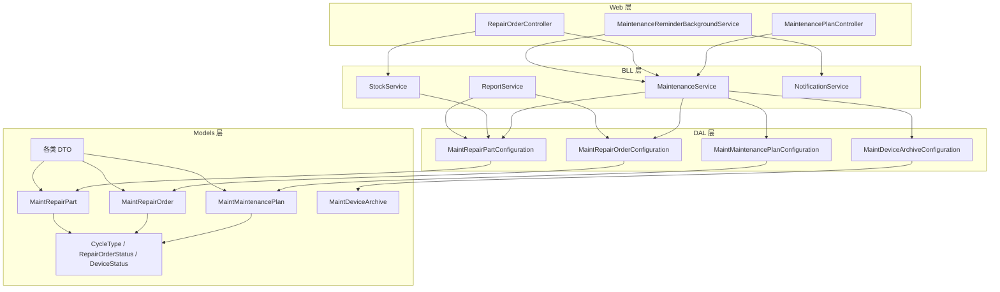
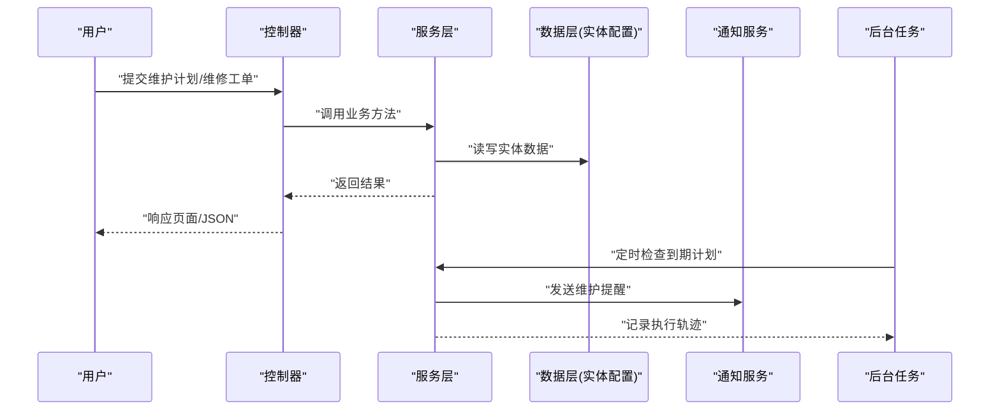
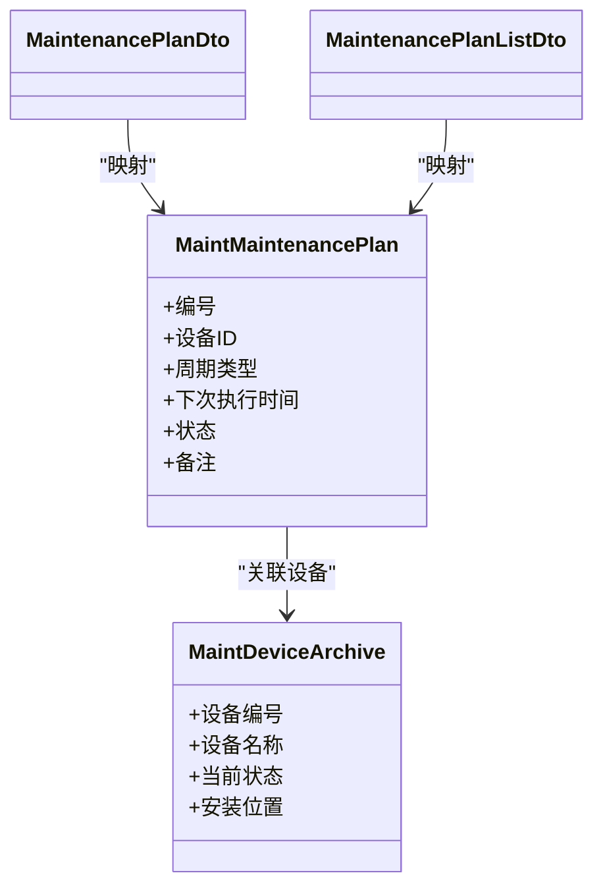
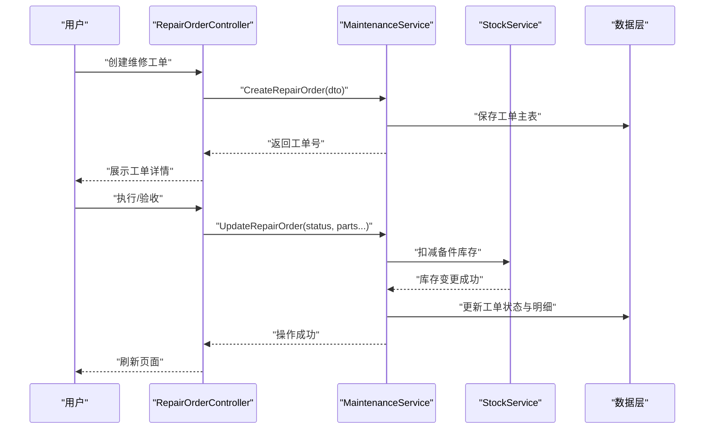
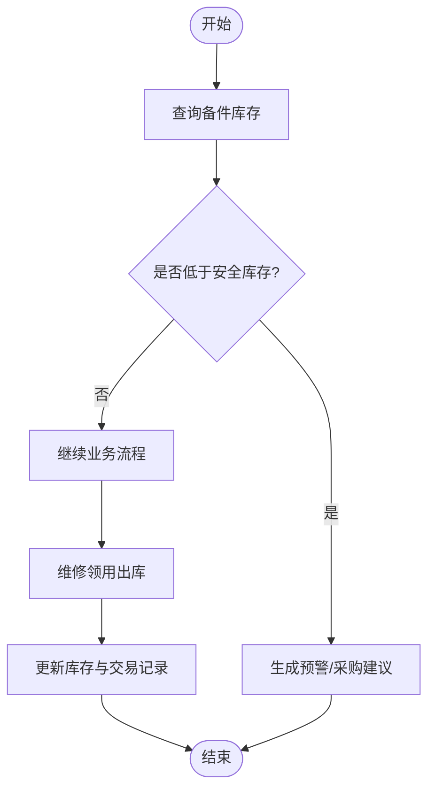
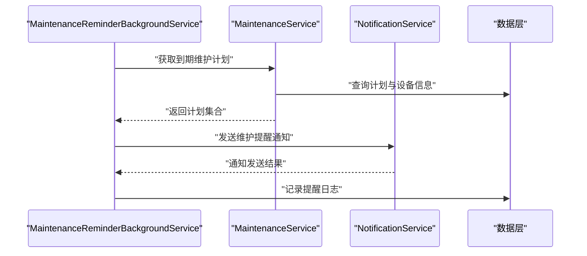
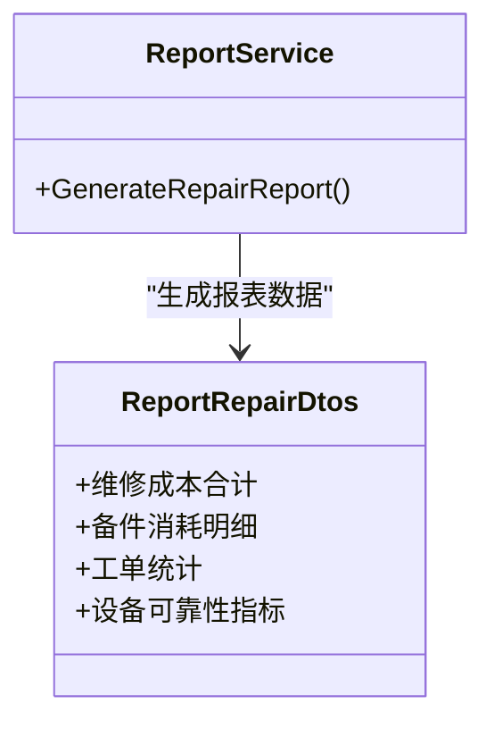
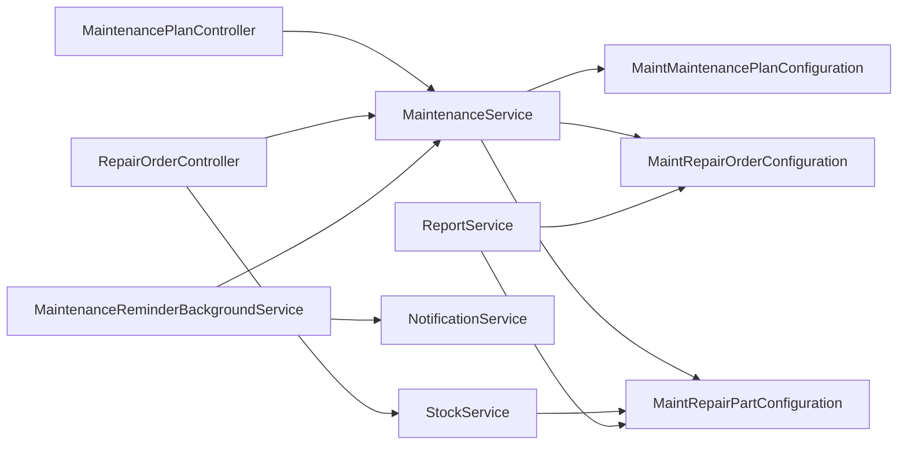

# 维护管理

<cite>
**本文引用的文件**   
- [MaintenanceService.cs](file://EquipmentIMS.BLL/Services/MaintenanceService.cs)
- [IMaintenanceService.cs](file://EquipmentIMS.BLL/Interfaces/IMaintenanceService.cs)
- [MaintenancePlanController.cs](file://EquipmentIMS.Web/Controllers/MaintenancePlanController.cs)
- [RepairOrderController.cs](file://EquipmentIMS.Web/Controllers/RepairOrderController.cs)
- [StockService.cs](file://EquipmentIMS.BLL/Services/StockService.cs)
- [IStockService.cs](file://EquipmentIMS.BLL/Interfaces/IStockService.cs)
- [NotificationService.cs](file://EquipmentIMS.BLL/Services/NotificationService.cs)
- [INotificationService.cs](file://EquipmentIMS.BLL/Interfaces/INotificationService.cs)
- [MaintenanceReminderBackgroundService.cs](file://EquipmentIMS.Web/BackgroundServices/MaintenanceReminderBackgroundService.cs)
- [ReportService.cs](file://EquipmentIMS.BLL/Services/ReportService.cs)
- [IReportService.cs](file://EquipmentIMS.BLL/Interfaces/IReportService.cs)
- [MaintMaintenancePlanConfiguration.cs](file://EquipmentIMS.DAL/Configurations/MaintMaintenancePlanConfiguration.cs)
- [MaintRepairOrderConfiguration.cs](file://EquipmentIMS.DAL/Configurations/MaintRepairOrderConfiguration.cs)
- [MaintRepairPartConfiguration.cs](file://EquipmentIMS.DAL/Configurations/MaintRepairPartConfiguration.cs)
- [MaintDeviceArchiveConfiguration.cs](file://EquipmentIMS.DAL/Configurations/MaintDeviceArchiveConfiguration.cs)
- [MaintMaintenancePlan.cs](file://EquipmentIMS.Models/Entities/MaintMaintenancePlan.cs)
- [MaintRepairOrder.cs](file://EquipmentIMS.Models/Entities/MaintRepairOrder.cs)
- [MaintRepairPart.cs](file://EquipmentIMS.Models/Entities/MaintRepairPart.cs)
- [MaintDeviceArchive.cs](file://EquipmentIMS.Models/Entities/MaintDeviceArchive.cs)
- [CycleType.cs](file://EquipmentIMS.Models/Enums/CycleType.cs)
- [RepairOrderStatus.cs](file://EquipmentIMS.Models/Enums/RepairOrderStatus.cs)
- [DeviceStatus.cs](file://EquipmentIMS.Models/Enums/DeviceStatus.cs)
- [MaintenancePlanDto.cs](file://EquipmentIMS.Models/DTOs/MaintenancePlanDto.cs)
- [MaintenancePlanListDto.cs](file://EquipmentIMS.Models/DTOs/MaintenancePlanListDto.cs)
- [RepairOrderDto.cs](file://EquipmentIMS.Models/DTOs/RepairOrderDto.cs)
- [RepairOrderListDto.cs](file://EquipmentIMS.Models/DTOs/RepairOrderListDto.cs)
- [RepairPartDto.cs](file://EquipmentIMS.Models/DTOs/RepairPartDto.cs)
- [ReportRepairDtos.cs](file://EquipmentIMS.Models/DTOs/Reports/ReportRepairDtos.cs)
- [GlobalExceptionMiddleware.cs](file://EquipmentIMS.Web/Filters/GlobalExceptionMiddleware.cs)
</cite>

## 目录
1. [简介](#简介)
2. [项目结构](#项目结构)
3. [核心组件](#核心组件)
4. [架构总览](#架构总览)
5. [详细组件分析](#详细组件分析)
6. [依赖关系分析](#依赖关系分析)
7. [性能考虑](#性能考虑)
8. [故障排查指南](#故障排查指南)
9. [结论](#结论)
10. [附录](#附录)

## 简介
本文件围绕“维护管理”模块，系统性阐述以下能力：
- 预防性维护计划：制定、执行与效果评估
- 维修工单：创建、分配、执行与验收全流程
- 备件管理：需求预测、库存管理与使用追踪
- 成本与可靠性：维护成本分析、设备可靠性统计与维护效率评估
- 提醒机制：维护提醒、告警与通知
- 诊断辅助与知识库：故障诊断辅助与知识沉淀（概念性说明）

该模块基于分层架构（Web/BLL/DAL/Models），通过控制器暴露接口，服务层封装业务逻辑，仓储与实体配置完成数据持久化。

## 项目结构
维护管理相关代码分布在如下层次：
- Web 层：控制器与后台任务
- BLL 层：维护、库存、报表、通知等服务
- DAL 层：实体配置与数据库映射
- Models 层：实体、枚举、DTO

图表来源
- [MaintenancePlanController.cs](file://EquipmentIMS.Web/Controllers/MaintenancePlanController.cs)
- [RepairOrderController.cs](file://EquipmentIMS.Web/Controllers/RepairOrderController.cs)
- [MaintenanceService.cs](file://EquipmentIMS.BLL/Services/MaintenanceService.cs)
- [StockService.cs](file://EquipmentIMS.BLL/Services/StockService.cs)
- [ReportService.cs](file://EquipmentIMS.BLL/Services/ReportService.cs)
- [NotificationService.cs](file://EquipmentIMS.BLL/Services/NotificationService.cs)
- [MaintenanceReminderBackgroundService.cs](file://EquipmentIMS.Web/BackgroundServices/MaintenanceReminderBackgroundService.cs)
- [MaintMaintenancePlanConfiguration.cs](file://EquipmentIMS.DAL/Configurations/MaintMaintenancePlanConfiguration.cs)
- [MaintRepairOrderConfiguration.cs](file://EquipmentIMS.DAL/Configurations/MaintRepairOrderConfiguration.cs)
- [MaintRepairPartConfiguration.cs](file://EquipmentIMS.DAL/Configurations/MaintRepairPartConfiguration.cs)
- [MaintDeviceArchiveConfiguration.cs](file://EquipmentIMS.DAL/Configurations/MaintDeviceArchiveConfiguration.cs)
- [MaintMaintenancePlan.cs](file://EquipmentIMS.Models/Entities/MaintMaintenancePlan.cs)
- [MaintRepairOrder.cs](file://EquipmentIMS.Models/Entities/MaintRepairOrder.cs)
- [MaintRepairPart.cs](file://EquipmentIMS.Models/Entities/MaintRepairPart.cs)
- [MaintDeviceArchive.cs](file://EquipmentIMS.Models/Entities/MaintDeviceArchive.cs)
- [CycleType.cs](file://EquipmentIMS.Models/Enums/CycleType.cs)
- [RepairOrderStatus.cs](file://EquipmentIMS.Models/Enums/RepairOrderStatus.cs)
- [DeviceStatus.cs](file://EquipmentIMS.Models/Enums/DeviceStatus.cs)
- [MaintenancePlanDto.cs](file://EquipmentIMS.Models/DTOs/MaintenancePlanDto.cs)
- [MaintenancePlanListDto.cs](file://EquipmentIMS.Models/DTOs/MaintenancePlanListDto.cs)
- [RepairOrderDto.cs](file://EquipmentIMS.Models/DTOs/RepairOrderDto.cs)
- [RepairOrderListDto.cs](file://EquipmentIMS.Models/DTOs/RepairOrderListDto.cs)
- [RepairPartDto.cs](file://EquipmentIMS.Models/DTOs/RepairPartDto.cs)
- [ReportRepairDtos.cs](file://EquipmentIMS.Models/DTOs/Reports/ReportRepairDtos.cs)

章节来源
- [MaintenancePlanController.cs](file://EquipmentIMS.Web/Controllers/MaintenancePlanController.cs)
- [RepairOrderController.cs](file://EquipmentIMS.Web/Controllers/RepairOrderController.cs)
- [MaintenanceService.cs](file://EquipmentIMS.BLL/Services/MaintenanceService.cs)
- [StockService.cs](file://EquipmentIMS.BLL/Services/StockService.cs)
- [ReportService.cs](file://EquipmentIMS.BLL/Services/ReportService.cs)
- [NotificationService.cs](file://EquipmentIMS.BLL/Services/NotificationService.cs)
- [MaintenanceReminderBackgroundService.cs](file://EquipmentIMS.Web/BackgroundServices/MaintenanceReminderBackgroundService.cs)
- [MaintMaintenancePlanConfiguration.cs](file://EquipmentIMS.DAL/Configurations/MaintMaintenancePlanConfiguration.cs)
- [MaintRepairOrderConfiguration.cs](file://EquipmentIMS.DAL/Configurations/MaintRepairOrderConfiguration.cs)
- [MaintRepairPartConfiguration.cs](file://EquipmentIMS.DAL/Configurations/MaintRepairPartConfiguration.cs)
- [MaintDeviceArchiveConfiguration.cs](file://EquipmentIMS.DAL/Configurations/MaintDeviceArchiveConfiguration.cs)
- [MaintMaintenancePlan.cs](file://EquipmentIMS.Models/Entities/MaintMaintenancePlan.cs)
- [MaintRepairOrder.cs](file://EquipmentIMS.Models/Entities/MaintRepairOrder.cs)
- [MaintRepairPart.cs](file://EquipmentIMS.Models/Entities/MaintRepairPart.cs)
- [MaintDeviceArchive.cs](file://EquipmentIMS.Models/Entities/MaintDeviceArchive.cs)
- [CycleType.cs](file://EquipmentIMS.Models/Enums/CycleType.cs)
- [RepairOrderStatus.cs](file://EquipmentIMS.Models/Enums/RepairOrderStatus.cs)
- [DeviceStatus.cs](file://EquipmentIMS.Models/Enums/DeviceStatus.cs)
- [MaintenancePlanDto.cs](file://EquipmentIMS.Models/DTOs/MaintenancePlanDto.cs)
- [MaintenancePlanListDto.cs](file://EquipmentIMS.Models/DTOs/MaintenancePlanListDto.cs)
- [RepairOrderDto.cs](file://EquipmentIMS.Models/DTOs/RepairOrderDto.cs)
- [RepairOrderListDto.cs](file://EquipmentIMS.Models/DTOs/RepairOrderListDto.cs)
- [RepairPartDto.cs](file://EquipmentIMS.Models/DTOs/RepairPartDto.cs)
- [ReportRepairDtos.cs](file://EquipmentIMS.Models/DTOs/Reports/ReportRepairDtos.cs)

## 核心组件
- 维护计划服务：负责维护计划的增删改查、周期计算、任务生成与状态跟踪。
- 维修工单服务：负责工单的创建、派发、执行、验收与关闭，以及与备件的关联扣减。
- 库存服务：提供备件库存查询、出入库事务处理、安全库存预警等能力。
- 通知服务：统一发送系统通知，支撑维护提醒与异常告警。
- 报表服务：汇总维修成本、停机时长、备件消耗等指标，输出报表 DTO。
- 后台提醒服务：定时扫描即将到期的维护计划，触发通知或自动派单。

章节来源
- [IMaintenanceService.cs](file://EquipmentIMS.BLL/Interfaces/IMaintenanceService.cs)
- [MaintenanceService.cs](file://EquipmentIMS.BLL/Services/MaintenanceService.cs)
- [IStockService.cs](file://EquipmentIMS.BLL/Interfaces/IStockService.cs)
- [StockService.cs](file://EquipmentIMS.BLL/Services/StockService.cs)
- [INotificationService.cs](file://EquipmentIMS.BLL/Interfaces/INotificationService.cs)
- [NotificationService.cs](file://EquipmentIMS.BLL/Services/NotificationService.cs)
- [IReportService.cs](file://EquipmentIMS.BLL/Interfaces/IReportService.cs)
- [ReportService.cs](file://EquipmentIMS.BLL/Services/ReportService.cs)
- [MaintenanceReminderBackgroundService.cs](file://EquipmentIMS.Web/BackgroundServices/MaintenanceReminderBackgroundService.cs)

## 架构总览
维护管理采用典型分层架构：
- Web 层控制器接收请求，调用服务层
- 服务层编排业务逻辑，协调库存、通知、报表等子域
- DAL 层通过实体配置将领域模型映射至数据库
- Models 层定义实体、枚举与 DTO，贯穿各层

图表来源
- [MaintenancePlanController.cs](file://EquipmentIMS.Web/Controllers/MaintenancePlanController.cs)
- [RepairOrderController.cs](file://EquipmentIMS.Web/Controllers/RepairOrderController.cs)
- [MaintenanceService.cs](file://EquipmentIMS.BLL/Services/MaintenanceService.cs)
- [NotificationService.cs](file://EquipmentIMS.BLL/Services/NotificationService.cs)
- [MaintenanceReminderBackgroundService.cs](file://EquipmentIMS.Web/BackgroundServices/MaintenanceReminderBackgroundService.cs)
- [MaintMaintenancePlanConfiguration.cs](file://EquipmentIMS.DAL/Configurations/MaintMaintenancePlanConfiguration.cs)
- [MaintRepairOrderConfiguration.cs](file://EquipmentIMS.DAL/Configurations/MaintRepairOrderConfiguration.cs)

## 详细组件分析

### 维护计划（预防性维护）
- 功能要点
  - 计划制定：支持按设备、周期类型（如日/周/月/年）、下次执行时间等维度创建计划
  - 计划执行：后台任务扫描到期计划，自动生成待执行任务并推送提醒
  - 效果评估：结合维修工单与设备状态，统计计划完成率、重复故障率、平均修复时间等
- 关键流程
  - 创建/编辑/删除维护计划
  - 周期计算与下次执行时间更新
  - 到期触发通知或自动派单
  - 关联设备档案与历史维修记录
- 数据模型与配置
  - 实体：维护计划、设备档案
  - 配置：维护计划配置、设备档案配置
  - DTO：维护计划列表与详情 DTO

图表来源
- [MaintMaintenancePlan.cs](file://EquipmentIMS.Models/Entities/MaintMaintenancePlan.cs)
- [MaintDeviceArchive.cs](file://EquipmentIMS.Models/Entities/MaintDeviceArchive.cs)
- [MaintMaintenancePlanConfiguration.cs](file://EquipmentIMS.DAL/Configurations/MaintMaintenancePlanConfiguration.cs)
- [MaintDeviceArchiveConfiguration.cs](file://EquipmentIMS.DAL/Configurations/MaintDeviceArchiveConfiguration.cs)
- [MaintenancePlanDto.cs](file://EquipmentIMS.Models/DTOs/MaintenancePlanDto.cs)
- [MaintenancePlanListDto.cs](file://EquipmentIMS.Models/DTOs/MaintenancePlanListDto.cs)

章节来源
- [MaintenancePlanController.cs](file://EquipmentIMS.Web/Controllers/MaintenancePlanController.cs)
- [MaintenanceService.cs](file://EquipmentIMS.BLL/Services/MaintenanceService.cs)
- [MaintMaintenancePlanConfiguration.cs](file://EquipmentIMS.DAL/Configurations/MaintMaintenancePlanConfiguration.cs)
- [MaintDeviceArchiveConfiguration.cs](file://EquipmentIMS.DAL/Configurations/MaintDeviceArchiveConfiguration.cs)
- [MaintMaintenancePlan.cs](file://EquipmentIMS.Models/Entities/MaintMaintenancePlan.cs)
- [MaintDeviceArchive.cs](file://EquipmentIMS.Models/Entities/MaintDeviceArchive.cs)
- [MaintenancePlanDto.cs](file://EquipmentIMS.Models/DTOs/MaintenancePlanDto.cs)
- [MaintenancePlanListDto.cs](file://EquipmentIMS.Models/DTOs/MaintenancePlanListDto.cs)
- [CycleType.cs](file://EquipmentIMS.Models/Enums/CycleType.cs)

### 维修工单（创建-分配-执行-验收）
- 功能要点
  - 工单生命周期：新建→派发→执行中→验收→关闭
  - 工单与备件关联：记录更换的备件及数量，联动库存扣减
  - 工单与设备状态联动：根据维修结果更新设备状态
- 关键流程
  - 创建工单（可来源于计划或报修）
  - 指派维修人员/班组
  - 执行过程中登记工时、费用、备件
  - 验收通过后关闭工单并归档
- 数据模型与配置
  - 实体：维修工单、维修备件
  - 配置：维修工单配置、维修备件配置
  - DTO：工单详情与列表 DTO

图表来源
- [RepairOrderController.cs](file://EquipmentIMS.Web/Controllers/RepairOrderController.cs)
- [MaintenanceService.cs](file://EquipmentIMS.BLL/Services/MaintenanceService.cs)
- [StockService.cs](file://EquipmentIMS.BLL/Services/StockService.cs)
- [MaintRepairOrderConfiguration.cs](file://EquipmentIMS.DAL/Configurations/MaintRepairOrderConfiguration.cs)
- [MaintRepairPartConfiguration.cs](file://EquipmentIMS.DAL/Configurations/MaintRepairPartConfiguration.cs)
- [MaintRepairOrder.cs](file://EquipmentIMS.Models/Entities/MaintRepairOrder.cs)
- [MaintRepairPart.cs](file://EquipmentIMS.Models/Entities/MaintRepairPart.cs)
- [RepairOrderDto.cs](file://EquipmentIMS.Models/DTOs/RepairOrderDto.cs)
- [RepairOrderListDto.cs](file://EquipmentIMS.Models/DTOs/RepairOrderListDto.cs)
- [RepairPartDto.cs](file://EquipmentIMS.Models/DTOs/RepairPartDto.cs)
- [RepairOrderStatus.cs](file://EquipmentIMS.Models/Enums/RepairOrderStatus.cs)

章节来源
- [RepairOrderController.cs](file://EquipmentIMS.Web/Controllers/RepairOrderController.cs)
- [MaintenanceService.cs](file://EquipmentIMS.BLL/Services/MaintenanceService.cs)
- [StockService.cs](file://EquipmentIMS.BLL/Services/StockService.cs)
- [MaintRepairOrderConfiguration.cs](file://EquipmentIMS.DAL/Configurations/MaintRepairOrderConfiguration.cs)
- [MaintRepairPartConfiguration.cs](file://EquipmentIMS.DAL/Configurations/MaintRepairPartConfiguration.cs)
- [MaintRepairOrder.cs](file://EquipmentIMS.Models/Entities/MaintRepairOrder.cs)
- [MaintRepairPart.cs](file://EquipmentIMS.Models/Entities/MaintRepairPart.cs)
- [RepairOrderDto.cs](file://EquipmentIMS.Models/DTOs/RepairOrderDto.cs)
- [RepairOrderListDto.cs](file://EquipmentIMS.Models/DTOs/RepairOrderListDto.cs)
- [RepairPartDto.cs](file://EquipmentIMS.Models/DTOs/RepairPartDto.cs)
- [RepairOrderStatus.cs](file://EquipmentIMS.Models/Enums/RepairOrderStatus.cs)

### 备件管理（需求预测、库存管理、使用追踪）
- 功能要点
  - 需求预测：基于历史维修频次、备件消耗趋势与安全库存阈值进行补货建议
  - 库存管理：入库、出库、调拨、盘点；支持批次与有效期管理（概念性扩展）
  - 使用追踪：与维修工单绑定，形成备件消耗台账
- 关键流程
  - 查询库存与预警
  - 创建出库单（维修领用）
  - 生成采购建议（低库存/周转慢）
- 数据模型与配置
  - 实体：库存交易、库存快照（由库存服务管理）
  - 配置：库存交易配置、库存预警配置
  - DTO：库存列表、交易记录 DTO

图表来源
- [StockService.cs](file://EquipmentIMS.BLL/Services/StockService.cs)
- [IStockService.cs](file://EquipmentIMS.BLL/Interfaces/IStockService.cs)
- [MaintRepairPartConfiguration.cs](file://EquipmentIMS.DAL/Configurations/MaintRepairPartConfiguration.cs)

章节来源
- [StockService.cs](file://EquipmentIMS.BLL/Services/StockService.cs)
- [IStockService.cs](file://EquipmentIMS.BLL/Interfaces/IStockService.cs)
- [MaintRepairPartConfiguration.cs](file://EquipmentIMS.DAL/Configurations/MaintRepairPartConfiguration.cs)

### 维护提醒机制
- 功能要点
  - 定时扫描到期维护计划
  - 生成系统通知并推送给相关人员
  - 可选：自动创建待执行工单
- 关键流程
  - 后台任务周期性执行
  - 筛选即将到期/已超期的计划
  - 调用通知服务发送消息
  - 记录提醒日志

图表来源
- [MaintenanceReminderBackgroundService.cs](file://EquipmentIMS.Web/BackgroundServices/MaintenanceReminderBackgroundService.cs)
- [MaintenanceService.cs](file://EquipmentIMS.BLL/Services/MaintenanceService.cs)
- [NotificationService.cs](file://EquipmentIMS.BLL/Services/NotificationService.cs)
- [MaintMaintenancePlanConfiguration.cs](file://EquipmentIMS.DAL/Configurations/MaintMaintenancePlanConfiguration.cs)

章节来源
- [MaintenanceReminderBackgroundService.cs](file://EquipmentIMS.Web/BackgroundServices/MaintenanceReminderBackgroundService.cs)
- [NotificationService.cs](file://EquipmentIMS.BLL/Services/NotificationService.cs)
- [INotificationService.cs](file://EquipmentIMS.BLL/Interfaces/INotificationService.cs)
- [MaintMaintenancePlanConfiguration.cs](file://EquipmentIMS.DAL/Configurations/MaintMaintenancePlanConfiguration.cs)

### 维护成本分析与设备可靠性统计
- 功能要点
  - 维护成本：人工、备件、外包费用汇总
  - 设备可靠性：MTBF（平均无故障时间）、故障次数、重复故障率
  - 维护效率：工单按时关闭率、平均修复时长、计划完成率
- 数据来源
  - 维修工单、维修备件、库存交易、设备状态
- 输出形式
  - 报表 DTO 聚合数据，供前端图表展示

图表来源
- [ReportService.cs](file://EquipmentIMS.BLL/Services/ReportService.cs)
- [IReportService.cs](file://EquipmentIMS.BLL/Interfaces/IReportService.cs)
- [ReportRepairDtos.cs](file://EquipmentIMS.Models/DTOs/Reports/ReportRepairDtos.cs)
- [MaintRepairOrderConfiguration.cs](file://EquipmentIMS.DAL/Configurations/MaintRepairOrderConfiguration.cs)
- [MaintRepairPartConfiguration.cs](file://EquipmentIMS.DAL/Configurations/MaintRepairPartConfiguration.cs)

章节来源
- [ReportService.cs](file://EquipmentIMS.BLL/Services/ReportService.cs)
- [IReportService.cs](file://EquipmentIMS.BLL/Interfaces/IReportService.cs)
- [ReportRepairDtos.cs](file://EquipmentIMS.Models/DTOs/Reports/ReportRepairDtos.cs)
- [MaintRepairOrderConfiguration.cs](file://EquipmentIMS.DAL/Configurations/MaintRepairOrderConfiguration.cs)
- [MaintRepairPartConfiguration.cs](file://EquipmentIMS.DAL/Configurations/MaintRepairPartConfiguration.cs)

### 故障诊断辅助与知识库（概念性说明）
- 故障诊断辅助
  - 基于历史工单与备件使用模式，推荐常见故障原因与处置步骤
  - 结合设备运行参数与报警事件，给出初步定位建议
- 知识库管理
  - 沉淀标准作业指导书、常见问题解答、案例复盘
  - 与工单关联，提升一线维修效率与质量

[本节为概念性内容，不直接分析具体文件]

## 依赖关系分析
- 控制器依赖服务层：维护计划与维修工单控制器分别依赖维护服务与库存服务
- 服务层依赖数据层：通过实体配置访问数据库
- 后台任务依赖通知与服务：定时触发提醒与派单
- 报表服务依赖多实体：聚合维修与库存数据

图表来源
- [MaintenancePlanController.cs](file://EquipmentIMS.Web/Controllers/MaintenancePlanController.cs)
- [RepairOrderController.cs](file://EquipmentIMS.Web/Controllers/RepairOrderController.cs)
- [MaintenanceService.cs](file://EquipmentIMS.BLL/Services/MaintenanceService.cs)
- [StockService.cs](file://EquipmentIMS.BLL/Services/StockService.cs)
- [NotificationService.cs](file://EquipmentIMS.BLL/Services/NotificationService.cs)
- [MaintenanceReminderBackgroundService.cs](file://EquipmentIMS.Web/BackgroundServices/MaintenanceReminderBackgroundService.cs)
- [ReportService.cs](file://EquipmentIMS.BLL/Services/ReportService.cs)
- [MaintMaintenancePlanConfiguration.cs](file://EquipmentIMS.DAL/Configurations/MaintMaintenancePlanConfiguration.cs)
- [MaintRepairOrderConfiguration.cs](file://EquipmentIMS.DAL/Configurations/MaintRepairOrderConfiguration.cs)
- [MaintRepairPartConfiguration.cs](file://EquipmentIMS.DAL/Configurations/MaintRepairPartConfiguration.cs)

章节来源
- [MaintenancePlanController.cs](file://EquipmentIMS.Web/Controllers/MaintenancePlanController.cs)
- [RepairOrderController.cs](file://EquipmentIMS.Web/Controllers/RepairOrderController.cs)
- [MaintenanceService.cs](file://EquipmentIMS.BLL/Services/MaintenanceService.cs)
- [StockService.cs](file://EquipmentIMS.BLL/Services/StockService.cs)
- [NotificationService.cs](file://EquipmentIMS.BLL/Services/NotificationService.cs)
- [MaintenanceReminderBackgroundService.cs](file://EquipmentIMS.Web/BackgroundServices/MaintenanceReminderBackgroundService.cs)
- [ReportService.cs](file://EquipmentIMS.BLL/Services/ReportService.cs)
- [MaintMaintenancePlanConfiguration.cs](file://EquipmentIMS.DAL/Configurations/MaintMaintenancePlanConfiguration.cs)
- [MaintRepairOrderConfiguration.cs](file://EquipmentIMS.DAL/Configurations/MaintRepairOrderConfiguration.cs)
- [MaintRepairPartConfiguration.cs](file://EquipmentIMS.DAL/Configurations/MaintRepairPartConfiguration.cs)

## 性能考虑
- 批量操作：对大批量维护计划生成与库存扣减建议使用批处理与事务边界控制
- 索引优化：在设备ID、计划周期类型、工单状态等常用查询字段建立索引
- 分页与过滤：列表查询应支持分页与条件过滤，避免全表扫描
- 异步处理：通知发送与报表导出可采用后台任务队列，降低请求延迟
- 缓存策略：对静态字典与热点配置进行缓存，减少数据库压力

[本节提供通用指导，不直接分析具体文件]

## 故障排查指南
- 全局异常中间件
  - 捕获未处理异常，统一返回错误码与消息，便于前端提示与日志采集
- 常见错误场景
  - 库存不足导致备件扣减失败：检查库存事务与并发锁
  - 通知发送失败：检查通知服务配置与重试策略
  - 计划到期未触发：检查后台任务调度与时间窗口设置
- 日志与审计
  - 结合操作日志与系统配置，快速定位问题根因

章节来源
- [GlobalExceptionMiddleware.cs](file://EquipmentIMS.Web/Filters/GlobalExceptionMiddleware.cs)

## 结论
维护管理模块以维护计划为核心，串联维修工单与备件管理，辅以提醒机制与报表分析，形成闭环的运维管理体系。通过分层架构与清晰的职责划分，系统具备良好的可扩展性与可维护性。建议在后续迭代中持续完善设备可靠性指标、知识库与智能诊断能力，进一步提升维护效率与设备可用性。

## 附录
- 术语说明
  - MTBF：平均无故障时间
  - 安全库存：为避免缺货而设置的最低库存水平
  - 工单生命周期：从创建到关闭的状态流转过程

[本节为补充说明，不直接分析具体文件]