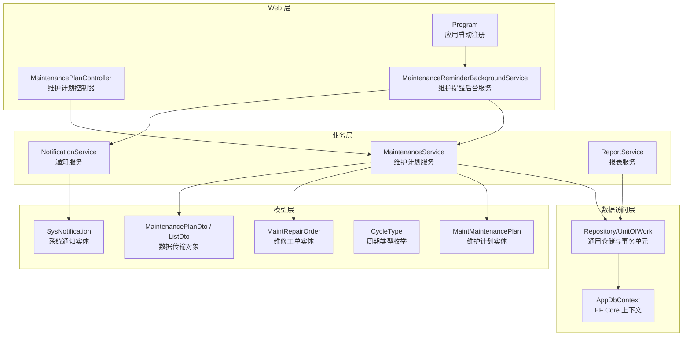
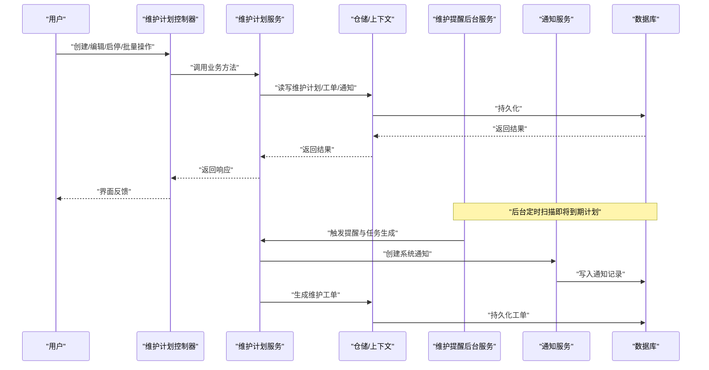
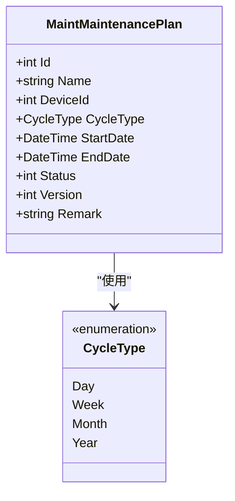
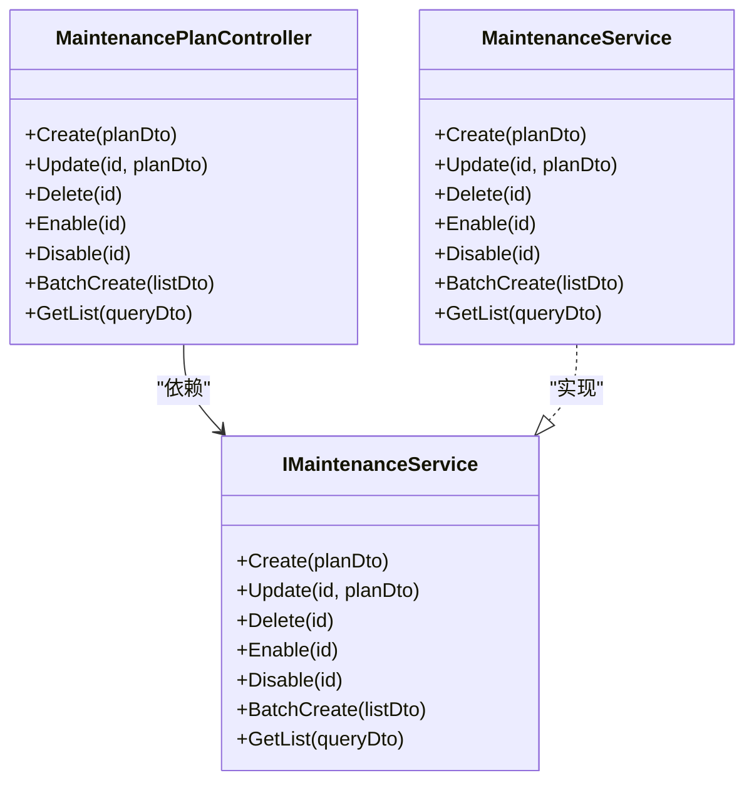
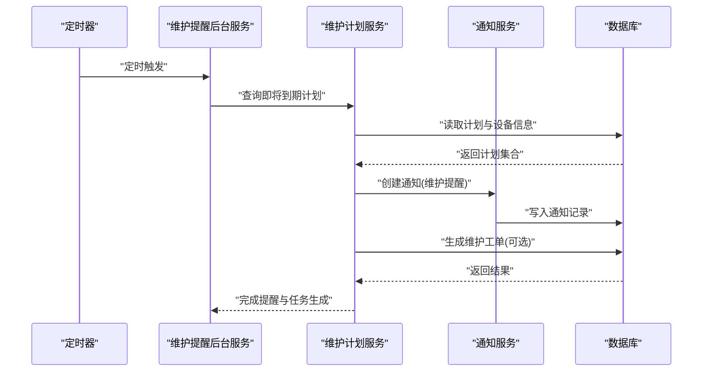
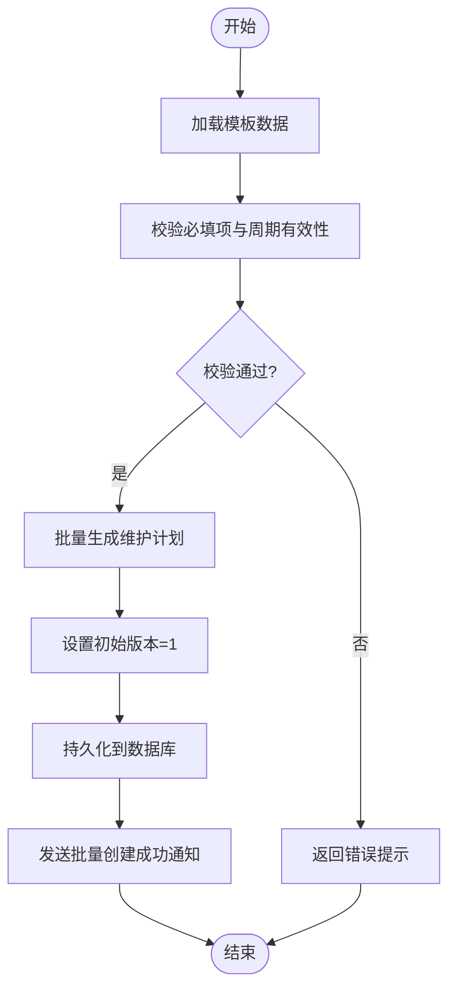
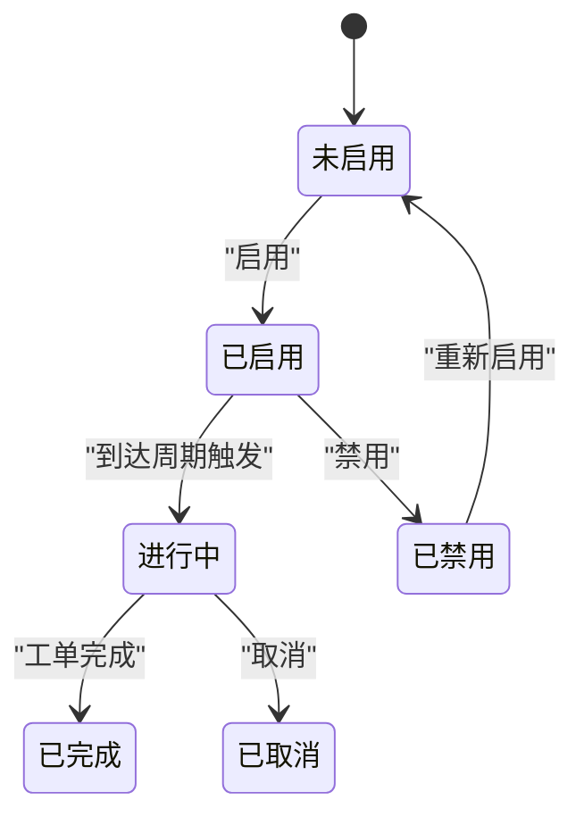
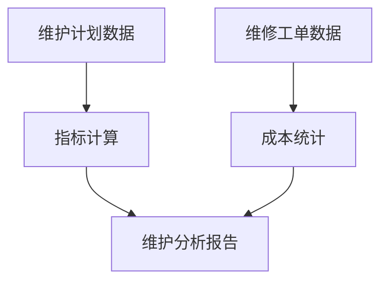
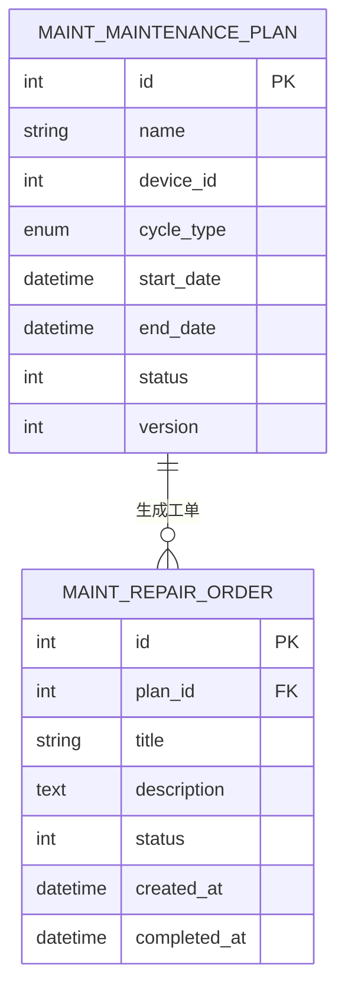
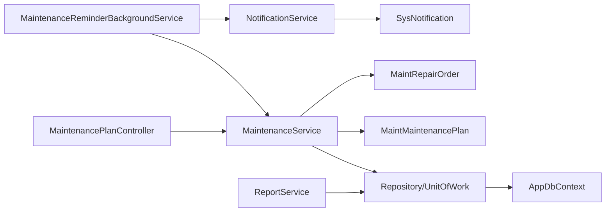

# 维护计划管理

<cite>
**本文引用的文件**   
- [MaintenancePlanController.cs](file://EquipmentIMS.Web/Controllers/MaintenancePlanController.cs)
- [MaintenanceService.cs](file://EquipmentIMS.BLL/Services/MaintenanceService.cs)
- [IMaintenanceService.cs](file://EquipmentIMS.BLL/Interfaces/IMaintenanceService.cs)
- [MaintMaintenancePlanConfiguration.cs](file://EquipmentIMS.DAL/Configurations/MaintMaintenancePlanConfiguration.cs)
- [MaintMaintenancePlan.cs](file://EquipmentIMS.Models/Entities/MaintMaintenancePlan.cs)
- [CycleType.cs](file://EquipmentIMS.Models/Enums/CycleType.cs)
- [MaintenancePlanDto.cs](file://EquipmentIMS.Models/DTOs/MaintenancePlanDto.cs)
- [MaintenancePlanListDto.cs](file://EquipmentIMS.Models/DTOs/MaintenancePlanListDto.cs)
- [MaintenanceReminderBackgroundService.cs](file://EquipmentIMS.Web/BackgroundServices/MaintenanceReminderBackgroundService.cs)
- [NotificationService.cs](file://EquipmentIMS.BLL/Services/NotificationService.cs)
- [INotificationService.cs](file://EquipmentIMS.BLL/Interfaces/INotificationService.cs)
- [SysNotification.cs](file://EquipmentIMS.Models/Entities/SysNotification.cs)
- [NotificationType.cs](file://EquipmentIMS.Models/Enums/NotificationType.cs)
- [RepairOrderDto.cs](file://EquipmentIMS.Models/DTOs/RepairOrderDto.cs)
- [MaintRepairOrderConfiguration.cs](file://EquipmentIMS.DAL/Configurations/MaintRepairOrderConfiguration.cs)
- [MaintRepairOrder.cs](file://EquipmentIMS.Models/Entities/MaintRepairOrder.cs)
- [ReportService.cs](file://EquipmentIMS.BLL/Services/ReportService.cs)
- [IReportService.cs](file://EquipmentIMS.BLL/Interfaces/IReportService.cs)
- [Program.cs](file://EquipmentIMS.Web/Program.cs)
</cite>

## 目录
1. [简介](#简介)
2. [项目结构](#项目结构)
3. [核心组件](#核心组件)
4. [架构总览](#架构总览)
5. [详细组件分析](#详细组件分析)
6. [依赖分析](#依赖分析)
7. [性能考虑](#性能考虑)
8. [故障排查指南](#故障排查指南)
9. [结论](#结论)
10. [附录](#附录)

## 简介
本技术文档围绕“维护计划管理”功能，系统性阐述预防性维护计划的制定、配置与执行机制。内容覆盖：
- 维护周期设置（日/周/月/年）
- 维护任务定义与分配策略
- 维护提醒系统（定时调度、通知推送、提醒机制）
- 模板管理、批量创建与版本控制
- 执行状态跟踪、完成记录与历史查询
- 效果评估指标、成本统计与分析报表
- 与维护工单的关联关系与数据流转

## 项目结构
维护计划管理在分层架构中分布于以下层次：
- Web 层：控制器与后台服务
- 业务层：领域服务与通知服务
- 数据访问层：实体与映射配置
- 模型层：实体、枚举、DTO

图表来源
- [MaintenancePlanController.cs](file://EquipmentIMS.Web/Controllers/MaintenancePlanController.cs)
- [MaintenanceReminderBackgroundService.cs](file://EquipmentIMS.Web/BackgroundServices/MaintenanceReminderBackgroundService.cs)
- [Program.cs](file://EquipmentIMS.Web/Program.cs)
- [MaintenanceService.cs](file://EquipmentIMS.BLL/Services/MaintenanceService.cs)
- [NotificationService.cs](file://EquipmentIMS.BLL/Services/NotificationService.cs)
- [ReportService.cs](file://EquipmentIMS.BLL/Services/ReportService.cs)
- [MaintMaintenancePlan.cs](file://EquipmentIMS.Models/Entities/MaintMaintenancePlan.cs)
- [SysNotification.cs](file://EquipmentIMS.Models/Entities/SysNotification.cs)
- [MaintRepairOrder.cs](file://EquipmentIMS.Models/Entities/MaintRepairOrder.cs)
- [CycleType.cs](file://EquipmentIMS.Models/Enums/CycleType.cs)
- [MaintenancePlanDto.cs](file://EquipmentIMS.Models/DTOs/MaintenancePlanDto.cs)
- [MaintenancePlanListDto.cs](file://EquipmentIMS.Models/DTOs/MaintenancePlanListDto.cs)

章节来源
- [MaintenancePlanController.cs](file://EquipmentIMS.Web/Controllers/MaintenancePlanController.cs)
- [MaintenanceService.cs](file://EquipmentIMS.BLL/Services/MaintenanceService.cs)
- [IMaintenanceService.cs](file://EquipmentIMS.BLL/Interfaces/IMaintenanceService.cs)
- [MaintMaintenancePlanConfiguration.cs](file://EquipmentIMS.DAL/Configurations/MaintMaintenancePlanConfiguration.cs)
- [MaintMaintenancePlan.cs](file://EquipmentIMS.Models/Entities/MaintMaintenancePlan.cs)
- [CycleType.cs](file://EquipmentIMS.Models/Enums/CycleType.cs)
- [MaintenancePlanDto.cs](file://EquipmentIMS.Models/DTOs/MaintenancePlanDto.cs)
- [MaintenancePlanListDto.cs](file://EquipmentIMS.Models/DTOs/MaintenancePlanListDto.cs)
- [MaintenanceReminderBackgroundService.cs](file://EquipmentIMS.Web/BackgroundServices/MaintenanceReminderBackgroundService.cs)
- [NotificationService.cs](file://EquipmentIMS.BLL/Services/NotificationService.cs)
- [INotificationService.cs](file://EquipmentIMS.BLL/Interfaces/INotificationService.cs)
- [SysNotification.cs](file://EquipmentIMS.Models/Entities/SysNotification.cs)
- [NotificationType.cs](file://EquipmentIMS.Models/Enums/NotificationType.cs)
- [RepairOrderDto.cs](file://EquipmentIMS.Models/DTOs/RepairOrderDto.cs)
- [MaintRepairOrderConfiguration.cs](file://EquipmentIMS.DAL/Configurations/MaintRepairOrderConfiguration.cs)
- [MaintRepairOrder.cs](file://EquipmentIMS.Models/Entities/MaintRepairOrder.cs)
- [ReportService.cs](file://EquipmentIMS.BLL/Services/ReportService.cs)
- [IReportService.cs](file://EquipmentIMS.BLL/Interfaces/IReportService.cs)
- [Program.cs](file://EquipmentIMS.Web/Program.cs)

## 核心组件
- 控制器层
  - 维护计划控制器提供维护计划的增删改查、启停、批量操作等接口能力，负责接收请求、参数校验、调用服务层并返回结果。
- 业务服务层
  - 维护计划服务封装维护计划的核心业务逻辑，包括周期计算、任务生成、状态流转、与工单联动、报表数据聚合等。
  - 通知服务负责将维护提醒写入系统通知表，并提供统一的通知推送能力。
  - 报表服务提供维护相关的统计与报表数据。
- 后台服务
  - 维护提醒后台服务按固定间隔扫描即将到期的维护计划，触发提醒与任务生成流程。
- 数据模型与映射
  - 维护计划实体与配置定义了周期类型、计划起止时间、状态、版本等字段及数据库映射。
  - 维修工单实体用于承载由维护计划生成的具体执行任务。
  - 系统通知实体承载提醒消息。
- 枚举与 DTO
  - 周期类型枚举支持日/周/月/年等常见周期。
  - DTO 用于前后端数据传输与分页展示。

章节来源
- [MaintenancePlanController.cs](file://EquipmentIMS.Web/Controllers/MaintenancePlanController.cs)
- [MaintenanceService.cs](file://EquipmentIMS.BLL/Services/MaintenanceService.cs)
- [IMaintenanceService.cs](file://EquipmentIMS.BLL/Interfaces/IMaintenanceService.cs)
- [NotificationService.cs](file://EquipmentIMS.BLL/Services/NotificationService.cs)
- [INotificationService.cs](file://EquipmentIMS.BLL/Interfaces/INotificationService.cs)
- [ReportService.cs](file://EquipmentIMS.BLL/Services/ReportService.cs)
- [IReportService.cs](file://EquipmentIMS.BLL/Interfaces/IReportService.cs)
- [MaintMaintenancePlan.cs](file://EquipmentIMS.Models/Entities/MaintMaintenancePlan.cs)
- [MaintMaintenancePlanConfiguration.cs](file://EquipmentIMS.DAL/Configurations/MaintMaintenancePlanConfiguration.cs)
- [MaintRepairOrder.cs](file://EquipmentIMS.Models/Entities/MaintRepairOrder.cs)
- [MaintRepairOrderConfiguration.cs](file://EquipmentIMS.DAL/Configurations/MaintRepairOrderConfiguration.cs)
- [SysNotification.cs](file://EquipmentIMS.Models/Entities/SysNotification.cs)
- [CycleType.cs](file://EquipmentIMS.Models/Enums/CycleType.cs)
- [NotificationType.cs](file://EquipmentIMS.Models/Enums/NotificationType.cs)
- [MaintenancePlanDto.cs](file://EquipmentIMS.Models/DTOs/MaintenancePlanDto.cs)
- [MaintenancePlanListDto.cs](file://EquipmentIMS.Models/DTOs/MaintenancePlanListDto.cs)
- [RepairOrderDto.cs](file://EquipmentIMS.Models/DTOs/RepairOrderDto.cs)

## 架构总览
维护计划管理的整体架构遵循分层与职责分离原则：
- Web 层暴露 REST 接口与页面视图，处理用户交互与权限控制。
- 业务层实现领域规则、工作流编排与跨模块协作。
- 数据访问层通过通用仓储与 EF Core 上下文进行持久化。
- 后台服务以独立生命周期运行，负责周期性任务与提醒。

图表来源
- [MaintenancePlanController.cs](file://EquipmentIMS.Web/Controllers/MaintenancePlanController.cs)
- [MaintenanceService.cs](file://EquipmentIMS.BLL/Services/MaintenanceService.cs)
- [MaintenanceReminderBackgroundService.cs](file://EquipmentIMS.Web/BackgroundServices/MaintenanceReminderBackgroundService.cs)
- [NotificationService.cs](file://EquipmentIMS.BLL/Services/NotificationService.cs)
- [MaintMaintenancePlan.cs](file://EquipmentIMS.Models/Entities/MaintMaintenancePlan.cs)
- [MaintRepairOrder.cs](file://EquipmentIMS.Models/Entities/MaintRepairOrder.cs)
- [SysNotification.cs](file://EquipmentIMS.Models/Entities/SysNotification.cs)

## 详细组件分析

### 维护计划实体与周期类型
- 维护计划实体包含计划标识、设备关联、周期类型、开始/结束时间、状态、版本、备注等字段，并通过配置类映射到数据库表结构。
- 周期类型枚举支持日/周/月/年，便于灵活配置维护频率。

图表来源
- [MaintMaintenancePlan.cs](file://EquipmentIMS.Models/Entities/MaintMaintenancePlan.cs)
- [MaintMaintenancePlanConfiguration.cs](file://EquipmentIMS.DAL/Configurations/MaintMaintenancePlanConfiguration.cs)
- [CycleType.cs](file://EquipmentIMS.Models/Enums/CycleType.cs)

章节来源
- [MaintMaintenancePlan.cs](file://EquipmentIMS.Models/Entities/MaintMaintenancePlan.cs)
- [MaintMaintenancePlanConfiguration.cs](file://EquipmentIMS.DAL/Configurations/MaintMaintenancePlanConfiguration.cs)
- [CycleType.cs](file://EquipmentIMS.Models/Enums/CycleType.cs)

### 维护计划控制器与服务契约
- 控制器提供维护计划的 CRUD、启停、批量创建、列表查询等接口，内部委托给维护计划服务。
- 服务契约定义了对外暴露的业务方法签名，确保控制器与服务解耦。

图表来源
- [MaintenancePlanController.cs](file://EquipmentIMS.Web/Controllers/MaintenancePlanController.cs)
- [IMaintenanceService.cs](file://EquipmentIMS.BLL/Interfaces/IMaintenanceService.cs)
- [MaintenanceService.cs](file://EquipmentIMS.BLL/Services/MaintenanceService.cs)

章节来源
- [MaintenancePlanController.cs](file://EquipmentIMS.Web/Controllers/MaintenancePlanController.cs)
- [IMaintenanceService.cs](file://EquipmentIMS.BLL/Interfaces/IMaintenanceService.cs)
- [MaintenanceService.cs](file://EquipmentIMS.BLL/Services/MaintenanceService.cs)

### 维护提醒后台服务与通知推送
- 后台服务按固定间隔扫描即将到期的维护计划，调用服务层生成提醒与任务。
- 通知服务将提醒写入系统通知实体，供前端展示与推送。

图表来源
- [MaintenanceReminderBackgroundService.cs](file://EquipmentIMS.Web/BackgroundServices/MaintenanceReminderBackgroundService.cs)
- [MaintenanceService.cs](file://EquipmentIMS.BLL/Services/MaintenanceService.cs)
- [NotificationService.cs](file://EquipmentIMS.BLL/Services/NotificationService.cs)
- [SysNotification.cs](file://EquipmentIMS.Models/Entities/SysNotification.cs)
- [MaintRepairOrder.cs](file://EquipmentIMS.Models/Entities/MaintRepairOrder.cs)

章节来源
- [MaintenanceReminderBackgroundService.cs](file://EquipmentIMS.Web/BackgroundServices/MaintenanceReminderBackgroundService.cs)
- [NotificationService.cs](file://EquipmentIMS.BLL/Services/NotificationService.cs)
- [INotificationService.cs](file://EquipmentIMS.BLL/Interfaces/INotificationService.cs)
- [SysNotification.cs](file://EquipmentIMS.Models/Entities/SysNotification.cs)
- [NotificationType.cs](file://EquipmentIMS.Models/Enums/NotificationType.cs)

### 维护计划模板管理与批量创建
- 模板管理：通过 DTO 抽象模板字段（如名称、周期类型、目标设备、任务清单、负责人等），支持保存为可复用模板。
- 批量创建：基于模板快速生成多条维护计划，减少重复配置工作量。
- 版本控制：维护计划实体包含版本号字段，每次更新递增版本，便于追溯变更历史。

章节来源
- [MaintenancePlanDto.cs](file://EquipmentIMS.Models/DTOs/MaintenancePlanDto.cs)
- [MaintenancePlanListDto.cs](file://EquipmentIMS.Models/DTOs/MaintenancePlanListDto.cs)
- [MaintMaintenancePlan.cs](file://EquipmentIMS.Models/Entities/MaintMaintenancePlan.cs)

### 维护执行状态跟踪与历史查询
- 状态跟踪：维护计划具备状态字段，支持启用/禁用、进行中、已完成等状态流转。
- 完成记录：当维护工单完成后，回写对应维护计划的完成时间与记录。
- 历史查询：通过列表 DTO 与分页能力，支持按设备、周期、状态、时间范围筛选查询。

章节来源
- [MaintMaintenancePlan.cs](file://EquipmentIMS.Models/Entities/MaintMaintenancePlan.cs)
- [MaintenancePlanListDto.cs](file://EquipmentIMS.Models/DTOs/MaintenancePlanListDto.cs)

### 维护效果评估指标、成本统计与分析报表
- 效果评估：通过完成率、按时率、平均修复时长、重复故障率等指标衡量维护质量。
- 成本统计：结合工单使用的备件、人工工时、外包费用等维度进行成本汇总。
- 分析报表：报表服务聚合维护计划与工单数据，输出多维度的统计报表。

章节来源
- [ReportService.cs](file://EquipmentIMS.BLL/Services/ReportService.cs)
- [IReportService.cs](file://EquipmentIMS.BLL/Interfaces/IReportService.cs)
- [RepairOrderDto.cs](file://EquipmentIMS.Models/DTOs/RepairOrderDto.cs)

### 与维护工单的关联关系与数据流转
- 关联关系：维护计划与维修工单存在一对多或一对一的关联，工单作为计划的具体执行载体。
- 数据流转：计划触发后生成工单；工单完成后回写计划完成状态与时间；必要时更新计划版本。

图表来源
- [MaintMaintenancePlan.cs](file://EquipmentIMS.Models/Entities/MaintMaintenancePlan.cs)
- [MaintRepairOrder.cs](file://EquipmentIMS.Models/Entities/MaintRepairOrder.cs)
- [MaintRepairOrderConfiguration.cs](file://EquipmentIMS.DAL/Configurations/MaintRepairOrderConfiguration.cs)

章节来源
- [MaintRepairOrder.cs](file://EquipmentIMS.Models/Entities/MaintRepairOrder.cs)
- [MaintRepairOrderConfiguration.cs](file://EquipmentIMS.DAL/Configurations/MaintRepairOrderConfiguration.cs)
- [RepairOrderDto.cs](file://EquipmentIMS.Models/DTOs/RepairOrderDto.cs)

## 依赖分析
- 控制器依赖服务契约，服务实现依赖仓储与上下文，后台服务依赖服务与通知服务。
- 模型层实体与枚举被上层广泛引用，构成稳定的数据结构基础。
- 报表服务依赖仓储与上下文，聚合维护与工单数据进行统计。

图表来源
- [MaintenancePlanController.cs](file://EquipmentIMS.Web/Controllers/MaintenancePlanController.cs)
- [MaintenanceService.cs](file://EquipmentIMS.BLL/Services/MaintenanceService.cs)
- [MaintenanceReminderBackgroundService.cs](file://EquipmentIMS.Web/BackgroundServices/MaintenanceReminderBackgroundService.cs)
- [NotificationService.cs](file://EquipmentIMS.BLL/Services/NotificationService.cs)
- [ReportService.cs](file://EquipmentIMS.BLL/Services/ReportService.cs)
- [MaintMaintenancePlan.cs](file://EquipmentIMS.Models/Entities/MaintMaintenancePlan.cs)
- [MaintRepairOrder.cs](file://EquipmentIMS.Models/Entities/MaintRepairOrder.cs)
- [SysNotification.cs](file://EquipmentIMS.Models/Entities/SysNotification.cs)

章节来源
- [MaintenancePlanController.cs](file://EquipmentIMS.Web/Controllers/MaintenancePlanController.cs)
- [MaintenanceService.cs](file://EquipmentIMS.BLL/Services/MaintenanceService.cs)
- [MaintenanceReminderBackgroundService.cs](file://EquipmentIMS.Web/BackgroundServices/MaintenanceReminderBackgroundService.cs)
- [NotificationService.cs](file://EquipmentIMS.BLL/Services/NotificationService.cs)
- [ReportService.cs](file://EquipmentIMS.BLL/Services/ReportService.cs)
- [MaintMaintenancePlan.cs](file://EquipmentIMS.Models/Entities/MaintMaintenancePlan.cs)
- [MaintRepairOrder.cs](file://EquipmentIMS.Models/Entities/MaintRepairOrder.cs)
- [SysNotification.cs](file://EquipmentIMS.Models/Entities/SysNotification.cs)

## 性能考虑
- 后台服务轮询间隔应合理设置，避免频繁扫描导致数据库压力过大。
- 批量创建时采用事务批量插入，减少往返次数。
- 列表查询使用分页与索引优化，提高检索效率。
- 报表统计尽量使用聚合查询与缓存策略，降低实时计算开销。

## 故障排查指南
- 后台服务未触发提醒
  - 检查后台服务是否在 Program 中正确注册与启动。
  - 确认计划状态与周期计算逻辑是否满足触发条件。
- 通知未显示
  - 检查通知服务是否正确写入系统通知表。
  - 验证前端通知列表接口是否拉取最新数据。
- 工单未生成
  - 检查维护计划服务中的工单生成逻辑与外键约束。
  - 查看数据库日志与异常堆栈定位问题。

章节来源
- [Program.cs](file://EquipmentIMS.Web/Program.cs)
- [MaintenanceReminderBackgroundService.cs](file://EquipmentIMS.Web/BackgroundServices/MaintenanceReminderBackgroundService.cs)
- [NotificationService.cs](file://EquipmentIMS.BLL/Services/NotificationService.cs)
- [SysNotification.cs](file://EquipmentIMS.Models/Entities/SysNotification.cs)
- [MaintRepairOrder.cs](file://EquipmentIMS.Models/Entities/MaintRepairOrder.cs)

## 结论
维护计划管理通过清晰的分层架构与职责划分，实现了从计划制定、周期配置、提醒调度到执行跟踪与报表分析的完整闭环。借助模板管理与批量创建提升效率，配合版本控制保障可追溯性，并与维修工单紧密联动形成数据一致性。建议在生产环境中持续优化后台服务调度策略与查询性能，完善指标体系与报表可视化，进一步提升运维效率与管理决策能力。

## 附录
- 关键 DTO 与枚举参考路径
  - 维护计划 DTO：[MaintenancePlanDto.cs](file://EquipmentIMS.Models/DTOs/MaintenancePlanDto.cs)、[MaintenancePlanListDto.cs](file://EquipmentIMS.Models/DTOs/MaintenancePlanListDto.cs)
  - 周期类型枚举：[CycleType.cs](file://EquipmentIMS.Models/Enums/CycleType.cs)
  - 通知类型枚举：[NotificationType.cs](file://EquipmentIMS.Models/Enums/NotificationType.cs)
  - 维修工单 DTO：[RepairOrderDto.cs](file://EquipmentIMS.Models/DTOs/RepairOrderDto.cs)