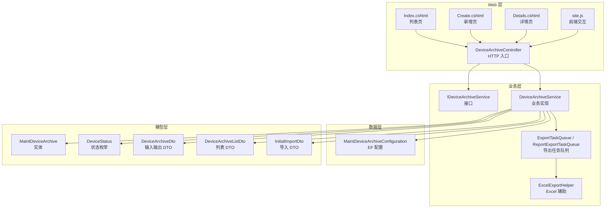
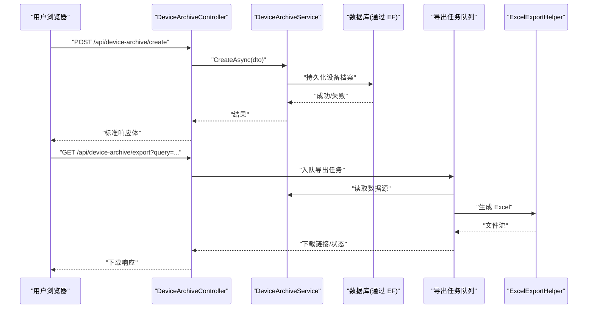
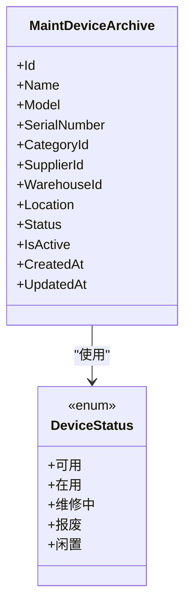
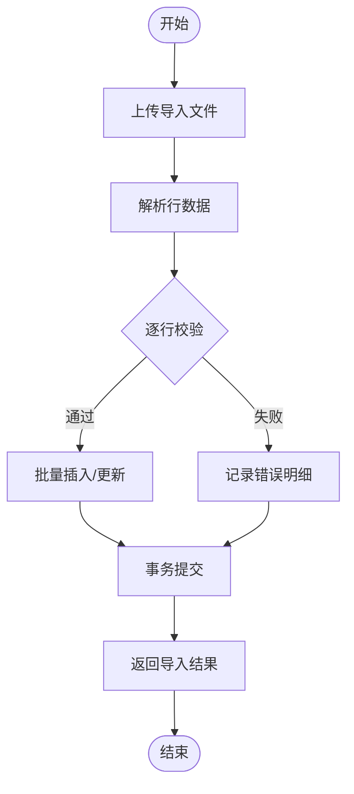
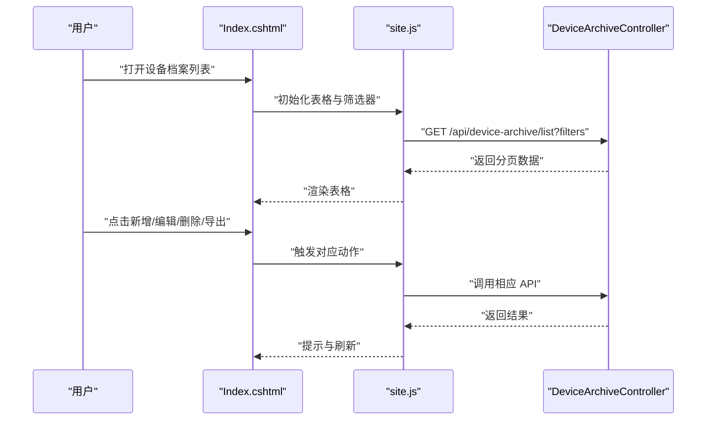
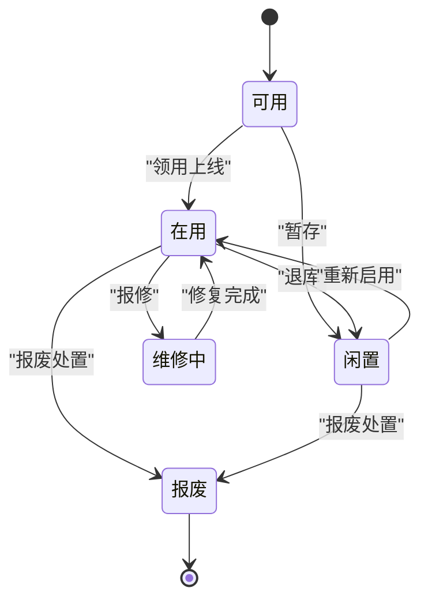
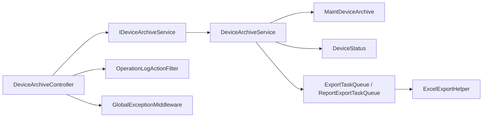

# 设备档案管理

<cite>
**本文引用的文件**   
- [DeviceArchiveController.cs](file://EquipmentIMS.Web/Controllers/DeviceArchiveController.cs)
- [DeviceArchiveService.cs](file://EquipmentIMS.BLL/Services/DeviceArchiveService.cs)
- [IDeviceArchiveService.cs](file://EquipmentIMS.BLL/Interfaces/IDeviceArchiveService.cs)
- [MaintDeviceArchiveConfiguration.cs](file://EquipmentIMS.DAL/Configurations/MaintDeviceArchiveConfiguration.cs)
- [MaintDeviceArchive.cs](file://EquipmentIMS.Models/Entities/MaintDeviceArchive.cs)
- [DeviceStatus.cs](file://EquipmentIMS.Models/Enums/DeviceStatus.cs)
- [DeviceArchiveDto.cs](file://EquipmentIMS.Models/DTOs/DeviceArchiveDto.cs)
- [DeviceArchiveListDto.cs](file://EquipmentIMS.Models/DTOs/DeviceArchiveListDto.cs)
- [InitialImportDto.cs](file://EquipmentIMS.Models/DTOs/InitialImportDto.cs)
- [ExportTaskQueue.cs](file://EquipmentIMS.BLL/Services/ExportTaskQueue.cs)
- [ReportExportTaskQueue.cs](file://EquipmentIMS.BLL/Services/ReportExportTaskQueue.cs)
- [ExcelExportHelper.cs](file://EquipmentIMS.Web/Helpers/ExcelExportHelper.cs)
- [GlobalExceptionMiddleware.cs](file://EquipmentIMS.Web/Filters/GlobalExceptionMiddleware.cs)
- [OperationLogActionFilter.cs](file://EquipmentIMS.Web/Filters/OperationLogActionFilter.cs)
- [Index.cshtml](file://EquipmentIMS.Web/Views/DeviceArchive/Index.cshtml)
- [Create.cshtml](file://EquipmentIMS.Web/Views/DeviceArchive/Create.cshtml)
- [Details.cshtml](file://EquipmentIMS.Web/Views/DeviceArchive/Details.cshtml)
- [site.js](file://EquipmentIMS.Web/wwwroot/js/site.js)
</cite>

## 目录
1. [简介](#简介)
2. [项目结构](#项目结构)
3. [核心组件](#核心组件)
4. [架构总览](#架构总览)
5. [详细组件分析](#详细组件分析)
6. [依赖关系分析](#依赖关系分析)
7. [性能考虑](#性能考虑)
8. [故障排查指南](#故障排查指南)
9. [结论](#结论)
10. [附录](#附录)

## 简介
本模块为“设备档案”提供全生命周期管理能力，覆盖设备信息录入、状态跟踪、分类管理、搜索查询、导入导出与批量操作等关键能力。通过分层架构（Web 控制器层、业务服务层、数据访问配置层、领域模型与枚举）实现清晰的职责划分与可维护性。文档面向产品、实施与开发人员，既提供高层流程说明，也给出代码级结构与交互细节。

## 项目结构
围绕设备档案的核心代码分布在以下层次：
- Web 层：控制器负责 HTTP 请求路由与参数校验；视图提供用户界面；前端脚本处理交互与异步调用。
- 业务层：服务接口与实现封装设备档案的业务规则、事务边界、导入导出编排、日志记录等。
- 数据层：实体映射配置定义数据库表结构及约束。
- 模型层：领域实体、枚举、DTO 与异常类型。

图表来源
- [DeviceArchiveController.cs](file://EquipmentIMS.Web/Controllers/DeviceArchiveController.cs)
- [DeviceArchiveService.cs](file://EquipmentIMS.BLL/Services/DeviceArchiveService.cs)
- [IDeviceArchiveService.cs](file://EquipmentIMS.BLL/Interfaces/IDeviceArchiveService.cs)
- [MaintDeviceArchiveConfiguration.cs](file://EquipmentIMS.DAL/Configurations/MaintDeviceArchiveConfiguration.cs)
- [MaintDeviceArchive.cs](file://EquipmentIMS.Models/Entities/MaintDeviceArchive.cs)
- [DeviceStatus.cs](file://EquipmentIMS.Models/Enums/DeviceStatus.cs)
- [DeviceArchiveDto.cs](file://EquipmentIMS.Models/DTOs/DeviceArchiveDto.cs)
- [DeviceArchiveListDto.cs](file://EquipmentIMS.Models/DTOs/DeviceArchiveListDto.cs)
- [InitialImportDto.cs](file://EquipmentIMS.Models/DTOs/InitialImportDto.cs)
- [ExportTaskQueue.cs](file://EquipmentIMS.BLL/Services/ExportTaskQueue.cs)
- [ReportExportTaskQueue.cs](file://EquipmentIMS.BLL/Services/ReportExportTaskQueue.cs)
- [ExcelExportHelper.cs](file://EquipmentIMS.Web/Helpers/ExcelExportHelper.cs)
- [Index.cshtml](file://EquipmentIMS.Web/Views/DeviceArchive/Index.cshtml)
- [Create.cshtml](file://EquipmentIMS.Web/Views/DeviceArchive/Create.cshtml)
- [Details.cshtml](file://EquipmentIMS.Web/Views/DeviceArchive/Details.cshtml)
- [site.js](file://EquipmentIMS.Web/wwwroot/js/site.js)

章节来源
- [DeviceArchiveController.cs](file://EquipmentIMS.Web/Controllers/DeviceArchiveController.cs)
- [DeviceArchiveService.cs](file://EquipmentIMS.BLL/Services/DeviceArchiveService.cs)
- [IDeviceArchiveService.cs](file://EquipmentIMS.BLL/Interfaces/IDeviceArchiveService.cs)
- [MaintDeviceArchiveConfiguration.cs](file://EquipmentIMS.DAL/Configurations/MaintDeviceArchiveConfiguration.cs)
- [MaintDeviceArchive.cs](file://EquipmentIMS.Models/Entities/MaintDeviceArchive.cs)
- [DeviceStatus.cs](file://EquipmentIMS.Models/Enums/DeviceStatus.cs)
- [DeviceArchiveDto.cs](file://EquipmentIMS.Models/DTOs/DeviceArchiveDto.cs)
- [DeviceArchiveListDto.cs](file://EquipmentIMS.Models/DTOs/DeviceArchiveListDto.cs)
- [InitialImportDto.cs](file://EquipmentIMS.Models/DTOs/InitialImportDto.cs)
- [ExportTaskQueue.cs](file://EquipmentIMS.BLL/Services/ExportTaskQueue.cs)
- [ReportExportTaskQueue.cs](file://EquipmentIMS.BLL/Services/ReportExportTaskQueue.cs)
- [ExcelExportHelper.cs](file://EquipmentIMS.Web/Helpers/ExcelExportHelper.cs)
- [Index.cshtml](file://EquipmentIMS.Web/Views/DeviceArchive/Index.cshtml)
- [Create.cshtml](file://EquipmentIMS.Web/Views/DeviceArchive/Create.cshtml)
- [Details.cshtml](file://EquipmentIMS.Web/Views/DeviceArchive/Details.cshtml)
- [site.js](file://EquipmentIMS.Web/wwwroot/js/site.js)

## 核心组件
- 控制器 DeviceArchiveController：暴露设备档案的增删改查、状态变更、位置更新、导入导出等 REST 风格接口，统一接收并返回标准响应体。
- 服务接口 IDeviceArchiveService：定义设备档案业务能力契约，便于替换实现与测试。
- 服务实现 DeviceArchiveService：封装业务规则、数据转换、事务边界、导入导出编排、审计日志写入等。
- 实体 MaintDeviceArchive：设备档案主实体，承载设备基础信息与运行状态。
- 枚举 DeviceStatus：设备状态值域，用于规范状态流转。
- DTO 集合：DeviceArchiveDto、DeviceArchiveListDto、InitialImportDto 分别用于表单提交、列表展示与批量导入。
- 导出任务队列 ExportTaskQueue/ReportExportTaskQueue：异步导出任务调度。
- Excel 导出辅助 ExcelExportHelper：生成 Excel 文件流。
- 全局异常中间件 GlobalExceptionMiddleware：统一异常捕获与错误响应。
- 操作日志过滤器 OperationLogActionFilter：自动记录关键操作的审计日志。

章节来源
- [DeviceArchiveController.cs](file://EquipmentIMS.Web/Controllers/DeviceArchiveController.cs)
- [DeviceArchiveService.cs](file://EquipmentIMS.BLL/Services/DeviceArchiveService.cs)
- [IDeviceArchiveService.cs](file://EquipmentIMS.BLL/Interfaces/IDeviceArchiveService.cs)
- [MaintDeviceArchive.cs](file://EquipmentIMS.Models/Entities/MaintDeviceArchive.cs)
- [DeviceStatus.cs](file://EquipmentIMS.Models/Enums/DeviceStatus.cs)
- [DeviceArchiveDto.cs](file://EquipmentIMS.Models/DTOs/DeviceArchiveDto.cs)
- [DeviceArchiveListDto.cs](file://EquipmentIMS.Models/DTOs/DeviceArchiveListDto.cs)
- [InitialImportDto.cs](file://EquipmentIMS.Models/DTOs/InitialImportDto.cs)
- [ExportTaskQueue.cs](file://EquipmentIMS.BLL/Services/ExportTaskQueue.cs)
- [ReportExportTaskQueue.cs](file://EquipmentIMS.BLL/Services/ReportExportTaskQueue.cs)
- [ExcelExportHelper.cs](file://EquipmentIMS.Web/Helpers/ExcelExportHelper.cs)
- [GlobalExceptionMiddleware.cs](file://EquipmentIMS.Web/Filters/GlobalExceptionMiddleware.cs)
- [OperationLogActionFilter.cs](file://EquipmentIMS.Web/Filters/OperationLogActionFilter.cs)

## 架构总览
设备档案采用典型三层架构：Web 控制器作为对外 API 网关，业务服务层承载规则与编排，数据层通过 EF 配置映射到数据库。导出功能通过后台任务队列解耦耗时操作，提升用户体验。

图表来源
- [DeviceArchiveController.cs](file://EquipmentIMS.Web/Controllers/DeviceArchiveController.cs)
- [DeviceArchiveService.cs](file://EquipmentIMS.BLL/Services/DeviceArchiveService.cs)
- [ExportTaskQueue.cs](file://EquipmentIMS.BLL/Services/ExportTaskQueue.cs)
- [ReportExportTaskQueue.cs](file://EquipmentIMS.BLL/Services/ReportExportTaskQueue.cs)
- [ExcelExportHelper.cs](file://EquipmentIMS.Web/Helpers/ExcelExportHelper.cs)

## 详细组件分析

### 设备实体与数据结构
设备档案实体包含设备标识、名称、型号、序列号、类别、供应商、仓库、位置、状态、启用标志、创建与更新时间等字段。具体字段以实体定义为准。

图表来源
- [MaintDeviceArchive.cs](file://EquipmentIMS.Models/Entities/MaintDeviceArchive.cs)
- [DeviceStatus.cs](file://EquipmentIMS.Models/Enums/DeviceStatus.cs)

章节来源
- [MaintDeviceArchive.cs](file://EquipmentIMS.Models/Entities/MaintDeviceArchive.cs)
- [DeviceStatus.cs](file://EquipmentIMS.Models/Enums/DeviceStatus.cs)
- [MaintDeviceArchiveConfiguration.cs](file://EquipmentIMS.DAL/Configurations/MaintDeviceArchiveConfiguration.cs)

### 控制器与 API 行为
- 列表查询：支持分页、多条件筛选（名称、型号、类别、状态、仓库、位置等），返回列表 DTO。
- 详情查看：根据 ID 获取单条设备档案。
- 新增/编辑：接收设备档案 DTO，进行必填项与格式校验后落库。
- 删除：逻辑删除或物理删除（依据实现）。
- 状态变更：按业务规则允许的状态转移执行更新。
- 位置更新：支持批量或单条位置调整。
- 导入：接收 Excel/CSV，解析并批量入库，返回成功/失败明细。
- 导出：将查询结果导出为 Excel，支持异步任务。

章节来源
- [DeviceArchiveController.cs](file://EquipmentIMS.Web/Controllers/DeviceArchiveController.cs)
- [DeviceArchiveDto.cs](file://EquipmentIMS.Models/DTOs/DeviceArchiveDto.cs)
- [DeviceArchiveListDto.cs](file://EquipmentIMS.Models/DTOs/DeviceArchiveListDto.cs)
- [InitialImportDto.cs](file://EquipmentIMS.Models/DTOs/InitialImportDto.cs)

### 业务服务与规则
- 数据验证：对关键字段进行非空、唯一性、格式校验（如序列号、邮箱、日期范围等）。
- 状态机：基于 DeviceStatus 枚举限制状态流转，避免非法变更。
- 事务边界：新增、编辑、批量导入在事务内执行，保证一致性。
- 审计日志：通过过滤器或服务内部记录关键操作（创建、变更、删除、导入、导出）。
- 导出编排：将大数据量导出放入后台队列，避免阻塞请求线程。

章节来源
- [DeviceArchiveService.cs](file://EquipmentIMS.BLL/Services/DeviceArchiveService.cs)
- [IDeviceArchiveService.cs](file://EquipmentIMS.BLL/Interfaces/IDeviceArchiveService.cs)
- [OperationLogActionFilter.cs](file://EquipmentIMS.Web/Filters/OperationLogActionFilter.cs)
- [ExportTaskQueue.cs](file://EquipmentIMS.BLL/Services/ExportTaskQueue.cs)
- [ReportExportTaskQueue.cs](file://EquipmentIMS.BLL/Services/ReportExportTaskQueue.cs)

### 数据访问与映射
- EF 配置 MaintDeviceArchiveConfiguration 定义表名、主键、索引、外键与约束，确保数据完整性与查询性能。
- 建议对常用查询字段建立索引（如名称、类别、状态、仓库、位置等）。

章节来源
- [MaintDeviceArchiveConfiguration.cs](file://EquipmentIMS.DAL/Configurations/MaintDeviceArchiveConfiguration.cs)

### 导入导出与批量操作
- 导入流程：上传文件 → 解析行数据 → 逐行校验 → 批量插入/更新 → 汇总结果（成功数、失败数、错误明细）。
- 导出流程：构建查询 → 入队任务 → 后台读取数据 → 生成 Excel → 返回下载链接或直接流式下载。
- 批量操作：支持批量状态变更、批量位置更新、批量启用/停用。

图表来源
- [InitialImportDto.cs](file://EquipmentIMS.Models/DTOs/InitialImportDto.cs)
- [DeviceArchiveService.cs](file://EquipmentIMS.BLL/Services/DeviceArchiveService.cs)
- [ExcelExportHelper.cs](file://EquipmentIMS.Web/Helpers/ExcelExportHelper.cs)
- [ExportTaskQueue.cs](file://EquipmentIMS.BLL/Services/ExportTaskQueue.cs)

章节来源
- [InitialImportDto.cs](file://EquipmentIMS.Models/DTOs/InitialImportDto.cs)
- [DeviceArchiveService.cs](file://EquipmentIMS.BLL/Services/DeviceArchiveService.cs)
- [ExcelExportHelper.cs](file://EquipmentIMS.Web/Helpers/ExcelExportHelper.cs)
- [ExportTaskQueue.cs](file://EquipmentIMS.BLL/Services/ExportTaskQueue.cs)
- [ReportExportTaskQueue.cs](file://EquipmentIMS.BLL/Services/ReportExportTaskQueue.cs)

### 用户界面与操作流程
- 列表页 Index.cshtml：展示设备清单，支持分页、筛选、排序、批量选择与批量操作按钮。
- 新增页 Create.cshtml：表单字段与客户端校验提示，提交至控制器新增接口。
- 详情页 Details.cshtml：展示设备详细信息与变更记录。
- 前端脚本 site.js：封装 AJAX 调用、加载态、错误提示与刷新逻辑。

图表来源
- [Index.cshtml](file://EquipmentIMS.Web/Views/DeviceArchive/Index.cshtml)
- [Create.cshtml](file://EquipmentIMS.Web/Views/DeviceArchive/Create.cshtml)
- [Details.cshtml](file://EquipmentIMS.Web/Views/DeviceArchive/Details.cshtml)
- [site.js](file://EquipmentIMS.Web/wwwroot/js/site.js)
- [DeviceArchiveController.cs](file://EquipmentIMS.Web/Controllers/DeviceArchiveController.cs)

章节来源
- [Index.cshtml](file://EquipmentIMS.Web/Views/DeviceArchive/Index.cshtml)
- [Create.cshtml](file://EquipmentIMS.Web/Views/DeviceArchive/Create.cshtml)
- [Details.cshtml](file://EquipmentIMS.Web/Views/DeviceArchive/Details.cshtml)
- [site.js](file://EquipmentIMS.Web/wwwroot/js/site.js)
- [DeviceArchiveController.cs](file://EquipmentIMS.Web/Controllers/DeviceArchiveController.cs)

### 生命周期管理与状态流转
设备从登记到退役的典型流程如下：
- 登记入库：新建设备档案，初始状态通常为“可用”。
- 领用上线：状态变更为“在用”，记录位置与责任人。
- 维修中：状态变更为“维修中”，关联维修计划或工单。
- 闲置：设备暂时不使用，状态变更为“闲置”。
- 报废：设备退出使用，状态变更为“报废”，归档历史。

图表来源
- [DeviceStatus.cs](file://EquipmentIMS.Models/Enums/DeviceStatus.cs)
- [DeviceArchiveService.cs](file://EquipmentIMS.BLL/Services/DeviceArchiveService.cs)

章节来源
- [DeviceStatus.cs](file://EquipmentIMS.Models/Enums/DeviceStatus.cs)
- [DeviceArchiveService.cs](file://EquipmentIMS.BLL/Services/DeviceArchiveService.cs)

## 依赖关系分析
- 控制器依赖服务接口，降低耦合度，便于单元测试与替换实现。
- 服务依赖实体与枚举，并通过 EF 配置访问数据库。
- 导出功能依赖任务队列与 Excel 辅助类，解耦耗时操作。
- 全局异常中间件与操作日志过滤器横切关注点，贯穿控制器层。

图表来源
- [DeviceArchiveController.cs](file://EquipmentIMS.Web/Controllers/DeviceArchiveController.cs)
- [IDeviceArchiveService.cs](file://EquipmentIMS.BLL/Interfaces/IDeviceArchiveService.cs)
- [DeviceArchiveService.cs](file://EquipmentIMS.BLL/Services/DeviceArchiveService.cs)
- [MaintDeviceArchive.cs](file://EquipmentIMS.Models/Entities/MaintDeviceArchive.cs)
- [DeviceStatus.cs](file://EquipmentIMS.Models/Enums/DeviceStatus.cs)
- [ExportTaskQueue.cs](file://EquipmentIMS.BLL/Services/ExportTaskQueue.cs)
- [ReportExportTaskQueue.cs](file://EquipmentIMS.BLL/Services/ReportExportTaskQueue.cs)
- [ExcelExportHelper.cs](file://EquipmentIMS.Web/Helpers/ExcelExportHelper.cs)
- [OperationLogActionFilter.cs](file://EquipmentIMS.Web/Filters/OperationLogActionFilter.cs)
- [GlobalExceptionMiddleware.cs](file://EquipmentIMS.Web/Filters/GlobalExceptionMiddleware.cs)

章节来源
- [DeviceArchiveController.cs](file://EquipmentIMS.Web/Controllers/DeviceArchiveController.cs)
- [IDeviceArchiveService.cs](file://EquipmentIMS.BLL/Interfaces/IDeviceArchiveService.cs)
- [DeviceArchiveService.cs](file://EquipmentIMS.BLL/Services/DeviceArchiveService.cs)
- [MaintDeviceArchive.cs](file://EquipmentIMS.Models/Entities/MaintDeviceArchive.cs)
- [DeviceStatus.cs](file://EquipmentIMS.Models/Enums/DeviceStatus.cs)
- [ExportTaskQueue.cs](file://EquipmentIMS.BLL/Services/ExportTaskQueue.cs)
- [ReportExportTaskQueue.cs](file://EquipmentIMS.BLL/Services/ReportExportTaskQueue.cs)
- [ExcelExportHelper.cs](file://EquipmentIMS.Web/Helpers/ExcelExportHelper.cs)
- [OperationLogActionFilter.cs](file://EquipmentIMS.Web/Filters/OperationLogActionFilter.cs)
- [GlobalExceptionMiddleware.cs](file://EquipmentIMS.Web/Filters/GlobalExceptionMiddleware.cs)

## 性能考虑
- 列表查询分页与索引：对高频筛选字段建立数据库索引，避免全表扫描。
- 导出异步化：大数据量导出走后台任务队列，减少请求超时风险。
- 批量操作：使用批量插入/更新减少往返次数。
- 缓存策略：对字典型数据（类别、仓库、供应商）可引入缓存以提升查询性能。
- 连接池与事务粒度：合理设置事务范围，避免长事务占用资源。

[本节为通用指导，不直接分析具体文件]

## 故障排查指南
- 统一异常处理：通过全局异常中间件捕获未处理异常，返回标准化错误响应，便于前端提示与日志追踪。
- 操作审计：通过操作日志过滤器记录关键操作，定位问题发生时间与上下文。
- 常见错误场景：
  - 导入失败：检查文件格式、必填字段、重复数据与数据类型。
  - 状态变更失败：确认当前状态是否允许目标状态转移。
  - 导出无响应：检查后台任务队列是否启动、磁盘空间与权限。
  - 查询缓慢：检查索引与过滤条件是否命中。

章节来源
- [GlobalExceptionMiddleware.cs](file://EquipmentIMS.Web/Filters/GlobalExceptionMiddleware.cs)
- [OperationLogActionFilter.cs](file://EquipmentIMS.Web/Filters/OperationLogActionFilter.cs)

## 结论
设备档案管理模块以清晰的分层架构与明确的职责边界，实现了设备全生命周期的数字化管理。通过严格的校验、状态机约束、异步导出与审计日志，保障了数据的准确性、一致性与可追溯性。建议在后续迭代中持续优化查询性能、完善错误提示与增强批量操作体验。

[本节为总结性内容，不直接分析具体文件]

## 附录
- 术语说明：
  - 设备档案：描述设备基本属性与运行状态的记录。
  - 状态机：规定设备状态及其合法转移的规则。
  - 导入/导出：批量数据读写操作，通常涉及 Excel/CSV 文件。
- 参考页面与接口路径：
  - 列表页：设备档案 Index.cshtml
  - 新增页：设备档案 Create.cshtml
  - 详情页：设备档案 Details.cshtml
  - 控制器：DeviceArchiveController.cs
  - 服务接口与实现：IDeviceArchiveService.cs、DeviceArchiveService.cs
  - 实体与配置：MaintDeviceArchive.cs、MaintDeviceArchiveConfiguration.cs
  - 枚举：DeviceStatus.cs
  - DTO：DeviceArchiveDto.cs、DeviceArchiveListDto.cs、InitialImportDto.cs
  - 导出相关：ExportTaskQueue.cs、ReportExportTaskQueue.cs、ExcelExportHelper.cs
  - 横切关注点：GlobalExceptionMiddleware.cs、OperationLogActionFilter.cs
  - 前端脚本：site.js

[本节为补充信息，不直接分析具体文件]