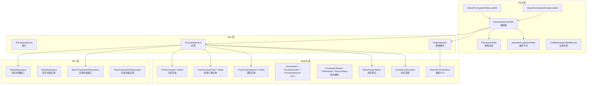
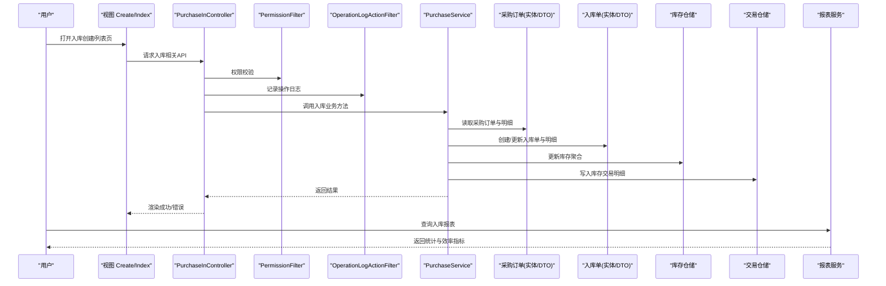
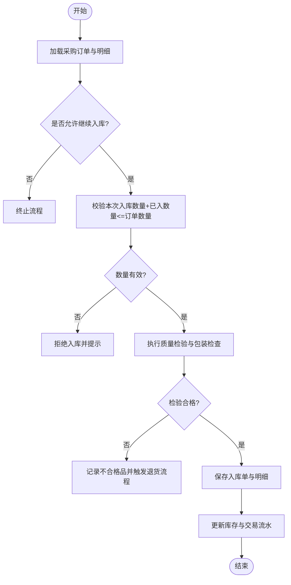
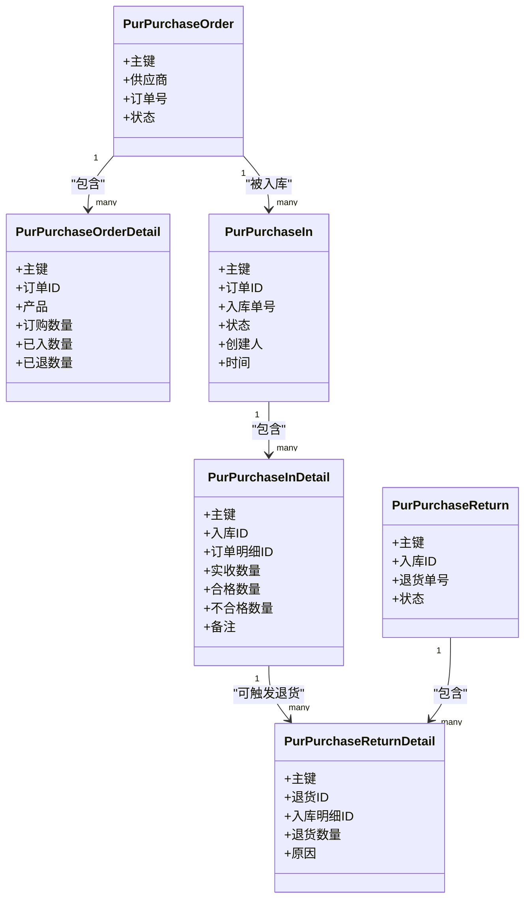
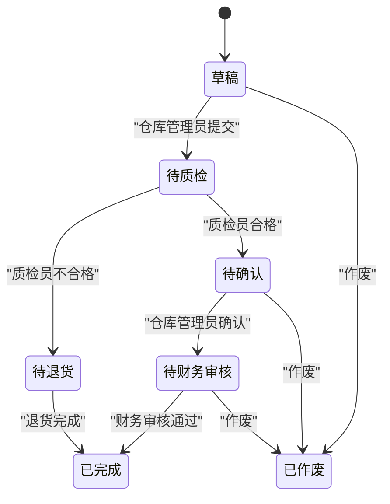
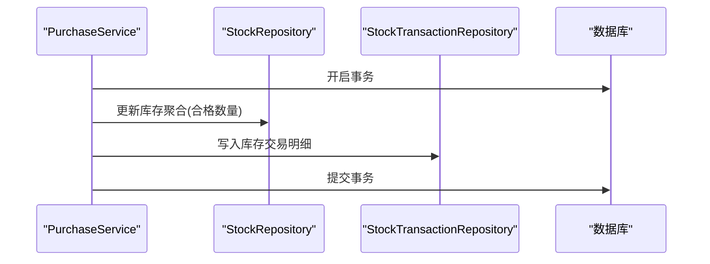
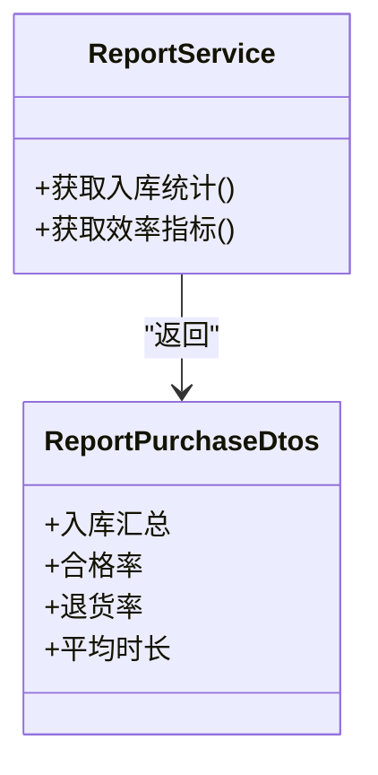
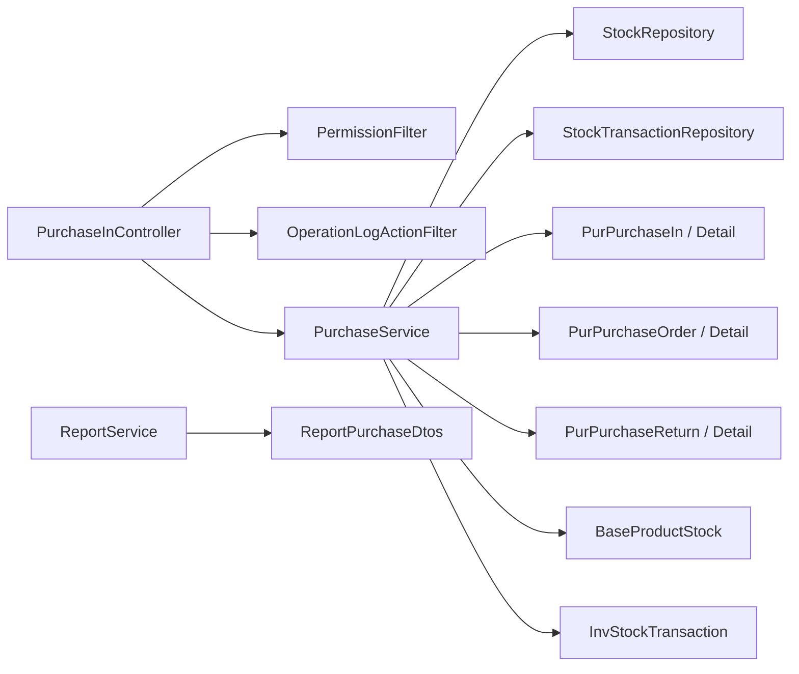

# 采购入库管理

<cite>
**本文引用的文件**   
- [PurchaseInController.cs](file://EquipmentIMS.Web/Controllers/PurchaseInController.cs)
- [PurchaseService.cs](file://EquipmentIMS.BLL/Services/PurchaseService.cs)
- [IPurchaseService.cs](file://EquipmentIMS.BLL/Interfaces/IPurchaseService.cs)
- [PurPurchaseIn.cs](file://EquipmentIMS.Models/Entities/PurPurchaseIn.cs)
- [PurPurchaseInDetail.cs](file://EquipmentIMS.Models/Entities/PurPurchaseInDetail.cs)
- [PurPurchaseOrder.cs](file://EquipmentIMS.Models/Entities/PurPurchaseOrder.cs)
- [PurPurchaseOrderDetail.cs](file://EquipmentIMS.Models/Entities/PurPurchaseOrderDetail.cs)
- [PurPurchaseReturn.cs](file://EquipmentIMS.Models/Entities/PurPurchaseReturn.cs)
- [PurPurchaseReturnDetail.cs](file://EquipmentIMS.Models/Entities/PurPurchaseReturnDetail.cs)
- [PurchaseInDto.cs](file://EquipmentIMS.Models/DTOs/PurchaseInDto.cs)
- [PurchaseInDetailDto.cs](file://EquipmentIMS.Models/DTOs/PurchaseInDetailDto.cs)
- [PurchaseInRequestDto.cs](file://EquipmentIMS.Models/DTOs/PurchaseInRequestDto.cs)
- [PurchaseOrderDto.cs](file://EquipmentIMS.Models/DTOs/PurchaseOrderDto.cs)
- [PurchaseOrderDetailDto.cs](file://EquipmentIMS.Models/DTOs/PurchaseOrderDetailDto.cs)
- [PurchaseReturnDto.cs](file://EquipmentIMS.Models/DTOs/PurchaseReturnDto.cs)
- [PurchaseInStatus.cs](file://EquipmentIMS.Models/Enums/PurchaseInStatus.cs)
- [PurchaseOrderStatus.cs](file://EquipmentIMS.Models/Enums/PurchaseOrderStatus.cs)
- [PurchaseReturnStatus.cs](file://EquipmentIMS.Models/Enums/PurchaseReturnStatus.cs)
- [StockRepository.cs](file://EquipmentIMS.DAL/Repositories/StockRepository.cs)
- [IStockRepository.cs](file://EquipmentIMS.DAL/Interfaces/IStockRepository.cs)
- [StockTransactionRepository.cs](file://EquipmentIMS.DAL/Repositories/StockTransactionRepository.cs)
- [IStockTransactionRepository.cs](file://EquipmentIMS.DAL/Interfaces/IStockTransactionRepository.cs)
- [InvStockTransaction.cs](file://EquipmentIMS.Models/Entities/InvStockTransaction.cs)
- [BaseProductStock.cs](file://EquipmentIMS.Models/Entities/BaseProductStock.cs)
- [TransactionType.cs](file://EquipmentIMS.Models/Enums/TransactionType.cs)
- [ReportService.cs](file://EquipmentIMS.BLL/Services/ReportService.cs)
- [ReportPurchaseDtos.cs](file://EquipmentIMS.Models/DTOs/Reports/ReportPurchaseDtos.cs)
- [PermissionFilter.cs](file://EquipmentIMS.Web/Filters/PermissionFilter.cs)
- [OperationLogActionFilter.cs](file://EquipmentIMS.Web/Filters/OperationLogActionFilter.cs)
- [GlobalExceptionMiddleware.cs](file://EquipmentIMS.Web/Filters/GlobalExceptionMiddleware.cs)
- [Create.cshtml](file://EquipmentIMS.Web/Views/PurchaseIn/Create.cshtml)
- [Index.cshtml](file://EquipmentIMS.Web/Views/PurchaseIn/Index.cshtml)
</cite>

## 目录
1. [简介](#简介)
2. [项目结构](#项目结构)
3. [核心组件](#核心组件)
4. [架构总览](#架构总览)
5. [详细组件分析](#详细组件分析)
6. [依赖关系分析](#依赖关系分析)
7. [性能考虑](#性能考虑)
8. [故障排查指南](#故障排查指南)
9. [结论](#结论)
10. [附录](#附录)

## 简介
本文件面向“采购入库管理”功能，围绕到货通知、质量检验、数量核对、包装检查等验收环节，系统阐述入库单与采购订单的关联关系，支持部分入库与分批入库场景；说明质量标准设定、不合格品处理与退货机制；描述仓库管理员确认、质检员验收、财务审核等多角色权限控制；并给出库存与应付账款的自动更新、报表统计、效率分析与异常处理方案。文档以代码级事实为依据，结合分层架构（Web/BLL/DAL/Models）进行可视化说明，帮助读者快速理解与落地实施。

## 项目结构
本项目采用典型分层架构：
- Web 层：控制器、视图、过滤器、后台服务等
- BLL 层：业务服务接口与实现、映射配置、扩展方法
- DAL 层：仓储接口与实现、通用仓储、工作单元、EF 配置
- Models 层：实体、DTO、枚举、异常定义

与采购入库相关的核心位置如下：
- Web 控制器：采购入库入口与权限校验、日志记录、异常统一处理
- BLL 服务：入库流程编排、与采购订单/库存/事务/退货的交互
- DAL 仓储：库存与交易明细持久化
- Models：实体模型、DTO、状态枚举

图表来源
- [PurchaseInController.cs](file://EquipmentIMS.Web/Controllers/PurchaseInController.cs)
- [PermissionFilter.cs](file://EquipmentIMS.Web/Filters/PermissionFilter.cs)
- [OperationLogActionFilter.cs](file://EquipmentIMS.Web/Filters/OperationLogActionFilter.cs)
- [PurchaseService.cs](file://EquipmentIMS.BLL/Services/PurchaseService.cs)
- [IPurchaseService.cs](file://EquipmentIMS.BLL/Interfaces/IPurchaseService.cs)
- [StockRepository.cs](file://EquipmentIMS.DAL/Repositories/StockRepository.cs)
- [IStockRepository.cs](file://EquipmentIMS.DAL/Interfaces/IStockRepository.cs)
- [StockTransactionRepository.cs](file://EquipmentIMS.DAL/Repositories/StockTransactionRepository.cs)
- [IStockTransactionRepository.cs](file://EquipmentIMS.DAL/Interfaces/IStockTransactionRepository.cs)
- [PurPurchaseIn.cs](file://EquipmentIMS.Models/Entities/PurPurchaseIn.cs)
- [PurPurchaseInDetail.cs](file://EquipmentIMS.Models/Entities/PurPurchaseInDetail.cs)
- [PurPurchaseOrder.cs](file://EquipmentIMS.Models/Entities/PurPurchaseOrder.cs)
- [PurPurchaseOrderDetail.cs](file://EquipmentIMS.Models/Entities/PurPurchaseOrderDetail.cs)
- [PurPurchaseReturn.cs](file://EquipmentIMS.Models/Entities/PurPurchaseReturn.cs)
- [PurPurchaseReturnDetail.cs](file://EquipmentIMS.Models/Entities/PurPurchaseReturnDetail.cs)
- [PurchaseInDto.cs](file://EquipmentIMS.Models/DTOs/PurchaseInDto.cs)
- [PurchaseInDetailDto.cs](file://EquipmentIMS.Models/DTOs/PurchaseInDetailDto.cs)
- [PurchaseInRequestDto.cs](file://EquipmentIMS.Models/DTOs/PurchaseInRequestDto.cs)
- [PurchaseOrderDto.cs](file://EquipmentIMS.Models/DTOs/PurchaseOrderDto.cs)
- [PurchaseOrderDetailDto.cs](file://EquipmentIMS.Models/DTOs/PurchaseOrderDetailDto.cs)
- [PurchaseReturnDto.cs](file://EquipmentIMS.Models/DTOs/PurchaseReturnDto.cs)
- [PurchaseInStatus.cs](file://EquipmentIMS.Models/Enums/PurchaseInStatus.cs)
- [PurchaseOrderStatus.cs](file://EquipmentIMS.Models/Enums/PurchaseOrderStatus.cs)
- [PurchaseReturnStatus.cs](file://EquipmentIMS.Models/Enums/PurchaseReturnStatus.cs)
- [BaseProductStock.cs](file://EquipmentIMS.Models/Entities/BaseProductStock.cs)
- [InvStockTransaction.cs](file://EquipmentIMS.Models/Entities/InvStockTransaction.cs)
- [TransactionType.cs](file://EquipmentIMS.Models/Enums/TransactionType.cs)
- [ReportService.cs](file://EquipmentIMS.BLL/Services/ReportService.cs)
- [ReportPurchaseDtos.cs](file://EquipmentIMS.Models/DTOs/Reports/ReportPurchaseDtos.cs)
- [Create.cshtml](file://EquipmentIMS.Web/Views/PurchaseIn/Create.cshtml)
- [Index.cshtml](file://EquipmentIMS.Web/Views/PurchaseIn/Index.cshtml)

章节来源
- [PurchaseInController.cs](file://EquipmentIMS.Web/Controllers/PurchaseInController.cs)
- [PurchaseService.cs](file://EquipmentIMS.BLL/Services/PurchaseService.cs)
- [IPurchaseService.cs](file://EquipmentIMS.BLL/Interfaces/IPurchaseService.cs)
- [StockRepository.cs](file://EquipmentIMS.DAL/Repositories/StockRepository.cs)
- [IStockRepository.cs](file://EquipmentIMS.DAL/Interfaces/IStockRepository.cs)
- [StockTransactionRepository.cs](file://EquipmentIMS.DAL/Repositories/StockTransactionRepository.cs)
- [IStockTransactionRepository.cs](file://EquipmentIMS.DAL/Interfaces/IStockTransactionRepository.cs)
- [PurPurchaseIn.cs](file://EquipmentIMS.Models/Entities/PurPurchaseIn.cs)
- [PurPurchaseInDetail.cs](file://EquipmentIMS.Models/Entities/PurPurchaseInDetail.cs)
- [PurPurchaseOrder.cs](file://EquipmentIMS.Models/Entities/PurPurchaseOrder.cs)
- [PurPurchaseOrderDetail.cs](file://EquipmentIMS.Models/Entities/PurPurchaseOrderDetail.cs)
- [PurPurchaseReturn.cs](file://EquipmentIMS.Models/Entities/PurPurchaseReturn.cs)
- [PurPurchaseReturnDetail.cs](file://EquipmentIMS.Models/Entities/PurPurchaseReturnDetail.cs)
- [PurchaseInDto.cs](file://EquipmentIMS.Models/DTOs/PurchaseInDto.cs)
- [PurchaseInDetailDto.cs](file://EquipmentIMS.Models/DTOs/PurchaseInDetailDto.cs)
- [PurchaseInRequestDto.cs](file://EquipmentIMS.Models/DTOs/PurchaseInRequestDto.cs)
- [PurchaseOrderDto.cs](file://EquipmentIMS.Models/DTOs/PurchaseOrderDto.cs)
- [PurchaseOrderDetailDto.cs](file://EquipmentIMS.Models/DTOs/PurchaseOrderDetailDto.cs)
- [PurchaseReturnDto.cs](file://EquipmentIMS.Models/DTOs/PurchaseReturnDto.cs)
- [PurchaseInStatus.cs](file://EquipmentIMS.Models/Enums/PurchaseInStatus.cs)
- [PurchaseOrderStatus.cs](file://EquipmentIMS.Models/Enums/PurchaseOrderStatus.cs)
- [PurchaseReturnStatus.cs](file://EquipmentIMS.Models/Enums/PurchaseReturnStatus.cs)
- [BaseProductStock.cs](file://EquipmentIMS.Models/Entities/BaseProductStock.cs)
- [InvStockTransaction.cs](file://EquipmentIMS.Models/Entities/InvStockTransaction.cs)
- [TransactionType.cs](file://EquipmentIMS.Models/Enums/TransactionType.cs)
- [ReportService.cs](file://EquipmentIMS.BLL/Services/ReportService.cs)
- [ReportPurchaseDtos.cs](file://EquipmentIMS.Models/DTOs/Reports/ReportPurchaseDtos.cs)
- [PermissionFilter.cs](file://EquipmentIMS.Web/Filters/PermissionFilter.cs)
- [OperationLogActionFilter.cs](file://EquipmentIMS.Web/Filters/OperationLogActionFilter.cs)
- [GlobalExceptionMiddleware.cs](file://EquipmentIMS.Web/Filters/GlobalExceptionMiddleware.cs)
- [Create.cshtml](file://EquipmentIMS.Web/Views/PurchaseIn/Create.cshtml)
- [Index.cshtml](file://EquipmentIMS.Web/Views/PurchaseIn/Index.cshtml)

## 核心组件
- 控制器层
  - 采购入库控制器提供创建、列表、详情、提交审核、作废等接口，集成权限过滤与操作日志。
- 业务服务层
  - 采购服务负责入库单生命周期管理、与采购订单的关联校验、部分/分批入库计算、质检结果处理、库存与交易流水写入、退货触发等。
- 数据访问层
  - 库存仓储负责产品库存聚合表的读写；交易仓储负责库存交易明细的写入，确保可追溯。
- 模型与枚举
  - 入库单、入库明细、采购订单、采购订单明细、退货单及明细为领域实体；对应 DTO 用于前后端传输；状态枚举约束业务流程。

章节来源
- [PurchaseInController.cs](file://EquipmentIMS.Web/Controllers/PurchaseInController.cs)
- [PurchaseService.cs](file://EquipmentIMS.BLL/Services/PurchaseService.cs)
- [IPurchaseService.cs](file://EquipmentIMS.BLL/Interfaces/IPurchaseService.cs)
- [StockRepository.cs](file://EquipmentIMS.DAL/Repositories/StockRepository.cs)
- [IStockRepository.cs](file://EquipmentIMS.DAL/Interfaces/IStockRepository.cs)
- [StockTransactionRepository.cs](file://EquipmentIMS.DAL/Repositories/StockTransactionRepository.cs)
- [IStockTransactionRepository.cs](file://EquipmentIMS.DAL/Interfaces/IStockTransactionRepository.cs)
- [PurPurchaseIn.cs](file://EquipmentIMS.Models/Entities/PurPurchaseIn.cs)
- [PurPurchaseInDetail.cs](file://EquipmentIMS.Models/Entities/PurPurchaseInDetail.cs)
- [PurPurchaseOrder.cs](file://EquipmentIMS.Models/Entities/PurPurchaseOrder.cs)
- [PurPurchaseOrderDetail.cs](file://EquipmentIMS.Models/Entities/PurPurchaseOrderDetail.cs)
- [PurPurchaseReturn.cs](file://EquipmentIMS.Models/Entities/PurPurchaseReturn.cs)
- [PurPurchaseReturnDetail.cs](file://EquipmentIMS.Models/Entities/PurPurchaseReturnDetail.cs)
- [PurchaseInDto.cs](file://EquipmentIMS.Models/DTOs/PurchaseInDto.cs)
- [PurchaseInDetailDto.cs](file://EquipmentIMS.Models/DTOs/PurchaseInDetailDto.cs)
- [PurchaseInRequestDto.cs](file://EquipmentIMS.Models/DTOs/PurchaseInRequestDto.cs)
- [PurchaseOrderDto.cs](file://EquipmentIMS.Models/DTOs/PurchaseOrderDto.cs)
- [PurchaseOrderDetailDto.cs](file://EquipmentIMS.Models/DTOs/PurchaseOrderDetailDto.cs)
- [PurchaseReturnDto.cs](file://EquipmentIMS.Models/DTOs/PurchaseReturnDto.cs)
- [PurchaseInStatus.cs](file://EquipmentIMS.Models/Enums/PurchaseInStatus.cs)
- [PurchaseOrderStatus.cs](file://EquipmentIMS.Models/Enums/PurchaseOrderStatus.cs)
- [PurchaseReturnStatus.cs](file://EquipmentIMS.Models/Enums/PurchaseReturnStatus.cs)

## 架构总览
采购入库从前端页面发起，经控制器权限校验与日志记录后进入业务服务层，完成与采购订单的关联校验、入库明细处理、库存与交易流水更新，必要时触发退货流程。报表服务提供入库统计与效率分析。

图表来源
- [PurchaseInController.cs](file://EquipmentIMS.Web/Controllers/PurchaseInController.cs)
- [PermissionFilter.cs](file://EquipmentIMS.Web/Filters/PermissionFilter.cs)
- [OperationLogActionFilter.cs](file://EquipmentIMS.Web/Filters/OperationLogActionFilter.cs)
- [PurchaseService.cs](file://EquipmentIMS.BLL/Services/PurchaseService.cs)
- [StockRepository.cs](file://EquipmentIMS.DAL/Repositories/StockRepository.cs)
- [IStockRepository.cs](file://EquipmentIMS.DAL/Interfaces/IStockRepository.cs)
- [StockTransactionRepository.cs](file://EquipmentIMS.DAL/Repositories/StockTransactionRepository.cs)
- [IStockTransactionRepository.cs](file://EquipmentIMS.DAL/Interfaces/IStockTransactionRepository.cs)
- [PurPurchaseOrder.cs](file://EquipmentIMS.Models/Entities/PurPurchaseOrder.cs)
- [PurPurchaseOrderDetail.cs](file://EquipmentIMS.Models/Entities/PurPurchaseOrderDetail.cs)
- [PurPurchaseIn.cs](file://EquipmentIMS.Models/Entities/PurPurchaseIn.cs)
- [PurPurchaseInDetail.cs](file://EquipmentIMS.Models/Entities/PurPurchaseInDetail.cs)
- [BaseProductStock.cs](file://EquipmentIMS.Models/Entities/BaseProductStock.cs)
- [InvStockTransaction.cs](file://EquipmentIMS.Models/Entities/InvStockTransaction.cs)
- [ReportService.cs](file://EquipmentIMS.BLL/Services/ReportService.cs)
- [ReportPurchaseDtos.cs](file://EquipmentIMS.Models/DTOs/Reports/ReportPurchaseDtos.cs)
- [Create.cshtml](file://EquipmentIMS.Web/Views/PurchaseIn/Create.cshtml)
- [Index.cshtml](file://EquipmentIMS.Web/Views/PurchaseIn/Index.cshtml)

## 详细组件分析

### 入库单与采购订单关联与部分/分批入库
- 关联关系
  - 入库单通过外键或业务字段关联到采购订单，入库明细与采购订单明细一一对应，便于追踪批次与行项。
- 部分入库与分批入库
  - 支持对同一采购订单行项多次入库，累计已入数量不超过订单行项数量；每次入库生成独立入库单与明细，保持历史可追溯。
- 数量与包装校验
  - 入库前需校验供应商送货清单、包装完整性、标签一致性；数量差异与包装破损需在入库明细中记录备注与附件。

图表来源
- [PurchaseService.cs](file://EquipmentIMS.BLL/Services/PurchaseService.cs)
- [PurPurchaseOrder.cs](file://EquipmentIMS.Models/Entities/PurPurchaseOrder.cs)
- [PurPurchaseOrderDetail.cs](file://EquipmentIMS.Models/Entities/PurPurchaseOrderDetail.cs)
- [PurPurchaseIn.cs](file://EquipmentIMS.Models/Entities/PurPurchaseIn.cs)
- [PurPurchaseInDetail.cs](file://EquipmentIMS.Models/Entities/PurPurchaseInDetail.cs)
- [BaseProductStock.cs](file://EquipmentIMS.Models/Entities/BaseProductStock.cs)
- [InvStockTransaction.cs](file://EquipmentIMS.Models/Entities/InvStockTransaction.cs)

章节来源
- [PurchaseService.cs](file://EquipmentIMS.BLL/Services/PurchaseService.cs)
- [PurPurchaseOrder.cs](file://EquipmentIMS.Models/Entities/PurPurchaseOrder.cs)
- [PurPurchaseOrderDetail.cs](file://EquipmentIMS.Models/Entities/PurPurchaseOrderDetail.cs)
- [PurPurchaseIn.cs](file://EquipmentIMS.Models/Entities/PurPurchaseIn.cs)
- [PurPurchaseInDetail.cs](file://EquipmentIMS.Models/Entities/PurPurchaseInDetail.cs)
- [BaseProductStock.cs](file://EquipmentIMS.Models/Entities/BaseProductStock.cs)
- [InvStockTransaction.cs](file://EquipmentIMS.Models/Entities/InvStockTransaction.cs)

### 质量标准、不合格品处理与退货机制
- 质量标准设定
  - 在入库明细中记录检验结果（合格/不合格）、缺陷类型、抽检比例、检验依据等，作为后续结算与考核依据。
- 不合格品处理
  - 对不合格品按行项登记，支持整行或部分数量不合格；系统自动生成退货建议并转入退货流程。
- 退货机制
  - 基于入库明细的不合格记录生成退货单与退货明细，关联原采购订单与入库单，保证逆向链路可追溯。

图表来源
- [PurPurchaseOrder.cs](file://EquipmentIMS.Models/Entities/PurPurchaseOrder.cs)
- [PurPurchaseOrderDetail.cs](file://EquipmentIMS.Models/Entities/PurPurchaseOrderDetail.cs)
- [PurPurchaseIn.cs](file://EquipmentIMS.Models/Entities/PurPurchaseIn.cs)
- [PurPurchaseInDetail.cs](file://EquipmentIMS.Models/Entities/PurPurchaseInDetail.cs)
- [PurPurchaseReturn.cs](file://EquipmentIMS.Models/Entities/PurPurchaseReturn.cs)
- [PurPurchaseReturnDetail.cs](file://EquipmentIMS.Models/Entities/PurPurchaseReturnDetail.cs)

章节来源
- [PurPurchaseOrder.cs](file://EquipmentIMS.Models/Entities/PurPurchaseOrder.cs)
- [PurPurchaseOrderDetail.cs](file://EquipmentIMS.Models/Entities/PurPurchaseOrderDetail.cs)
- [PurPurchaseIn.cs](file://EquipmentIMS.Models/Entities/PurPurchaseIn.cs)
- [PurPurchaseInDetail.cs](file://EquipmentIMS.Models/Entities/PurPurchaseInDetail.cs)
- [PurPurchaseReturn.cs](file://EquipmentIMS.Models/Entities/PurPurchaseReturn.cs)
- [PurPurchaseReturnDetail.cs](file://EquipmentIMS.Models/Entities/PurPurchaseReturnDetail.cs)

### 入库单审核流程与角色权限控制
- 角色与权限
  - 仓库管理员：确认到货、发起入库、填写数量与包装信息
  - 质检员：执行质量检验、判定合格/不合格、记录缺陷
  - 财务部门：审核入库金额与发票匹配、确认应付账款
- 权限控制
  - 通过权限过滤器在控制器层拦截未授权访问，确保各角色仅能执行其职责范围内的操作。
- 审核流转
  - 草稿→待质检→待确认→待财务审核→已完成；任一节点失败可回退至上一节点或作废。

图表来源
- [PurchaseInStatus.cs](file://EquipmentIMS.Models/Enums/PurchaseInStatus.cs)
- [PurchaseReturnStatus.cs](file://EquipmentIMS.Models/Enums/PurchaseReturnStatus.cs)
- [PermissionFilter.cs](file://EquipmentIMS.Web/Filters/PermissionFilter.cs)
- [PurchaseInController.cs](file://EquipmentIMS.Web/Controllers/PurchaseInController.cs)

章节来源
- [PurchaseInStatus.cs](file://EquipmentIMS.Models/Enums/PurchaseInStatus.cs)
- [PurchaseReturnStatus.cs](file://EquipmentIMS.Models/Enums/PurchaseReturnStatus.cs)
- [PermissionFilter.cs](file://EquipmentIMS.Web/Filters/PermissionFilter.cs)
- [PurchaseInController.cs](file://EquipmentIMS.Web/Controllers/PurchaseInController.cs)

### 库存与应付账款实时更新
- 库存增加
  - 入库完成后，根据合格数量更新产品库存聚合表，并写入库存交易明细，记录交易类型、数量、方向、关联单据号等。
- 应付账款更新
  - 入库金额与采购订单价格一致时，自动触发应付账款更新；若存在折扣或差异，需在财务审核阶段调整。
- 事务一致性
  - 入库单、库存与交易流水在同一事务内提交，确保数据一致性。

图表来源
- [PurchaseService.cs](file://EquipmentIMS.BLL/Services/PurchaseService.cs)
- [StockRepository.cs](file://EquipmentIMS.DAL/Repositories/StockRepository.cs)
- [IStockRepository.cs](file://EquipmentIMS.DAL/Interfaces/IStockRepository.cs)
- [StockTransactionRepository.cs](file://EquipmentIMS.DAL/Repositories/StockTransactionRepository.cs)
- [IStockTransactionRepository.cs](file://EquipmentIMS.DAL/Interfaces/IStockTransactionRepository.cs)
- [BaseProductStock.cs](file://EquipmentIMS.Models/Entities/BaseProductStock.cs)
- [InvStockTransaction.cs](file://EquipmentIMS.Models/Entities/InvStockTransaction.cs)
- [TransactionType.cs](file://EquipmentIMS.Models/Enums/TransactionType.cs)

章节来源
- [PurchaseService.cs](file://EquipmentIMS.BLL/Services/PurchaseService.cs)
- [StockRepository.cs](file://EquipmentIMS.DAL/Repositories/StockRepository.cs)
- [IStockRepository.cs](file://EquipmentIMS.DAL/Interfaces/IStockRepository.cs)
- [StockTransactionRepository.cs](file://EquipmentIMS.DAL/Repositories/StockTransactionRepository.cs)
- [IStockTransactionRepository.cs](file://EquipmentIMS.DAL/Interfaces/IStockTransactionRepository.cs)
- [BaseProductStock.cs](file://EquipmentIMS.Models/Entities/BaseProductStock.cs)
- [InvStockTransaction.cs](file://EquipmentIMS.Models/Entities/InvStockTransaction.cs)
- [TransactionType.cs](file://EquipmentIMS.Models/Enums/TransactionType.cs)

### 入库报表统计与效率分析
- 报表维度
  - 按供应商、产品、时间段统计入库数量、合格率、退货率、平均入库时长等。
- 数据来源
  - 基于入库单、入库明细、退货单、库存交易明细聚合计算。
- 输出形式
  - 提供结构化 DTO 供前端图表展示与导出。

图表来源
- [ReportService.cs](file://EquipmentIMS.BLL/Services/ReportService.cs)
- [ReportPurchaseDtos.cs](file://EquipmentIMS.Models/DTOs/Reports/ReportPurchaseDtos.cs)

章节来源
- [ReportService.cs](file://EquipmentIMS.BLL/Services/ReportService.cs)
- [ReportPurchaseDtos.cs](file://EquipmentIMS.Models/DTOs/Reports/ReportPurchaseDtos.cs)

### 前端页面与交互
- 创建页
  - 选择采购订单后自动带出订单明细，支持逐行录入实收数量、合格/不合格数量、备注与附件。
- 列表页
  - 展示入库单列表，支持按状态筛选、分页、导出。

章节来源
- [Create.cshtml](file://EquipmentIMS.Web/Views/PurchaseIn/Create.cshtml)
- [Index.cshtml](file://EquipmentIMS.Web/Views/PurchaseIn/Index.cshtml)

## 依赖关系分析
- 控制器依赖权限过滤器与操作日志过滤器，保障安全与审计。
- 控制器调用采购服务，采购服务依赖库存与交易仓储，最终落库到实体模型。
- 报表服务依赖报表 DTO，提供统计与效率指标。

图表来源
- [PurchaseInController.cs](file://EquipmentIMS.Web/Controllers/PurchaseInController.cs)
- [PermissionFilter.cs](file://EquipmentIMS.Web/Filters/PermissionFilter.cs)
- [OperationLogActionFilter.cs](file://EquipmentIMS.Web/Filters/OperationLogActionFilter.cs)
- [PurchaseService.cs](file://EquipmentIMS.BLL/Services/PurchaseService.cs)
- [StockRepository.cs](file://EquipmentIMS.DAL/Repositories/StockRepository.cs)
- [IStockRepository.cs](file://EquipmentIMS.DAL/Interfaces/IStockRepository.cs)
- [StockTransactionRepository.cs](file://EquipmentIMS.DAL/Repositories/StockTransactionRepository.cs)
- [IStockTransactionRepository.cs](file://EquipmentIMS.DAL/Interfaces/IStockTransactionRepository.cs)
- [PurPurchaseIn.cs](file://EquipmentIMS.Models/Entities/PurPurchaseIn.cs)
- [PurPurchaseInDetail.cs](file://EquipmentIMS.Models/Entities/PurPurchaseInDetail.cs)
- [PurPurchaseOrder.cs](file://EquipmentIMS.Models/Entities/PurPurchaseOrder.cs)
- [PurPurchaseOrderDetail.cs](file://EquipmentIMS.Models/Entities/PurPurchaseOrderDetail.cs)
- [PurPurchaseReturn.cs](file://EquipmentIMS.Models/Entities/PurPurchaseReturn.cs)
- [PurPurchaseReturnDetail.cs](file://EquipmentIMS.Models/Entities/PurPurchaseReturnDetail.cs)
- [BaseProductStock.cs](file://EquipmentIMS.Models/Entities/BaseProductStock.cs)
- [InvStockTransaction.cs](file://EquipmentIMS.Models/Entities/InvStockTransaction.cs)
- [ReportService.cs](file://EquipmentIMS.BLL/Services/ReportService.cs)
- [ReportPurchaseDtos.cs](file://EquipmentIMS.Models/DTOs/Reports/ReportPurchaseDtos.cs)

章节来源
- [PurchaseInController.cs](file://EquipmentIMS.Web/Controllers/PurchaseInController.cs)
- [PermissionFilter.cs](file://EquipmentIMS.Web/Filters/PermissionFilter.cs)
- [OperationLogActionFilter.cs](file://EquipmentIMS.Web/Filters/OperationLogActionFilter.cs)
- [PurchaseService.cs](file://EquipmentIMS.BLL/Services/PurchaseService.cs)
- [StockRepository.cs](file://EquipmentIMS.DAL/Repositories/StockRepository.cs)
- [IStockRepository.cs](file://EquipmentIMS.DAL/Interfaces/IStockRepository.cs)
- [StockTransactionRepository.cs](file://EquipmentIMS.DAL/Repositories/StockTransactionRepository.cs)
- [IStockTransactionRepository.cs](file://EquipmentIMS.DAL/Interfaces/IStockTransactionRepository.cs)
- [PurPurchaseIn.cs](file://EquipmentIMS.Models/Entities/PurPurchaseIn.cs)
- [PurPurchaseInDetail.cs](file://EquipmentIMS.Models/Entities/PurPurchaseInDetail.cs)
- [PurPurchaseOrder.cs](file://EquipmentIMS.Models/Entities/PurPurchaseOrder.cs)
- [PurPurchaseOrderDetail.cs](file://EquipmentIMS.Models/Entities/PurPurchaseOrderDetail.cs)
- [PurPurchaseReturn.cs](file://EquipmentIMS.Models/Entities/PurPurchaseReturn.cs)
- [PurPurchaseReturnDetail.cs](file://EquipmentIMS.Models/Entities/PurPurchaseReturnDetail.cs)
- [BaseProductStock.cs](file://EquipmentIMS.Models/Entities/BaseProductStock.cs)
- [InvStockTransaction.cs](file://EquipmentIMS.Models/Entities/InvStockTransaction.cs)
- [ReportService.cs](file://EquipmentIMS.BLL/Services/ReportService.cs)
- [ReportPurchaseDtos.cs](file://EquipmentIMS.Models/DTOs/Reports/ReportPurchaseDtos.cs)

## 性能考虑
- 批量入库优化
  - 对于大批量明细，建议在入库服务层使用批量更新与批量插入，减少往返数据库次数。
- 索引设计
  - 为入库单号、采购订单号、产品ID、供应商ID、时间范围建立合适索引，提升查询与报表性能。
- 事务粒度
  - 将入库单、库存与交易流水置于同一事务，避免长事务影响并发；必要时拆分子事务。
- 缓存策略
  - 对热点字典（如产品基础信息、仓库信息）进行缓存，降低重复查询开销。
- 异步任务
  - 报表导出与大数据量统计可放入后台任务队列，避免阻塞主流程。

[本节为通用指导，不直接分析具体文件]

## 故障排查指南
- 权限问题
  - 若出现无权限访问，检查权限过滤器配置与用户角色分配。
- 数据不一致
  - 入库后库存未增加或交易缺失，核查事务提交与仓储写入逻辑。
- 数量超限
  - 部分入库累计超过订单数量时，检查校验逻辑与已入数量计算。
- 退货异常
  - 退货单无法生成或关联失败，检查入库明细不合格记录与退货单生成条件。
- 全局异常
  - 使用全局异常中间件捕获并记录异常堆栈，定位问题根因。

章节来源
- [PermissionFilter.cs](file://EquipmentIMS.Web/Filters/PermissionFilter.cs)
- [GlobalExceptionMiddleware.cs](file://EquipmentIMS.Web/Filters/GlobalExceptionMiddleware.cs)
- [PurchaseService.cs](file://EquipmentIMS.BLL/Services/PurchaseService.cs)
- [StockRepository.cs](file://EquipmentIMS.DAL/Repositories/StockRepository.cs)
- [StockTransactionRepository.cs](file://EquipmentIMS.DAL/Repositories/StockTransactionRepository.cs)

## 结论
采购入库管理通过清晰的层次划分与严格的权限控制，实现了从到货通知、质量检验、数量核对、包装检查到入库确认、财务审核的全流程闭环。系统支持部分入库与分批入库，具备不合格品处理与退货机制，并在入库完成后自动更新库存与应付账款。配合报表统计与效率分析，为持续优化入库效率与供应链协同提供了数据支撑。

[本节为总结性内容，不直接分析具体文件]

## 附录
- 关键 DTO 与实体路径参考
  - 入库单与明细：[PurchaseInDto.cs](file://EquipmentIMS.Models/DTOs/PurchaseInDto.cs)、[PurchaseInDetailDto.cs](file://EquipmentIMS.Models/DTOs/PurchaseInDetailDto.cs)、[PurPurchaseIn.cs](file://EquipmentIMS.Models/Entities/PurPurchaseIn.cs)、[PurPurchaseInDetail.cs](file://EquipmentIMS.Models/Entities/PurPurchaseInDetail.cs)
  - 采购订单与明细：[PurchaseOrderDto.cs](file://EquipmentIMS.Models/DTOs/PurchaseOrderDto.cs)、[PurchaseOrderDetailDto.cs](file://EquipmentIMS.Models/DTOs/PurchaseOrderDetailDto.cs)、[PurPurchaseOrder.cs](file://EquipmentIMS.Models/Entities/PurPurchaseOrder.cs)、[PurPurchaseOrderDetail.cs](file://EquipmentIMS.Models/Entities/PurPurchaseOrderDetail.cs)
  - 退货单与明细：[PurchaseReturnDto.cs](file://EquipmentIMS.Models/DTOs/PurchaseReturnDto.cs)、[PurPurchaseReturn.cs](file://EquipmentIMS.Models/Entities/PurPurchaseReturn.cs)、[PurPurchaseReturnDetail.cs](file://EquipmentIMS.Models/Entities/PurPurchaseReturnDetail.cs)
  - 库存与交易：[BaseProductStock.cs](file://EquipmentIMS.Models/Entities/BaseProductStock.cs)、[InvStockTransaction.cs](file://EquipmentIMS.Models/Entities/InvStockTransaction.cs)、[TransactionType.cs](file://EquipmentIMS.Models/Enums/TransactionType.cs)
  - 状态枚举：[PurchaseInStatus.cs](file://EquipmentIMS.Models/Enums/PurchaseInStatus.cs)、[PurchaseOrderStatus.cs](file://EquipmentIMS.Models/Enums/PurchaseOrderStatus.cs)、[PurchaseReturnStatus.cs](file://EquipmentIMS.Models/Enums/PurchaseReturnStatus.cs)
  - 控制器与服务：[PurchaseInController.cs](file://EquipmentIMS.Web/Controllers/PurchaseInController.cs)、[PurchaseService.cs](file://EquipmentIMS.BLL/Services/PurchaseService.cs)、[IPurchaseService.cs](file://EquipmentIMS.BLL/Interfaces/IPurchaseService.cs)
  - 仓储接口与实现：[IStockRepository.cs](file://EquipmentIMS.DAL/Interfaces/IStockRepository.cs)、[StockRepository.cs](file://EquipmentIMS.DAL/Repositories/StockRepository.cs)、[IStockTransactionRepository.cs](file://EquipmentIMS.DAL/Interfaces/IStockTransactionRepository.cs)、[StockTransactionRepository.cs](file://EquipmentIMS.DAL/Repositories/StockTransactionRepository.cs)
  - 报表：[ReportService.cs](file://EquipmentIMS.BLL/Services/ReportService.cs)、[ReportPurchaseDtos.cs](file://EquipmentIMS.Models/DTOs/Reports/ReportPurchaseDtos.cs)
  - 前端视图：[Create.cshtml](file://EquipmentIMS.Web/Views/PurchaseIn/Create.cshtml)、[Index.cshtml](file://EquipmentIMS.Web/Views/PurchaseIn/Index.cshtml)