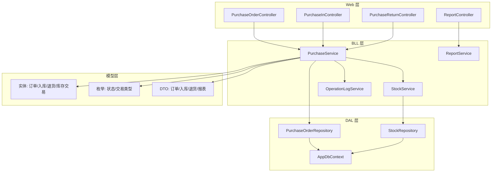
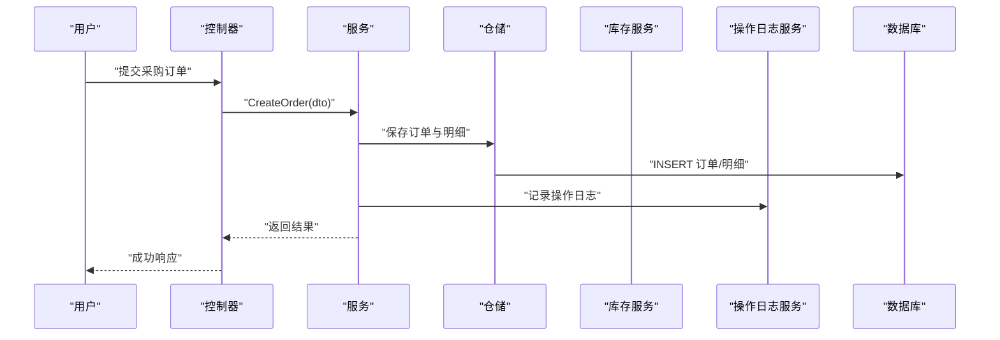
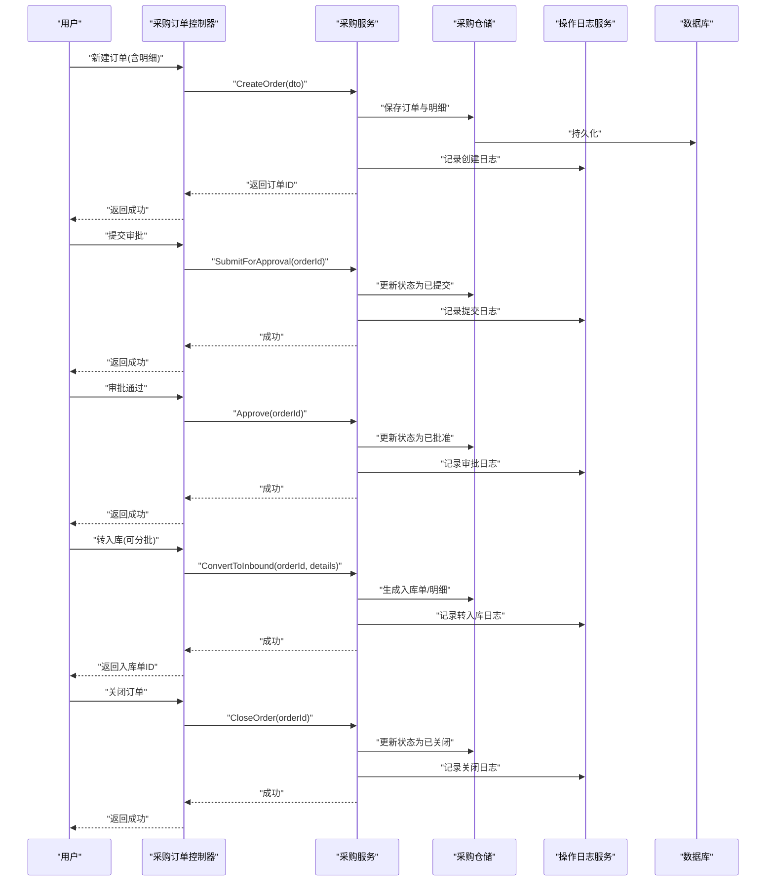
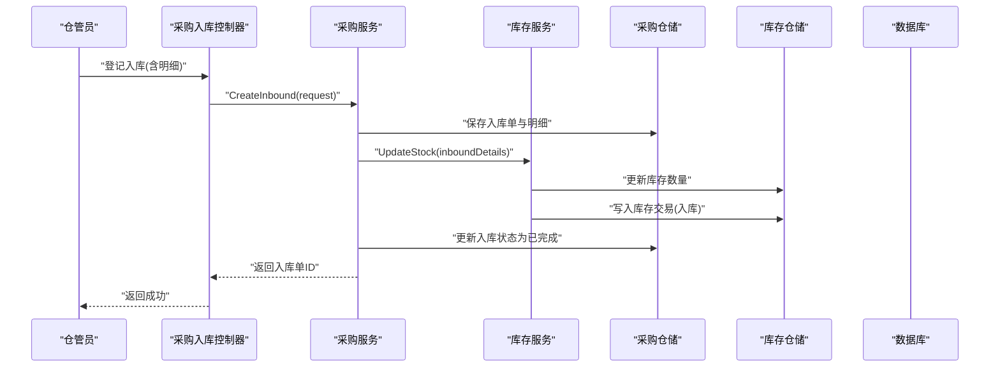
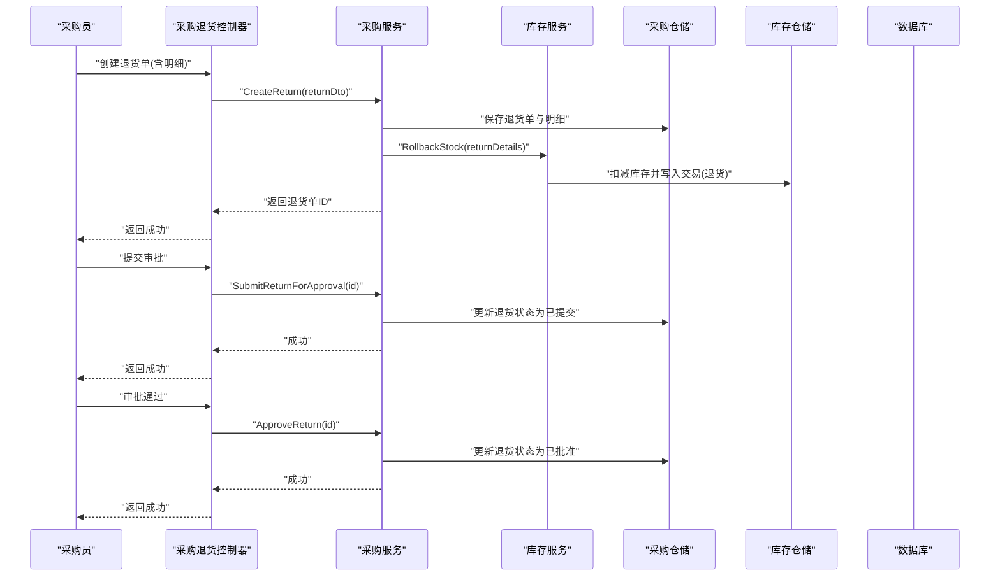
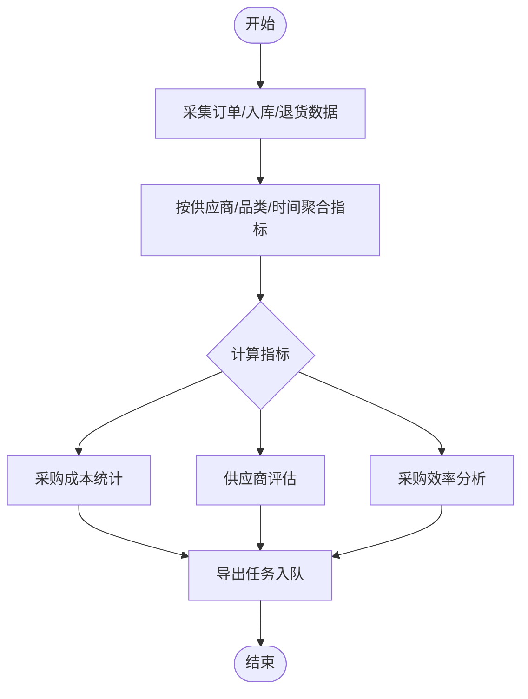
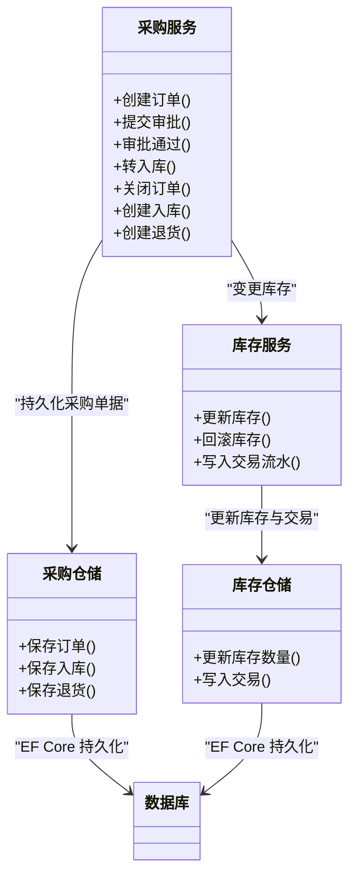
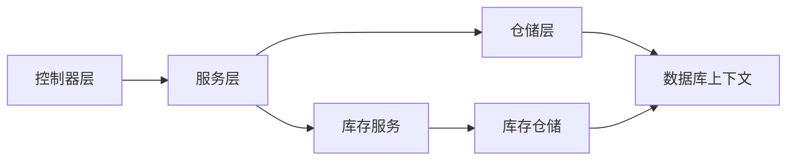

# 采购管理

<cite>
**本文引用的文件**   
- [PurchaseOrderController.cs](file://EquipmentIMS.Web/Controllers/PurchaseOrderController.cs)
- [PurchaseInController.cs](file://EquipmentIMS.Web/Controllers/PurchaseInController.cs)
- [PurchaseReturnController.cs](file://EquipmentIMS.Web/Controllers/PurchaseReturnController.cs)
- [PurchaseService.cs](file://EquipmentIMS.BLL/Services/PurchaseService.cs)
- [IPurchaseService.cs](file://EquipmentIMS.BLL/Interfaces/IPurchaseService.cs)
- [PurchaseOrderRepository.cs](file://EquipmentIMS.DAL/Repositories/PurchaseOrderRepository.cs)
- [IPurchaseOrderRepository.cs](file://EquipmentIMS.DAL/Interfaces/IPurchaseOrderRepository.cs)
- [PurPurchaseOrder.cs](file://EquipmentIMS.Models/Entities/PurPurchaseOrder.cs)
- [PurPurchaseOrderDetail.cs](file://EquipmentIMS.Models/Entities/PurPurchaseOrderDetail.cs)
- [PurPurchaseIn.cs](file://EquipmentIMS.Models/Entities/PurPurchaseIn.cs)
- [PurPurchaseInDetail.cs](file://EquipmentIMS.Models/Entities/PurPurchaseInDetail.cs)
- [PurPurchaseReturn.cs](file://EquipmentIMS.Models/Entities/PurPurchaseReturn.cs)
- [PurPurchaseReturnDetail.cs](file://EquipmentIMS.Models/Entities/PurPurchaseReturnDetail.cs)
- [PurchaseOrderDto.cs](file://EquipmentIMS.Models/DTOs/PurchaseOrderDto.cs)
- [PurchaseInDto.cs](file://EquipmentIMS.Models/DTOs/PurchaseInDto.cs)
- [PurchaseInRequestDto.cs](file://EquipmentIMS.Models/DTOs/PurchaseInRequestDto.cs)
- [PurchaseInDetailDto.cs](file://EquipmentIMS.Models/DTOs/PurchaseInDetailDto.cs)
- [PurchaseReturnDto.cs](file://EquipmentIMS.Models/DTOs/PurchaseReturnDto.cs)
- [PurchaseOrderStatus.cs](file://EquipmentIMS.Models/Enums/PurchaseOrderStatus.cs)
- [PurchaseInStatus.cs](file://EquipmentIMS.Models/Enums/PurchaseInStatus.cs)
- [PurchaseReturnStatus.cs](file://EquipmentIMS.Models/Enums/PurchaseReturnStatus.cs)
- [StockService.cs](file://EquipmentIMS.BLL/Services/StockService.cs)
- [IStockService.cs](file://EquipmentIMS.BLL/Interfaces/IStockService.cs)
- [StockRepository.cs](file://EquipmentIMS.DAL/Repositories/StockRepository.cs)
- [IStockRepository.cs](file://EquipmentIMS.DAL/Interfaces/IStockRepository.cs)
- [InvStockTransaction.cs](file://EquipmentIMS.Models/Entities/InvStockTransaction.cs)
- [TransactionType.cs](file://EquipmentIMS.Models/Enums/TransactionType.cs)
- [ReportService.cs](file://EquipmentIMS.BLL/Services/ReportService.cs)
- [ReportExportTaskQueue.cs](file://EquipmentIMS.BLL/Services/ReportExportTaskQueue.cs)
- [ReportController.cs](file://EquipmentIMS.Web/Controllers/ReportController.cs)
- [ReportPurchaseDtos.cs](file://EquipmentIMS.Models/DTOs/Reports/ReportPurchaseDtos.cs)
- [OperationLogService.cs](file://EquipmentIMS.BLL/Services/OperationLogService.cs)
- [IOperationLogService.cs](file://EquipmentIMS.BLL/Interfaces/IOperationLogService.cs)
- [SysOperationLog.cs](file://EquipmentIMS.Models/Entities/SysOperationLog.cs)
- [GlobalExceptionMiddleware.cs](file://EquipmentIMS.Web/Filters/GlobalExceptionMiddleware.cs)
- [AppDbContext.cs](file://EquipmentIMS.DAL/AppDbContext.cs)
</cite>

## 目录
1. [简介](#简介)
2. [项目结构](#项目结构)
3. [核心组件](#核心组件)
4. [架构总览](#架构总览)
5. [详细组件分析](#详细组件分析)
6. [依赖关系分析](#依赖关系分析)
7. [性能考虑](#性能考虑)
8. [故障排查指南](#故障排查指南)
9. [结论](#结论)
10. [附录](#附录)

## 简介
本文件面向采购管理模块，系统性阐述采购订单管理、采购入库流程、采购退货处理等核心能力，覆盖从创建、审批、执行到关闭的全生命周期；同时说明验收与质检、数量核对、供应商评估、采购成本统计与效率分析，以及与库存、财务系统的集成和数据同步机制。文档以代码仓库为依据，提供可视化架构图与流程图，帮助读者快速理解并落地使用。

## 项目结构
采购管理采用分层架构：Web 控制器层负责请求路由与参数校验；BLL 服务层封装业务规则与跨域协调；DAL 仓储层对接数据库实体与配置；Models 定义实体、枚举、DTO 与异常类型。

图表来源
- [PurchaseOrderController.cs](file://EquipmentIMS.Web/Controllers/PurchaseOrderController.cs)
- [PurchaseInController.cs](file://EquipmentIMS.Web/Controllers/PurchaseInController.cs)
- [PurchaseReturnController.cs](file://EquipmentIMS.Web/Controllers/PurchaseReturnController.cs)
- [PurchaseService.cs](file://EquipmentIMS.BLL/Services/PurchaseService.cs)
- [StockService.cs](file://EquipmentIMS.BLL/Services/StockService.cs)
- [ReportService.cs](file://EquipmentIMS.BLL/Services/ReportService.cs)
- [OperationLogService.cs](file://EquipmentIMS.BLL/Services/OperationLogService.cs)
- [PurchaseOrderRepository.cs](file://EquipmentIMS.DAL/Repositories/PurchaseOrderRepository.cs)
- [StockRepository.cs](file://EquipmentIMS.DAL/Repositories/StockRepository.cs)
- [AppDbContext.cs](file://EquipmentIMS.DAL/AppDbContext.cs)

章节来源
- [PurchaseOrderController.cs](file://EquipmentIMS.Web/Controllers/PurchaseOrderController.cs)
- [PurchaseInController.cs](file://EquipmentIMS.Web/Controllers/PurchaseInController.cs)
- [PurchaseReturnController.cs](file://EquipmentIMS.Web/Controllers/PurchaseReturnController.cs)
- [PurchaseService.cs](file://EquipmentIMS.BLL/Services/PurchaseService.cs)
- [StockService.cs](file://EquipmentIMS.BLL/Services/StockService.cs)
- [ReportService.cs](file://EquipmentIMS.BLL/Services/ReportService.cs)
- [OperationLogService.cs](file://EquipmentIMS.BLL/Services/OperationLogService.cs)
- [PurchaseOrderRepository.cs](file://EquipmentIMS.DAL/Repositories/PurchaseOrderRepository.cs)
- [StockRepository.cs](file://EquipmentIMS.DAL/Repositories/StockRepository.cs)
- [AppDbContext.cs](file://EquipmentIMS.DAL/AppDbContext.cs)

## 核心组件
- 控制器层
  - 采购订单控制器：提供订单的增删改查、提交审批、转入库、关闭等接口。
  - 采购入库控制器：提供按订单生成入库单、登记明细、完成入库并触发库存变动。
  - 采购退货控制器：支持创建退货单、关联原入库或订单、回滚库存并记录流水。
  - 报表控制器：聚合采购相关指标，支持导出任务队列异步处理。
- 服务层
  - 采购服务：编排订单生命周期、入库与退货的业务规则，调用仓储与库存服务，记录操作日志。
  - 库存服务：统一维护库存数量与交易流水，保证事务一致性。
  - 报表服务：汇总供应商评估、采购成本与效率指标。
  - 操作日志服务：记录关键业务动作，便于审计与追溯。
- 数据访问层
  - 采购仓储：封装订单、入库、退货实体的持久化逻辑。
  - 库存仓储：封装库存主数据与交易流水的读写。
  - 上下文：EF Core 数据上下文，承载实体映射与配置。
- 模型层
  - 实体：订单、订单明细、入库、入库明细、退货、退货明细、库存交易等。
  - 枚举：订单状态、入库状态、退货状态、交易类型等。
  - DTO：用于 API 输入输出与报表展示的数据契约。

章节来源
- [PurchaseOrderController.cs](file://EquipmentIMS.Web/Controllers/PurchaseOrderController.cs)
- [PurchaseInController.cs](file://EquipmentIMS.Web/Controllers/PurchaseInController.cs)
- [PurchaseReturnController.cs](file://EquipmentIMS.Web/Controllers/PurchaseReturnController.cs)
- [PurchaseService.cs](file://EquipmentIMS.BLL/Services/PurchaseService.cs)
- [StockService.cs](file://EquipmentIMS.BLL/Services/StockService.cs)
- [ReportService.cs](file://EquipmentIMS.BLL/Services/ReportService.cs)
- [OperationLogService.cs](file://EquipmentIMS.BLL/Services/OperationLogService.cs)
- [PurchaseOrderRepository.cs](file://EquipmentIMS.DAL/Repositories/PurchaseOrderRepository.cs)
- [StockRepository.cs](file://EquipmentIMS.DAL/Repositories/StockRepository.cs)
- [AppDbContext.cs](file://EquipmentIMS.DAL/AppDbContext.cs)
- [PurPurchaseOrder.cs](file://EquipmentIMS.Models/Entities/PurPurchaseOrder.cs)
- [PurPurchaseOrderDetail.cs](file://EquipmentIMS.Models/Entities/PurPurchaseOrderDetail.cs)
- [PurPurchaseIn.cs](file://EquipmentIMS.Models/Entities/PurPurchaseIn.cs)
- [PurPurchaseInDetail.cs](file://EquipmentIMS.Models/Entities/PurPurchaseInDetail.cs)
- [PurPurchaseReturn.cs](file://EquipmentIMS.Models/Entities/PurPurchaseReturn.cs)
- [PurPurchaseReturnDetail.cs](file://EquipmentIMS.Models/Entities/PurPurchaseReturnDetail.cs)
- [PurchaseOrderDto.cs](file://EquipmentIMS.Models/DTOs/PurchaseOrderDto.cs)
- [PurchaseInDto.cs](file://EquipmentIMS.Models/DTOs/PurchaseInDto.cs)
- [PurchaseInRequestDto.cs](file://EquipmentIMS.Models/DTOs/PurchaseInRequestDto.cs)
- [PurchaseInDetailDto.cs](file://EquipmentIMS.Models/DTOs/PurchaseInDetailDto.cs)
- [PurchaseReturnDto.cs](file://EquipmentIMS.Models/DTOs/PurchaseReturnDto.cs)
- [PurchaseOrderStatus.cs](file://EquipmentIMS.Models/Enums/PurchaseOrderStatus.cs)
- [PurchaseInStatus.cs](file://EquipmentIMS.Models/Enums/PurchaseInStatus.cs)
- [PurchaseReturnStatus.cs](file://EquipmentIMS.Models/Enums/PurchaseReturnStatus.cs)
- [InvStockTransaction.cs](file://EquipmentIMS.Models/Entities/InvStockTransaction.cs)
- [TransactionType.cs](file://EquipmentIMS.Models/Enums/TransactionType.cs)

## 架构总览
采购管理遵循“控制器→服务→仓储→数据库”的分层调用路径，并通过 DTO 与枚举进行契约约束。关键交互如下：
- 控制器接收 HTTP 请求，校验参数后调用服务。
- 服务实现业务编排，必要时调用库存服务更新库存与交易流水，并写入操作日志。
- 仓储通过 EF Core 上下文对实体进行持久化。
- 报表服务聚合多源数据，结合导出任务队列异步生成报表。

图表来源
- [PurchaseOrderController.cs](file://EquipmentIMS.Web/Controllers/PurchaseOrderController.cs)
- [PurchaseService.cs](file://EquipmentIMS.BLL/Services/PurchaseService.cs)
- [PurchaseOrderRepository.cs](file://EquipmentIMS.DAL/Repositories/PurchaseOrderRepository.cs)
- [OperationLogService.cs](file://EquipmentIMS.BLL/Services/OperationLogService.cs)
- [AppDbContext.cs](file://EquipmentIMS.DAL/AppDbContext.cs)

## 详细组件分析

### 采购订单管理（创建、审批、执行、关闭）
- 功能要点
  - 创建订单：选择供应商、产品、数量、单价、期望到货日期等，生成唯一订单号。
  - 审批流转：草稿→已提交→已批准→已拒绝；支持驳回与撤销。
  - 执行阶段：已批准后可转为待入库；支持分批入库与部分关闭。
  - 关闭策略：全部入库后自动关闭；支持手动关闭未完全入库的订单（需备注原因）。
- 关键实体与 DTO
  - 实体：订单、订单明细
  - DTO：订单查询与编辑视图对象
  - 枚举：订单状态
- 典型流程（序列图）

图表来源
- [PurchaseOrderController.cs](file://EquipmentIMS.Web/Controllers/PurchaseOrderController.cs)
- [PurchaseService.cs](file://EquipmentIMS.BLL/Services/PurchaseService.cs)
- [PurchaseOrderRepository.cs](file://EquipmentIMS.DAL/Repositories/PurchaseOrderRepository.cs)
- [OperationLogService.cs](file://EquipmentIMS.BLL/Services/OperationLogService.cs)
- [PurPurchaseOrder.cs](file://EquipmentIMS.Models/Entities/PurPurchaseOrder.cs)
- [PurPurchaseOrderDetail.cs](file://EquipmentIMS.Models/Entities/PurPurchaseOrderDetail.cs)
- [PurchaseOrderDto.cs](file://EquipmentIMS.Models/DTOs/PurchaseOrderDto.cs)
- [PurchaseOrderStatus.cs](file://EquipmentIMS.Models/Enums/PurchaseOrderStatus.cs)

章节来源
- [PurchaseOrderController.cs](file://EquipmentIMS.Web/Controllers/PurchaseOrderController.cs)
- [PurchaseService.cs](file://EquipmentIMS.BLL/Services/PurchaseService.cs)
- [PurchaseOrderRepository.cs](file://EquipmentIMS.DAL/Repositories/PurchaseOrderRepository.cs)
- [OperationLogService.cs](file://EquipmentIMS.BLL/Services/OperationLogService.cs)
- [PurPurchaseOrder.cs](file://EquipmentIMS.Models/Entities/PurPurchaseOrder.cs)
- [PurPurchaseOrderDetail.cs](file://EquipmentIMS.Models/Entities/PurPurchaseOrderDetail.cs)
- [PurchaseOrderDto.cs](file://EquipmentIMS.Models/DTOs/PurchaseOrderDto.cs)
- [PurchaseOrderStatus.cs](file://EquipmentIMS.Models/Enums/PurchaseOrderStatus.cs)

### 采购入库流程（验收、质检、数量核对）
- 功能要点
  - 按订单生成入库单：支持整单或部分数量入库，保留未入库数量。
  - 验收与质检：登记实际到货数量、批次、有效期、质检结果（合格/不合格/让步接收）。
  - 数量核对：系统比对订单数量与实际数量，差异需记录原因并走例外处理。
  - 入库完成：更新库存可用量，生成库存交易流水（入库类型），标记入库单完成。
- 关键实体与 DTO
  - 实体：入库、入库明细、库存交易
  - DTO：入库单、入库请求、入库明细
  - 枚举：入库状态、交易类型
- 入库完成流程（序列图）

图表来源
- [PurchaseInController.cs](file://EquipmentIMS.Web/Controllers/PurchaseInController.cs)
- [PurchaseService.cs](file://EquipmentIMS.BLL/Services/PurchaseService.cs)
- [StockService.cs](file://EquipmentIMS.BLL/Services/StockService.cs)
- [PurchaseOrderRepository.cs](file://EquipmentIMS.DAL/Repositories/PurchaseOrderRepository.cs)
- [StockRepository.cs](file://EquipmentIMS.DAL/Repositories/StockRepository.cs)
- [PurPurchaseIn.cs](file://EquipmentIMS.Models/Entities/PurPurchaseIn.cs)
- [PurPurchaseInDetail.cs](file://EquipmentIMS.Models/Entities/PurPurchaseInDetail.cs)
- [InvStockTransaction.cs](file://EquipmentIMS.Models/Entities/InvStockTransaction.cs)
- [PurchaseInDto.cs](file://EquipmentIMS.Models/DTOs/PurchaseInDto.cs)
- [PurchaseInRequestDto.cs](file://EquipmentIMS.Models/DTOs/PurchaseInRequestDto.cs)
- [PurchaseInDetailDto.cs](file://EquipmentIMS.Models/DTOs/PurchaseInDetailDto.cs)
- [PurchaseInStatus.cs](file://EquipmentIMS.Models/Enums/PurchaseInStatus.cs)
- [TransactionType.cs](file://EquipmentIMS.Models/Enums/TransactionType.cs)

章节来源
- [PurchaseInController.cs](file://EquipmentIMS.Web/Controllers/PurchaseInController.cs)
- [PurchaseService.cs](file://EquipmentIMS.BLL/Services/PurchaseService.cs)
- [StockService.cs](file://EquipmentIMS.BLL/Services/StockService.cs)
- [PurchaseOrderRepository.cs](file://EquipmentIMS.DAL/Repositories/PurchaseOrderRepository.cs)
- [StockRepository.cs](file://EquipmentIMS.DAL/Repositories/StockRepository.cs)
- [PurPurchaseIn.cs](file://EquipmentIMS.Models/Entities/PurPurchaseIn.cs)
- [PurPurchaseInDetail.cs](file://EquipmentIMS.Models/Entities/PurPurchaseInDetail.cs)
- [InvStockTransaction.cs](file://EquipmentIMS.Models/Entities/InvStockTransaction.cs)
- [PurchaseInDto.cs](file://EquipmentIMS.Models/DTOs/PurchaseInDto.cs)
- [PurchaseInRequestDto.cs](file://EquipmentIMS.Models/DTOs/PurchaseInRequestDto.cs)
- [PurchaseInDetailDto.cs](file://EquipmentIMS.Models/DTOs/PurchaseInDetailDto.cs)
- [PurchaseInStatus.cs](file://EquipmentIMS.Models/Enums/PurchaseInStatus.cs)
- [TransactionType.cs](file://EquipmentIMS.Models/Enums/TransactionType.cs)

### 采购退货处理（原因分析、审批、库存回滚）
- 功能要点
  - 退货原因：质量缺陷、错发漏发、过期、包装破损、其他。
  - 审批流程：草稿→已提交→已批准→已拒绝；支持撤回与修改。
  - 库存回滚：按退货明细扣减库存，生成库存交易流水（退货类型），并关联原入库单或订单。
  - 财务联动：退货影响应付账款与成本核算（由财务模块消费库存交易与退货单据）。
- 关键实体与 DTO
  - 实体：退货、退货明细、库存交易
  - DTO：退货单
  - 枚举：退货状态、交易类型
- 退货流程（序列图）

图表来源
- [PurchaseReturnController.cs](file://EquipmentIMS.Web/Controllers/PurchaseReturnController.cs)
- [PurchaseService.cs](file://EquipmentIMS.BLL/Services/PurchaseService.cs)
- [StockService.cs](file://EquipmentIMS.BLL/Services/StockService.cs)
- [PurchaseOrderRepository.cs](file://EquipmentIMS.DAL/Repositories/PurchaseOrderRepository.cs)
- [StockRepository.cs](file://EquipmentIMS.DAL/Repositories/StockRepository.cs)
- [PurPurchaseReturn.cs](file://EquipmentIMS.Models/Entities/PurPurchaseReturn.cs)
- [PurPurchaseReturnDetail.cs](file://EquipmentIMS.Models/Entities/PurPurchaseReturnDetail.cs)
- [InvStockTransaction.cs](file://EquipmentIMS.Models/Entities/InvStockTransaction.cs)
- [PurchaseReturnDto.cs](file://EquipmentIMS.Models/DTOs/PurchaseReturnDto.cs)
- [PurchaseReturnStatus.cs](file://EquipmentIMS.Models/Enums/PurchaseReturnStatus.cs)
- [TransactionType.cs](file://EquipmentIMS.Models/Enums/TransactionType.cs)

章节来源
- [PurchaseReturnController.cs](file://EquipmentIMS.Web/Controllers/PurchaseReturnController.cs)
- [PurchaseService.cs](file://EquipmentIMS.BLL/Services/PurchaseService.cs)
- [StockService.cs](file://EquipmentIMS.BLL/Services/StockService.cs)
- [PurchaseOrderRepository.cs](file://EquipmentIMS.DAL/Repositories/PurchaseOrderRepository.cs)
- [StockRepository.cs](file://EquipmentIMS.DAL/Repositories/StockRepository.cs)
- [PurPurchaseReturn.cs](file://EquipmentIMS.Models/Entities/PurPurchaseReturn.cs)
- [PurPurchaseReturnDetail.cs](file://EquipmentIMS.Models/Entities/PurPurchaseReturnDetail.cs)
- [InvStockTransaction.cs](file://EquipmentIMS.Models/Entities/InvStockTransaction.cs)
- [PurchaseReturnDto.cs](file://EquipmentIMS.Models/DTOs/PurchaseReturnDto.cs)
- [PurchaseReturnStatus.cs](file://EquipmentIMS.Models/Enums/PurchaseReturnStatus.cs)
- [TransactionType.cs](file://EquipmentIMS.Models/Enums/TransactionType.cs)

### 供应商评估、采购成本统计与效率分析
- 供应商评估
  - 维度：交期达成率、合格率、价格竞争力、服务评分、历史合作评价。
  - 数据来源：订单履约、入库质检、退货率、价格趋势。
- 采购成本统计
  - 指标：按供应商/品类/时间维度的采购金额、平均单价、折扣与返利、运费分摊。
  - 成本归集：基于入库明细与退货冲销计算净采购成本。
- 采购效率分析
  - 指标：订单周期（创建至入库）、审批时长、入库及时率、缺货等待时长。
- 报表与导出
  - 报表服务聚合数据，导出任务队列异步生成 Excel/CSV，避免阻塞主线程。
- 关键组件
  - 报表服务、导出任务队列、报表 DTO、报表控制器

图表来源
- [ReportService.cs](file://EquipmentIMS.BLL/Services/ReportService.cs)
- [ReportExportTaskQueue.cs](file://EquipmentIMS.BLL/Services/ReportExportTaskQueue.cs)
- [ReportController.cs](file://EquipmentIMS.Web/Controllers/ReportController.cs)
- [ReportPurchaseDtos.cs](file://EquipmentIMS.Models/DTOs/Reports/ReportPurchaseDtos.cs)

章节来源
- [ReportService.cs](file://EquipmentIMS.BLL/Services/ReportService.cs)
- [ReportExportTaskQueue.cs](file://EquipmentIMS.BLL/Services/ReportExportTaskQueue.cs)
- [ReportController.cs](file://EquipmentIMS.Web/Controllers/ReportController.cs)
- [ReportPurchaseDtos.cs](file://EquipmentIMS.Models/DTOs/Reports/ReportPurchaseDtos.cs)

### 与库存、财务系统集成与数据同步
- 与库存集成
  - 入库：增加可用库存，写入入库交易流水。
  - 退货：扣减库存，写入退货交易流水。
  - 一致性：通过库存服务在事务内更新库存与交易，确保账实一致。
- 与财务集成
  - 数据源：入库与退货交易流水作为应付与成本核算依据。
  - 同步机制：财务系统订阅库存交易事件或通过定时拉取交易流水进行对账。
- 关键实体与枚举
  - 库存交易实体、交易类型枚举

图表来源
- [PurchaseService.cs](file://EquipmentIMS.BLL/Services/PurchaseService.cs)
- [StockService.cs](file://EquipmentIMS.BLL/Services/StockService.cs)
- [PurchaseOrderRepository.cs](file://EquipmentIMS.DAL/Repositories/PurchaseOrderRepository.cs)
- [StockRepository.cs](file://EquipmentIMS.DAL/Repositories/StockRepository.cs)
- [AppDbContext.cs](file://EquipmentIMS.DAL/AppDbContext.cs)
- [InvStockTransaction.cs](file://EquipmentIMS.Models/Entities/InvStockTransaction.cs)
- [TransactionType.cs](file://EquipmentIMS.Models/Enums/TransactionType.cs)

章节来源
- [PurchaseService.cs](file://EquipmentIMS.BLL/Services/PurchaseService.cs)
- [StockService.cs](file://EquipmentIMS.BLL/Services/StockService.cs)
- [PurchaseOrderRepository.cs](file://EquipmentIMS.DAL/Repositories/PurchaseOrderRepository.cs)
- [StockRepository.cs](file://EquipmentIMS.DAL/Repositories/StockRepository.cs)
- [AppDbContext.cs](file://EquipmentIMS.DAL/AppDbContext.cs)
- [InvStockTransaction.cs](file://EquipmentIMS.Models/Entities/InvStockTransaction.cs)
- [TransactionType.cs](file://EquipmentIMS.Models/Enums/TransactionType.cs)

## 依赖关系分析
- 组件耦合
  - 控制器仅依赖服务接口，保持松耦合。
  - 服务依赖仓储与库存服务，职责清晰。
  - 仓储依赖 EF Core 上下文，屏蔽数据库细节。
- 外部依赖
  - EF Core 数据上下文与实体映射。
  - 可选：导出任务队列（后台服务）用于报表导出。
- 潜在循环依赖
  - 当前分层清晰，未见循环引用；若扩展财务集成，建议通过事件总线或消息队列解耦。

图表来源
- [PurchaseOrderController.cs](file://EquipmentIMS.Web/Controllers/PurchaseOrderController.cs)
- [PurchaseInController.cs](file://EquipmentIMS.Web/Controllers/PurchaseInController.cs)
- [PurchaseReturnController.cs](file://EquipmentIMS.Web/Controllers/PurchaseReturnController.cs)
- [PurchaseService.cs](file://EquipmentIMS.BLL/Services/PurchaseService.cs)
- [StockService.cs](file://EquipmentIMS.BLL/Services/StockService.cs)
- [PurchaseOrderRepository.cs](file://EquipmentIMS.DAL/Repositories/PurchaseOrderRepository.cs)
- [StockRepository.cs](file://EquipmentIMS.DAL/Repositories/StockRepository.cs)
- [AppDbContext.cs](file://EquipmentIMS.DAL/AppDbContext.cs)

章节来源
- [PurchaseOrderController.cs](file://EquipmentIMS.Web/Controllers/PurchaseOrderController.cs)
- [PurchaseInController.cs](file://EquipmentIMS.Web/Controllers/PurchaseInController.cs)
- [PurchaseReturnController.cs](file://EquipmentIMS.Web/Controllers/PurchaseReturnController.cs)
- [PurchaseService.cs](file://EquipmentIMS.BLL/Services/PurchaseService.cs)
- [StockService.cs](file://EquipmentIMS.BLL/Services/StockService.cs)
- [PurchaseOrderRepository.cs](file://EquipmentIMS.DAL/Repositories/PurchaseOrderRepository.cs)
- [StockRepository.cs](file://EquipmentIMS.DAL/Repositories/StockRepository.cs)
- [AppDbContext.cs](file://EquipmentIMS.DAL/AppDbContext.cs)

## 性能考虑
- 批量操作
  - 入库与退货明细批量写入，减少往返次数。
- 索引优化
  - 对订单号、入库单号、供应商ID、产品ID、交易时间建立合适索引。
- 异步导出
  - 报表导出使用任务队列，避免长时间占用请求线程。
- 事务边界
  - 库存更新与交易写入在同一事务中，保障一致性。
- 缓存策略
  - 基础数据（供应商、产品）可引入缓存降低查询压力。

[本节为通用性能建议，不直接分析具体文件]

## 故障排查指南
- 全局异常中间件
  - 捕获未处理异常，统一返回错误码与消息，便于前端提示与日志追踪。
- 操作日志
  - 关键业务动作均记录操作日志，包含操作人、时间、前后状态，便于审计与回溯。
- 常见错误定位
  - 库存不足：检查入库前可用量与锁定量。
  - 状态不一致：核对订单/入库/退货状态机转换是否合法。
  - 数据不同步：核对库存交易流水与库存主数据是否匹配。

章节来源
- [GlobalExceptionMiddleware.cs](file://EquipmentIMS.Web/Filters/GlobalExceptionMiddleware.cs)
- [OperationLogService.cs](file://EquipmentIMS.BLL/Services/OperationLogService.cs)
- [IOperationLogService.cs](file://EquipmentIMS.BLL/Interfaces/IOperationLogService.cs)
- [SysOperationLog.cs](file://EquipmentIMS.Models/Entities/SysOperationLog.cs)

## 结论
采购管理模块围绕“订单—入库—退货”的主线，构建了完整的业务流程与数据闭环。通过分层架构与清晰的职责划分，实现了良好的可维护性与可扩展性。结合库存交易流水与操作日志，确保了数据的可追溯性与一致性。报表与导出能力为供应商评估、成本统计与效率分析提供了数据支撑，有助于持续优化采购策略与运营效率。

## 附录
- 术语表
  - 订单：采购方与供应商达成的商品或服务购买约定。
  - 入库：将到货商品登记并增加库存的过程。
  - 退货：因质量或其他原因退回供应商并扣减库存的过程。
  - 库存交易：记录库存变动的流水条目，用于对账与分析。
- 参考文件
  - 控制器与服务：见各控制器与服务文件路径
  - 实体与枚举：见 Models/Entities 与 Models/Enums 下对应文件
  - 仓储与上下文：见 DAL/Repositories 与 AppDbContext