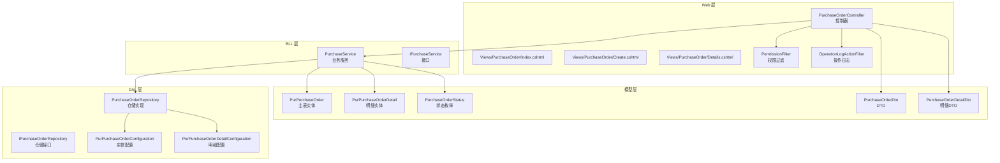
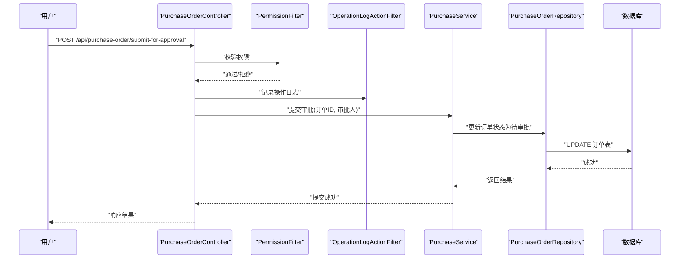
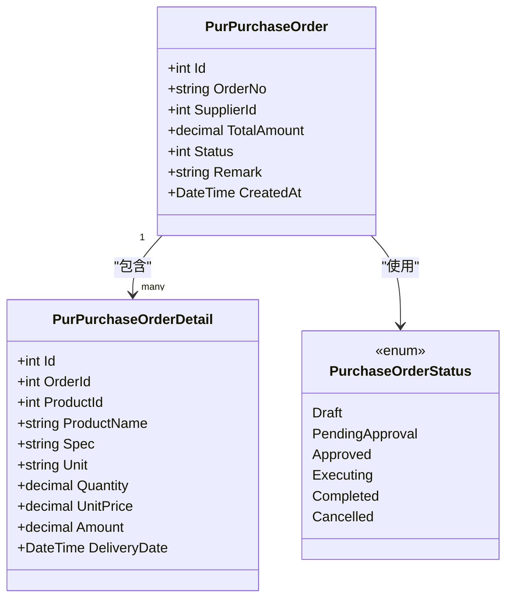
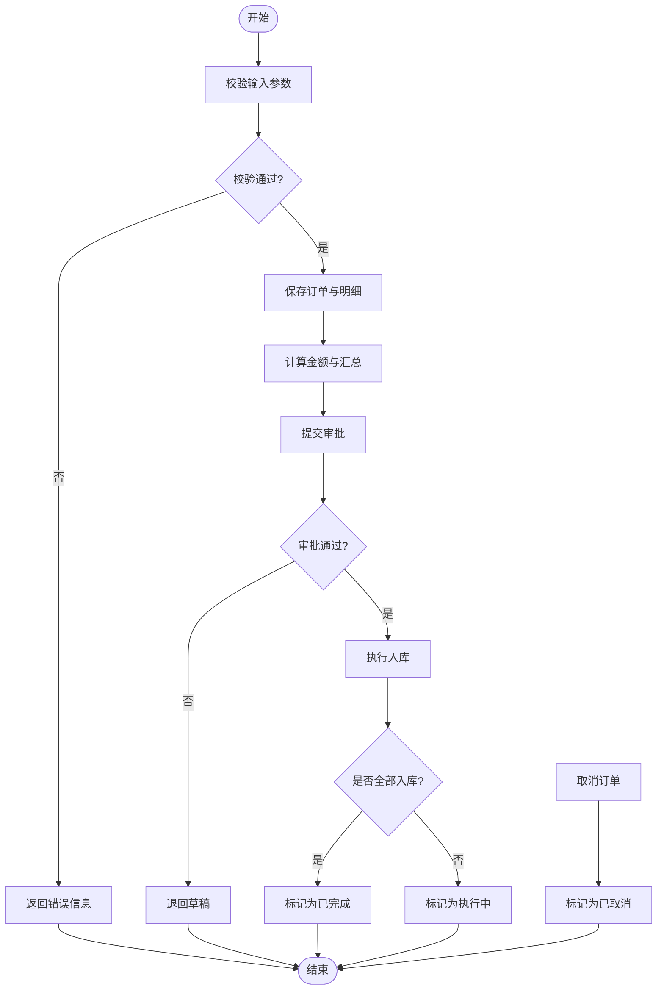
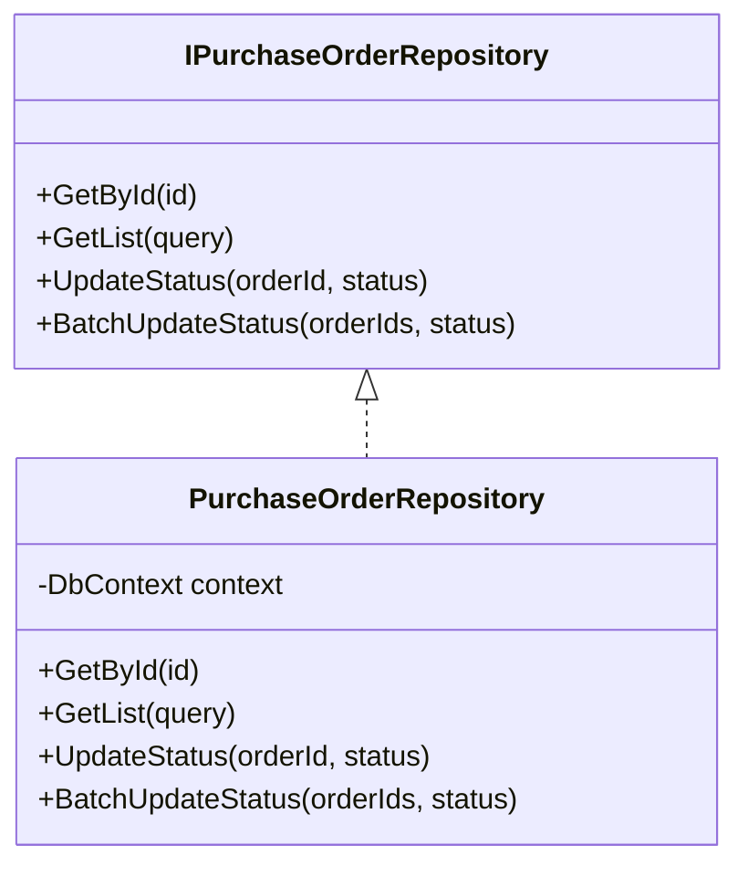
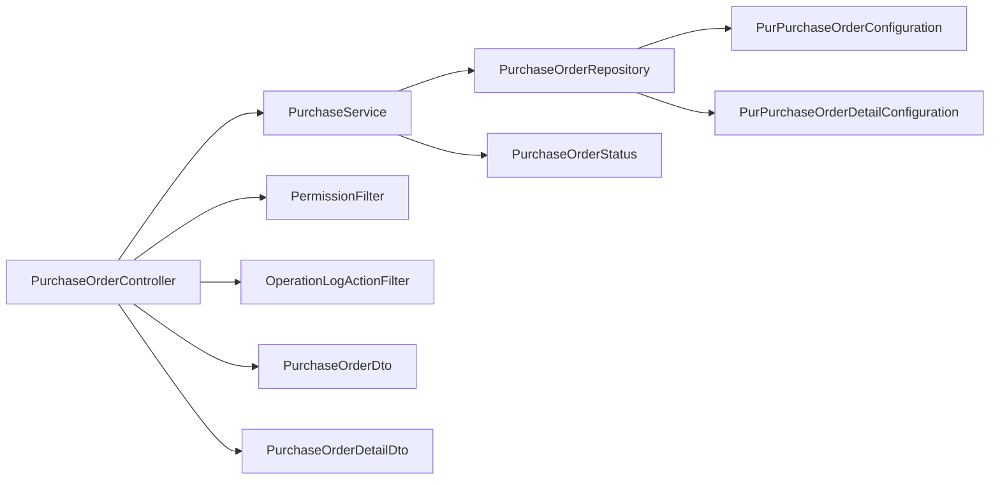

# 采购订单管理

<cite>
**本文引用的文件**   
- [PurchaseOrderController.cs](file://EquipmentIMS.Web/Controllers/PurchaseOrderController.cs)
- [PurchaseService.cs](file://EquipmentIMS.BLL/Services/PurchaseService.cs)
- [IPurchaseService.cs](file://EquipmentIMS.BLL/Interfaces/IPurchaseService.cs)
- [PurchaseOrderRepository.cs](file://EquipmentIMS.DAL/Repositories/PurchaseOrderRepository.cs)
- [IPurchaseOrderRepository.cs](file://EquipmentIMS.DAL/Interfaces/IPurchaseOrderRepository.cs)
- [PurPurchaseOrderConfiguration.cs](file://EquipmentIMS.DAL/Configurations/PurPurchaseOrderConfiguration.cs)
- [PurPurchaseOrderDetailConfiguration.cs](file://EquipmentIMS.DAL/Configurations/PurPurchaseOrderDetailConfiguration.cs)
- [PurPurchaseOrder.cs](file://EquipmentIMS.Models/Entities/PurPurchaseOrder.cs)
- [PurPurchaseOrderDetail.cs](file://EquipmentIMS.Models/Entities/PurPurchaseOrderDetail.cs)
- [PurchaseOrderStatus.cs](file://EquipmentIMS.Models/Enums/PurchaseOrderStatus.cs)
- [PurchaseOrderDto.cs](file://EquipmentIMS.Models/DTOs/PurchaseOrderDto.cs)
- [PurchaseOrderDetailDto.cs](file://EquipmentIMS.Models/DTOs/PurchaseOrderDetailDto.cs)
- [PurchaseOrderViewModel.cs](file://EquipmentIMS.Web/Models/PurchaseOrderViewModel.cs)
- [Index.cshtml](file://EquipmentIMS.Web/Views/PurchaseOrder/Index.cshtml)
- [Create.cshtml](file://EquipmentIMS.Web/Views/PurchaseOrder/Create.cshtml)
- [Details.cshtml](file://EquipmentIMS.Web/Views/PurchaseOrder/Details.cshtml)
- [PermissionFilter.cs](file://EquipmentIMS.Web/Filters/PermissionFilter.cs)
- [OperationLogActionFilter.cs](file://EquipmentIMS.Web/Filters/OperationLogActionFilter.cs)
</cite>

## 目录
1. [简介](#简介)
2. [项目结构](#项目结构)
3. [核心组件](#核心组件)
4. [架构总览](#架构总览)
5. [详细组件分析](#详细组件分析)
6. [依赖关系分析](#依赖关系分析)
7. [性能考虑](#性能考虑)
8. [故障排查指南](#故障排查指南)
9. [结论](#结论)
10. [附录](#附录)

## 简介
本文件面向采购订单管理功能，覆盖从创建、编辑、审批、执行到关闭的全流程。文档重点说明：
- 状态管理机制与转换规则（草稿、待审批、已批准、执行中、已完成、已取消）
- 采购订单明细管理（产品选择、数量、单价、交货日期）
- 审批流程（多级审批、审批意见记录、权限控制）
- 查询统计（按供应商、时间范围、状态等多维度筛选）
- 打印导出、模板管理与批量操作能力

## 项目结构
采购订单模块采用分层架构：Web 层提供控制器与视图；BLL 层封装业务逻辑；DAL 层负责数据访问；Models 层定义实体、枚举与 DTO；Filters 提供权限与审计拦截。

图表来源
- [PurchaseOrderController.cs](file://EquipmentIMS.Web/Controllers/PurchaseOrderController.cs)
- [PurchaseService.cs](file://EquipmentIMS.BLL/Services/PurchaseService.cs)
- [IPurchaseService.cs](file://EquipmentIMS.BLL/Interfaces/IPurchaseService.cs)
- [PurchaseOrderRepository.cs](file://EquipmentIMS.DAL/Repositories/PurchaseOrderRepository.cs)
- [IPurchaseOrderRepository.cs](file://EquipmentIMS.DAL/Interfaces/IPurchaseOrderRepository.cs)
- [PurPurchaseOrderConfiguration.cs](file://EquipmentIMS.DAL/Configurations/PurPurchaseOrderConfiguration.cs)
- [PurPurchaseOrderDetailConfiguration.cs](file://EquipmentIMS.DAL/Configurations/PurPurchaseOrderDetailConfiguration.cs)
- [PurPurchaseOrder.cs](file://EquipmentIMS.Models/Entities/PurPurchaseOrder.cs)
- [PurPurchaseOrderDetail.cs](file://EquipmentIMS.Models/Entities/PurPurchaseOrderDetail.cs)
- [PurchaseOrderStatus.cs](file://EquipmentIMS.Models/Enums/PurchaseOrderStatus.cs)
- [PurchaseOrderDto.cs](file://EquipmentIMS.Models/DTOs/PurchaseOrderDto.cs)
- [PurchaseOrderDetailDto.cs](file://EquipmentIMS.Models/DTOs/PurchaseOrderDetailDto.cs)
- [PermissionFilter.cs](file://EquipmentIMS.Web/Filters/PermissionFilter.cs)
- [OperationLogActionFilter.cs](file://EquipmentIMS.Web/Filters/OperationLogActionFilter.cs)

章节来源
- [PurchaseOrderController.cs](file://EquipmentIMS.Web/Controllers/PurchaseOrderController.cs)
- [PurchaseService.cs](file://EquipmentIMS.BLL/Services/PurchaseService.cs)
- [PurchaseOrderRepository.cs](file://EquipmentIMS.DAL/Repositories/PurchaseOrderRepository.cs)
- [PurPurchaseOrderConfiguration.cs](file://EquipmentIMS.DAL/Configurations/PurPurchaseOrderConfiguration.cs)
- [PurPurchaseOrderDetailConfiguration.cs](file://EquipmentIMS.DAL/Configurations/PurPurchaseOrderDetailConfiguration.cs)
- [PurPurchaseOrder.cs](file://EquipmentIMS.Models/Entities/PurPurchaseOrder.cs)
- [PurPurchaseOrderDetail.cs](file://EquipmentIMS.Models/Entities/PurPurchaseOrderDetail.cs)
- [PurchaseOrderStatus.cs](file://EquipmentIMS.Models/Enums/PurchaseOrderStatus.cs)
- [PurchaseOrderDto.cs](file://EquipmentIMS.Models/DTOs/PurchaseOrderDto.cs)
- [PurchaseOrderDetailDto.cs](file://EquipmentIMS.Models/DTOs/PurchaseOrderDetailDto.cs)
- [PermissionFilter.cs](file://EquipmentIMS.Web/Filters/PermissionFilter.cs)
- [OperationLogActionFilter.cs](file://EquipmentIMS.Web/Filters/OperationLogActionFilter.cs)

## 核心组件
- 控制器层：提供采购订单的增删改查、提交审批、执行入库、关闭等 API。
- 服务层：封装订单生命周期、校验、状态流转、明细聚合计算、权限与审计调用。
- 仓储层：基于 EF Core 的通用仓储扩展，提供分页、条件查询、事务支持。
- 实体与配置：主表与明细表的实体及映射配置，包含字段约束与关联关系。
- 枚举与 DTO：统一的状态枚举与数据传输对象，保证前后端一致的数据契约。
- 过滤器：权限校验与操作日志记录，贯穿控制器方法。

章节来源
- [PurchaseOrderController.cs](file://EquipmentIMS.Web/Controllers/PurchaseOrderController.cs)
- [PurchaseService.cs](file://EquipmentIMS.BLL/Services/PurchaseService.cs)
- [IPurchaseService.cs](file://EquipmentIMS.BLL/Interfaces/IPurchaseService.cs)
- [PurchaseOrderRepository.cs](file://EquipmentIMS.DAL/Repositories/PurchaseOrderRepository.cs)
- [IPurchaseOrderRepository.cs](file://EquipmentIMS.DAL/Interfaces/IPurchaseOrderRepository.cs)
- [PurPurchaseOrder.cs](file://EquipmentIMS.Models/Entities/PurPurchaseOrder.cs)
- [PurPurchaseOrderDetail.cs](file://EquipmentIMS.Models/Entities/PurPurchaseOrderDetail.cs)
- [PurchaseOrderStatus.cs](file://EquipmentIMS.Models/Enums/PurchaseOrderStatus.cs)
- [PurchaseOrderDto.cs](file://EquipmentIMS.Models/DTOs/PurchaseOrderDto.cs)
- [PurchaseOrderDetailDto.cs](file://EquipmentIMS.Models/DTOs/PurchaseOrderDetailDto.cs)
- [PermissionFilter.cs](file://EquipmentIMS.Web/Filters/PermissionFilter.cs)
- [OperationLogActionFilter.cs](file://EquipmentIMS.Web/Filters/OperationLogActionFilter.cs)

## 架构总览
下图展示一次“提交审批”请求在系统中的调用链路与数据流向。

图表来源
- [PurchaseOrderController.cs](file://EquipmentIMS.Web/Controllers/PurchaseOrderController.cs)
- [PermissionFilter.cs](file://EquipmentIMS.Web/Filters/PermissionFilter.cs)
- [OperationLogActionFilter.cs](file://EquipmentIMS.Web/Filters/OperationLogActionFilter.cs)
- [PurchaseService.cs](file://EquipmentIMS.BLL/Services/PurchaseService.cs)
- [PurchaseOrderRepository.cs](file://EquipmentIMS.DAL/Repositories/PurchaseOrderRepository.cs)

## 详细组件分析

### 实体与数据模型
- 主表实体：包含订单编号、供应商、总金额、状态、创建人、创建时间、备注等字段。
- 明细实体：包含订单ID、产品ID、产品名称、规格型号、单位、数量、单价、金额、交货日期等。
- 状态枚举：定义草稿、待审批、已批准、执行中、已完成、已取消等状态值。
- DTO：用于 API 输入输出，包括主表信息与明细集合。

图表来源
- [PurPurchaseOrder.cs](file://EquipmentIMS.Models/Entities/PurPurchaseOrder.cs)
- [PurPurchaseOrderDetail.cs](file://EquipmentIMS.Models/Entities/PurPurchaseOrderDetail.cs)
- [PurchaseOrderStatus.cs](file://EquipmentIMS.Models/Enums/PurchaseOrderStatus.cs)

章节来源
- [PurPurchaseOrder.cs](file://EquipmentIMS.Models/Entities/PurPurchaseOrder.cs)
- [PurPurchaseOrderDetail.cs](file://EquipmentIMS.Models/Entities/PurPurchaseOrderDetail.cs)
- [PurchaseOrderStatus.cs](file://EquipmentIMS.Models/Enums/PurchaseOrderStatus.cs)
- [PurchaseOrderDto.cs](file://EquipmentIMS.Models/DTOs/PurchaseOrderDto.cs)
- [PurchaseOrderDetailDto.cs](file://EquipmentIMS.Models/DTOs/PurchaseOrderDetailDto.cs)

### 控制器与视图
- 控制器提供以下关键 API：
  - 列表查询：支持分页、多条件筛选（供应商、时间范围、状态）。
  - 新增/编辑：保存主表与明细，自动计算合计金额。
  - 提交审批：将订单状态由草稿转为待审批。
  - 执行入库：根据明细生成入库单并更新订单状态为执行中或完成。
  - 关闭/取消：将订单置为已取消或已完成。
- 视图页面：
  - Index.cshtml：列表页，含筛选表单、分页与批量操作按钮。
  - Create.cshtml：新建/编辑表单，支持动态添加明细行。
  - Details.cshtml：详情查看与审批操作入口。

章节来源
- [PurchaseOrderController.cs](file://EquipmentIMS.Web/Controllers/PurchaseOrderController.cs)
- [Index.cshtml](file://EquipmentIMS.Web/Views/PurchaseOrder/Index.cshtml)
- [Create.cshtml](file://EquipmentIMS.Web/Views/PurchaseOrder/Create.cshtml)
- [Details.cshtml](file://EquipmentIMS.Web/Views/PurchaseOrder/Details.cshtml)

### 服务层与业务规则
- 创建与编辑：
  - 校验必填字段（供应商、明细产品、数量、单价、交货日期）。
  - 自动生成订单编号（可结合编号生成服务）。
  - 计算明细金额与订单总金额。
- 审批流程：
  - 支持多级审批：当前状态为待审批时，允许指定审批人进行审批。
  - 审批通过后状态转为已批准；驳回则回到草稿。
  - 记录审批意见与审批历史（可通过操作日志或专用审批表）。
- 执行与关闭：
  - 已批准后可执行入库，状态转为执行中；全部入库完成后转为已完成。
  - 支持取消：未执行的订单可取消，状态转为已取消。
- 权限控制：
  - 通过权限过滤器限制不同角色对提交审批、执行、关闭等操作的能力。

图表来源
- [PurchaseService.cs](file://EquipmentIMS.BLL/Services/PurchaseService.cs)
- [PurchaseOrderStatus.cs](file://EquipmentIMS.Models/Enums/PurchaseOrderStatus.cs)

章节来源
- [PurchaseService.cs](file://EquipmentIMS.BLL/Services/PurchaseService.cs)
- [IPurchaseService.cs](file://EquipmentIMS.BLL/Interfaces/IPurchaseService.cs)
- [PurchaseOrderStatus.cs](file://EquipmentIMS.Models/Enums/PurchaseOrderStatus.cs)

### 仓储层与数据访问
- 通用仓储：提供基础 CRUD、分页、条件查询、事务支持。
- 采购订单仓储：
  - 按供应商、时间范围、状态组合查询。
  - 批量更新状态（如批量取消）。
  - 获取订单详情与明细集合。
- 实体配置：
  - 主表与明细表的主外键关系、字段长度与精度、索引优化。

图表来源
- [IPurchaseOrderRepository.cs](file://EquipmentIMS.DAL/Interfaces/IPurchaseOrderRepository.cs)
- [PurchaseOrderRepository.cs](file://EquipmentIMS.DAL/Repositories/PurchaseOrderRepository.cs)
- [PurPurchaseOrderConfiguration.cs](file://EquipmentIMS.DAL/Configurations/PurPurchaseOrderConfiguration.cs)
- [PurPurchaseOrderDetailConfiguration.cs](file://EquipmentIMS.DAL/Configurations/PurPurchaseOrderDetailConfiguration.cs)

章节来源
- [IPurchaseOrderRepository.cs](file://EquipmentIMS.DAL/Interfaces/IPurchaseOrderRepository.cs)
- [PurchaseOrderRepository.cs](file://EquipmentIMS.DAL/Repositories/PurchaseOrderRepository.cs)
- [PurPurchaseOrderConfiguration.cs](file://EquipmentIMS.DAL/Configurations/PurPurchaseOrderConfiguration.cs)
- [PurPurchaseOrderDetailConfiguration.cs](file://EquipmentIMS.DAL/Configurations/PurPurchaseOrderDetailConfiguration.cs)

### 权限与审计
- 权限过滤：
  - 在控制器方法前校验当前用户是否具备相应权限（如提交审批、执行、关闭）。
- 操作日志：
  - 自动记录关键操作的上下文（操作人、时间、动作、目标对象），便于审计与追溯。

章节来源
- [PermissionFilter.cs](file://EquipmentIMS.Web/Filters/PermissionFilter.cs)
- [OperationLogActionFilter.cs](file://EquipmentIMS.Web/Filters/OperationLogActionFilter.cs)

### 查询统计与导出
- 查询统计：
  - 支持多维度筛选：供应商、时间范围、状态、创建人等。
  - 支持分页加载与排序。
- 导出与打印：
  - 列表导出为 Excel（借助 Excel 导出助手）。
  - 详情页支持打印预览与模板化输出（可在前端集成打印样式或后端生成 PDF）。
- 批量操作：
  - 批量取消、批量提交审批（需权限控制与二次确认）。

章节来源
- [PurchaseOrderController.cs](file://EquipmentIMS.Web/Controllers/PurchaseOrderController.cs)
- [Index.cshtml](file://EquipmentIMS.Web/Views/PurchaseOrder/Index.cshtml)
- [Details.cshtml](file://EquipmentIMS.Web/Views/PurchaseOrder/Details.cshtml)

## 依赖关系分析
- 控制器依赖服务接口，服务实现依赖仓储接口，仓储实现依赖 EF Core 上下文与实体配置。
- 过滤器作为横切关注点，注入到控制器管道中，确保权限与审计的一致性。
- 模型层通过 DTO 解耦前后端数据结构，避免直接暴露实体细节。

图表来源
- [PurchaseOrderController.cs](file://EquipmentIMS.Web/Controllers/PurchaseOrderController.cs)
- [PurchaseService.cs](file://EquipmentIMS.BLL/Services/PurchaseService.cs)
- [PurchaseOrderRepository.cs](file://EquipmentIMS.DAL/Repositories/PurchaseOrderRepository.cs)
- [PurPurchaseOrderConfiguration.cs](file://EquipmentIMS.DAL/Configurations/PurPurchaseOrderConfiguration.cs)
- [PurPurchaseOrderDetailConfiguration.cs](file://EquipmentIMS.DAL/Configurations/PurPurchaseOrderDetailConfiguration.cs)
- [PurchaseOrderStatus.cs](file://EquipmentIMS.Models/Enums/PurchaseOrderStatus.cs)
- [PurchaseOrderDto.cs](file://EquipmentIMS.Models/DTOs/PurchaseOrderDto.cs)
- [PurchaseOrderDetailDto.cs](file://EquipmentIMS.Models/DTOs/PurchaseOrderDetailDto.cs)
- [PermissionFilter.cs](file://EquipmentIMS.Web/Filters/PermissionFilter.cs)
- [OperationLogActionFilter.cs](file://EquipmentIMS.Web/Filters/OperationLogActionFilter.cs)

章节来源
- [PurchaseOrderController.cs](file://EquipmentIMS.Web/Controllers/PurchaseOrderController.cs)
- [PurchaseService.cs](file://EquipmentIMS.BLL/Services/PurchaseService.cs)
- [PurchaseOrderRepository.cs](file://EquipmentIMS.DAL/Repositories/PurchaseOrderRepository.cs)
- [PurPurchaseOrderConfiguration.cs](file://EquipmentIMS.DAL/Configurations/PurPurchaseOrderConfiguration.cs)
- [PurPurchaseOrderDetailConfiguration.cs](file://EquipmentIMS.DAL/Configurations/PurPurchaseOrderDetailConfiguration.cs)
- [PurchaseOrderStatus.cs](file://EquipmentIMS.Models/Enums/PurchaseOrderStatus.cs)
- [PurchaseOrderDto.cs](file://EquipmentIMS.Models/DTOs/PurchaseOrderDto.cs)
- [PurchaseOrderDetailDto.cs](file://EquipmentIMS.Models/DTOs/PurchaseOrderDetailDto.cs)
- [PermissionFilter.cs](file://EquipmentIMS.Web/Filters/PermissionFilter.cs)
- [OperationLogActionFilter.cs](file://EquipmentIMS.Web/Filters/OperationLogActionFilter.cs)

## 性能考虑
- 查询优化：
  - 使用分页与只读投影减少数据传输量。
  - 针对常用筛选字段建立索引（供应商、状态、创建时间）。
- 事务与并发：
  - 订单状态更新与明细写入应在同一事务内完成，避免不一致。
  - 并发提交审批时采用乐观锁或版本号控制。
- 导出性能：
  - 大数据量导出采用流式写入，避免一次性加载至内存。
- 缓存策略：
  - 字典数据（产品、供应商）可短期缓存以减少重复查询。

[本节为通用指导，不直接分析具体文件]

## 故障排查指南
- 常见错误：
  - 参数校验失败：检查必填字段、数值范围与格式。
  - 权限不足：确认当前用户角色与权限配置。
  - 状态非法转换：检查当前状态与目标状态的合法性。
- 日志定位：
  - 查看操作日志记录，定位异常时间点与操作人。
  - 启用调试日志，跟踪服务层与仓储层的关键步骤。
- 数据一致性：
  - 核对订单总金额与明细合计是否一致。
  - 检查入库单与订单状态的同步情况。

章节来源
- [OperationLogActionFilter.cs](file://EquipmentIMS.Web/Filters/OperationLogActionFilter.cs)
- [PurchaseService.cs](file://EquipmentIMS.BLL/Services/PurchaseService.cs)
- [PurchaseOrderRepository.cs](file://EquipmentIMS.DAL/Repositories/PurchaseOrderRepository.cs)

## 结论
采购订单管理模块通过清晰的分层架构与严格的权限与审计机制，实现了从创建到关闭的完整生命周期管理。状态机设计确保了业务流程的可控性与可追溯性，配合多维查询与导出能力，满足日常运营需求。建议在生产环境中完善审批历史表与报表统计，进一步提升系统可用性与决策支持能力。

[本节为总结性内容，不直接分析具体文件]

## 附录
- 术语说明：
  - 草稿：订单已保存但未提交审批。
  - 待审批：订单已提交等待审批人处理。
  - 已批准：审批通过，可进入执行阶段。
  - 执行中：已开始入库但尚未全部完成。
  - 已完成：所有明细均已入库。
  - 已取消：订单被取消，不再执行。
- 参考视图与控制器路径：
  - 列表页：[Index.cshtml](file://EquipmentIMS.Web/Views/PurchaseOrder/Index.cshtml)
  - 新建/编辑：[Create.cshtml](file://EquipmentIMS.Web/Views/PurchaseOrder/Create.cshtml)
  - 详情页：[Details.cshtml](file://EquipmentIMS.Web/Views/PurchaseOrder/Details.cshtml)
  - 控制器：[PurchaseOrderController.cs](file://EquipmentIMS.Web/Controllers/PurchaseOrderController.cs)