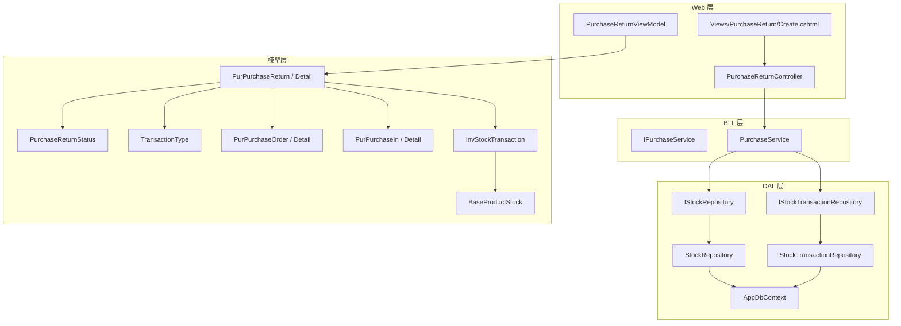
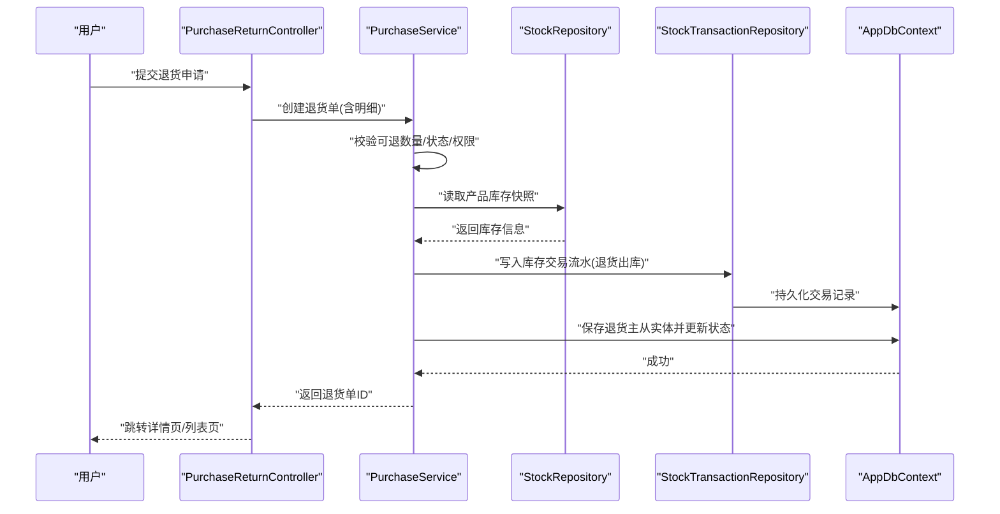
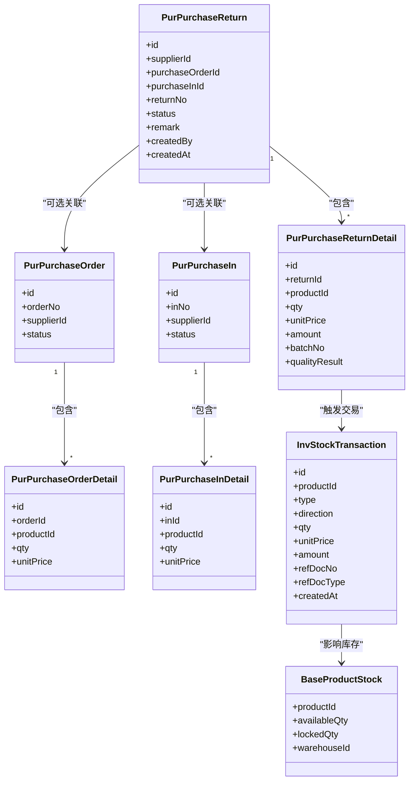
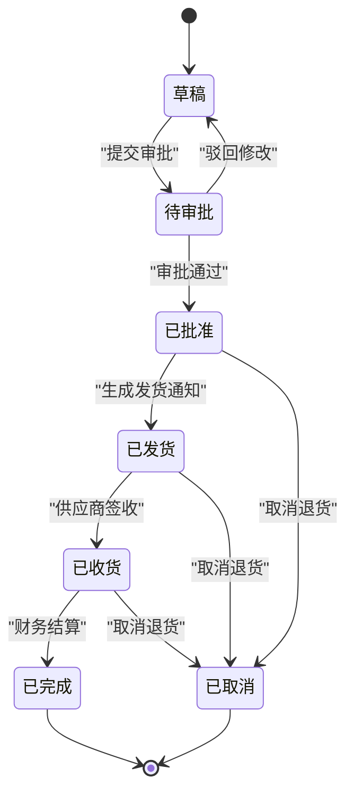
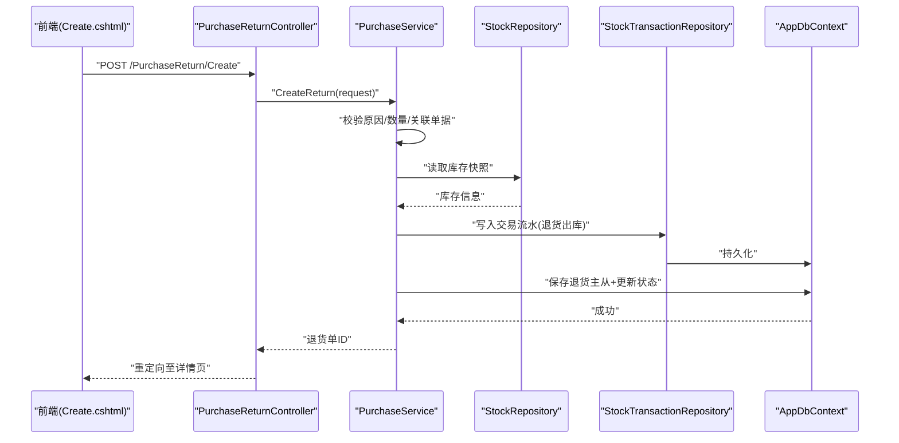
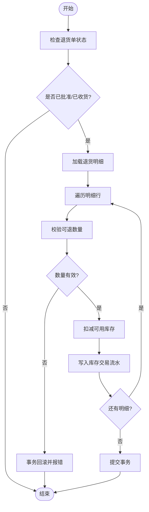
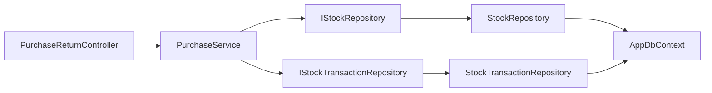

# 采购退货管理

<cite>
**本文引用的文件**   
- [PurPurchaseReturn.cs](file://EquipmentIMS.Models/Entities/PurPurchaseReturn.cs)
- [PurPurchaseReturnDetail.cs](file://EquipmentIMS.Models/Entities/PurPurchaseReturnDetail.cs)
- [PurchaseReturnDto.cs](file://EquipmentIMS.Models/DTOs/PurchaseReturnDto.cs)
- [PurchaseReturnStatus.cs](file://EquipmentIMS.Models/Enums/PurchaseReturnStatus.cs)
- [TransactionType.cs](file://EquipmentIMS.Models/Enums/TransactionType.cs)
- [PurPurchaseOrder.cs](file://EquipmentIMS.Models/Entities/PurPurchaseOrder.cs)
- [PurPurchaseOrderDetail.cs](file://EquipmentIMS.Models/Entities/PurPurchaseOrderDetail.cs)
- [PurPurchaseIn.cs](file://EquipmentIMS.Models/Entities/PurPurchaseIn.cs)
- [PurPurchaseInDetail.cs](file://EquipmentIMS.Models/Entities/PurPurchaseInDetail.cs)
- [InvStockTransaction.cs](file://EquipmentIMS.Models/Entities/InvStockTransaction.cs)
- [BaseProductStock.cs](file://EquipmentIMS.Models/Entities/BaseProductStock.cs)
- [IPurchaseService.cs](file://EquipmentIMS.BLL/Interfaces/IPurchaseService.cs)
- [PurchaseService.cs](file://EquipmentIMS.BLL/Services/PurchaseService.cs)
- [IStockRepository.cs](file://EquipmentIMS.DAL/Interfaces/IStockRepository.cs)
- [StockRepository.cs](file://EquipmentIMS.DAL/Repositories/StockRepository.cs)
- [IStockTransactionRepository.cs](file://EquipmentIMS.DAL/Interfaces/IStockTransactionRepository.cs)
- [StockTransactionRepository.cs](file://EquipmentIMS.DAL/Repositories/StockTransactionRepository.cs)
- [AppDbContext.cs](file://EquipmentIMS.DAL/AppDbContext.cs)
- [PurPurchaseReturnConfiguration.cs](file://EquipmentIMS.DAL/Configurations/PurPurchaseReturnConfiguration.cs)
- [PurPurchaseReturnDetailConfiguration.cs](file://EquipmentIMS.DAL/Configurations/PurPurchaseReturnDetailConfiguration.cs)
- [PurchaseReturnController.cs](file://EquipmentIMS.Web/Controllers/PurchaseReturnController.cs)
- [PurchaseReturnViewModel.cs](file://EquipmentIMS.Web/Models/PurchaseReturnViewModel.cs)
- [Create.cshtml](file://EquipmentIMS.Web/Views/PurchaseReturn/Create.cshtml)
</cite>

## 目录
1. [简介](#简介)
2. [项目结构](#项目结构)
3. [核心组件](#核心组件)
4. [架构总览](#架构总览)
5. [详细组件分析](#详细组件分析)
6. [依赖关系分析](#依赖关系分析)
7. [性能考虑](#性能考虑)
8. [故障排查指南](#故障排查指南)
9. [结论](#结论)
10. [附录](#附录)

## 简介
本文件围绕“采购退货管理”功能，结合仓库现有代码结构与领域模型，系统化阐述以下方面：
- 业务场景：质量问题退货、数量差异退货、规格不符退货、过期商品退货等。
- 流程与规则：退货申请、原因分类、数量确认、审批流转（状态机）。
- 关联关系：退货单与原始采购订单或入库单的关联，支持部分退货与整单退货。
- 库存回滚：基于事务的库存扣减与交易流水记录，确保数据一致性。
- 成本核算与索赔：退货成本计算、供应商索赔处理思路。
- 统计分析与绩效：退货率、供应商绩效评估指标与报表维度。
- 物流跟踪与费用结算：退货物流节点与费用归集、结算策略建议。

## 项目结构
本项目采用分层架构：Web 层提供控制器与视图；BLL 层封装业务服务；DAL 层负责仓储与实体映射；Models 层定义实体、枚举与 DTO。采购退货相关的关键位置如下：
- 模型与枚举：退货主从实体、状态枚举、交易类型枚举。
- 仓储接口与实现：库存与交易流水仓储。
- 业务服务：采购服务中集成退货逻辑。
- Web 控制器与视图：退货创建页面与控制器入口。

图表来源
- [PurchaseReturnController.cs](file://EquipmentIMS.Web/Controllers/PurchaseReturnController.cs)
- [PurchaseReturnViewModel.cs](file://EquipmentIMS.Web/Models/PurchaseReturnViewModel.cs)
- [Create.cshtml](file://EquipmentIMS.Web/Views/PurchaseReturn/Create.cshtml)
- [IPurchaseService.cs](file://EquipmentIMS.BLL/Interfaces/IPurchaseService.cs)
- [PurchaseService.cs](file://EquipmentIMS.BLL/Services/PurchaseService.cs)
- [IStockRepository.cs](file://EquipmentIMS.DAL/Interfaces/IStockRepository.cs)
- [StockRepository.cs](file://EquipmentIMS.DAL/Repositories/StockRepository.cs)
- [IStockTransactionRepository.cs](file://EquipmentIMS.DAL/Interfaces/IStockTransactionRepository.cs)
- [StockTransactionRepository.cs](file://EquipmentIMS.DAL/Repositories/StockTransactionRepository.cs)
- [AppDbContext.cs](file://EquipmentIMS.DAL/AppDbContext.cs)
- [PurPurchaseReturn.cs](file://EquipmentIMS.Models/Entities/PurPurchaseReturn.cs)
- [PurPurchaseReturnDetail.cs](file://EquipmentIMS.Models/Entities/PurPurchaseReturnDetail.cs)
- [PurchaseReturnStatus.cs](file://EquipmentIMS.Models/Enums/PurchaseReturnStatus.cs)
- [TransactionType.cs](file://EquipmentIMS.Models/Enums/TransactionType.cs)
- [PurPurchaseOrder.cs](file://EquipmentIMS.Models/Entities/PurPurchaseOrder.cs)
- [PurPurchaseOrderDetail.cs](file://EquipmentIMS.Models/Entities/PurPurchaseOrderDetail.cs)
- [PurPurchaseIn.cs](file://EquipmentIMS.Models/Entities/PurPurchaseIn.cs)
- [PurPurchaseInDetail.cs](file://EquipmentIMS.Models/Entities/PurPurchaseInDetail.cs)
- [InvStockTransaction.cs](file://EquipmentIMS.Models/Entities/InvStockTransaction.cs)
- [BaseProductStock.cs](file://EquipmentIMS.Models/Entities/BaseProductStock.cs)

章节来源
- [PurPurchaseReturn.cs](file://EquipmentIMS.Models/Entities/PurPurchaseReturn.cs)
- [PurPurchaseReturnDetail.cs](file://EquipmentIMS.Models/Entities/PurPurchaseReturnDetail.cs)
- [PurchaseReturnStatus.cs](file://EquipmentIMS.Models/Enums/PurchaseReturnStatus.cs)
- [TransactionType.cs](file://EquipmentIMS.Models/Enums/TransactionType.cs)
- [IPurchaseService.cs](file://EquipmentIMS.BLL/Interfaces/IPurchaseService.cs)
- [PurchaseService.cs](file://EquipmentIMS.BLL/Services/PurchaseService.cs)
- [IStockRepository.cs](file://EquipmentIMS.DAL/Interfaces/IStockRepository.cs)
- [StockRepository.cs](file://EquipmentIMS.DAL/Repositories/StockRepository.cs)
- [IStockTransactionRepository.cs](file://EquipmentIMS.DAL/Interfaces/IStockTransactionRepository.cs)
- [StockTransactionRepository.cs](file://EquipmentIMS.DAL/Repositories/StockTransactionRepository.cs)
- [AppDbContext.cs](file://EquipmentIMS.DAL/AppDbContext.cs)
- [PurchaseReturnController.cs](file://EquipmentIMS.Web/Controllers/PurchaseReturnController.cs)
- [PurchaseReturnViewModel.cs](file://EquipmentIMS.Web/Models/PurchaseReturnViewModel.cs)
- [Create.cshtml](file://EquipmentIMS.Web/Views/PurchaseReturn/Create.cshtml)

## 核心组件
- 退货主从实体
  - 退货主表：承载供应商、关联采购订单/入库单、退货单号、状态、备注、创建人、时间戳等。
  - 退货明细：承载产品、退货数量、单价、金额、批次/序列号（可选）、质量判定结果等。
- 状态枚举
  - 用于表达退货单生命周期：草稿、待审批、已批准、已发货、已收货、已完成、已取消等。
- 交易类型枚举
  - 用于标识库存交易方向，如“采购退货出库”等，配合库存交易流水使用。
- 业务服务
  - 采购服务中提供退货相关的业务方法，包括创建退货单、校验可退数量、执行库存回滚、生成交易流水、更新状态等。
- 仓储接口与实现
  - 库存仓储：读取/更新产品库存快照。
  - 交易仓储：持久化库存交易流水，保证审计与追溯。
- Web 控制器与视图
  - 控制器暴露退货创建、查询、详情等接口；视图提供退货申请表单与交互。

章节来源
- [PurPurchaseReturn.cs](file://EquipmentIMS.Models/Entities/PurPurchaseReturn.cs)
- [PurPurchaseReturnDetail.cs](file://EquipmentIMS.Models/Entities/PurPurchaseReturnDetail.cs)
- [PurchaseReturnStatus.cs](file://EquipmentIMS.Models/Enums/PurchaseReturnStatus.cs)
- [TransactionType.cs](file://EquipmentIMS.Models/Enums/TransactionType.cs)
- [IPurchaseService.cs](file://EquipmentIMS.BLL/Interfaces/IPurchaseService.cs)
- [PurchaseService.cs](file://EquipmentIMS.BLL/Services/PurchaseService.cs)
- [IStockRepository.cs](file://EquipmentIMS.DAL/Interfaces/IStockRepository.cs)
- [StockRepository.cs](file://EquipmentIMS.DAL/Repositories/StockRepository.cs)
- [IStockTransactionRepository.cs](file://EquipmentIMS.DAL/Interfaces/IStockTransactionRepository.cs)
- [StockTransactionRepository.cs](file://EquipmentIMS.DAL/Repositories/StockTransactionRepository.cs)
- [PurchaseReturnController.cs](file://EquipmentIMS.Web/Controllers/PurchaseReturnController.cs)
- [PurchaseReturnViewModel.cs](file://EquipmentIMS.Web/Models/PurchaseReturnViewModel.cs)
- [Create.cshtml](file://EquipmentIMS.Web/Views/PurchaseReturn/Create.cshtml)

## 架构总览
采购退货在系统中的调用链路由 Web 控制器发起，进入 BLL 采购服务，再由 DAL 仓储访问数据库完成库存与交易流水的原子性变更。

图表来源
- [PurchaseReturnController.cs](file://EquipmentIMS.Web/Controllers/PurchaseReturnController.cs)
- [PurchaseService.cs](file://EquipmentIMS.BLL/Services/PurchaseService.cs)
- [StockRepository.cs](file://EquipmentIMS.DAL/Repositories/StockRepository.cs)
- [StockTransactionRepository.cs](file://EquipmentIMS.DAL/Repositories/StockTransactionRepository.cs)
- [AppDbContext.cs](file://EquipmentIMS.DAL/AppDbContext.cs)

## 详细组件分析

### 数据模型与关系
- 退货主表与明细表构成一对多关系，明细指向具体产品与数量。
- 退货单通过外键或业务字段关联到原始采购订单或入库单，支持按行级部分退货。
- 库存交易流水记录每次库存变动，包含交易类型、方向、数量、单价、金额、关联单据号等。
- 产品库存快照表维护当前可用库存，供退货校验与回滚使用。

图表来源
- [PurPurchaseReturn.cs](file://EquipmentIMS.Models/Entities/PurPurchaseReturn.cs)
- [PurPurchaseReturnDetail.cs](file://EquipmentIMS.Models/Entities/PurPurchaseReturnDetail.cs)
- [PurPurchaseOrder.cs](file://EquipmentIMS.Models/Entities/PurPurchaseOrder.cs)
- [PurPurchaseOrderDetail.cs](file://EquipmentIMS.Models/Entities/PurPurchaseOrderDetail.cs)
- [PurPurchaseIn.cs](file://EquipmentIMS.Models/Entities/PurPurchaseIn.cs)
- [PurPurchaseInDetail.cs](file://EquipmentIMS.Models/Entities/PurPurchaseInDetail.cs)
- [InvStockTransaction.cs](file://EquipmentIMS.Models/Entities/InvStockTransaction.cs)
- [BaseProductStock.cs](file://EquipmentIMS.Models/Entities/BaseProductStock.cs)

章节来源
- [PurPurchaseReturn.cs](file://EquipmentIMS.Models/Entities/PurPurchaseReturn.cs)
- [PurPurchaseReturnDetail.cs](file://EquipmentIMS.Models/Entities/PurPurchaseReturnDetail.cs)
- [PurPurchaseOrder.cs](file://EquipmentIMS.Models/Entities/PurPurchaseOrder.cs)
- [PurPurchaseOrderDetail.cs](file://EquipmentIMS.Models/Entities/PurPurchaseOrderDetail.cs)
- [PurPurchaseIn.cs](file://EquipmentIMS.Models/Entities/PurPurchaseIn.cs)
- [PurPurchaseInDetail.cs](file://EquipmentIMS.Models/Entities/PurPurchaseInDetail.cs)
- [InvStockTransaction.cs](file://EquipmentIMS.Models/Entities/InvStockTransaction.cs)
- [BaseProductStock.cs](file://EquipmentIMS.Models/Entities/BaseProductStock.cs)

### 业务流程与状态机
- 退货申请：选择供应商、关联采购订单或入库单、填写退货明细（产品、数量、原因、批次等）。
- 原因分类：质量问题、数量差异、规格不符、过期商品等，可在明细或主表上记录。
- 数量确认：系统根据原始订单/入库明细的未退数量进行校验，防止超退。
- 审批流程：草稿→待审批→已批准→已发货→已收货→已完成；异常时可取消。
- 库存回滚：批准后触发库存交易流水，减少可用库存；若为在途或锁定库存，需相应调整。
- 成本核算：按明细单价与数量计算退货金额，支持加权平均或移动平均成本策略。
- 供应商索赔：对质量问题或过期商品，标记索赔项，生成索赔记录并与退货单关联。

图表来源
- [PurchaseReturnStatus.cs](file://EquipmentIMS.Models/Enums/PurchaseReturnStatus.cs)

章节来源
- [PurchaseReturnStatus.cs](file://EquipmentIMS.Models/Enums/PurchaseReturnStatus.cs)
- [PurchaseService.cs](file://EquipmentIMS.BLL/Services/PurchaseService.cs)

### 退货申请流程（API 时序）
- 前端提交退货申请，控制器接收并调用采购服务。
- 服务层校验：
  - 退货原因与附件是否完整。
  - 关联订单/入库单是否存在且状态允许退货。
  - 明细数量不超过未退数量。
- 服务层执行：
  - 保存退货主从实体。
  - 生成库存交易流水（退货出库）。
  - 更新产品库存快照。
  - 更新退货单状态为“已批准”或“待审批”，视配置而定。
- 返回结果给前端，展示退货单详情。

图表来源
- [Create.cshtml](file://EquipmentIMS.Web/Views/PurchaseReturn/Create.cshtml)
- [PurchaseReturnController.cs](file://EquipmentIMS.Web/Controllers/PurchaseReturnController.cs)
- [PurchaseService.cs](file://EquipmentIMS.BLL/Services/PurchaseService.cs)
- [StockRepository.cs](file://EquipmentIMS.DAL/Repositories/StockRepository.cs)
- [StockTransactionRepository.cs](file://EquipmentIMS.DAL/Repositories/StockTransactionRepository.cs)
- [AppDbContext.cs](file://EquipmentIMS.DAL/AppDbContext.cs)

章节来源
- [Create.cshtml](file://EquipmentIMS.Web/Views/PurchaseReturn/Create.cshtml)
- [PurchaseReturnController.cs](file://EquipmentIMS.Web/Controllers/PurchaseReturnController.cs)
- [PurchaseService.cs](file://EquipmentIMS.BLL/Services/PurchaseService.cs)
- [StockRepository.cs](file://EquipmentIMS.DAL/Repositories/StockRepository.cs)
- [StockTransactionRepository.cs](file://EquipmentIMS.DAL/Repositories/StockTransactionRepository.cs)
- [AppDbContext.cs](file://EquipmentIMS.DAL/AppDbContext.cs)

### 库存回滚机制
- 触发时机：退货单状态变更为“已批准”或“已收货”时（取决于企业策略），执行库存回滚。
- 回滚范围：按明细逐行扣减对应产品的可用库存；若存在锁定库存（如在途、质检中），需同步调整。
- 交易流水：每笔回滚生成一条库存交易记录，包含交易类型、方向、数量、单价、金额、关联单据号等，便于审计与追溯。
- 一致性保障：在同一数据库事务内完成退货单保存、库存更新与交易流水写入，失败则整体回滚。

图表来源
- [PurchaseService.cs](file://EquipmentIMS.BLL/Services/PurchaseService.cs)
- [StockRepository.cs](file://EquipmentIMS.DAL/Repositories/StockRepository.cs)
- [StockTransactionRepository.cs](file://EquipmentIMS.DAL/Repositories/StockTransactionRepository.cs)
- [AppDbContext.cs](file://EquipmentIMS.DAL/AppDbContext.cs)

章节来源
- [PurchaseService.cs](file://EquipmentIMS.BLL/Services/PurchaseService.cs)
- [StockRepository.cs](file://EquipmentIMS.DAL/Repositories/StockRepository.cs)
- [StockTransactionRepository.cs](file://EquipmentIMS.DAL/Repositories/StockTransactionRepository.cs)
- [AppDbContext.cs](file://EquipmentIMS.DAL/AppDbContext.cs)

### 退货成本核算与供应商索赔
- 成本核算：
  - 按退货明细的单价与数量计算退货金额，支持多种成本策略（如加权平均、移动平均）。
  - 将退货金额计入应付账款冲减或供应商往来账户。
- 供应商索赔：
  - 针对质量问题或过期商品，在退货明细中标记索赔项。
  - 生成索赔记录，关联退货单与供应商，跟踪索赔进度与赔付金额。
  - 与财务模块对接，生成索赔入账与核销凭证。

章节来源
- [PurPurchaseReturnDetail.cs](file://EquipmentIMS.Models/Entities/PurPurchaseReturnDetail.cs)
- [PurchaseService.cs](file://EquipmentIMS.BLL/Services/PurchaseService.cs)

### 退货统计分析、退货率与供应商绩效
- 退货率：
  - 公式：退货率 = 退货数量 / 采购数量（可按供应商、产品、时间段聚合）。
  - 支持按供应商、产品类别、仓库等多维度统计。
- 供应商绩效：
  - 指标：退货率、质量问题占比、过期商品占比、平均退货周期、索赔成功率。
  - 输出供应商评分卡，辅助采购决策与供应商淘汰。
- 报表与导出：
  - 提供退货汇总报表、趋势图、Top N 问题产品与供应商。
  - 支持 Excel 导出与定时任务生成报告。

章节来源
- [PurchaseService.cs](file://EquipmentIMS.BLL/Services/PurchaseService.cs)
- [ReportService.cs](file://EquipmentIMS.BLL/Services/ReportService.cs)

### 退货物流跟踪与费用结算
- 物流跟踪：
  - 记录退货发货时间、承运商、运单号、预计到达时间、实际签收时间。
  - 支持状态推送与异常预警（延误、破损、拒收）。
- 费用结算：
  - 运费、装卸费、检验费等费用归集到退货单或供应商账单。
  - 与应付账款模块对接，生成费用发票与付款计划。
  - 支持费用分摊到具体退货明细或供应商。

章节来源
- [PurchaseService.cs](file://EquipmentIMS.BLL/Services/PurchaseService.cs)

## 依赖关系分析
- 控制器依赖采购服务，采购服务依赖库存与交易仓储。
- 仓储实现依赖数据库上下文，所有写操作应在事务中执行。
- 实体与配置类定义数据库映射关系，确保主从表与外键约束正确。

图表来源
- [PurchaseReturnController.cs](file://EquipmentIMS.Web/Controllers/PurchaseReturnController.cs)
- [PurchaseService.cs](file://EquipmentIMS.BLL/Services/PurchaseService.cs)
- [IStockRepository.cs](file://EquipmentIMS.DAL/Interfaces/IStockRepository.cs)
- [StockRepository.cs](file://EquipmentIMS.DAL/Repositories/StockRepository.cs)
- [IStockTransactionRepository.cs](file://EquipmentIMS.DAL/Interfaces/IStockTransactionRepository.cs)
- [StockTransactionRepository.cs](file://EquipmentIMS.DAL/Repositories/StockTransactionRepository.cs)
- [AppDbContext.cs](file://EquipmentIMS.DAL/AppDbContext.cs)

章节来源
- [PurchaseReturnController.cs](file://EquipmentIMS.Web/Controllers/PurchaseReturnController.cs)
- [PurchaseService.cs](file://EquipmentIMS.BLL/Services/PurchaseService.cs)
- [IStockRepository.cs](file://EquipmentIMS.DAL/Interfaces/IStockRepository.cs)
- [StockRepository.cs](file://EquipmentIMS.DAL/Repositories/StockRepository.cs)
- [IStockTransactionRepository.cs](file://EquipmentIMS.DAL/Interfaces/IStockTransactionRepository.cs)
- [StockTransactionRepository.cs](file://EquipmentIMS.DAL/Repositories/StockTransactionRepository.cs)
- [AppDbContext.cs](file://EquipmentIMS.DAL/AppDbContext.cs)

## 性能考虑
- 批量操作：退货明细较多时，建议使用批量插入与批量更新，减少往返次数。
- 索引优化：为退货单号、关联订单/入库单号、产品ID、供应商ID建立合适索引，提升查询与关联性能。
- 事务粒度：尽量缩小事务范围，避免长事务导致锁竞争；将非关键操作移出事务。
- 缓存策略：对频繁读取的产品基础信息与供应商信息可使用内存缓存，降低数据库压力。
- 异步处理：物流状态推送、报表导出等非实时任务使用后台服务异步执行。

[本节为通用指导，不直接分析具体文件]

## 故障排查指南
- 常见错误
  - 超退：退货数量超过未退数量，应提示并阻止提交。
  - 状态冲突：退货单处于不可操作状态（如已完成）时禁止再次操作。
  - 库存不足：回滚前校验可用库存，不足时应提示或走特殊流程（如冻结库存释放）。
  - 事务失败：数据库连接超时或死锁，应重试或降级处理并记录日志。
- 定位方法
  - 查看库存交易流水，核对交易类型、方向、数量与金额是否正确。
  - 检查退货单状态机流转是否符合预期。
  - 审查控制器与服务层的参数校验与异常捕获逻辑。
- 恢复策略
  - 对于部分失败的批处理，提供补偿任务重新执行。
  - 对异常数据进行人工复核与修正，并记录审计日志。

章节来源
- [PurchaseService.cs](file://EquipmentIMS.BLL/Services/PurchaseService.cs)
- [StockTransactionRepository.cs](file://EquipmentIMS.DAL/Repositories/StockTransactionRepository.cs)
- [PurchaseReturnController.cs](file://EquipmentIMS.Web/Controllers/PurchaseReturnController.cs)

## 结论
采购退货管理在本项目中以清晰的实体模型、严谨的状态机与事务化的库存回滚为核心，实现了从申请、审批到结算的全链路闭环。通过完善的交易流水与统计分析能力，系统能够有效支撑退货成本控制与供应商绩效管理。建议在后续迭代中增强物流跟踪与费用结算模块，进一步提升端到端的可视化与自动化水平。

[本节为总结性内容，不直接分析具体文件]

## 附录
- 术语说明
  - 退货单：记录供应商退货的主从单据。
  - 库存交易流水：记录每次库存变动的审计轨迹。
  - 供应商索赔：因质量问题或过期导致的经济追偿流程。
- 参考视图与控制器
  - 退货创建页面：Create.cshtml
  - 退货控制器：PurchaseReturnController.cs
  - 退货视图模型：PurchaseReturnViewModel.cs

章节来源
- [Create.cshtml](file://EquipmentIMS.Web/Views/PurchaseReturn/Create.cshtml)
- [PurchaseReturnController.cs](file://EquipmentIMS.Web/Controllers/PurchaseReturnController.cs)
- [PurchaseReturnViewModel.cs](file://EquipmentIMS.Web/Models/PurchaseReturnViewModel.cs)