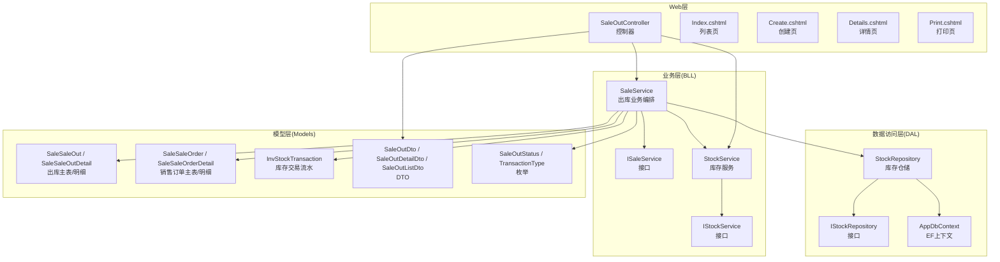
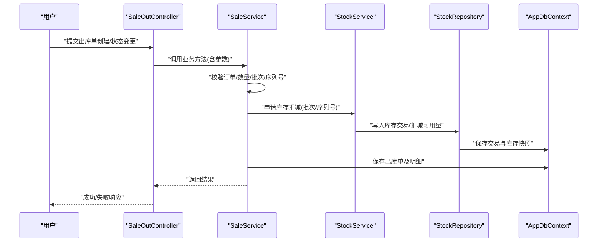
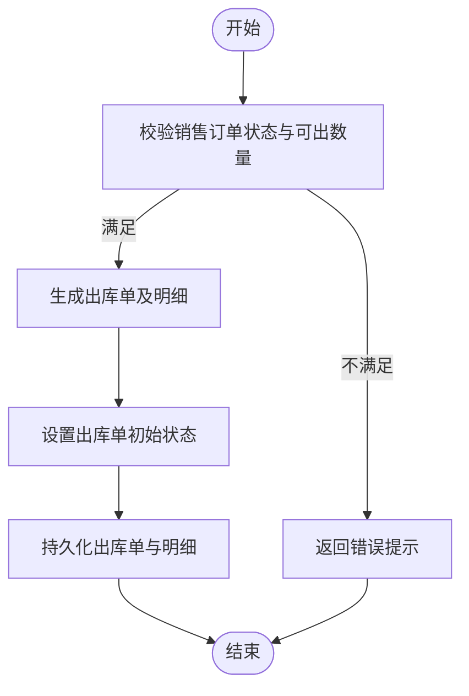
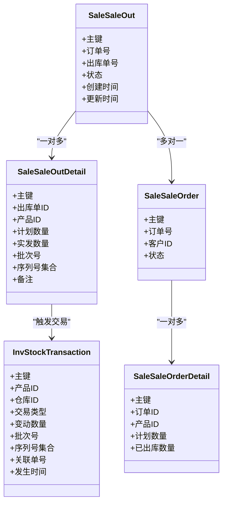
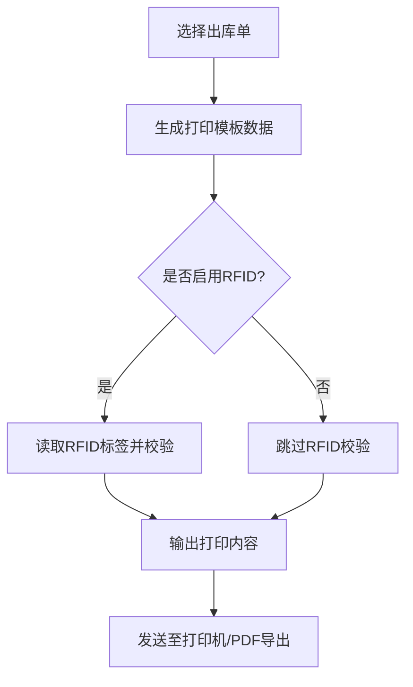
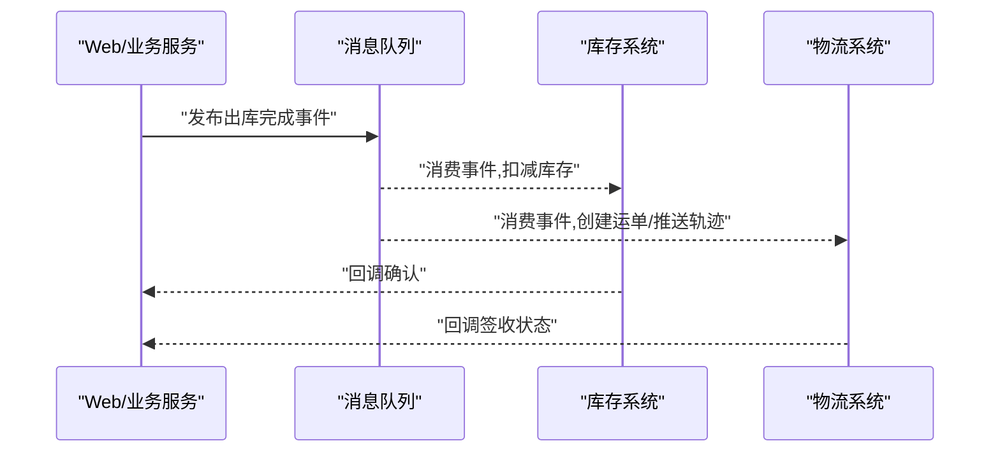
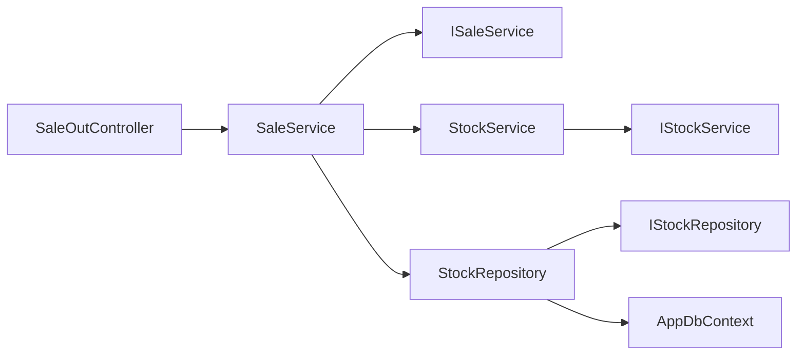

# 销售出库管理

<cite>
**本文引用的文件**   
- [SaleOutController.cs](file://EquipmentIMS.Web/Controllers/SaleOutController.cs)
- [SaleService.cs](file://EquipmentIMS.BLL/Services/SaleService.cs)
- [ISaleService.cs](file://EquipmentIMS.BLL/Interfaces/ISaleService.cs)
- [StockService.cs](file://EquipmentIMS.BLL/Services/StockService.cs)
- [IStockService.cs](file://EquipmentIMS.BLL/Interfaces/IStockService.cs)
- [SaleOutDto.cs](file://EquipmentIMS.Models/DTOs/SaleOutDto.cs)
- [SaleOutDetailDto.cs](file://EquipmentIMS.Models/DTOs/SaleOutDetailDto.cs)
- [SaleOutListDto.cs](file://EquipmentIMS.Models/DTOs/SaleOutListDto.cs)
- [SaleSaleOut.cs](file://EquipmentIMS.Models/Entities/SaleSaleOut.cs)
- [SaleSaleOutDetail.cs](file://EquipmentIMS.Models/Entities/SaleSaleOutDetail.cs)
- [SaleSaleOrder.cs](file://EquipmentIMS.Models/Entities/SaleSaleOrder.cs)
- [SaleSaleOrderDetail.cs](file://EquipmentIMS.Models/Entities/SaleSaleOrderDetail.cs)
- [SaleOutStatus.cs](file://EquipmentIMS.Models/Enums/SaleOutStatus.cs)
- [TransactionType.cs](file://EquipmentIMS.Models/Enums/TransactionType.cs)
- [InvStockTransaction.cs](file://EquipmentIMS.Models/Entities/InvStockTransaction.cs)
- [StockRepository.cs](file://EquipmentIMS.DAL/Repositories/StockRepository.cs)
- [IStockRepository.cs](file://EquipmentIMS.DAL/Interfaces/IStockRepository.cs)
- [AppDbContext.cs](file://EquipmentIMS.DAL/AppDbContext.cs)
- [SaleOut/Index.cshtml](file://EquipmentIMS.Web/Views/SaleOut/Index.cshtml)
- [SaleOut/Create.cshtml](file://EquipmentIMS.Web/Views/SaleOut/Create.cshtml)
- [SaleOut/Details.cshtml](file://EquipmentIMS.Web/Views/SaleOut/Details.cshtml)
- [SaleOut/Print.cshtml](file://EquipmentIMS.Web/Views/SaleOut/Print.cshtml)
</cite>

## 目录
1. [简介](#简介)
2. [项目结构](#项目结构)
3. [核心组件](#核心组件)
4. [架构总览](#架构总览)
5. [详细组件分析](#详细组件分析)
6. [依赖关系分析](#依赖关系分析)
7. [性能考虑](#性能考虑)
8. [故障排查指南](#故障排查指南)
9. [结论](#结论)
10. [附录](#附录)

## 简介
本文件面向“销售出库管理”功能，覆盖从销售订单到出库单创建、拣货、包装、发货的全流程；阐述出库单与销售订单的关联与自动生成机制；说明库存扣减逻辑、批次管理与序列号追踪；包含出库质检、包装规范、物流信息录入与客户签收确认；提供单据打印、条码生成与RFID集成支持；并给出与库存系统、物流系统的实时数据同步与异常处理方案。文档以代码仓库中的实体、DTO、服务与控制器为依据进行结构化说明，帮助读者快速理解实现与扩展点。

## 项目结构
销售出库相关能力分布在以下层次：
- Web层（控制器与视图）：提供页面交互、列表查询、详情查看、打印等入口
- 业务层（BLL）：编排出库业务流程、校验、状态流转、库存扣减、事务记录
- 数据访问层（DAL）：仓储接口与通用仓储实现，持久化出库单、明细、库存交易等
- 模型层（Models）：实体、枚举、DTO定义，承载领域概念与数据传输契约

图表来源
- [SaleOutController.cs](file://EquipmentIMS.Web/Controllers/SaleOutController.cs)
- [SaleService.cs](file://EquipmentIMS.BLL/Services/SaleService.cs)
- [ISaleService.cs](file://EquipmentIMS.BLL/Interfaces/ISaleService.cs)
- [StockService.cs](file://EquipmentIMS.BLL/Services/StockService.cs)
- [IStockService.cs](file://EquipmentIMS.BLL/Interfaces/IStockService.cs)
- [StockRepository.cs](file://EquipmentIMS.DAL/Repositories/StockRepository.cs)
- [IStockRepository.cs](file://EquipmentIMS.DAL/Interfaces/IStockRepository.cs)
- [AppDbContext.cs](file://EquipmentIMS.DAL/AppDbContext.cs)
- [SaleOutDto.cs](file://EquipmentIMS.Models/DTOs/SaleOutDto.cs)
- [SaleOutDetailDto.cs](file://EquipmentIMS.Models/DTOs/SaleOutDetailDto.cs)
- [SaleOutListDto.cs](file://EquipmentIMS.Models/DTOs/SaleOutListDto.cs)
- [SaleSaleOut.cs](file://EquipmentIMS.Models/Entities/SaleSaleOut.cs)
- [SaleSaleOutDetail.cs](file://EquipmentIMS.Models/Entities/SaleSaleOutDetail.cs)
- [SaleSaleOrder.cs](file://EquipmentIMS.Models/Entities/SaleSaleOrder.cs)
- [SaleSaleOrderDetail.cs](file://EquipmentIMS.Models/Entities/SaleSaleOrderDetail.cs)
- [InvStockTransaction.cs](file://EquipmentIMS.Models/Entities/InvStockTransaction.cs)
- [SaleOutStatus.cs](file://EquipmentIMS.Models/Enums/SaleOutStatus.cs)
- [TransactionType.cs](file://EquipmentIMS.Models/Enums/TransactionType.cs)

章节来源
- [SaleOutController.cs](file://EquipmentIMS.Web/Controllers/SaleOutController.cs)
- [SaleService.cs](file://EquipmentIMS.BLL/Services/SaleService.cs)
- [StockService.cs](file://EquipmentIMS.BLL/Services/StockService.cs)
- [StockRepository.cs](file://EquipmentIMS.DAL/Repositories/StockRepository.cs)
- [AppDbContext.cs](file://EquipmentIMS.DAL/AppDbContext.cs)
- [SaleOutDto.cs](file://EquipmentIMS.Models/DTOs/SaleOutDto.cs)
- [SaleOutDetailDto.cs](file://EquipmentIMS.Models/DTOs/SaleOutDetailDto.cs)
- [SaleOutListDto.cs](file://EquipmentIMS.Models/DTOs/SaleOutListDto.cs)
- [SaleSaleOut.cs](file://EquipmentIMS.Models/Entities/SaleSaleOut.cs)
- [SaleSaleOutDetail.cs](file://EquipmentIMS.Models/Entities/SaleSaleOutDetail.cs)
- [SaleSaleOrder.cs](file://EquipmentIMS.Models/Entities/SaleSaleOrder.cs)
- [SaleSaleOrderDetail.cs](file://EquipmentIMS.Models/Entities/SaleSaleOrderDetail.cs)
- [InvStockTransaction.cs](file://EquipmentIMS.Models/Entities/InvStockTransaction.cs)
- [SaleOutStatus.cs](file://EquipmentIMS.Models/Enums/SaleOutStatus.cs)
- [TransactionType.cs](file://EquipmentIMS.Models/Enums/TransactionType.cs)

## 核心组件
- 控制器层
  - 负责接收请求、参数校验、调用业务服务、返回结果与渲染视图
  - 关键职责：出库单列表、新增、详情、打印、状态操作（如拣货、包装、发货、签收）
- 业务服务层
  - 出库业务编排：校验订单可出、生成出库单及明细、执行库存扣减、记录库存交易、更新状态
  - 与库存服务协作完成批次/序列号分配与扣减
- 数据访问层
  - 仓储接口与实现：对出库单、明细、库存交易进行CRUD与批量操作
  - 通过EF上下文统一事务边界
- 模型与DTO
  - 实体：出库主表/明细、销售订单主表/明细、库存交易流水
  - DTO：用于API/视图传输的数据结构
  - 枚举：出库状态、交易类型等

章节来源
- [SaleOutController.cs](file://EquipmentIMS.Web/Controllers/SaleOutController.cs)
- [SaleService.cs](file://EquipmentIMS.BLL/Services/SaleService.cs)
- [ISaleService.cs](file://EquipmentIMS.BLL/Interfaces/ISaleService.cs)
- [StockService.cs](file://EquipmentIMS.BLL/Services/StockService.cs)
- [IStockService.cs](file://EquipmentIMS.BLL/Interfaces/IStockService.cs)
- [StockRepository.cs](file://EquipmentIMS.DAL/Repositories/StockRepository.cs)
- [IStockRepository.cs](file://EquipmentIMS.DAL/Interfaces/IStockRepository.cs)
- [SaleOutDto.cs](file://EquipmentIMS.Models/DTOs/SaleOutDto.cs)
- [SaleOutDetailDto.cs](file://EquipmentIMS.Models/DTOs/SaleOutDetailDto.cs)
- [SaleOutListDto.cs](file://EquipmentIMS.Models/DTOs/SaleOutListDto.cs)
- [SaleSaleOut.cs](file://EquipmentIMS.Models/Entities/SaleSaleOut.cs)
- [SaleSaleOutDetail.cs](file://EquipmentIMS.Models/Entities/SaleSaleOutDetail.cs)
- [SaleSaleOrder.cs](file://EquipmentIMS.Models/Entities/SaleSaleOrder.cs)
- [SaleSaleOrderDetail.cs](file://EquipmentIMS.Models/Entities/SaleSaleOrderDetail.cs)
- [InvStockTransaction.cs](file://EquipmentIMS.Models/Entities/InvStockTransaction.cs)
- [SaleOutStatus.cs](file://EquipmentIMS.Models/Enums/SaleOutStatus.cs)
- [TransactionType.cs](file://EquipmentIMS.Models/Enums/TransactionType.cs)

## 架构总览
下图展示从Web请求到数据落库的整体链路，以及关键领域对象之间的关系。

图表来源
- [SaleOutController.cs](file://EquipmentIMS.Web/Controllers/SaleOutController.cs)
- [SaleService.cs](file://EquipmentIMS.BLL/Services/SaleService.cs)
- [StockService.cs](file://EquipmentIMS.BLL/Services/StockService.cs)
- [StockRepository.cs](file://EquipmentIMS.DAL/Repositories/StockRepository.cs)
- [AppDbContext.cs](file://EquipmentIMS.DAL/AppDbContext.cs)

## 详细组件分析

### 出库单与销售订单的关联与自动生成功能
- 关联关系
  - 出库单通过外键或业务字段关联至销售订单，明细逐行对应订单明细
  - 支持部分出库：同一订单可多次生成多个出库单，直至全部出库完成
- 自动生成
  - 在订单满足出库条件时，可由业务服务根据订单明细自动生成出库单及明细
  - 自动生成时需校验：订单状态、可出数量、批次/序列号策略、价格与折扣一致性
- 状态联动
  - 出库单状态推进（待拣货→已拣货→已包装→已发货→已签收）
  - 订单层面可维护“已出库数量”，当累计等于订单数量时标记为已完成

图表来源
- [SaleService.cs](file://EquipmentIMS.BLL/Services/SaleService.cs)
- [SaleSaleOrder.cs](file://EquipmentIMS.Models/Entities/SaleSaleOrder.cs)
- [SaleSaleOrderDetail.cs](file://EquipmentIMS.Models/Entities/SaleSaleOrderDetail.cs)
- [SaleSaleOut.cs](file://EquipmentIMS.Models/Entities/SaleSaleOut.cs)
- [SaleSaleOutDetail.cs](file://EquipmentIMS.Models/Entities/SaleSaleOutDetail.cs)

章节来源
- [SaleService.cs](file://EquipmentIMS.BLL/Services/SaleService.cs)
- [SaleSaleOrder.cs](file://EquipmentIMS.Models/Entities/SaleSaleOrder.cs)
- [SaleSaleOrderDetail.cs](file://EquipmentIMS.Models/Entities/SaleSaleOrderDetail.cs)
- [SaleSaleOut.cs](file://EquipmentIMS.Models/Entities/SaleSaleOut.cs)
- [SaleSaleOutDetail.cs](file://EquipmentIMS.Models/Entities/SaleSaleOutDetail.cs)

### 库存扣减逻辑、批次管理与序列号追踪
- 扣减时机
  - 建议在“拣货完成”或“包装完成”时触发实际库存扣减，避免过早扣减导致超卖
  - 若采用预占模式，可在创建出库单时预占库存，发货时再正式扣减
- 批次管理
  - 按批次维度扣减，支持先进先出(FIFO)、指定批次、近效期优先等策略
  - 批次信息需随出库明细持久化，便于追溯
- 序列号追踪
  - 对序列号管理的商品，需在出库明细中记录具体序列号集合
  - 序列号唯一性校验与重复出库拦截
- 库存交易流水
  - 每次扣减均产生一条库存交易记录，包含交易类型、数量、批次、序列号、关联出库单等

图表来源
- [SaleSaleOut.cs](file://EquipmentIMS.Models/Entities/SaleSaleOut.cs)
- [SaleSaleOutDetail.cs](file://EquipmentIMS.Models/Entities/SaleSaleOutDetail.cs)
- [InvStockTransaction.cs](file://EquipmentIMS.Models/Entities/InvStockTransaction.cs)
- [SaleSaleOrder.cs](file://EquipmentIMS.Models/Entities/SaleSaleOrder.cs)
- [SaleSaleOrderDetail.cs](file://EquipmentIMS.Models/Entities/SaleSaleOrderDetail.cs)

章节来源
- [SaleService.cs](file://EquipmentIMS.BLL/Services/SaleService.cs)
- [StockService.cs](file://EquipmentIMS.BLL/Services/StockService.cs)
- [StockRepository.cs](file://EquipmentIMS.DAL/Repositories/StockRepository.cs)
- [SaleSaleOut.cs](file://EquipmentIMS.Models/Entities/SaleSaleOut.cs)
- [SaleSaleOutDetail.cs](file://EquipmentIMS.Models/Entities/SaleSaleOutDetail.cs)
- [InvStockTransaction.cs](file://EquipmentIMS.Models/Entities/InvStockTransaction.cs)
- [SaleOutStatus.cs](file://EquipmentIMS.Models/Enums/SaleOutStatus.cs)
- [TransactionType.cs](file://EquipmentIMS.Models/Enums/TransactionType.cs)

### 出库质检、包装规范、物流信息录入与客户签收确认
- 出库质检
  - 在拣货完成后进入质检环节，记录质检结果（合格/不合格）、质检人、时间
  - 不合格品走退货或返工流程，不影响合格品的后续发货
- 包装规范
  - 包装阶段记录包装清单、箱号、重量体积、包装材料等信息
  - 支持按箱/托盘维度绑定序列号与批次，便于装车与交接
- 物流信息录入
  - 发货前录入承运商、运单号、预计到达时间、配送地址等
  - 支持多渠道对接（快递、零担、整车），预留扩展接口
- 客户签收确认
  - 支持线上回传签收凭证（电子签名/照片）或线下纸质签收扫描归档
  - 签收后更新出库单状态为“已签收”，并触发财务结算前置条件

图表来源
- [SaleOutStatus.cs](file://EquipmentIMS.Models/Enums/SaleOutStatus.cs)
- [SaleSaleOut.cs](file://EquipmentIMS.Models/Entities/SaleSaleOut.cs)

章节来源
- [SaleOutStatus.cs](file://EquipmentIMS.Models/Enums/SaleOutStatus.cs)
- [SaleSaleOut.cs](file://EquipmentIMS.Models/Entities/SaleSaleOut.cs)

### 出库单据打印、条码生成与RFID集成支持
- 单据打印
  - 提供打印视图模板，支持出库单、装箱单、拣货单、发货单等多类单据
  - 支持PDF导出与浏览器直接打印
- 条码生成
  - 基于产品编码/批次/序列号生成标准条码（如Code128、QR码）
  - 支持批量打印标签，适配常见标签打印机
- RFID集成
  - 在包装与发货环节读取RFID标签，自动匹配出库明细
  - 提供读写接口抽象，便于接入不同厂商设备

图表来源
- [SaleOut/Print.cshtml](file://EquipmentIMS.Web/Views/SaleOut/Print.cshtml)
- [SaleOut/Index.cshtml](file://EquipmentIMS.Web/Views/SaleOut/Index.cshtml)

章节来源
- [SaleOut/Print.cshtml](file://EquipmentIMS.Web/Views/SaleOut/Print.cshtml)
- [SaleOut/Index.cshtml](file://EquipmentIMS.Web/Views/SaleOut/Index.cshtml)

### 与库存系统、物流系统的实时数据同步与异常处理
- 实时同步
  - 库存系统：出库扣减成功后推送最新库存快照与交易流水
  - 物流系统：发货完成后推送运单号、轨迹回调、签收状态
- 同步策略
  - 建议采用事件驱动或消息队列，保证最终一致性
  - 幂等设计：同一单号多次推送不会造成重复扣减或重复发货
- 异常处理
  - 重试与退避：网络抖动或服务不可用时的自动重试
  - 死信队列：失败消息进入死信队列人工干预
  - 补偿机制：定时任务核对差异，自动修复不一致

[此图为概念性流程图，未直接映射具体源码文件，故不提供图表来源]

## 依赖关系分析
- 控制器依赖业务服务，业务服务依赖库存服务与仓储接口
- 仓储接口由具体仓储实现，统一通过EF上下文访问数据库
- 模型层实体与DTO被上层广泛使用，构成跨层契约

图表来源
- [SaleOutController.cs](file://EquipmentIMS.Web/Controllers/SaleOutController.cs)
- [SaleService.cs](file://EquipmentIMS.BLL/Services/SaleService.cs)
- [ISaleService.cs](file://EquipmentIMS.BLL/Interfaces/ISaleService.cs)
- [StockService.cs](file://EquipmentIMS.BLL/Services/StockService.cs)
- [IStockService.cs](file://EquipmentIMS.BLL/Interfaces/IStockService.cs)
- [StockRepository.cs](file://EquipmentIMS.DAL/Repositories/StockRepository.cs)
- [IStockRepository.cs](file://EquipmentIMS.DAL/Interfaces/IStockRepository.cs)
- [AppDbContext.cs](file://EquipmentIMS.DAL/AppDbContext.cs)

章节来源
- [SaleOutController.cs](file://EquipmentIMS.Web/Controllers/SaleOutController.cs)
- [SaleService.cs](file://EquipmentIMS.BLL/Services/SaleService.cs)
- [StockService.cs](file://EquipmentIMS.BLL/Services/StockService.cs)
- [StockRepository.cs](file://EquipmentIMS.DAL/Repositories/StockRepository.cs)
- [AppDbContext.cs](file://EquipmentIMS.DAL/AppDbContext.cs)

## 性能考虑
- 批量操作
  - 出库明细与库存交易尽量批量写入，减少往返次数
- 索引优化
  - 对出库单号、订单号、产品ID、批次号、序列号建立合适索引
- 分页与懒加载
  - 列表查询使用分页，避免一次性加载大量数据
- 并发控制
  - 高并发场景下对库存扣减加锁或使用乐观锁，防止超卖
- 缓存策略
  - 基础字典（仓库、产品、承运商）可缓存，降低频繁查询

[本节为通用指导，不涉及具体文件分析]

## 故障排查指南
- 常见问题
  - 出库数量超过可出数量：检查订单已出库数量与本次申请数量
  - 批次不足：确认批次可用量与出库策略
  - 序列号重复：校验序列号唯一性与是否已被其他出库占用
  - 库存交易缺失：核对事务边界与仓储写入是否成功
- 定位步骤
  - 查看出库单状态与明细，确认各节点是否完整
  - 检索库存交易流水，核对交易类型与数量
  - 检查外部系统回调日志，确认同步是否成功
- 恢复手段
  - 针对未完成的出库单，允许撤销或作废并重试
  - 对库存差异进行手工调整并记录审计日志

章节来源
- [SaleSaleOut.cs](file://EquipmentIMS.Models/Entities/SaleSaleOut.cs)
- [SaleSaleOutDetail.cs](file://EquipmentIMS.Models/Entities/SaleSaleOutDetail.cs)
- [InvStockTransaction.cs](file://EquipmentIMS.Models/Entities/InvStockTransaction.cs)

## 结论
销售出库管理围绕“订单—出库—库存—物流”的主线展开，通过清晰的实体与DTO契约、分层架构与状态机驱动，实现了从创建、拣货、包装、发货到签收的闭环。结合批次与序列号管理、库存交易流水与外部系统同步，既保证了准确性与可追溯性，也为扩展与集成提供了良好基础。

## 附录
- 视图入口
  - 列表：[SaleOut/Index.cshtml](file://EquipmentIMS.Web/Views/SaleOut/Index.cshtml)
  - 创建：[SaleOut/Create.cshtml](file://EquipmentIMS.Web/Views/SaleOut/Create.cshtml)
  - 详情：[SaleOut/Details.cshtml](file://EquipmentIMS.Web/Views/SaleOut/Details.cshtml)
  - 打印：[SaleOut/Print.cshtml](file://EquipmentIMS.Web/Views/SaleOut/Print.cshtml)
- 关键DTO
  - [SaleOutDto.cs](file://EquipmentIMS.Models/DTOs/SaleOutDto.cs)
  - [SaleOutDetailDto.cs](file://EquipmentIMS.Models/DTOs/SaleOutDetailDto.cs)
  - [SaleOutListDto.cs](file://EquipmentIMS.Models/DTOs/SaleOutListDto.cs)