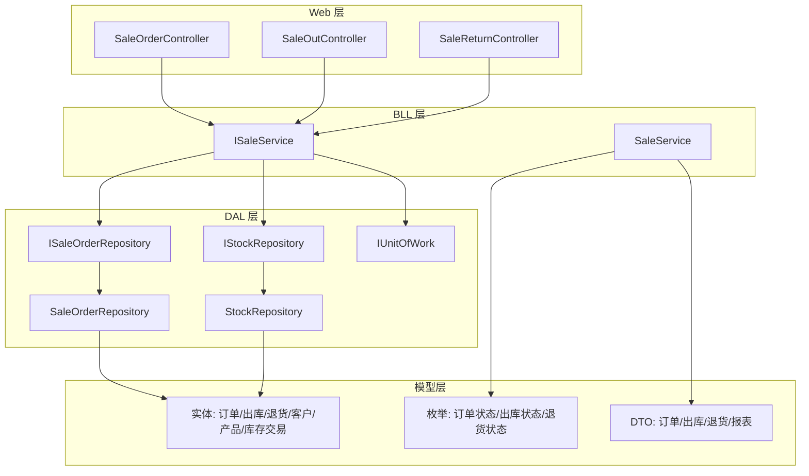
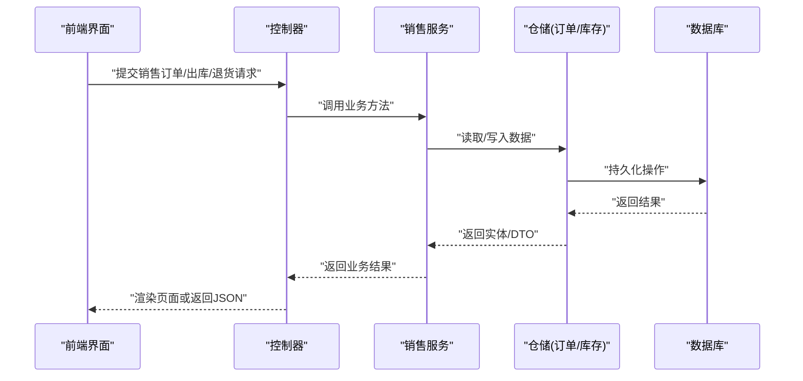
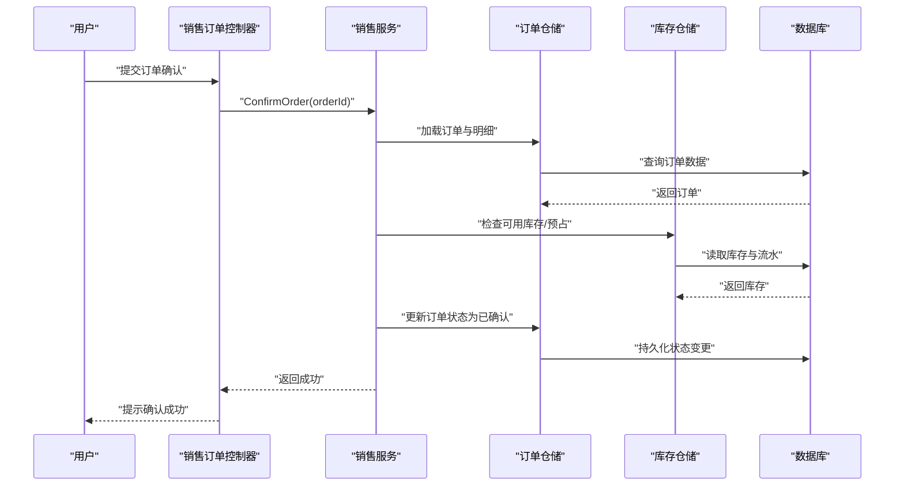
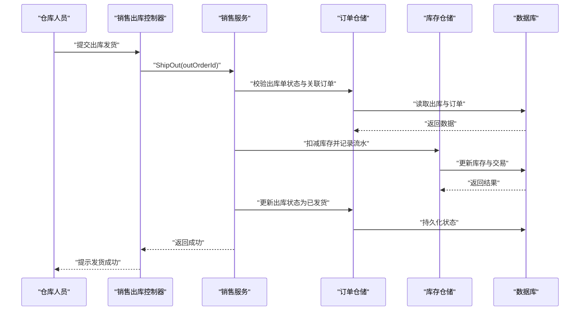
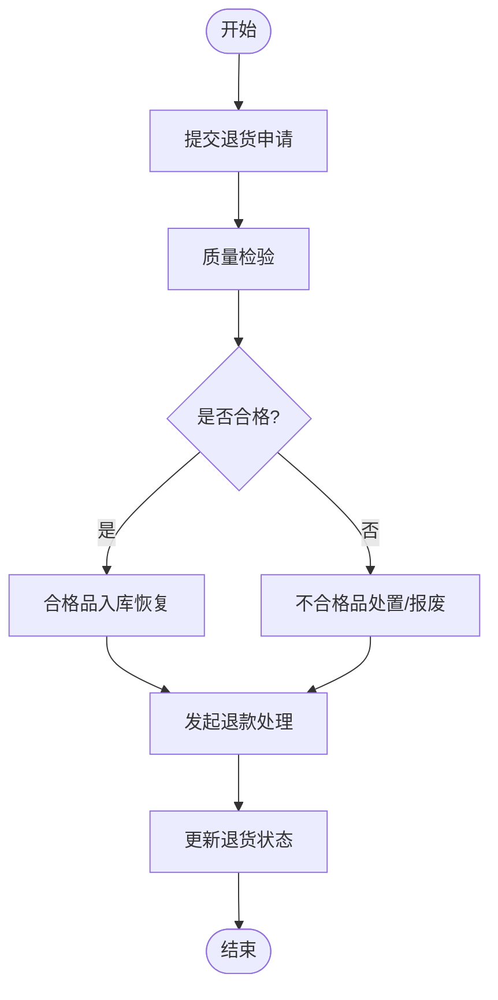
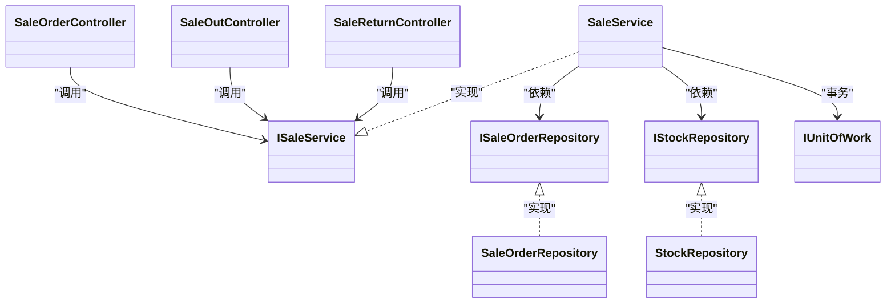

# 销售管理

<cite>
**本文引用的文件**   
- [SaleOrderController.cs](file://EquipmentIMS.Web/Controllers/SaleOrderController.cs)
- [SaleOutController.cs](file://EquipmentIMS.Web/Controllers/SaleOutController.cs)
- [SaleReturnController.cs](file://EquipmentIMS.Web/Controllers/SaleReturnController.cs)
- [ISaleService.cs](file://EquipmentIMS.BLL/Interfaces/ISaleService.cs)
- [SaleService.cs](file://EquipmentIMS.BLL/Services/SaleService.cs)
- [ISaleOrderRepository.cs](file://EquipmentIMS.DAL/Interfaces/ISaleOrderRepository.cs)
- [SaleOrderRepository.cs](file://EquipmentIMS.DAL/Repositories/SaleOrderRepository.cs)
- [IStockRepository.cs](file://EquipmentIMS.DAL/Interfaces/IStockRepository.cs)
- [StockRepository.cs](file://EquipmentIMS.DAL/Repositories/StockRepository.cs)
- [IUnitOfWork.cs](file://EquipmentIMS.DAL/Interfaces/IUnitOfWork.cs)
- [SaleSaleOrder.cs](file://EquipmentIMS.Models/Entities/SaleSaleOrder.cs)
- [SaleSaleOrderDetail.cs](file://EquipmentIMS.Models/Entities/SaleSaleOrderDetail.cs)
- [SaleSaleOut.cs](file://EquipmentIMS.Models/Entities/SaleSaleOut.cs)
- [SaleSaleOutDetail.cs](file://EquipmentIMS.Models/Entities/SaleSaleOutDetail.cs)
- [SaleReturn.cs](file://EquipmentIMS.Models/Entities/SaleReturn.cs)
- [SaleReturnDetail.cs](file://EquipmentIMS.Models/Entities/SaleReturnDetail.cs)
- [BaseCustomer.cs](file://EquipmentIMS.Models/Entities/BaseCustomer.cs)
- [BaseProduct.cs](file://EquipmentIMS.Models/Entities/BaseProduct.cs)
- [BaseProductStock.cs](file://EquipmentIMS.Models/Entities/BaseProductStock.cs)
- [InvStockTransaction.cs](file://EquipmentIMS.Models/Entities/InvStockTransaction.cs)
- [SaleOrderStatus.cs](file://EquipmentIMS.Models/Enums/SaleOrderStatus.cs)
- [SaleOutStatus.cs](file://EquipmentIMS.Models/Enums/SaleOutStatus.cs)
- [SaleReturnStatus.cs](file://EquipmentIMS.Models/Enums/SaleReturnStatus.cs)
- [SaleOrderDto.cs](file://EquipmentIMS.Models/DTOs/SaleOrderDto.cs)
- [SaleOrderDetailDto.cs](file://EquipmentIMS.Models/DTOs/SaleOrderDetailDto.cs)
- [SaleOutDto.cs](file://EquipmentIMS.Models/DTOs/SaleOutDto.cs)
- [SaleOutDetailDto.cs](file://EquipmentIMS.Models/DTOs/SaleOutDetailDto.cs)
- [SaleReturnDto.cs](file://EquipmentIMS.Models/DTOs/SaleReturnDto.cs)
- [SaleReturnDetailDto.cs](file://EquipmentIMS.Models/DTOs/SaleReturnDetailDto.cs)
- [ReportSaleDtos.cs](file://EquipmentIMS.Models/DTOs/Reports/ReportSaleDtos.cs)
- [Program.cs](file://EquipmentIMS.Web/Program.cs)
</cite>

## 目录
1. [简介](#简介)
2. [项目结构](#项目结构)
3. [核心组件](#核心组件)
4. [架构总览](#架构总览)
5. [详细组件分析](#详细组件分析)
6. [依赖关系分析](#依赖关系分析)
7. [性能考虑](#性能考虑)
8. [故障排查指南](#故障排查指南)
9. [结论](#结论)
10. [附录](#附录)

## 简介
本文件面向“销售管理”模块，围绕销售订单、销售出库与销售退货三大核心流程展开，覆盖从报价、确认、发货到结算的端到端业务闭环；同时说明拣货、包装、发货与客户签收等出库作业环节，以及退货质量检验、退款处理与库存恢复。文档还包含客户信用管理、销售绩效统计与客户满意度分析的扩展能力设计，并阐述销售与库存、财务、物流系统的集成点与数据流转机制。

## 项目结构
销售管理采用分层架构：Web 层提供控制器与视图，BLL 层封装业务服务，DAL 层通过仓储与上下文访问数据库，Models 层定义实体、枚举与 DTO。

图表来源
- [SaleOrderController.cs](file://EquipmentIMS.Web/Controllers/SaleOrderController.cs)
- [SaleOutController.cs](file://EquipmentIMS.Web/Controllers/SaleOutController.cs)
- [SaleReturnController.cs](file://EquipmentIMS.Web/Controllers/SaleReturnController.cs)
- [ISaleService.cs](file://EquipmentIMS.BLL/Interfaces/ISaleService.cs)
- [SaleService.cs](file://EquipmentIMS.BLL/Services/SaleService.cs)
- [ISaleOrderRepository.cs](file://EquipmentIMS.DAL/Interfaces/ISaleOrderRepository.cs)
- [SaleOrderRepository.cs](file://EquipmentIMS.DAL/Repositories/SaleOrderRepository.cs)
- [IStockRepository.cs](file://EquipmentIMS.DAL/Interfaces/IStockRepository.cs)
- [StockRepository.cs](file://EquipmentIMS.DAL/Repositories/StockRepository.cs)
- [IUnitOfWork.cs](file://EquipmentIMS.DAL/Interfaces/IUnitOfWork.cs)
- [SaleSaleOrder.cs](file://EquipmentIMS.Models/Entities/SaleSaleOrder.cs)
- [SaleSaleOut.cs](file://EquipmentIMS.Models/Entities/SaleSaleOut.cs)
- [SaleReturn.cs](file://EquipmentIMS.Models/Entities/SaleReturn.cs)
- [BaseCustomer.cs](file://EquipmentIMS.Models/Entities/BaseCustomer.cs)
- [BaseProduct.cs](file://EquipmentIMS.Models/Entities/BaseProduct.cs)
- [BaseProductStock.cs](file://EquipmentIMS.Models/Entities/BaseProductStock.cs)
- [InvStockTransaction.cs](file://EquipmentIMS.Models/Entities/InvStockTransaction.cs)
- [SaleOrderStatus.cs](file://EquipmentIMS.Models/Enums/SaleOrderStatus.cs)
- [SaleOutStatus.cs](file://EquipmentIMS.Models/Enums/SaleOutStatus.cs)
- [SaleReturnStatus.cs](file://EquipmentIMS.Models/Enums/SaleReturnStatus.cs)
- [ReportSaleDtos.cs](file://EquipmentIMS.Models/DTOs/Reports/ReportSaleDtos.cs)

章节来源
- [Program.cs](file://EquipmentIMS.Web/Program.cs)

## 核心组件
- 控制器层
  - 销售订单控制器：负责订单创建、编辑、确认、取消、查询与详情展示。
  - 销售出库控制器：负责按订单生成出库单、执行拣货/包装/发货、更新出库状态与库存扣减。
  - 销售退货控制器：支持退货申请、质检判定、入库恢复与退款处理。
- 业务服务层
  - 销售服务接口与实现：编排订单、出库、退货的业务规则，协调库存事务与状态机变更。
- 数据访问层
  - 销售订单仓储：订单主从表读写、分页与筛选。
  - 库存仓储：库存数量、可用量、库存流水记录。
  - 工作单元：保证跨仓储操作的原子性。
- 模型层
  - 实体：销售订单、订单明细、销售出库、出库明细、销售退货、退货明细、客户、产品、产品库存、库存交易。
  - 枚举：订单状态、出库状态、退货状态。
  - DTO：用于 API 输入输出与报表聚合。

章节来源
- [SaleOrderController.cs](file://EquipmentIMS.Web/Controllers/SaleOrderController.cs)
- [SaleOutController.cs](file://EquipmentIMS.Web/Controllers/SaleOutController.cs)
- [SaleReturnController.cs](file://EquipmentIMS.Web/Controllers/SaleReturnController.cs)
- [ISaleService.cs](file://EquipmentIMS.BLL/Interfaces/ISaleService.cs)
- [SaleService.cs](file://EquipmentIMS.BLL/Services/SaleService.cs)
- [ISaleOrderRepository.cs](file://EquipmentIMS.DAL/Interfaces/ISaleOrderRepository.cs)
- [SaleOrderRepository.cs](file://EquipmentIMS.DAL/Repositories/SaleOrderRepository.cs)
- [IStockRepository.cs](file://EquipmentIMS.DAL/Interfaces/IStockRepository.cs)
- [StockRepository.cs](file://EquipmentIMS.DAL/Repositories/StockRepository.cs)
- [IUnitOfWork.cs](file://EquipmentIMS.DAL/Interfaces/IUnitOfWork.cs)
- [SaleSaleOrder.cs](file://EquipmentIMS.Models/Entities/SaleSaleOrder.cs)
- [SaleSaleOrderDetail.cs](file://EquipmentIMS.Models/Entities/SaleSaleOrderDetail.cs)
- [SaleSaleOut.cs](file://EquipmentIMS.Models/Entities/SaleSaleOut.cs)
- [SaleSaleOutDetail.cs](file://EquipmentIMS.Models/Entities/SaleSaleOutDetail.cs)
- [SaleReturn.cs](file://EquipmentIMS.Models/Entities/SaleReturn.cs)
- [SaleReturnDetail.cs](file://EquipmentIMS.Models/Entities/SaleReturnDetail.cs)
- [BaseCustomer.cs](file://EquipmentIMS.Models/Entities/BaseCustomer.cs)
- [BaseProduct.cs](file://EquipmentIMS.Models/Entities/BaseProduct.cs)
- [BaseProductStock.cs](file://EquipmentIMS.Models/Entities/BaseProductStock.cs)
- [InvStockTransaction.cs](file://EquipmentIMS.Models/Entities/InvStockTransaction.cs)
- [SaleOrderStatus.cs](file://EquipmentIMS.Models/Enums/SaleOrderStatus.cs)
- [SaleOutStatus.cs](file://EquipmentIMS.Models/Enums/SaleOutStatus.cs)
- [SaleReturnStatus.cs](file://EquipmentIMS.Models/Enums/SaleReturnStatus.cs)
- [SaleOrderDto.cs](file://EquipmentIMS.Models/DTOs/SaleOrderDto.cs)
- [SaleOrderDetailDto.cs](file://EquipmentIMS.Models/DTOs/SaleOrderDetailDto.cs)
- [SaleOutDto.cs](file://EquipmentIMS.Models/DTOs/SaleOutDto.cs)
- [SaleOutDetailDto.cs](file://EquipmentIMS.Models/DTOs/SaleOutDetailDto.cs)
- [SaleReturnDto.cs](file://EquipmentIMS.Models/DTOs/SaleReturnDto.cs)
- [SaleReturnDetailDto.cs](file://EquipmentIMS.Models/DTOs/SaleReturnDetailDto.cs)
- [ReportSaleDtos.cs](file://EquipmentIMS.Models/DTOs/Reports/ReportSaleDtos.cs)

## 架构总览
销售管理遵循“控制器→服务→仓储→数据库”的分层调用链，关键业务流程由服务编排，确保状态机与库存事务的一致性。

图表来源
- [SaleOrderController.cs](file://EquipmentIMS.Web/Controllers/SaleOrderController.cs)
- [SaleOutController.cs](file://EquipmentIMS.Web/Controllers/SaleOutController.cs)
- [SaleReturnController.cs](file://EquipmentIMS.Web/Controllers/SaleReturnController.cs)
- [ISaleService.cs](file://EquipmentIMS.BLL/Interfaces/ISaleService.cs)
- [SaleService.cs](file://EquipmentIMS.BLL/Services/SaleService.cs)
- [ISaleOrderRepository.cs](file://EquipmentIMS.DAL/Interfaces/ISaleOrderRepository.cs)
- [SaleOrderRepository.cs](file://EquipmentIMS.DAL/Repositories/SaleOrderRepository.cs)
- [IStockRepository.cs](file://EquipmentIMS.DAL/Interfaces/IStockRepository.cs)
- [StockRepository.cs](file://EquipmentIMS.DAL/Repositories/StockRepository.cs)

## 详细组件分析

### 销售订单管理（报价、确认、发货、结算）
- 功能要点
  - 报价：基于客户价格策略与产品基础信息计算单价、折扣与金额。
  - 确认：校验客户信用额度、库存可用量与订单完整性后，将订单状态置为已确认。
  - 发货：根据已确认订单生成出库任务，触发库存预占或扣减。
  - 结算：在出库完成后进行应收记账与发票关联（与财务系统对接）。
- 关键实体与枚举
  - 销售订单、订单明细、客户、产品、产品库存、库存交易。
  - 订单状态枚举用于驱动状态机流转。
- 典型序列图（订单确认与发货）

图表来源
- [SaleOrderController.cs](file://EquipmentIMS.Web/Controllers/SaleOrderController.cs)
- [ISaleService.cs](file://EquipmentIMS.BLL/Interfaces/ISaleService.cs)
- [SaleService.cs](file://EquipmentIMS.BLL/Services/SaleService.cs)
- [ISaleOrderRepository.cs](file://EquipmentIMS.DAL/Interfaces/ISaleOrderRepository.cs)
- [SaleOrderRepository.cs](file://EquipmentIMS.DAL/Repositories/SaleOrderRepository.cs)
- [IStockRepository.cs](file://EquipmentIMS.DAL/Interfaces/IStockRepository.cs)
- [StockRepository.cs](file://EquipmentIMS.DAL/Repositories/StockRepository.cs)
- [SaleSaleOrder.cs](file://EquipmentIMS.Models/Entities/SaleSaleOrder.cs)
- [SaleSaleOrderDetail.cs](file://EquipmentIMS.Models/Entities/SaleSaleOrderDetail.cs)
- [BaseCustomer.cs](file://EquipmentIMS.Models/Entities/BaseCustomer.cs)
- [BaseProduct.cs](file://EquipmentIMS.Models/Entities/BaseProduct.cs)
- [BaseProductStock.cs](file://EquipmentIMS.Models/Entities/BaseProductStock.cs)
- [InvStockTransaction.cs](file://EquipmentIMS.Models/Entities/InvStockTransaction.cs)
- [SaleOrderStatus.cs](file://EquipmentIMS.Models/Enums/SaleOrderStatus.cs)

章节来源
- [SaleOrderController.cs](file://EquipmentIMS.Web/Controllers/SaleOrderController.cs)
- [ISaleService.cs](file://EquipmentIMS.BLL/Interfaces/ISaleService.cs)
- [SaleService.cs](file://EquipmentIMS.BLL/Services/SaleService.cs)
- [ISaleOrderRepository.cs](file://EquipmentIMS.DAL/Interfaces/ISaleOrderRepository.cs)
- [SaleOrderRepository.cs](file://EquipmentIMS.DAL/Repositories/SaleOrderRepository.cs)
- [IStockRepository.cs](file://EquipmentIMS.DAL/Interfaces/IStockRepository.cs)
- [StockRepository.cs](file://EquipmentIMS.DAL/Repositories/StockRepository.cs)
- [SaleSaleOrder.cs](file://EquipmentIMS.Models/Entities/SaleSaleOrder.cs)
- [SaleSaleOrderDetail.cs](file://EquipmentIMS.Models/Entities/SaleSaleOrderDetail.cs)
- [BaseCustomer.cs](file://EquipmentIMS.Models/Entities/BaseCustomer.cs)
- [BaseProduct.cs](file://EquipmentIMS.Models/Entities/BaseProduct.cs)
- [BaseProductStock.cs](file://EquipmentIMS.Models/Entities/BaseProductStock.cs)
- [InvStockTransaction.cs](file://EquipmentIMS.Models/Entities/InvStockTransaction.cs)
- [SaleOrderStatus.cs](file://EquipmentIMS.Models/Enums/SaleOrderStatus.cs)

### 销售出库流程（拣货、包装、发货、签收）
- 功能要点
  - 拣货：依据出库单明细生成拣货任务，支持批次/库位指引。
  - 包装：复核商品与数量，打印装箱清单与标签。
  - 发货：选择承运商与运单号，触发库存正式扣减与出库状态推进。
  - 签收：回传签收信息，完成交付闭环并可触发结算。
- 关键实体与枚举
  - 销售出库、出库明细、库存交易、出库状态枚举。
- 典型序列图（出库发货）

图表来源
- [SaleOutController.cs](file://EquipmentIMS.Web/Controllers/SaleOutController.cs)
- [ISaleService.cs](file://EquipmentIMS.BLL/Interfaces/ISaleService.cs)
- [SaleService.cs](file://EquipmentIMS.BLL/Services/SaleService.cs)
- [ISaleOrderRepository.cs](file://EquipmentIMS.DAL/Interfaces/ISaleOrderRepository.cs)
- [SaleOrderRepository.cs](file://EquipmentIMS.DAL/Repositories/SaleOrderRepository.cs)
- [IStockRepository.cs](file://EquipmentIMS.DAL/Interfaces/IStockRepository.cs)
- [StockRepository.cs](file://EquipmentIMS.DAL/Repositories/StockRepository.cs)
- [SaleSaleOut.cs](file://EquipmentIMS.Models/Entities/SaleSaleOut.cs)
- [SaleSaleOutDetail.cs](file://EquipmentIMS.Models/Entities/SaleSaleOutDetail.cs)
- [InvStockTransaction.cs](file://EquipmentIMS.Models/Entities/InvStockTransaction.cs)
- [SaleOutStatus.cs](file://EquipmentIMS.Models/Enums/SaleOutStatus.cs)

章节来源
- [SaleOutController.cs](file://EquipmentIMS.Web/Controllers/SaleOutController.cs)
- [ISaleService.cs](file://EquipmentIMS.BLL/Interfaces/ISaleService.cs)
- [SaleService.cs](file://EquipmentIMS.BLL/Services/SaleService.cs)
- [ISaleOrderRepository.cs](file://EquipmentIMS.DAL/Interfaces/ISaleOrderRepository.cs)
- [SaleOrderRepository.cs](file://EquipmentIMS.DAL/Repositories/SaleOrderRepository.cs)
- [IStockRepository.cs](file://EquipmentIMS.DAL/Interfaces/IStockRepository.cs)
- [StockRepository.cs](file://EquipmentIMS.DAL/Repositories/StockRepository.cs)
- [SaleSaleOut.cs](file://EquipmentIMS.Models/Entities/SaleSaleOut.cs)
- [SaleSaleOutDetail.cs](file://EquipmentIMS.Models/Entities/SaleSaleOutDetail.cs)
- [InvStockTransaction.cs](file://EquipmentIMS.Models/Entities/InvStockTransaction.cs)
- [SaleOutStatus.cs](file://EquipmentIMS.Models/Enums/SaleOutStatus.cs)

### 销售退货处理（质检、退款、库存恢复）
- 功能要点
  - 质检：对退回商品进行质量判定（合格/不合格），决定后续入库与报废比例。
  - 退款：根据退货明细与合同条款发起退款审批与执行。
  - 库存恢复：合格品回仓，不合格品进入不良品库或报废流程。
- 关键实体与枚举
  - 销售退货、退货明细、库存交易、退货状态枚举。
- 流程图（退货处理）

图表来源
- [SaleReturnController.cs](file://EquipmentIMS.Web/Controllers/SaleReturnController.cs)
- [ISaleService.cs](file://EquipmentIMS.BLL/Interfaces/ISaleService.cs)
- [SaleService.cs](file://EquipmentIMS.BLL/Services/SaleService.cs)
- [ISaleOrderRepository.cs](file://EquipmentIMS.DAL/Interfaces/ISaleOrderRepository.cs)
- [SaleOrderRepository.cs](file://EquipmentIMS.DAL/Repositories/SaleOrderRepository.cs)
- [IStockRepository.cs](file://EquipmentIMS.DAL/Interfaces/IStockRepository.cs)
- [StockRepository.cs](file://EquipmentIMS.DAL/Repositories/StockRepository.cs)
- [SaleReturn.cs](file://EquipmentIMS.Models/Entities/SaleReturn.cs)
- [SaleReturnDetail.cs](file://EquipmentIMS.Models/Entities/SaleReturnDetail.cs)
- [InvStockTransaction.cs](file://EquipmentIMS.Models/Entities/InvStockTransaction.cs)
- [SaleReturnStatus.cs](file://EquipmentIMS.Models/Enums/SaleReturnStatus.cs)

章节来源
- [SaleReturnController.cs](file://EquipmentIMS.Web/Controllers/SaleReturnController.cs)
- [ISaleService.cs](file://EquipmentIMS.BLL/Interfaces/ISaleService.cs)
- [SaleService.cs](file://EquipmentIMS.BLL/Services/SaleService.cs)
- [ISaleOrderRepository.cs](file://EquipmentIMS.DAL/Interfaces/ISaleOrderRepository.cs)
- [SaleOrderRepository.cs](file://EquipmentIMS.DAL/Repositories/SaleOrderRepository.cs)
- [IStockRepository.cs](file://EquipmentIMS.DAL/Interfaces/IStockRepository.cs)
- [StockRepository.cs](file://EquipmentIMS.DAL/Repositories/StockRepository.cs)
- [SaleReturn.cs](file://EquipmentIMS.Models/Entities/SaleReturn.cs)
- [SaleReturnDetail.cs](file://EquipmentIMS.Models/Entities/SaleReturnDetail.cs)
- [InvStockTransaction.cs](file://EquipmentIMS.Models/Entities/InvStockTransaction.cs)
- [SaleReturnStatus.cs](file://EquipmentIMS.Models/Enums/SaleReturnStatus.cs)

### 客户信用管理
- 能力说明
  - 维护客户信用额度、账期与风险等级。
  - 下单前进行信用校验，超限则阻止确认或触发审批流。
- 相关实体
  - 客户实体用于承载信用字段与历史行为指标。
- 集成点
  - 在订单确认流程中调用信用校验逻辑，结合库存可用性共同决策。

章节来源
- [BaseCustomer.cs](file://EquipmentIMS.Models/Entities/BaseCustomer.cs)
- [ISaleService.cs](file://EquipmentIMS.BLL/Interfaces/ISaleService.cs)
- [SaleService.cs](file://EquipmentIMS.BLL/Services/SaleService.cs)
- [SaleOrderStatus.cs](file://EquipmentIMS.Models/Enums/SaleOrderStatus.cs)

### 销售绩效统计与客户满意度分析
- 能力说明
  - 销售绩效：按时间、区域、销售员维度统计销售额、毛利、订单数、转化率等。
  - 客户满意度：结合售后反馈、退货率、准时交付率等指标形成满意度评分。
- 数据源
  - 销售订单、出库、退货与库存交易数据。
- 输出形式
  - 使用报表 DTO 聚合指标，供前端图表展示与导出。

章节来源
- [ReportSaleDtos.cs](file://EquipmentIMS.Models/DTOs/Reports/ReportSaleDtos.cs)
- [SaleSaleOrder.cs](file://EquipmentIMS.Models/Entities/SaleSaleOrder.cs)
- [SaleSaleOut.cs](file://EquipmentIMS.Models/Entities/SaleSaleOut.cs)
- [SaleReturn.cs](file://EquipmentIMS.Models/Entities/SaleReturn.cs)
- [InvStockTransaction.cs](file://EquipmentIMS.Models/Entities/InvStockTransaction.cs)

### 系统集成与数据流转
- 与库存系统集成
  - 出库时扣减库存并记录库存流水；退货合格品回仓增加库存。
- 与财务系统集成
  - 出库完成后生成应收凭证，退货确认后冲销应收或触发退款。
- 与物流系统集成
  - 发货阶段同步承运商与运单号，签收回调更新交付状态。
- 数据流转原则
  - 以工作单元保障跨仓储事务一致性；所有库存变动均通过库存交易留痕。

章节来源
- [IUnitOfWork.cs](file://EquipmentIMS.DAL/Interfaces/IUnitOfWork.cs)
- [IStockRepository.cs](file://EquipmentIMS.DAL/Interfaces/IStockRepository.cs)
- [StockRepository.cs](file://EquipmentIMS.DAL/Repositories/StockRepository.cs)
- [InvStockTransaction.cs](file://EquipmentIMS.Models/Entities/InvStockTransaction.cs)
- [SaleSaleOut.cs](file://EquipmentIMS.Models/Entities/SaleSaleOut.cs)
- [SaleReturn.cs](file://EquipmentIMS.Models/Entities/SaleReturn.cs)

## 依赖关系分析
- 组件耦合
  - 控制器仅依赖服务接口，降低与实现的耦合度。
  - 服务依赖仓储接口与工作单元，便于替换实现与测试。
- 直接依赖
  - 销售服务依赖订单仓储与库存仓储。
  - 仓储依赖数据库上下文与实体映射。
- 外部集成点
  - 财务与物流系统通过服务层对外暴露接口进行集成。

图表来源
- [SaleOrderController.cs](file://EquipmentIMS.Web/Controllers/SaleOrderController.cs)
- [SaleOutController.cs](file://EquipmentIMS.Web/Controllers/SaleOutController.cs)
- [SaleReturnController.cs](file://EquipmentIMS.Web/Controllers/SaleReturnController.cs)
- [ISaleService.cs](file://EquipmentIMS.BLL/Interfaces/ISaleService.cs)
- [SaleService.cs](file://EquipmentIMS.BLL/Services/SaleService.cs)
- [ISaleOrderRepository.cs](file://EquipmentIMS.DAL/Interfaces/ISaleOrderRepository.cs)
- [SaleOrderRepository.cs](file://EquipmentIMS.DAL/Repositories/SaleOrderRepository.cs)
- [IStockRepository.cs](file://EquipmentIMS.DAL/Interfaces/IStockRepository.cs)
- [StockRepository.cs](file://EquipmentIMS.DAL/Repositories/StockRepository.cs)
- [IUnitOfWork.cs](file://EquipmentIMS.DAL/Interfaces/IUnitOfWork.cs)

章节来源
- [SaleOrderController.cs](file://EquipmentIMS.Web/Controllers/SaleOrderController.cs)
- [SaleOutController.cs](file://EquipmentIMS.Web/Controllers/SaleOutController.cs)
- [SaleReturnController.cs](file://EquipmentIMS.Web/Controllers/SaleReturnController.cs)
- [ISaleService.cs](file://EquipmentIMS.BLL/Interfaces/ISaleService.cs)
- [SaleService.cs](file://EquipmentIMS.BLL/Services/SaleService.cs)
- [ISaleOrderRepository.cs](file://EquipmentIMS.DAL/Interfaces/ISaleOrderRepository.cs)
- [SaleOrderRepository.cs](file://EquipmentIMS.DAL/Repositories/SaleOrderRepository.cs)
- [IStockRepository.cs](file://EquipmentIMS.DAL/Interfaces/IStockRepository.cs)
- [StockRepository.cs](file://EquipmentIMS.DAL/Repositories/StockRepository.cs)
- [IUnitOfWork.cs](file://EquipmentIMS.DAL/Interfaces/IUnitOfWork.cs)

## 性能考虑
- 索引优化
  - 为订单、出库、退货的主键与常用查询字段建立索引，提升列表与筛选性能。
- 批量操作
  - 大批量出库与退货建议分批提交，避免长事务锁竞争。
- 缓存策略
  - 对热点产品与价格策略进行短期缓存，减少重复计算与查询。
- 异步处理
  - 报表导出、通知与日志记录可异步执行，缩短主流程响应时间。

## 故障排查指南
- 常见问题定位
  - 订单无法确认：检查客户信用额度、库存可用量与必填字段。
  - 出库失败：核对出库单状态、库存扣减流水与并发冲突。
  - 退货异常：确认质检结果、退款审批状态与库存恢复记录。
- 日志与审计
  - 关注库存交易流水与操作日志，快速回溯问题链路。
- 重试与补偿
  - 对网络调用（如物流、财务）增加重试与幂等控制，必要时引入补偿任务。

## 结论
销售管理模块以清晰的分层架构与严谨的状态机设计，实现了从报价到结算、从出库到签收、从退货到退款的完整闭环。通过工作单元与库存流水保障数据一致性，并通过报表 DTO 支撑绩效与满意度分析。未来可在信用风控、智能补货与自动化结算方面持续增强。

## 附录
- 术语说明
  - 预占：在确认阶段锁定库存，防止超卖。
  - 流水：记录每一次库存变动的明细，用于追溯与分析。
- 参考 DTO 与实体路径
  - 订单 DTO：[SaleOrderDto.cs](file://EquipmentIMS.Models/DTOs/SaleOrderDto.cs)、[SaleOrderDetailDto.cs](file://EquipmentIMS.Models/DTOs/SaleOrderDetailDto.cs)
  - 出库 DTO：[SaleOutDto.cs](file://EquipmentIMS.Models/DTOs/SaleOutDto.cs)、[SaleOutDetailDto.cs](file://EquipmentIMS.Models/DTOs/SaleOutDetailDto.cs)
  - 退货 DTO：[SaleReturnDto.cs](file://EquipmentIMS.Models/DTOs/SaleReturnDto.cs)、[SaleReturnDetailDto.cs](file://EquipmentIMS.Models/DTOs/SaleReturnDetailDto.cs)
  - 报表 DTO：[ReportSaleDtos.cs](file://EquipmentIMS.Models/DTOs/Reports/ReportSaleDtos.cs)
  - 实体：见“核心组件”所列实体文件路径