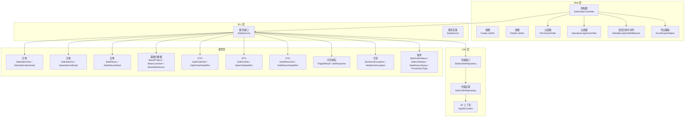
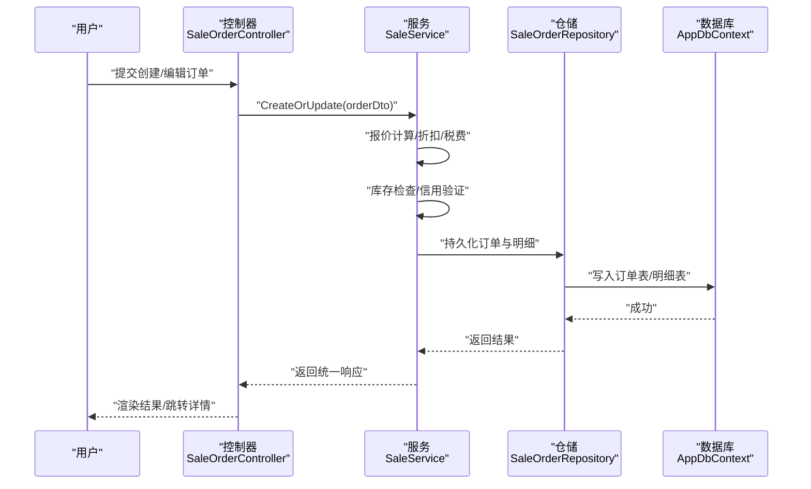
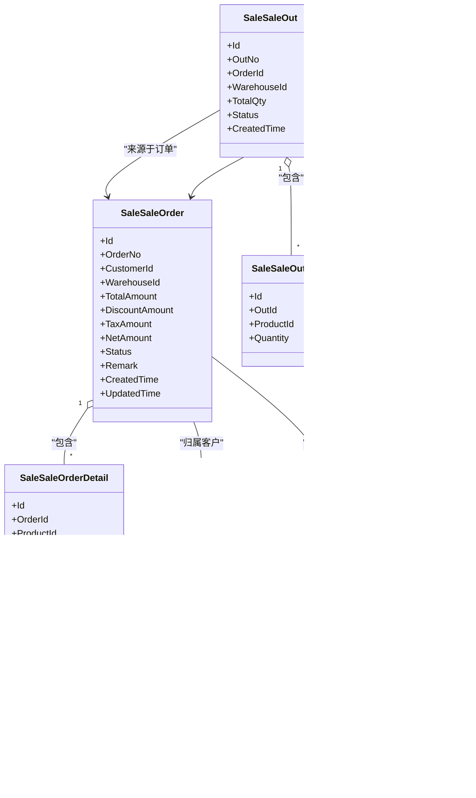
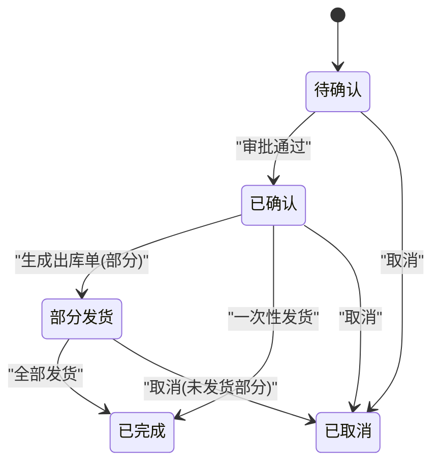
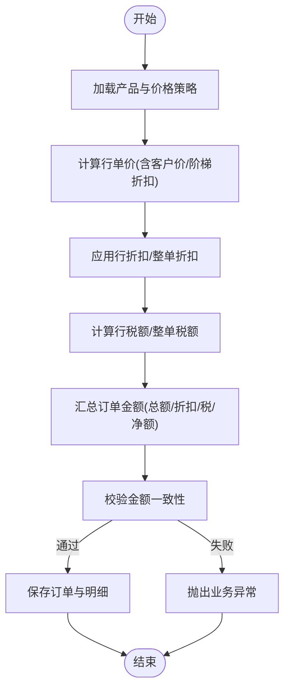
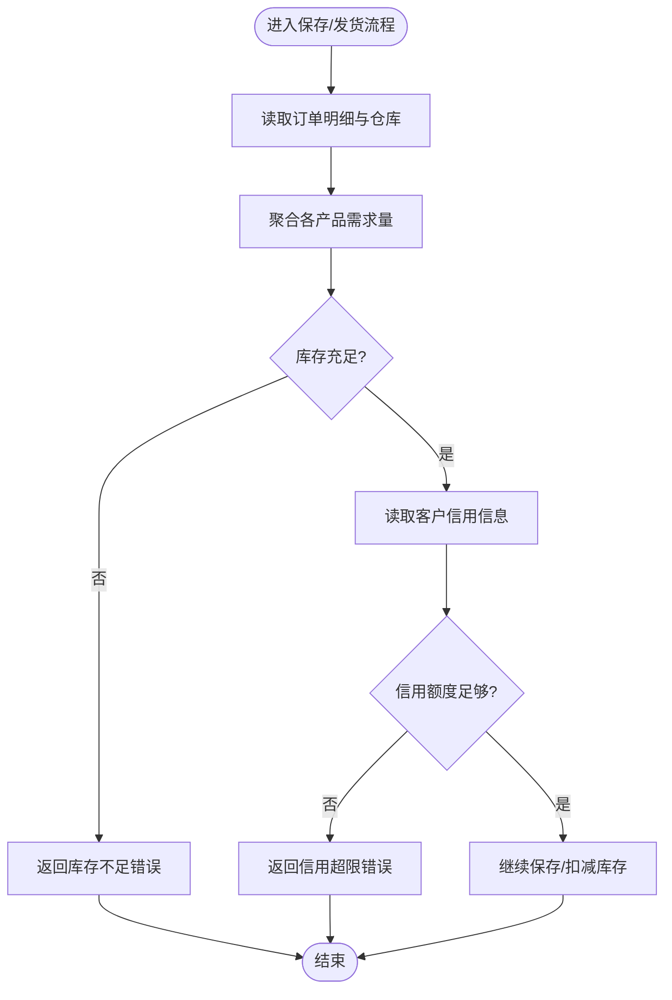
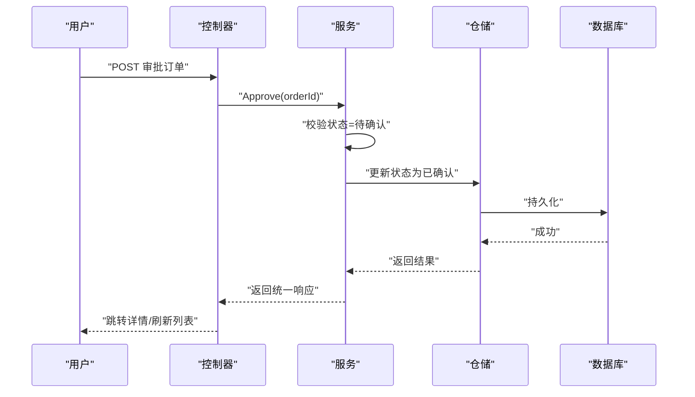
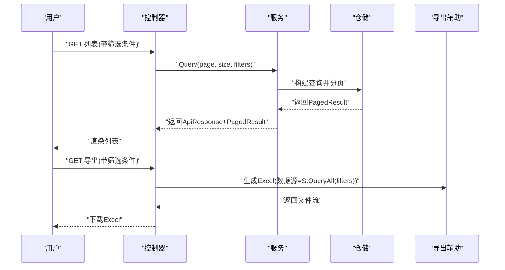
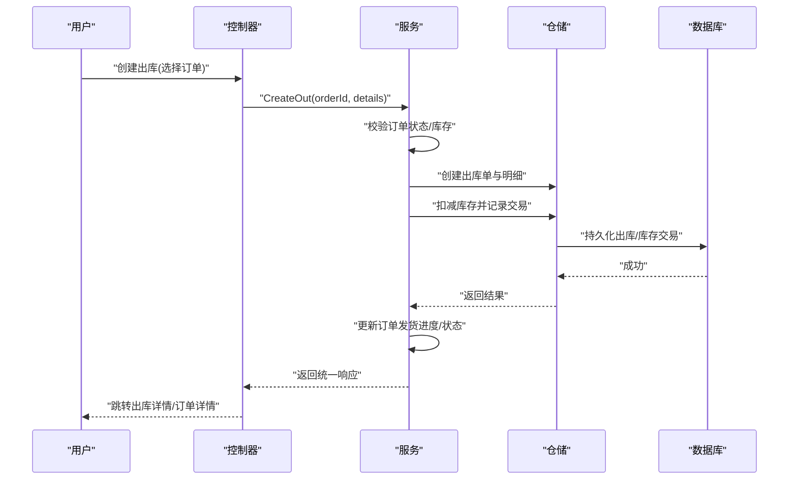
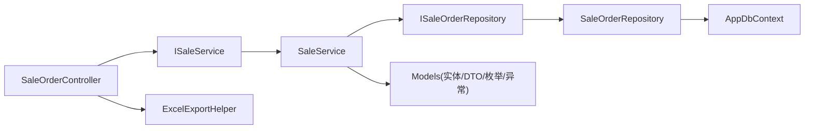

# 销售订单管理

<cite>
**本文引用的文件**   
- [SaleOrderController.cs](file://EquipmentIMS.Web/Controllers/SaleOrderController.cs)
- [ISaleService.cs](file://EquipmentIMS.BLL/Interfaces/ISaleService.cs)
- [SaleService.cs](file://EquipmentIMS.BLL/Services/SaleService.cs)
- [ISaleOrderRepository.cs](file://EquipmentIMS.DAL/Interfaces/ISaleOrderRepository.cs)
- [SaleOrderRepository.cs](file://EquipmentIMS.DAL/Repositories/SaleOrderRepository.cs)
- [AppDbContext.cs](file://EquipmentIMS.DAL/AppDbContext.cs)
- [SaleSaleOrder.cs](file://EquipmentIMS.Models/Entities/SaleSaleOrder.cs)
- [SaleSaleOrderDetail.cs](file://EquipmentIMS.Models/Entities/SaleSaleOrderDetail.cs)
- [SaleSaleOut.cs](file://EquipmentIMS.Models/Entities/SaleSaleOut.cs)
- [SaleSaleOutDetail.cs](file://EquipmentIMS.Models/Entities/SaleSaleOutDetail.cs)
- [SaleReturn.cs](file://EquipmentIMS.Models/Entities/SaleReturn.cs)
- [SaleReturnDetail.cs](file://EquipmentIMS.Models/Entities/SaleReturnDetail.cs)
- [BaseProduct.cs](file://EquipmentIMS.Models/Entities/BaseProduct.cs)
- [BaseCustomer.cs](file://EquipmentIMS.Models/Entities/BaseCustomer.cs)
- [BaseWarehouse.cs](file://EquipmentIMS.Models/Entities/BaseWarehouse.cs)
- [SaleOrderStatus.cs](file://EquipmentIMS.Models/Enums/SaleOrderStatus.cs)
- [SaleOutStatus.cs](file://EquipmentIMS.Models/Enums/SaleOutStatus.cs)
- [SaleReturnStatus.cs](file://EquipmentIMS.Models/Enums/SaleReturnStatus.cs)
- [TransactionType.cs](file://EquipmentIMS.Models/Enums/TransactionType.cs)
- [SaleOrderDto.cs](file://EquipmentIMS.Models/DTOs/SaleOrderDto.cs)
- [SaleOrderDetailDto.cs](file://EquipmentIMS.Models/DTOs/SaleOrderDetailDto.cs)
- [SaleOutDto.cs](file://EquipmentIMS.Models/DTOs/SaleOutDto.cs)
- [SaleOutDetailDto.cs](file://EquipmentIMS.Models/DTOs/SaleOutDetailDto.cs)
- [SaleReturnDto.cs](file://EquipmentIMS.Models/DTOs/SaleReturnDto.cs)
- [SaleReturnDetailDto.cs](file://EquipmentIMS.Models/DTOs/SaleReturnDetailDto.cs)
- [PagedResult.cs](file://EquipmentIMS.Models/DTOs/PagedResult.cs)
- [ApiResponse.cs](file://EquipmentIMS.Models/DTOs/ApiResponse.cs)
- [BusinessException.cs](file://EquipmentIMS.Models/Exceptions/BusinessException.cs)
- [ValidationException.cs](file://EquipmentIMS.Models/Exceptions/ValidationException.cs)
- [GlobalExceptionMiddleware.cs](file://EquipmentIMS.Web/Filters/GlobalExceptionMiddleware.cs)
- [OperationLogActionFilter.cs](file://EquipmentIMS.Web/Filters/OperationLogActionFilter.cs)
- [PermissionFilter.cs](file://EquipmentIMS.Web/Filters/PermissionFilter.cs)
- [ExcelExportHelper.cs](file://EquipmentIMS.Web/Helpers/ExcelExportHelper.cs)
- [Create.cshtml](file://EquipmentIMS.Web/Views/SaleOrder/Create.cshtml)
- [Details.cshtml](file://EquipmentIMS.Web/Views/SaleOrder/Details.cshtml)
</cite>

## 目录
1. [简介](#简介)
2. [项目结构](#项目结构)
3. [核心组件](#核心组件)
4. [架构总览](#架构总览)
5. [详细组件分析](#详细组件分析)
6. [依赖关系分析](#依赖关系分析)
7. [性能考虑](#性能考虑)
8. [故障排查指南](#故障排查指南)
9. [结论](#结论)
10. [附录](#附录)

## 简介
本文件面向“销售订单管理”功能，覆盖从创建、编辑、审批到跟踪的全流程。重点说明：
- 订单报价计算、库存检查、客户信用验证等核心业务逻辑
- 订单状态管理机制（待确认、已确认、部分发货、已完成、已取消）及流转规则
- 订单明细管理、价格策略应用、折扣与税费处理
- 查询、筛选、导出与打印能力
- 与销售出库、退货的关联关系与数据同步机制

## 项目结构
销售订单相关代码遵循分层架构：Web 控制器层调用业务服务层，服务层通过仓储访问数据库实体与上下文。视图层提供创建与详情页面。

图表来源
- [SaleOrderController.cs](file://EquipmentIMS.Web/Controllers/SaleOrderController.cs)
- [ISaleService.cs](file://EquipmentIMS.BLL/Interfaces/ISaleService.cs)
- [SaleService.cs](file://EquipmentIMS.BLL/Services/SaleService.cs)
- [ISaleOrderRepository.cs](file://EquipmentIMS.DAL/Interfaces/ISaleOrderRepository.cs)
- [SaleOrderRepository.cs](file://EquipmentIMS.DAL/Repositories/SaleOrderRepository.cs)
- [AppDbContext.cs](file://EquipmentIMS.DAL/AppDbContext.cs)
- [SaleSaleOrder.cs](file://EquipmentIMS.Models/Entities/SaleSaleOrder.cs)
- [SaleSaleOrderDetail.cs](file://EquipmentIMS.Models/Entities/SaleSaleOrderDetail.cs)
- [SaleSaleOut.cs](file://EquipmentIMS.Models/Entities/SaleSaleOut.cs)
- [SaleSaleOutDetail.cs](file://EquipmentIMS.Models/Entities/SaleSaleOutDetail.cs)
- [SaleReturn.cs](file://EquipmentIMS.Models/Entities/SaleReturn.cs)
- [SaleReturnDetail.cs](file://EquipmentIMS.Models/Entities/SaleReturnDetail.cs)
- [BaseProduct.cs](file://EquipmentIMS.Models/Entities/BaseProduct.cs)
- [BaseCustomer.cs](file://EquipmentIMS.Models/Entities/BaseCustomer.cs)
- [BaseWarehouse.cs](file://EquipmentIMS.Models/Entities/BaseWarehouse.cs)
- [SaleOrderStatus.cs](file://EquipmentIMS.Models/Enums/SaleOrderStatus.cs)
- [SaleOutStatus.cs](file://EquipmentIMS.Models/Enums/SaleOutStatus.cs)
- [SaleReturnStatus.cs](file://EquipmentIMS.Models/Enums/SaleReturnStatus.cs)
- [TransactionType.cs](file://EquipmentIMS.Models/Enums/TransactionType.cs)
- [SaleOrderDto.cs](file://EquipmentIMS.Models/DTOs/SaleOrderDto.cs)
- [SaleOrderDetailDto.cs](file://EquipmentIMS.Models/DTOs/SaleOrderDetailDto.cs)
- [SaleOutDto.cs](file://EquipmentIMS.Models/DTOs/SaleOutDto.cs)
- [SaleOutDetailDto.cs](file://EquipmentIMS.Models/DTOs/SaleOutDetailDto.cs)
- [SaleReturnDto.cs](file://EquipmentIMS.Models/DTOs/SaleReturnDto.cs)
- [SaleReturnDetailDto.cs](file://EquipmentIMS.Models/DTOs/SaleReturnDetailDto.cs)
- [PagedResult.cs](file://EquipmentIMS.Models/DTOs/PagedResult.cs)
- [ApiResponse.cs](file://EquipmentIMS.Models/DTOs/ApiResponse.cs)
- [BusinessException.cs](file://EquipmentIMS.Models/Exceptions/BusinessException.cs)
- [ValidationException.cs](file://EquipmentIMS.Models/Exceptions/ValidationException.cs)
- [GlobalExceptionMiddleware.cs](file://EquipmentIMS.Web/Filters/GlobalExceptionMiddleware.cs)
- [OperationLogActionFilter.cs](file://EquipmentIMS.Web/Filters/OperationLogActionFilter.cs)
- [PermissionFilter.cs](file://EquipmentIMS.Web/Filters/PermissionFilter.cs)
- [ExcelExportHelper.cs](file://EquipmentIMS.Web/Helpers/ExcelExportHelper.cs)
- [Create.cshtml](file://EquipmentIMS.Web/Views/SaleOrder/Create.cshtml)
- [Details.cshtml](file://EquipmentIMS.Web/Views/SaleOrder/Details.cshtml)

章节来源
- [SaleOrderController.cs](file://EquipmentIMS.Web/Controllers/SaleOrderController.cs)
- [ISaleService.cs](file://EquipmentIMS.BLL/Interfaces/ISaleService.cs)
- [SaleService.cs](file://EquipmentIMS.BLL/Services/SaleService.cs)
- [ISaleOrderRepository.cs](file://EquipmentIMS.DAL/Interfaces/ISaleOrderRepository.cs)
- [SaleOrderRepository.cs](file://EquipmentIMS.DAL/Repositories/SaleOrderRepository.cs)
- [AppDbContext.cs](file://EquipmentIMS.DAL/AppDbContext.cs)
- [SaleSaleOrder.cs](file://EquipmentIMS.Models/Entities/SaleSaleOrder.cs)
- [SaleSaleOrderDetail.cs](file://EquipmentIMS.Models/Entities/SaleSaleOrderDetail.cs)
- [SaleSaleOut.cs](file://EquipmentIMS.Models/Entities/SaleSaleOut.cs)
- [SaleSaleOutDetail.cs](file://EquipmentIMS.Models/Entities/SaleSaleOutDetail.cs)
- [SaleReturn.cs](file://EquipmentIMS.Models/Entities/SaleReturn.cs)
- [SaleReturnDetail.cs](file://EquipmentIMS.Models/Entities/SaleReturnDetail.cs)
- [BaseProduct.cs](file://EquipmentIMS.Models/Entities/BaseProduct.cs)
- [BaseCustomer.cs](file://EquipmentIMS.Models/Entities/BaseCustomer.cs)
- [BaseWarehouse.cs](file://EquipmentIMS.Models/Entities/BaseWarehouse.cs)
- [SaleOrderStatus.cs](file://EquipmentIMS.Models/Enums/SaleOrderStatus.cs)
- [SaleOutStatus.cs](file://EquipmentIMS.Models/Enums/SaleOutStatus.cs)
- [SaleReturnStatus.cs](file://EquipmentIMS.Models/Enums/SaleReturnStatus.cs)
- [TransactionType.cs](file://EquipmentIMS.Models/Enums/TransactionType.cs)
- [SaleOrderDto.cs](file://EquipmentIMS.Models/DTOs/SaleOrderDto.cs)
- [SaleOrderDetailDto.cs](file://EquipmentIMS.Models/DTOs/SaleOrderDetailDto.cs)
- [SaleOutDto.cs](file://EquipmentIMS.Models/DTOs/SaleOutDto.cs)
- [SaleOutDetailDto.cs](file://EquipmentIMS.Models/DTOs/SaleOutDetailDto.cs)
- [SaleReturnDto.cs](file://EquipmentIMS.Models/DTOs/SaleReturnDto.cs)
- [SaleReturnDetailDto.cs](file://EquipmentIMS.Models/DTOs/SaleReturnDetailDto.cs)
- [PagedResult.cs](file://EquipmentIMS.Models/DTOs/PagedResult.cs)
- [ApiResponse.cs](file://EquipmentIMS.Models/DTOs/ApiResponse.cs)
- [BusinessException.cs](file://EquipmentIMS.Models/Exceptions/BusinessException.cs)
- [ValidationException.cs](file://EquipmentIMS.Models/Exceptions/ValidationException.cs)
- [GlobalExceptionMiddleware.cs](file://EquipmentIMS.Web/Filters/GlobalExceptionMiddleware.cs)
- [OperationLogActionFilter.cs](file://EquipmentIMS.Web/Filters/OperationLogActionFilter.cs)
- [PermissionFilter.cs](file://EquipmentIMS.Web/Filters/PermissionFilter.cs)
- [ExcelExportHelper.cs](file://EquipmentIMS.Web/Helpers/ExcelExportHelper.cs)
- [Create.cshtml](file://EquipmentIMS.Web/Views/SaleOrder/Create.cshtml)
- [Details.cshtml](file://EquipmentIMS.Web/Views/SaleOrder/Details.cshtml)

## 核心组件
- 控制器层：负责接收请求、参数校验、权限控制、日志记录、导出与返回统一响应。
- 服务层：封装订单创建、编辑、审批、发货、退货等业务编排；执行报价计算、库存检查、信用验证、状态机流转、事务边界控制。
- 仓储层：提供对订单、出库、退货及相关主数据的增删改查与复杂查询。
- 模型层：包含实体、DTO、枚举、异常与分页/响应封装。
- 视图层：提供订单创建与详情展示界面。

章节来源
- [SaleOrderController.cs](file://EquipmentIMS.Web/Controllers/SaleOrderController.cs)
- [ISaleService.cs](file://EquipmentIMS.BLL/Interfaces/ISaleService.cs)
- [SaleService.cs](file://EquipmentIMS.BLL/Services/SaleService.cs)
- [ISaleOrderRepository.cs](file://EquipmentIMS.DAL/Interfaces/ISaleOrderRepository.cs)
- [SaleOrderRepository.cs](file://EquipmentIMS.DAL/Repositories/SaleOrderRepository.cs)
- [SaleOrderDto.cs](file://EquipmentIMS.Models/DTOs/SaleOrderDto.cs)
- [SaleOrderDetailDto.cs](file://EquipmentIMS.Models/DTOs/SaleOrderDetailDto.cs)
- [PagedResult.cs](file://EquipmentIMS.Models/DTOs/PagedResult.cs)
- [ApiResponse.cs](file://EquipmentIMS.Models/DTOs/ApiResponse.cs)

## 架构总览
销售订单关键流程包括：创建订单、编辑订单、审批确认、生成出库单并扣减库存、完成或取消订单、发起退货。

图表来源
- [SaleOrderController.cs](file://EquipmentIMS.Web/Controllers/SaleOrderController.cs)
- [SaleService.cs](file://EquipmentIMS.BLL/Services/SaleService.cs)
- [ISaleService.cs](file://EquipmentIMS.BLL/Interfaces/ISaleService.cs)
- [SaleOrderRepository.cs](file://EquipmentIMS.DAL/Repositories/SaleOrderRepository.cs)
- [ISaleOrderRepository.cs](file://EquipmentIMS.DAL/Interfaces/ISaleOrderRepository.cs)
- [AppDbContext.cs](file://EquipmentIMS.DAL/AppDbContext.cs)

## 详细组件分析

### 订单实体与关系
销售订单由订单头与明细组成，并与产品、客户、仓库等主数据关联。同时与出库单、退货单存在一对多关系。

图表来源
- [SaleSaleOrder.cs](file://EquipmentIMS.Models/Entities/SaleSaleOrder.cs)
- [SaleSaleOrderDetail.cs](file://EquipmentIMS.Models/Entities/SaleSaleOrderDetail.cs)
- [SaleSaleOut.cs](file://EquipmentIMS.Models/Entities/SaleSaleOut.cs)
- [SaleSaleOutDetail.cs](file://EquipmentIMS.Models/Entities/SaleSaleOutDetail.cs)
- [SaleReturn.cs](file://EquipmentIMS.Models/Entities/SaleReturn.cs)
- [SaleReturnDetail.cs](file://EquipmentIMS.Models/Entities/SaleReturnDetail.cs)
- [BaseProduct.cs](file://EquipmentIMS.Models/Entities/BaseProduct.cs)
- [BaseCustomer.cs](file://EquipmentIMS.Models/Entities/BaseCustomer.cs)
- [BaseWarehouse.cs](file://EquipmentIMS.Models/Entities/BaseWarehouse.cs)

章节来源
- [SaleSaleOrder.cs](file://EquipmentIMS.Models/Entities/SaleSaleOrder.cs)
- [SaleSaleOrderDetail.cs](file://EquipmentIMS.Models/Entities/SaleSaleOrderDetail.cs)
- [SaleSaleOut.cs](file://EquipmentIMS.Models/Entities/SaleSaleOut.cs)
- [SaleSaleOutDetail.cs](file://EquipmentIMS.Models/Entities/SaleSaleOutDetail.cs)
- [SaleReturn.cs](file://EquipmentIMS.Models/Entities/SaleReturn.cs)
- [SaleReturnDetail.cs](file://EquipmentIMS.Models/Entities/SaleReturnDetail.cs)
- [BaseProduct.cs](file://EquipmentIMS.Models/Entities/BaseProduct.cs)
- [BaseCustomer.cs](file://EquipmentIMS.Models/Entities/BaseCustomer.cs)
- [BaseWarehouse.cs](file://EquipmentIMS.Models/Entities/BaseWarehouse.cs)

### 订单状态机与流转
订单状态涵盖：待确认、已确认、部分发货、已完成、已取消。出库状态与退货状态分别独立管理，但受订单状态约束。

图表来源
- [SaleOrderStatus.cs](file://EquipmentIMS.Models/Enums/SaleOrderStatus.cs)
- [SaleOutStatus.cs](file://EquipmentIMS.Models/Enums/SaleOutStatus.cs)
- [SaleReturnStatus.cs](file://EquipmentIMS.Models/Enums/SaleReturnStatus.cs)

章节来源
- [SaleOrderStatus.cs](file://EquipmentIMS.Models/Enums/SaleOrderStatus.cs)
- [SaleOutStatus.cs](file://EquipmentIMS.Models/Enums/SaleOutStatus.cs)
- [SaleReturnStatus.cs](file://EquipmentIMS.Models/Enums/SaleReturnStatus.cs)

### 报价计算、折扣与税费
- 报价计算：基于产品默认价、客户价格策略（如按客户定价）、数量阶梯折扣等计算行单价。
- 折扣：支持整单折扣与行级折扣，最终影响订单净额。
- 税费：按行税率或整单税率计算税额，汇总至订单税额字段。
- 金额汇总：订单总额、折扣额、税额、净额在保存前进行一致性校验。

图表来源
- [SaleService.cs](file://EquipmentIMS.BLL/Services/SaleService.cs)
- [BaseProduct.cs](file://EquipmentIMS.Models/Entities/BaseProduct.cs)
- [BaseCustomer.cs](file://EquipmentIMS.Models/Entities/BaseCustomer.cs)
- [SaleSaleOrder.cs](file://EquipmentIMS.Models/Entities/SaleSaleOrder.cs)
- [SaleSaleOrderDetail.cs](file://EquipmentIMS.Models/Entities/SaleSaleOrderDetail.cs)

章节来源
- [SaleService.cs](file://EquipmentIMS.BLL/Services/SaleService.cs)
- [BaseProduct.cs](file://EquipmentIMS.Models/Entities/BaseProduct.cs)
- [BaseCustomer.cs](file://EquipmentIMS.Models/Entities/BaseCustomer.cs)
- [SaleSaleOrder.cs](file://EquipmentIMS.Models/Entities/SaleSaleOrder.cs)
- [SaleSaleOrderDetail.cs](file://EquipmentIMS.Models/Entities/SaleSaleOrderDetail.cs)

### 库存检查与信用验证
- 库存检查：根据订单明细与目标仓库，校验可用库存是否满足需求；不足时阻止提交或提示分批发货。
- 信用验证：读取客户信用额度与已用额度，判断新增订单后是否超限；超限则拒绝或要求特批。
- 并发安全：在保存订单与后续出库扣减时使用事务与锁机制，避免超卖。

图表来源
- [SaleService.cs](file://EquipmentIMS.BLL/Services/SaleService.cs)
- [BaseProduct.cs](file://EquipmentIMS.Models/Entities/BaseProduct.cs)
- [BaseCustomer.cs](file://EquipmentIMS.Models/Entities/BaseCustomer.cs)
- [BaseWarehouse.cs](file://EquipmentIMS.Models/Entities/BaseWarehouse.cs)

章节来源
- [SaleService.cs](file://EquipmentIMS.BLL/Services/SaleService.cs)
- [BaseProduct.cs](file://EquipmentIMS.Models/Entities/BaseProduct.cs)
- [BaseCustomer.cs](file://EquipmentIMS.Models/Entities/BaseCustomer.cs)
- [BaseWarehouse.cs](file://EquipmentIMS.Models/Entities/BaseWarehouse.cs)

### 审批与确认流程
- 审批入口：控制器提供审批动作，服务层校验当前状态仅允许从“待确认”转为“已确认”。
- 审计与日志：操作日志过滤器记录审批人、时间、变更前后状态。
- 幂等性：重复提交审批应被识别并忽略或返回相同结果。

图表来源
- [SaleOrderController.cs](file://EquipmentIMS.Web/Controllers/SaleOrderController.cs)
- [SaleService.cs](file://EquipmentIMS.BLL/Services/SaleService.cs)
- [ISaleService.cs](file://EquipmentIMS.BLL/Interfaces/ISaleService.cs)
- [SaleOrderRepository.cs](file://EquipmentIMS.DAL/Repositories/SaleOrderRepository.cs)
- [ISaleOrderRepository.cs](file://EquipmentIMS.DAL/Interfaces/ISaleOrderRepository.cs)
- [AppDbContext.cs](file://EquipmentIMS.DAL/AppDbContext.cs)

章节来源
- [SaleOrderController.cs](file://EquipmentIMS.Web/Controllers/SaleOrderController.cs)
- [SaleService.cs](file://EquipmentIMS.BLL/Services/SaleService.cs)
- [ISaleService.cs](file://EquipmentIMS.BLL/Interfaces/ISaleService.cs)
- [SaleOrderRepository.cs](file://EquipmentIMS.DAL/Repositories/SaleOrderRepository.cs)
- [ISaleOrderRepository.cs](file://EquipmentIMS.DAL/Interfaces/ISaleOrderRepository.cs)
- [AppDbContext.cs](file://EquipmentIMS.DAL/AppDbContext.cs)

### 订单明细管理
- 明细项包含产品、数量、单价、折扣率、税率、行金额等。
- 支持批量添加、删除、修改；修改后重新计算订单总额、折扣、税额与净额。
- 前端视图提供动态明细表格与实时合计显示。

章节来源
- [SaleSaleOrderDetail.cs](file://EquipmentIMS.Models/Entities/SaleSaleOrderDetail.cs)
- [SaleOrderDetailDto.cs](file://EquipmentIMS.Models/DTOs/SaleOrderDetailDto.cs)
- [Create.cshtml](file://EquipmentIMS.Web/Views/SaleOrder/Create.cshtml)
- [Details.cshtml](file://EquipmentIMS.Web/Views/SaleOrder/Details.cshtml)

### 查询、筛选、导出与打印
- 查询与筛选：支持按订单号、客户、仓库、日期范围、状态等多条件组合查询，返回分页结果。
- 导出：将查询结果导出为 Excel，使用导出辅助工具生成工作簿。
- 打印：详情页提供打印样式与按钮，便于纸质归档。

图表来源
- [SaleOrderController.cs](file://EquipmentIMS.Web/Controllers/SaleOrderController.cs)
- [SaleService.cs](file://EquipmentIMS.BLL/Services/SaleService.cs)
- [ISaleService.cs](file://EquipmentIMS.BLL/Interfaces/ISaleService.cs)
- [SaleOrderRepository.cs](file://EquipmentIMS.DAL/Repositories/SaleOrderRepository.cs)
- [ISaleOrderRepository.cs](file://EquipmentIMS.DAL/Interfaces/ISaleOrderRepository.cs)
- [ExcelExportHelper.cs](file://EquipmentIMS.Web/Helpers/ExcelExportHelper.cs)
- [PagedResult.cs](file://EquipmentIMS.Models/DTOs/PagedResult.cs)
- [ApiResponse.cs](file://EquipmentIMS.Models/DTOs/ApiResponse.cs)

章节来源
- [SaleOrderController.cs](file://EquipmentIMS.Web/Controllers/SaleOrderController.cs)
- [SaleService.cs](file://EquipmentIMS.BLL/Services/SaleService.cs)
- [ISaleService.cs](file://EquipmentIMS.BLL/Interfaces/ISaleService.cs)
- [SaleOrderRepository.cs](file://EquipmentIMS.DAL/Repositories/SaleOrderRepository.cs)
- [ISaleOrderRepository.cs](file://EquipmentIMS.DAL/Interfaces/ISaleOrderRepository.cs)
- [ExcelExportHelper.cs](file://EquipmentIMS.Web/Helpers/ExcelExportHelper.cs)
- [PagedResult.cs](file://EquipmentIMS.Models/DTOs/PagedResult.cs)
- [ApiResponse.cs](file://EquipmentIMS.Models/DTOs/ApiResponse.cs)

### 与销售出库、退货的关联与数据同步
- 出库：从已确认或部分发货状态的订单生成出库单，扣减库存，更新订单发货进度；当累计发货量等于订单总量时，订单自动完成。
- 退货：针对已发货的订单明细发起退货，增加库存，更新退货状态；退货完成后不影响订单已完成状态，但可触发售后统计。
- 数据同步：出库与退货均通过仓储层更新库存交易记录，确保库存一致性与可追溯。

图表来源
- [SaleOrderController.cs](file://EquipmentIMS.Web/Controllers/SaleOrderController.cs)
- [SaleService.cs](file://EquipmentIMS.BLL/Services/SaleService.cs)
- [ISaleService.cs](file://EquipmentIMS.BLL/Interfaces/ISaleService.cs)
- [SaleOrderRepository.cs](file://EquipmentIMS.DAL/Repositories/SaleOrderRepository.cs)
- [ISaleOrderRepository.cs](file://EquipmentIMS.DAL/Interfaces/ISaleOrderRepository.cs)
- [SaleSaleOut.cs](file://EquipmentIMS.Models/Entities/SaleSaleOut.cs)
- [SaleSaleOutDetail.cs](file://EquipmentIMS.Models/Entities/SaleSaleOutDetail.cs)
- [SaleSaleOrder.cs](file://EquipmentIMS.Models/Entities/SaleSaleOrder.cs)
- [AppDbContext.cs](file://EquipmentIMS.DAL/AppDbContext.cs)

章节来源
- [SaleOrderController.cs](file://EquipmentIMS.Web/Controllers/SaleOrderController.cs)
- [SaleService.cs](file://EquipmentIMS.BLL/Services/SaleService.cs)
- [ISaleService.cs](file://EquipmentIMS.BLL/Interfaces/ISaleService.cs)
- [SaleOrderRepository.cs](file://EquipmentIMS.DAL/Repositories/SaleOrderRepository.cs)
- [ISaleOrderRepository.cs](file://EquipmentIMS.DAL/Interfaces/ISaleOrderRepository.cs)
- [SaleSaleOut.cs](file://EquipmentIMS.Models/Entities/SaleSaleOut.cs)
- [SaleSaleOutDetail.cs](file://EquipmentIMS.Models/Entities/SaleSaleOutDetail.cs)
- [SaleSaleOrder.cs](file://EquipmentIMS.Models/Entities/SaleSaleOrder.cs)
- [AppDbContext.cs](file://EquipmentIMS.DAL/AppDbContext.cs)

### 权限控制与操作日志
- 权限过滤：控制器方法受权限过滤器保护，仅授权角色可访问。
- 操作日志：过滤器拦截关键操作，记录操作人、时间、IP、动作类型与结果。
- 全局异常：统一捕获并返回标准错误响应，便于前端提示与审计。

章节来源
- [PermissionFilter.cs](file://EquipmentIMS.Web/Filters/PermissionFilter.cs)
- [OperationLogActionFilter.cs](file://EquipmentIMS.Web/Filters/OperationLogActionFilter.cs)
- [GlobalExceptionMiddleware.cs](file://EquipmentIMS.Web/Filters/GlobalExceptionMiddleware.cs)

## 依赖关系分析
- 控制器依赖服务接口，服务实现依赖仓储接口，仓储实现依赖 EF 上下文。
- 模型层提供实体、DTO、枚举与异常，贯穿全链路。
- 导出辅助工具被控制器直接调用，用于生成 Excel。

图表来源
- [SaleOrderController.cs](file://EquipmentIMS.Web/Controllers/SaleOrderController.cs)
- [ISaleService.cs](file://EquipmentIMS.BLL/Interfaces/ISaleService.cs)
- [SaleService.cs](file://EquipmentIMS.BLL/Services/SaleService.cs)
- [ISaleOrderRepository.cs](file://EquipmentIMS.DAL/Interfaces/ISaleOrderRepository.cs)
- [SaleOrderRepository.cs](file://EquipmentIMS.DAL/Repositories/SaleOrderRepository.cs)
- [AppDbContext.cs](file://EquipmentIMS.DAL/AppDbContext.cs)
- [ExcelExportHelper.cs](file://EquipmentIMS.Web/Helpers/ExcelExportHelper.cs)

章节来源
- [SaleOrderController.cs](file://EquipmentIMS.Web/Controllers/SaleOrderController.cs)
- [ISaleService.cs](file://EquipmentIMS.BLL/Interfaces/ISaleService.cs)
- [SaleService.cs](file://EquipmentIMS.BLL/Services/SaleService.cs)
- [ISaleOrderRepository.cs](file://EquipmentIMS.DAL/Interfaces/ISaleOrderRepository.cs)
- [SaleOrderRepository.cs](file://EquipmentIMS.DAL/Repositories/SaleOrderRepository.cs)
- [AppDbContext.cs](file://EquipmentIMS.DAL/AppDbContext.cs)
- [ExcelExportHelper.cs](file://EquipmentIMS.Web/Helpers/ExcelExportHelper.cs)

## 性能考虑
- 查询优化：使用分页与选择性投影减少数据传输；对常用筛选字段建立索引（如订单号、客户ID、仓库ID、状态、创建时间）。
- 批量操作：明细导入与导出采用批量写入/读取，降低往返次数。
- 并发控制：库存扣减与订单状态更新使用事务与行级锁，避免超卖与竞态条件。
- 缓存策略：对主数据（产品、客户、仓库）与价格策略进行短期缓存，减少频繁查询。
- 异步导出：大批量导出任务可放入后台队列，避免阻塞请求线程。

[本节为通用指导，不直接分析具体文件]

## 故障排查指南
- 常见错误
  - 库存不足：检查产品可用库存与目标仓库配置，确认是否存在其他占用或未审核出库。
  - 信用超限：核对客户信用额度与已用额度，必要时调整额度或分批发货。
  - 状态非法：确认当前订单状态是否允许执行该操作（如仅“待确认”可审批）。
  - 金额不一致：检查折扣与税费计算逻辑，确保行金额与订单汇总一致。
- 定位方法
  - 查看全局异常中间件返回的统一错误信息。
  - 检查操作日志过滤器记录的审批与关键操作轨迹。
  - 核对仓储层返回的分页与筛选结果是否符合预期。
- 恢复建议
  - 对于库存问题，优先释放占用或调整出库计划。
  - 对于信用问题，联系财务或上级审批调整额度。
  - 对于状态问题，回滚到上一合法状态后再试。

章节来源
- [GlobalExceptionMiddleware.cs](file://EquipmentIMS.Web/Filters/GlobalExceptionMiddleware.cs)
- [OperationLogActionFilter.cs](file://EquipmentIMS.Web/Filters/OperationLogActionFilter.cs)
- [BusinessException.cs](file://EquipmentIMS.Models/Exceptions/BusinessException.cs)
- [ValidationException.cs](file://EquipmentIMS.Models/Exceptions/ValidationException.cs)

## 结论
销售订单管理模块以分层架构为基础，围绕订单生命周期构建了完整的业务流程：从报价计算、库存与信用校验，到审批确认、出库扣减与退货处理，再到查询、导出与打印。通过明确的状态机与事务边界，保障了数据一致性与可追溯性。建议在后续迭代中完善价格策略扩展点、引入更细粒度的权限控制与审计报表，以提升系统的灵活性与可观测性。

[本节为总结性内容，不直接分析具体文件]

## 附录
- 前端视图参考
  - 订单创建：[Create.cshtml](file://EquipmentIMS.Web/Views/SaleOrder/Create.cshtml)
  - 订单详情：[Details.cshtml](file://EquipmentIMS.Web/Views/SaleOrder/Details.cshtml)
- 关键 DTO 与枚举
  - 订单与明细 DTO：[SaleOrderDto.cs](file://EquipmentIMS.Models/DTOs/SaleOrderDto.cs)、[SaleOrderDetailDto.cs](file://EquipmentIMS.Models/DTOs/SaleOrderDetailDto.cs)
  - 出库与退货 DTO：[SaleOutDto.cs](file://EquipmentIMS.Models/DTOs/SaleOutDto.cs)、[SaleOutDetailDto.cs](file://EquipmentIMS.Models/DTOs/SaleOutDetailDto.cs)、[SaleReturnDto.cs](file://EquipmentIMS.Models/DTOs/SaleReturnDto.cs)、[SaleReturnDetailDto.cs](file://EquipmentIMS.Models/DTOs/SaleReturnDetailDto.cs)
  - 状态枚举：[SaleOrderStatus.cs](file://EquipmentIMS.Models/Enums/SaleOrderStatus.cs)、[SaleOutStatus.cs](file://EquipmentIMS.Models/Enums/SaleOutStatus.cs)、[SaleReturnStatus.cs](file://EquipmentIMS.Models/Enums/SaleReturnStatus.cs)
  - 交易类型：[TransactionType.cs](file://EquipmentIMS.Models/Enums/TransactionType.cs)

章节来源
- [Create.cshtml](file://EquipmentIMS.Web/Views/SaleOrder/Create.cshtml)
- [Details.cshtml](file://EquipmentIMS.Web/Views/SaleOrder/Details.cshtml)
- [SaleOrderDto.cs](file://EquipmentIMS.Models/DTOs/SaleOrderDto.cs)
- [SaleOrderDetailDto.cs](file://EquipmentIMS.Models/DTOs/SaleOrderDetailDto.cs)
- [SaleOutDto.cs](file://EquipmentIMS.Models/DTOs/SaleOutDto.cs)
- [SaleOutDetailDto.cs](file://EquipmentIMS.Models/DTOs/SaleOutDetailDto.cs)
- [SaleReturnDto.cs](file://EquipmentIMS.Models/DTOs/SaleReturnDto.cs)
- [SaleReturnDetailDto.cs](file://EquipmentIMS.Models/DTOs/SaleReturnDetailDto.cs)
- [SaleOrderStatus.cs](file://EquipmentIMS.Models/Enums/SaleOrderStatus.cs)
- [SaleOutStatus.cs](file://EquipmentIMS.Models/Enums/SaleOutStatus.cs)
- [SaleReturnStatus.cs](file://EquipmentIMS.Models/Enums/SaleReturnStatus.cs)
- [TransactionType.cs](file://EquipmentIMS.Models/Enums/TransactionType.cs)