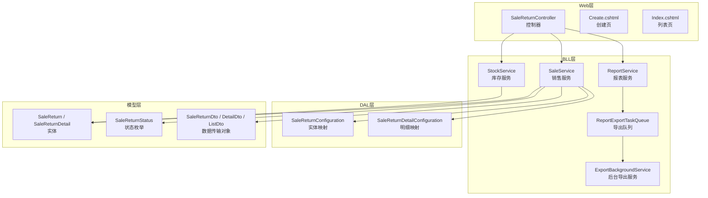
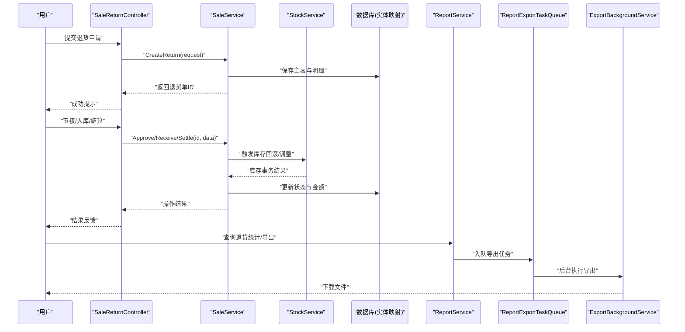
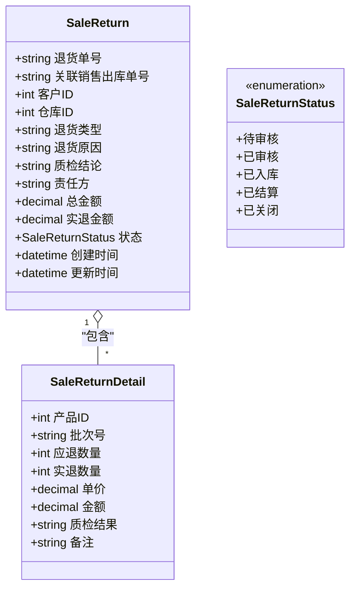
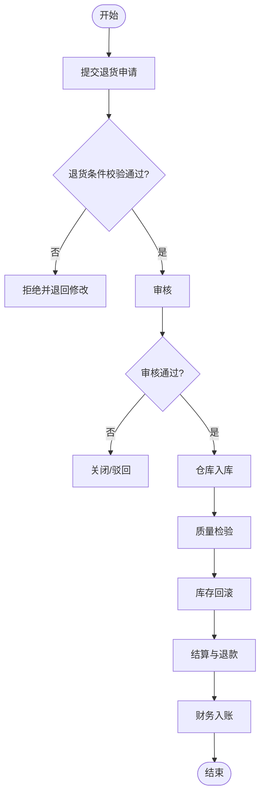
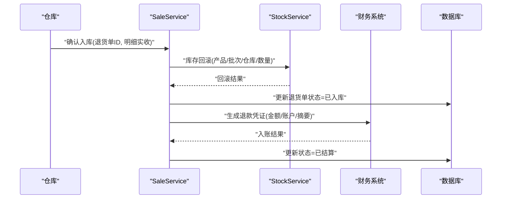
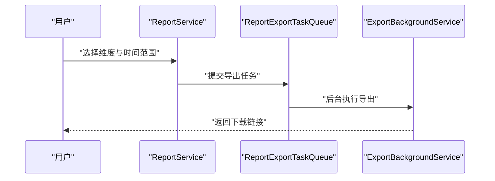
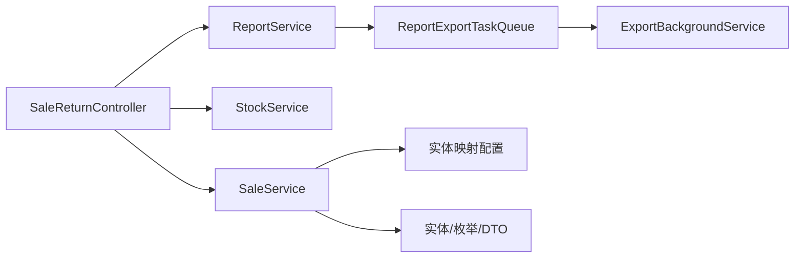

# 销售退货管理

<cite>
**本文引用的文件**   
- [SaleReturn.cs](file://EquipmentIMS.Models/Entities/SaleReturn.cs)
- [SaleReturnDetail.cs](file://EquipmentIMS.Models/Entities/SaleReturnDetail.cs)
- [SaleReturnStatus.cs](file://EquipmentIMS.Models/Enums/SaleReturnStatus.cs)
- [SaleReturnDto.cs](file://EquipmentIMS.Models/DTOs/SaleReturnDto.cs)
- [SaleReturnDetailDto.cs](file://EquipmentIMS.Models/DTOs/SaleReturnDetailDto.cs)
- [SaleReturnListDto.cs](file://EquipmentIMS.Models/DTOs/SaleReturnListDto.cs)
- [SaleReturnConfiguration.cs](file://EquipmentIMS.DAL/Configurations/SaleReturnConfiguration.cs)
- [SaleReturnDetailConfiguration.cs](file://EquipmentIMS.DAL/Configurations/SaleReturnDetailConfiguration.cs)
- [SaleReturnController.cs](file://EquipmentIMS.Web/Controllers/SaleReturnController.cs)
- [SaleReturnViewModel.cs](file://EquipmentIMS.Web/Models/SaleReturnViewModel.cs)
- [Create.cshtml](file://EquipmentIMS.Web/Views/SaleReturn/Create.cshtml)
- [Index.cshtml](file://EquipmentIMS.Web/Views/SaleReturn/Index.cshtml)
- [SaleService.cs](file://EquipmentIMS.BLL/Services/SaleService.cs)
- [ISaleService.cs](file://EquipmentIMS.BLL/Interfaces/ISaleService.cs)
- [StockService.cs](file://EquipmentIMS.BLL/Services/StockService.cs)
- [IStockService.cs](file://EquipmentIMS.BLL/Interfaces/IStockService.cs)
- [ReportService.cs](file://EquipmentIMS.BLL/Services/ReportService.cs)
- [ReportExportTaskQueue.cs](file://EquipmentIMS.BLL/Services/ReportExportTaskQueue.cs)
- [ExportBackgroundService.cs](file://EquipmentIMS.Web/BackgroundServices/ExportBackgroundService.cs)
- [GlobalExceptionMiddleware.cs](file://EquipmentIMS.Web/Filters/GlobalExceptionMiddleware.cs)
- [OperationLogActionFilter.cs](file://EquipmentIMS.Web/Filters/OperationLogActionFilter.cs)
- [SysOperationLog.cs](file://EquipmentIMS.Models/Entities/SysOperationLog.cs)
</cite>

## 目录
1. [简介](#简介)
2. [项目结构](#项目结构)
3. [核心组件](#核心组件)
4. [架构总览](#架构总览)
5. [详细组件分析](#详细组件分析)
6. [依赖关系分析](#依赖关系分析)
7. [性能考虑](#性能考虑)
8. [故障排查指南](#故障排查指南)
9. [结论](#结论)
10. [附录](#附录)

## 简介
本文件围绕“销售退货管理”功能，系统化梳理从申请、审核、处理到结算的完整流程，覆盖退货原因分类、质量检验标准与退货条件判定规则；阐述退货入库、库存恢复与退款计算逻辑；说明退货成本分析、责任归属与供应商索赔处理；并提供退货统计分析、退货率监控与客户满意度评估能力。同时，明确与销售出库、库存、财务系统的集成点及数据一致性保障机制。

## 项目结构
销售退货相关代码分布在模型层、数据访问配置、业务服务、控制器与视图等层次：
- 模型与枚举：定义退货主表、明细、状态枚举以及对应的 DTO。
- 数据访问配置：EF Core 实体映射配置。
- 控制器与视图：提供创建、列表、操作入口的前后端交互。
- 业务服务：封装退货流程、库存联动、报表导出等核心逻辑。
- 后台任务与中间件：支持异步导出与全局异常处理、操作日志记录。

图表来源
- [SaleReturnController.cs](file://EquipmentIMS.Web/Controllers/SaleReturnController.cs)
- [SaleService.cs](file://EquipmentIMS.BLL/Services/SaleService.cs)
- [StockService.cs](file://EquipmentIMS.BLL/Services/StockService.cs)
- [ReportService.cs](file://EquipmentIMS.BLL/Services/ReportService.cs)
- [ReportExportTaskQueue.cs](file://EquipmentIMS.BLL/Services/ReportExportTaskQueue.cs)
- [ExportBackgroundService.cs](file://EquipmentIMS.Web/BackgroundServices/ExportBackgroundService.cs)
- [SaleReturnConfiguration.cs](file://EquipmentIMS.DAL/Configurations/SaleReturnConfiguration.cs)
- [SaleReturnDetailConfiguration.cs](file://EquipmentIMS.DAL/Configurations/SaleReturnDetailConfiguration.cs)
- [SaleReturn.cs](file://EquipmentIMS.Models/Entities/SaleReturn.cs)
- [SaleReturnDetail.cs](file://EquipmentIMS.Models/Entities/SaleReturnDetail.cs)
- [SaleReturnStatus.cs](file://EquipmentIMS.Models/Enums/SaleReturnStatus.cs)
- [SaleReturnDto.cs](file://EquipmentIMS.Models/DTOs/SaleReturnDto.cs)
- [SaleReturnDetailDto.cs](file://EquipmentIMS.Models/DTOs/SaleReturnDetailDto.cs)
- [SaleReturnListDto.cs](file://EquipmentIMS.Models/DTOs/SaleReturnListDto.cs)

章节来源
- [SaleReturnController.cs](file://EquipmentIMS.Web/Controllers/SaleReturnController.cs)
- [SaleService.cs](file://EquipmentIMS.BLL/Services/SaleService.cs)
- [StockService.cs](file://EquipmentIMS.BLL/Services/StockService.cs)
- [ReportService.cs](file://EquipmentIMS.BLL/Services/ReportService.cs)
- [ReportExportTaskQueue.cs](file://EquipmentIMS.BLL/Services/ReportExportTaskQueue.cs)
- [ExportBackgroundService.cs](file://EquipmentIMS.Web/BackgroundServices/ExportBackgroundService.cs)
- [SaleReturnConfiguration.cs](file://EquipmentIMS.DAL/Configurations/SaleReturnConfiguration.cs)
- [SaleReturnDetailConfiguration.cs](file://EquipmentIMS.DAL/Configurations/SaleReturnDetailConfiguration.cs)
- [SaleReturn.cs](file://EquipmentIMS.Models/Entities/SaleReturn.cs)
- [SaleReturnDetail.cs](file://EquipmentIMS.Models/Entities/SaleReturnDetail.cs)
- [SaleReturnStatus.cs](file://EquipmentIMS.Models/Enums/SaleReturnStatus.cs)
- [SaleReturnDto.cs](file://EquipmentIMS.Models/DTOs/SaleReturnDto.cs)
- [SaleReturnDetailDto.cs](file://EquipmentIMS.Models/DTOs/SaleReturnDetailDto.cs)
- [SaleReturnListDto.cs](file://EquipmentIMS.Models/DTOs/SaleReturnListDto.cs)

## 核心组件
- 实体与映射
  - 退货主表与明细表实体及其 EF 配置，承载退货单号、关联销售出库、客户、仓库、状态、金额、数量、备注等字段。
  - 明细包含产品、批次、数量、单价、金额、质检结果、责任方等关键信息。
- 状态枚举
  - 通过统一的状态枚举驱动审批流（如待审核、已审核、已入库、已结算、已关闭等）。
- DTO 与 ViewModel
  - 面向 API 与 UI 的数据传输对象，用于创建、编辑、列表展示与导出。
- 控制器
  - 暴露退货单的增删改查、提交审核、入库确认、结算等操作接口。
- 业务服务
  - 封装退货申请校验、审批流转、入库与库存回滚、退款计算、报表统计等。
- 报表与导出
  - 提供退货统计、退货率、客户满意度等指标，并支持异步导出。

章节来源
- [SaleReturn.cs](file://EquipmentIMS.Models/Entities/SaleReturn.cs)
- [SaleReturnDetail.cs](file://EquipmentIMS.Models/Entities/SaleReturnDetail.cs)
- [SaleReturnStatus.cs](file://EquipmentIMS.Models/Enums/SaleReturnStatus.cs)
- [SaleReturnDto.cs](file://EquipmentIMS.Models/DTOs/SaleReturnDto.cs)
- [SaleReturnDetailDto.cs](file://EquipmentIMS.Models/DTOs/SaleReturnDetailDto.cs)
- [SaleReturnListDto.cs](file://EquipmentIMS.Models/DTOs/SaleReturnListDto.cs)
- [SaleReturnConfiguration.cs](file://EquipmentIMS.DAL/Configurations/SaleReturnConfiguration.cs)
- [SaleReturnDetailConfiguration.cs](file://EquipmentIMS.DAL/Configurations/SaleReturnDetailConfiguration.cs)
- [SaleReturnController.cs](file://EquipmentIMS.Web/Controllers/SaleReturnController.cs)
- [SaleService.cs](file://EquipmentIMS.BLL/Services/SaleService.cs)
- [StockService.cs](file://EquipmentIMS.BLL/Services/StockService.cs)
- [ReportService.cs](file://EquipmentIMS.BLL/Services/ReportService.cs)

## 架构总览
销售退货采用分层架构：Web 控制器接收请求，调用 BLL 服务完成业务编排，DAL 通过 EF Core 持久化数据，并通过枚举与 DTO 贯穿各层。

图表来源
- [SaleReturnController.cs](file://EquipmentIMS.Web/Controllers/SaleReturnController.cs)
- [SaleService.cs](file://EquipmentIMS.BLL/Services/SaleService.cs)
- [StockService.cs](file://EquipmentIMS.BLL/Services/StockService.cs)
- [ReportService.cs](file://EquipmentIMS.BLL/Services/ReportService.cs)
- [ReportExportTaskQueue.cs](file://EquipmentIMS.BLL/Services/ReportExportTaskQueue.cs)
- [ExportBackgroundService.cs](file://EquipmentIMS.Web/BackgroundServices/ExportBackgroundService.cs)

## 详细组件分析

### 实体与数据模型
- 退货主表
  - 关键字段：退货单号、关联销售出库单号、客户、仓库、退货类型、退货原因、质检结论、责任方、总金额、实退金额、状态、创建/更新时间等。
- 退货明细
  - 关键字段：产品、批次/序列号、应退数量、实退数量、单价、金额、质检结果、备注等。
- 状态枚举
  - 使用统一状态机控制生命周期，确保审批与结算不可逆或受控跳转。

图表来源
- [SaleReturn.cs](file://EquipmentIMS.Models/Entities/SaleReturn.cs)
- [SaleReturnDetail.cs](file://EquipmentIMS.Models/Entities/SaleReturnDetail.cs)
- [SaleReturnStatus.cs](file://EquipmentIMS.Models/Enums/SaleReturnStatus.cs)

章节来源
- [SaleReturn.cs](file://EquipmentIMS.Models/Entities/SaleReturn.cs)
- [SaleReturnDetail.cs](file://EquipmentIMS.Models/Entities/SaleReturnDetail.cs)
- [SaleReturnStatus.cs](file://EquipmentIMS.Models/Enums/SaleReturnStatus.cs)
- [SaleReturnConfiguration.cs](file://EquipmentIMS.DAL/Configurations/SaleReturnConfiguration.cs)
- [SaleReturnDetailConfiguration.cs](file://EquipmentIMS.DAL/Configurations/SaleReturnDetailConfiguration.cs)

### 业务流程与规则
- 退货申请
  - 输入：关联销售出库单、退货明细（产品、数量、原因、质检初判等）。
  - 校验：退货条件（是否在允许期限内、是否可退、是否超量）、库存与价格基准、必填项完整性。
- 审核
  - 依据退货原因与质检结论进行审批，必要时转交质量部门复核。
  - 通过后进入“已审核”，锁定后续入库与结算路径。
- 入库处理
  - 仓库按明细收货，记录实收数量与质检终检结果。
  - 触发库存回滚：将实退数量加回到对应仓库与批次。
- 结算
  - 根据实退数量与单价计算退款金额，支持部分退货与折扣/费用扣减。
  - 生成财务凭证（对接财务系统），更新状态为“已结算”。
- 关闭
  - 对无需结算或特殊场景进行关闭归档。

章节来源
- [SaleReturnController.cs](file://EquipmentIMS.Web/Controllers/SaleReturnController.cs)
- [SaleService.cs](file://EquipmentIMS.BLL/Services/SaleService.cs)
- [StockService.cs](file://EquipmentIMS.BLL/Services/StockService.cs)

### 退货原因分类与质量检验标准
- 退货原因分类
  - 常见分类：质量问题、错发漏发、包装破损、客户拒收、政策召回等。
  - 在明细中记录具体原因，便于后续分析与责任划分。
- 质量检验标准
  - 初检：申请时由业务人员初步判断。
  - 复检：仓库入库后进行专业质检，确定最终结论（合格/不合格/需返修/报废）。
  - 质检结果影响库存处置与退款比例。

章节来源
- [SaleReturnDetail.cs](file://EquipmentIMS.Models/Entities/SaleReturnDetail.cs)
- [SaleReturn.cs](file://EquipmentIMS.Models/Entities/SaleReturn.cs)

### 退货条件判定规则
- 时效性：自销售出库日起在允许退货期内。
- 可退性：产品属性允许退货（如定制类不可退）。
- 数量限制：实退数量不超过应退数量且不超过原出库数量。
- 状态约束：仅“已审核”的退货单可入库；仅“已入库”的可结算。
- 价格基准：以原出库价或约定价为准，支持促销/折扣折算。

章节来源
- [SaleReturn.cs](file://EquipmentIMS.Models/Entities/SaleReturn.cs)
- [SaleReturnDetail.cs](file://EquipmentIMS.Models/Entities/SaleReturnDetail.cs)
- [SaleReturnStatus.cs](file://EquipmentIMS.Models/Enums/SaleReturnStatus.cs)

### 退货入库、库存恢复与退款计算
- 入库
  - 仓库按明细逐项收货，记录实收数量与质检终检结论。
- 库存恢复
  - 根据实退数量与批次，增加目标仓库库存，保证账实一致。
- 退款计算
  - 基础公式：退款金额 = 实退数量 × 单价 − 扣减费用（如运费、损耗、违约金）。
  - 支持部分退货与多批次合并结算。
- 财务对接
  - 生成退款凭证，同步至财务系统，确保应收冲销与资金流出一致。

图表来源
- [SaleService.cs](file://EquipmentIMS.BLL/Services/SaleService.cs)
- [StockService.cs](file://EquipmentIMS.BLL/Services/StockService.cs)

章节来源
- [SaleService.cs](file://EquipmentIMS.BLL/Services/SaleService.cs)
- [StockService.cs](file://EquipmentIMS.BLL/Services/StockService.cs)

### 退货成本分析、责任归属与供应商索赔
- 成本分析
  - 按产品、客户、仓库、时间段汇总退货数量与金额，识别高退货率品类与客户。
- 责任归属
  - 基于质检结论与退货原因，判定责任方（我方、物流、客户、供应商等）。
- 供应商索赔
  - 若责任归供应商，生成索赔记录并与采购退货流程联动，跟踪索赔进度与到账。

章节来源
- [SaleReturnDetail.cs](file://EquipmentIMS.Models/Entities/SaleReturnDetail.cs)
- [SaleReturn.cs](file://EquipmentIMS.Models/Entities/SaleReturn.cs)

### 退货统计分析、退货率监控与客户满意度评估
- 统计维度
  - 退货率 = 退货数量/销售数量；退货金额占比；按产品/客户/仓库/渠道/时间维度的趋势分析。
- 监控预警
  - 设定阈值，当某产品或客户的退货率超过阈值时发出预警。
- 客户满意度
  - 结合退货处理时长、一次通过率、客户回访评分，形成满意度指标。
- 报表导出
  - 支持批量导出，通过后台任务异步处理大数据量。

图表来源
- [ReportService.cs](file://EquipmentIMS.BLL/Services/ReportService.cs)
- [ReportExportTaskQueue.cs](file://EquipmentIMS.BLL/Services/ReportExportTaskQueue.cs)
- [ExportBackgroundService.cs](file://EquipmentIMS.Web/BackgroundServices/ExportBackgroundService.cs)

章节来源
- [ReportService.cs](file://EquipmentIMS.BLL/Services/ReportService.cs)
- [ReportExportTaskQueue.cs](file://EquipmentIMS.BLL/Services/ReportExportTaskQueue.cs)
- [ExportBackgroundService.cs](file://EquipmentIMS.Web/BackgroundServices/ExportBackgroundService.cs)

### 前端页面与交互
- 创建页
  - 提供退货申请表单，支持选择销售出库单、填写退货明细、上传附件、选择退货原因与初检结论。
- 列表页
  - 展示退货单列表，支持筛选、分页、查看详情、执行审核/入库/结算等操作。

章节来源
- [Create.cshtml](file://EquipmentIMS.Web/Views/SaleReturn/Create.cshtml)
- [Index.cshtml](file://EquipmentIMS.Web/Views/SaleReturn/Index.cshtml)
- [SaleReturnViewModel.cs](file://EquipmentIMS.Web/Models/SaleReturnViewModel.cs)

## 依赖关系分析
- 控制器依赖服务层：SaleReturnController 依赖 SaleService、StockService、ReportService。
- 服务层依赖数据层：SaleService 通过实体映射配置读写数据库；StockService 负责库存事务。
- 报表导出依赖后台任务：ReportService 将任务入队，后台服务异步执行导出。

图表来源
- [SaleReturnController.cs](file://EquipmentIMS.Web/Controllers/SaleReturnController.cs)
- [SaleService.cs](file://EquipmentIMS.BLL/Services/SaleService.cs)
- [StockService.cs](file://EquipmentIMS.BLL/Services/StockService.cs)
- [ReportService.cs](file://EquipmentIMS.BLL/Services/ReportService.cs)
- [ReportExportTaskQueue.cs](file://EquipmentIMS.BLL/Services/ReportExportTaskQueue.cs)
- [ExportBackgroundService.cs](file://EquipmentIMS.Web/BackgroundServices/ExportBackgroundService.cs)
- [SaleReturnConfiguration.cs](file://EquipmentIMS.DAL/Configurations/SaleReturnConfiguration.cs)
- [SaleReturnDetailConfiguration.cs](file://EquipmentIMS.DAL/Configurations/SaleReturnDetailConfiguration.cs)
- [SaleReturn.cs](file://EquipmentIMS.Models/Entities/SaleReturn.cs)
- [SaleReturnDetail.cs](file://EquipmentIMS.Models/Entities/SaleReturnDetail.cs)
- [SaleReturnStatus.cs](file://EquipmentIMS.Models/Enums/SaleReturnStatus.cs)
- [SaleReturnDto.cs](file://EquipmentIMS.Models/DTOs/SaleReturnDto.cs)
- [SaleReturnDetailDto.cs](file://EquipmentIMS.Models/DTOs/SaleReturnDetailDto.cs)
- [SaleReturnListDto.cs](file://EquipmentIMS.Models/DTOs/SaleReturnListDto.cs)

章节来源
- [SaleReturnController.cs](file://EquipmentIMS.Web/Controllers/SaleReturnController.cs)
- [SaleService.cs](file://EquipmentIMS.BLL/Services/SaleService.cs)
- [StockService.cs](file://EquipmentIMS.BLL/Services/StockService.cs)
- [ReportService.cs](file://EquipmentIMS.BLL/Services/ReportService.cs)
- [ReportExportTaskQueue.cs](file://EquipmentIMS.BLL/Services/ReportExportTaskQueue.cs)
- [ExportBackgroundService.cs](file://EquipmentIMS.Web/BackgroundServices/ExportBackgroundService.cs)
- [SaleReturnConfiguration.cs](file://EquipmentIMS.DAL/Configurations/SaleReturnConfiguration.cs)
- [SaleReturnDetailConfiguration.cs](file://EquipmentIMS.DAL/Configurations/SaleReturnDetailConfiguration.cs)
- [SaleReturn.cs](file://EquipmentIMS.Models/Entities/SaleReturn.cs)
- [SaleReturnDetail.cs](file://EquipmentIMS.Models/Entities/SaleReturnDetail.cs)
- [SaleReturnStatus.cs](file://EquipmentIMS.Models/Enums/SaleReturnStatus.cs)
- [SaleReturnDto.cs](file://EquipmentIMS.Models/DTOs/SaleReturnDto.cs)
- [SaleReturnDetailDto.cs](file://EquipmentIMS.Models/DTOs/SaleReturnDetailDto.cs)
- [SaleReturnListDto.cs](file://EquipmentIMS.Models/DTOs/SaleReturnListDto.cs)

## 性能考虑
- 批量操作与分页：列表与导出采用分页与异步导出，避免长时间阻塞。
- 事务边界：入库与库存回滚在同一事务内，减少并发冲突与不一致。
- 索引优化：对退货单号、关联销售出库单号、客户、仓库、时间等常用查询字段建立索引。
- 缓存策略：对字典数据（如退货原因、仓库）进行缓存，降低重复查询开销。

[本节为通用指导，不直接分析具体文件]

## 故障排查指南
- 全局异常处理
  - 通过全局中间件捕获未处理异常，统一返回错误码与消息，便于前端提示与日志追踪。
- 操作日志
  - 通过过滤器记录关键操作的审计日志，包括操作人、时间、IP、请求参数与结果，便于问题定位与合规审计。
- 常见问题
  - 退货单状态异常：检查状态机跳转是否合法，是否存在并发更新导致的状态不一致。
  - 库存差异：核对入库实收数量与明细是否一致，检查库存回滚事务是否成功。
  - 退款金额不符：复核单价、折扣、扣减费用与汇率换算逻辑。

章节来源
- [GlobalExceptionMiddleware.cs](file://EquipmentIMS.Web/Filters/GlobalExceptionMiddleware.cs)
- [OperationLogActionFilter.cs](file://EquipmentIMS.Web/Filters/OperationLogActionFilter.cs)
- [SysOperationLog.cs](file://EquipmentIMS.Models/Entities/SysOperationLog.cs)

## 结论
销售退货管理通过清晰的实体模型、严格的状态机与完善的服务编排，实现了从申请到结算的全链路闭环。借助库存联动与财务对接，保障了账实一致与资金安全；通过统计分析与导出能力，支撑持续改进与决策。建议在生产环境强化并发控制、幂等设计与审计追踪，进一步提升稳定性与可观测性。

[本节为总结性内容，不直接分析具体文件]

## 附录
- 术语
  - 退货单：记录一次退货业务的主体单据。
  - 退货明细：退货单下的逐行产品信息与数量金额。
  - 库存回滚：将退货实物重新计入仓库库存的过程。
  - 结算：根据实退数量与约定规则计算退款并生成财务凭证。
- 参考文件路径
  - 控制器：[SaleReturnController.cs](file://EquipmentIMS.Web/Controllers/SaleReturnController.cs)
  - 服务：[SaleService.cs](file://EquipmentIMS.BLL/Services/SaleService.cs)、[StockService.cs](file://EquipmentIMS.BLL/Services/StockService.cs)、[ReportService.cs](file://EquipmentIMS.BLL/Services/ReportService.cs)
  - 实体与配置：[SaleReturn.cs](file://EquipmentIMS.Models/Entities/SaleReturn.cs)、[SaleReturnDetail.cs](file://EquipmentIMS.Models/Entities/SaleReturnDetail.cs)、[SaleReturnConfiguration.cs](file://EquipmentIMS.DAL/Configurations/SaleReturnConfiguration.cs)、[SaleReturnDetailConfiguration.cs](file://EquipmentIMS.DAL/Configurations/SaleReturnDetailConfiguration.cs)
  - 视图：[Create.cshtml](file://EquipmentIMS.Web/Views/SaleReturn/Create.cshtml)、[Index.cshtml](file://EquipmentIMS.Web/Views/SaleReturn/Index.cshtml)