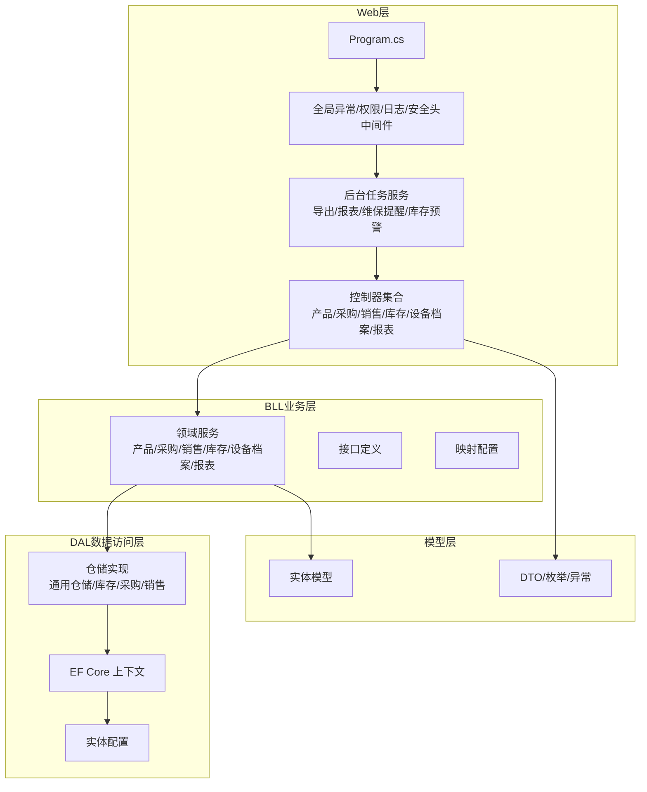
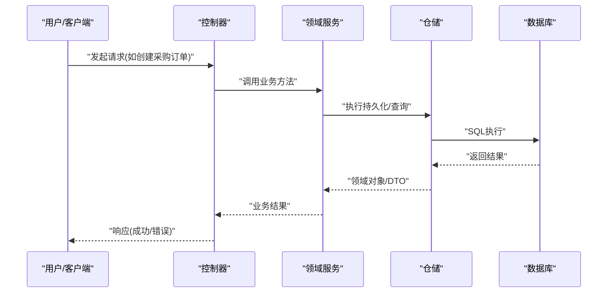
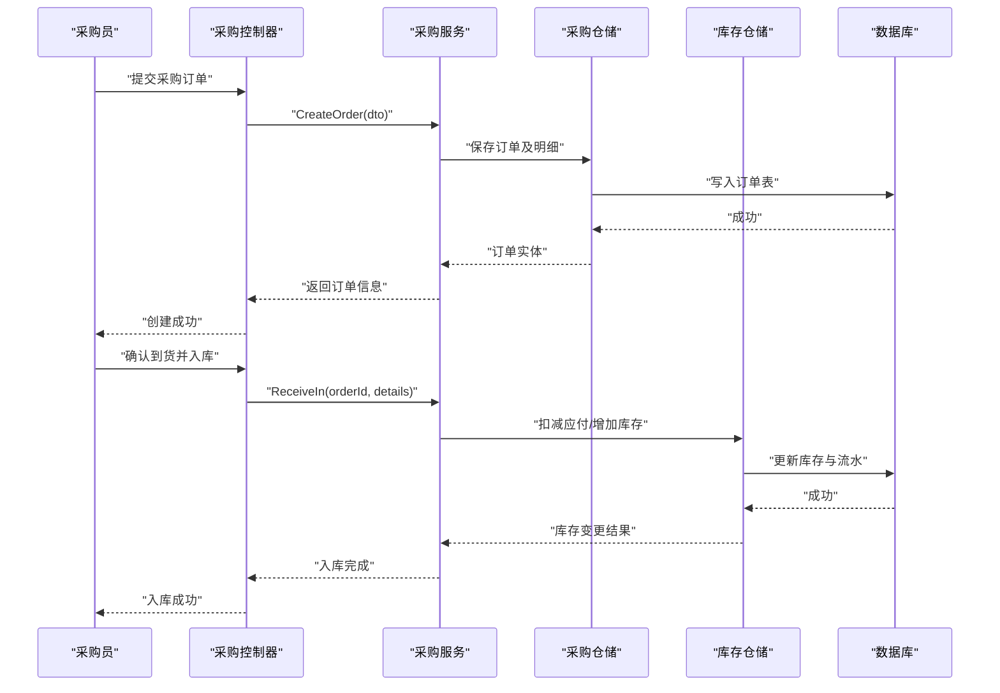
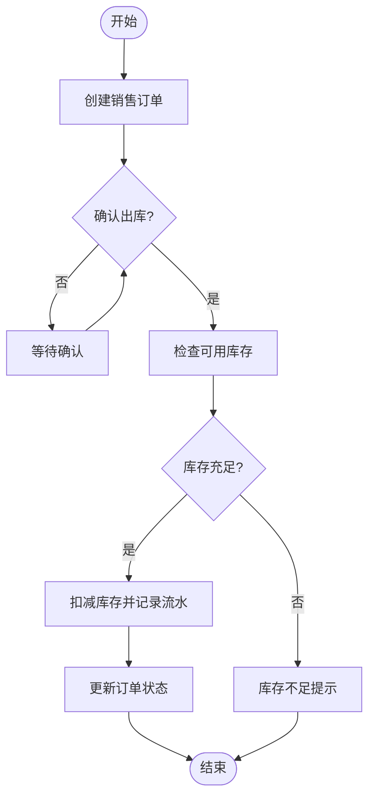
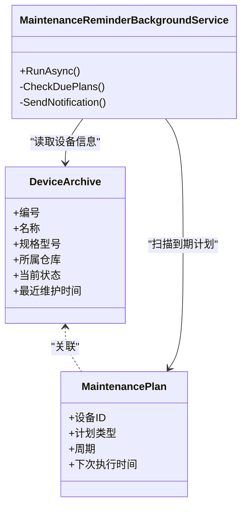
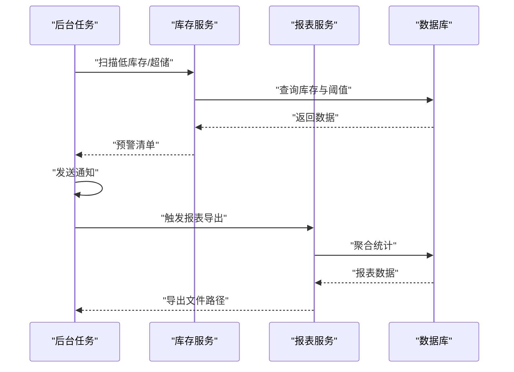
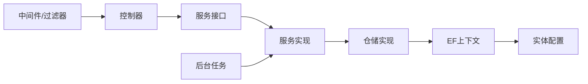

# 系统介绍与目标

<cite>
**本文引用的文件**   
- [Program.cs](file://EquipmentIMS.Web/Program.cs)
- [appsettings.json](file://EquipmentIMS.Web/appsettings.json)
- [DataSeed.cs](file://EquipmentIMS.Web/DataSeed.cs)
- [GlobalExceptionMiddleware.cs](file://EquipmentIMS.Web/Filters/GlobalExceptionMiddleware.cs)
- [PermissionFilter.cs](file://EquipmentIMS.Web/Filters/PermissionFilter.cs)
- [OperationLogActionFilter.cs](file://EquipmentIMS.Web/Filters/OperationLogActionFilter.cs)
- [SecurityHeadersMiddleware.cs](file://EquipmentIMS.Web/Filters/SecurityHeadersMiddleware.cs)
- [ExportBackgroundService.cs](file://EquipmentIMS.Web/BackgroundServices/ExportBackgroundService.cs)
- [MaintenanceReminderBackgroundService.cs](file://EquipmentIMS.Web/BackgroundServices/MaintenanceReminderBackgroundService.cs)
- [ReportExportBackgroundService.cs](file://EquipmentIMS.Web/BackgroundServices/ReportExportBackgroundService.cs)
- [StockAlertBackgroundService.cs](file://EquipmentIMS.Web/BackgroundServices/StockAlertBackgroundService.cs)
- [DashboardController.cs](file://EquipmentIMS.Web/Controllers/DashboardController.cs)
- [ProductController.cs](file://EquipmentIMS.Web/Controllers/ProductController.cs)
- [PurchaseOrderController.cs](file://EquipmentIMS.Web/Controllers/PurchaseOrderController.cs)
- [SaleOrderController.cs](file://EquipmentIMS.Web/Controllers/SaleOrderController.cs)
- [StockController.cs](file://EquipmentIMS.Web/Controllers/StockController.cs)
- [DeviceArchiveController.cs](file://EquipmentIMS.Web/Controllers/DeviceArchiveController.cs)
- [ReportController.cs](file://EquipmentIMS.Web/Controllers/ReportController.cs)
- [CategoryService.cs](file://EquipmentIMS.BLL/Services/CategoryService.cs)
- [ProductService.cs](file://EquipmentIMS.BLL/Services/ProductService.cs)
- [PurchaseService.cs](file://EquipmentIMS.BLL/Services/PurchaseService.cs)
- [SaleService.cs](file://EquipmentIMS.BLL/Services/SaleService.cs)
- [StockService.cs](file://EquipmentIMS.BLL/Services/StockService.cs)
- [DeviceArchiveService.cs](file://EquipmentIMS.BLL/Services/DeviceArchiveService.cs)
- [ReportService.cs](file://EquipmentIMS.BLL/Services/ReportService.cs)
- [IProductService.cs](file://EquipmentIMS.BLL/Interfaces/IProductService.cs)
- [IPurchaseService.cs](file://EquipmentIMS.BLL/Interfaces/IPurchaseService.cs)
- [ISaleService.cs](file://EquipmentIMS.BLL/Interfaces/ISaleService.cs)
- [IStockService.cs](file://EquipmentIMS.BLL/Interfaces/IStockService.cs)
- [IDeviceArchiveService.cs](file://EquipmentIMS.BLL/Interfaces/IDeviceArchiveService.cs)
- [IReportService.cs](file://EquipmentIMS.BLL/Interfaces/IReportService.cs)
- [GenericRepository.cs](file://EquipmentIMS.DAL/Repositories/GenericRepository.cs)
- [StockRepository.cs](file://EquipmentIMS.DAL/Repositories/StockRepository.cs)
- [PurchaseOrderRepository.cs](file://EquipmentIMS.DAL/Repositories/PurchaseOrderRepository.cs)
- [SaleOrderRepository.cs](file://EquipmentIMS.DAL/Repositories/SaleOrderRepository.cs)
- [AppDbContext.cs](file://EquipmentIMS.DAL/AppDbContext.cs)
- [BaseProductConfiguration.cs](file://EquipmentIMS.DAL/Configurations/BaseProductConfiguration.cs)
- [PurPurchaseOrderConfiguration.cs](file://EquipmentIMS.DAL/Configurations/PurPurchaseOrderConfiguration.cs)
- [SaleSaleOrderConfiguration.cs](file://EquipmentIMS.DAL/Configurations/SaleSaleOrderConfiguration.cs)
- [InvStockTransactionConfiguration.cs](file://EquipmentIMS.DAL/Configurations/InvStockTransactionConfiguration.cs)
- [MaintDeviceArchiveConfiguration.cs](file://EquipmentIMS.DAL/Configurations/MaintDeviceArchiveConfiguration.cs)
- [BaseProduct.cs](file://EquipmentIMS.Models/Entities/BaseProduct.cs)
- [PurPurchaseOrder.cs](file://EquipmentIMS.Models/Entities/PurPurchaseOrder.cs)
- [SaleSaleOrder.cs](file://EquipmentIMS.Models/Entities/SaleSaleOrder.cs)
- [InvStockTransaction.cs](file://EquipmentIMS.Models/Entities/InvStockTransaction.cs)
- [MaintDeviceArchive.cs](file://EquipmentIMS.Models/Entities/MaintDeviceArchive.cs)
</cite>

## 目录
1. [引言](#引言)
2. [项目结构](#项目结构)
3. [核心组件](#核心组件)
4. [架构总览](#架构总览)
5. [详细组件分析](#详细组件分析)
6. [依赖关系分析](#依赖关系分析)
7. [性能考虑](#性能考虑)
8. [故障排查指南](#故障排查指南)
9. [结论](#结论)
10. [附录](#附录)

## 引言
THMS设备库存管理系统面向制造、分销与服务型企业，围绕“设备全生命周期管理、库存优化、采购销售流程自动化”三大核心价值，提供从基础主数据到交易流转、从库存预警到报表分析的端到端能力。系统通过分层架构与领域建模，将业务过程沉淀为可复用的服务与仓储，结合后台任务与中间件，实现高可用、可扩展的企业级应用。

- 业务目标
  - 设备全生命周期：覆盖建档、入库、调拨、盘点、维修、报废等关键节点，形成完整追溯链。
  - 库存优化：以安全库存、出入库流水、盘点差异为核心，降低缺货与积压风险。
  - 采购销售自动化：订单驱动出入库与库存变动，减少人工干预与差错。
- 适用场景
  - 多仓库、多货主的设备与备件管理
  - 供应商协同与采购闭环
  - 客户订单履约与售后维修联动
- 目标用户
  - 仓储与供应链人员、采购与销售团队、设备运维工程师、财务与审计、管理层决策者

## 项目结构
系统采用典型三层架构（Web层、BLL业务层、DAL数据访问层）+ 模型层，配合后台任务与中间件，职责清晰、扩展性强。

图表来源
- [Program.cs:1-200](file://EquipmentIMS.Web/Program.cs#L1-L200)
- [GlobalExceptionMiddleware.cs:1-120](file://EquipmentIMS.Web/Filters/GlobalExceptionMiddleware.cs#L1-L120)
- [PermissionFilter.cs:1-120](file://EquipmentIMS.Web/Filters/PermissionFilter.cs#L1-L120)
- [OperationLogActionFilter.cs:1-120](file://EquipmentIMS.Web/Filters/OperationLogActionFilter.cs#L1-L120)
- [SecurityHeadersMiddleware.cs:1-120](file://EquipmentIMS.Web/Filters/SecurityHeadersMiddleware.cs#L1-L120)
- [ExportBackgroundService.cs:1-120](file://EquipmentIMS.Web/BackgroundServices/ExportBackgroundService.cs#L1-L120)
- [MaintenanceReminderBackgroundService.cs:1-120](file://EquipmentIMS.Web/BackgroundServices/MaintenanceReminderBackgroundService.cs#L1-L120)
- [ReportExportBackgroundService.cs:1-120](file://EquipmentIMS.Web/BackgroundServices/ReportExportBackgroundService.cs#L1-L120)
- [StockAlertBackgroundService.cs:1-120](file://EquipmentIMS.Web/BackgroundServices/StockAlertBackgroundService.cs#L1-L120)
- [ProductController.cs:1-200](file://EquipmentIMS.Web/Controllers/ProductController.cs#L1-L200)
- [PurchaseOrderController.cs:1-200](file://EquipmentIMS.Web/Controllers/PurchaseOrderController.cs#L1-L200)
- [SaleOrderController.cs:1-200](file://EquipmentIMS.Web/Controllers/SaleOrderController.cs#L1-L200)
- [StockController.cs:1-200](file://EquipmentIMS.Web/Controllers/StockController.cs#L1-L200)
- [DeviceArchiveController.cs:1-200](file://EquipmentIMS.Web/Controllers/DeviceArchiveController.cs#L1-L200)
- [ReportController.cs:1-200](file://EquipmentIMS.Web/Controllers/ReportController.cs#L1-L200)
- [CategoryService.cs:1-200](file://EquipmentIMS.BLL/Services/CategoryService.cs#L1-L200)
- [ProductService.cs:1-200](file://EquipmentIMS.BLL/Services/ProductService.cs#L1-L200)
- [PurchaseService.cs:1-200](file://EquipmentIMS.BLL/Services/PurchaseService.cs#L1-L200)
- [SaleService.cs:1-200](file://EquipmentIMS.BLL/Services/SaleService.cs#L1-L200)
- [StockService.cs:1-200](file://EquipmentIMS.BLL/Services/StockService.cs#L1-L200)
- [DeviceArchiveService.cs:1-200](file://EquipmentIMS.BLL/Services/DeviceArchiveService.cs#L1-L200)
- [ReportService.cs:1-200](file://EquipmentIMS.BLL/Services/ReportService.cs#L1-L200)
- [GenericRepository.cs:1-200](file://EquipmentIMS.DAL/Repositories/GenericRepository.cs#L1-L200)
- [StockRepository.cs:1-200](file://EquipmentIMS.DAL/Repositories/StockRepository.cs#L1-L200)
- [PurchaseOrderRepository.cs:1-200](file://EquipmentIMS.DAL/Repositories/PurchaseOrderRepository.cs#L1-L200)
- [SaleOrderRepository.cs:1-200](file://EquipmentIMS.DAL/Repositories/SaleOrderRepository.cs#L1-L200)
- [AppDbContext.cs:1-200](file://EquipmentIMS.DAL/AppDbContext.cs#L1-L200)
- [BaseProductConfiguration.cs:1-120](file://EquipmentIMS.DAL/Configurations/BaseProductConfiguration.cs#L1-L120)
- [PurPurchaseOrderConfiguration.cs:1-120](file://EquipmentIMS.DAL/Configurations/PurPurchaseOrderConfiguration.cs#L1-L120)
- [SaleSaleOrderConfiguration.cs:1-120](file://EquipmentIMS.DAL/Configurations/SaleSaleOrderConfiguration.cs#L1-L120)
- [InvStockTransactionConfiguration.cs:1-120](file://EquipmentIMS.DAL/Configurations/InvStockTransactionConfiguration.cs#L1-L120)
- [MaintDeviceArchiveConfiguration.cs:1-120](file://EquipmentIMS.DAL/Configurations/MaintDeviceArchiveConfiguration.cs#L1-L120)
- [BaseProduct.cs:1-120](file://EquipmentIMS.Models/Entities/BaseProduct.cs#L1-L120)
- [PurPurchaseOrder.cs:1-120](file://EquipmentIMS.Models/Entities/PurPurchaseOrder.cs#L1-L120)
- [SaleSaleOrder.cs:1-120](file://EquipmentIMS.Models/Entities/SaleSaleOrder.cs#L1-L120)
- [InvStockTransaction.cs:1-120](file://EquipmentIMS.Models/Entities/InvStockTransaction.cs#L1-L120)
- [MaintDeviceArchive.cs:1-120](file://EquipmentIMS.Models/Entities/MaintDeviceArchive.cs#L1-L120)

章节来源
- [Program.cs:1-200](file://EquipmentIMS.Web/Program.cs#L1-L200)
- [appsettings.json:1-200](file://EquipmentIMS.Web/appsettings.json#L1-L200)

## 核心组件
- Web层
  - 启动与注册：程序入口负责中间件、过滤器、后台服务与依赖注入的装配。
  - 控制器：按领域划分，暴露RESTful API或MVC页面，承载用户交互与请求路由。
  - 中间件与过滤器：统一异常处理、权限校验、操作日志与安全响应头。
  - 后台任务：定时巡检库存预警、维保提醒、报表导出与批量导出。
- BLL业务层
  - 领域服务：封装跨实体的业务流程与事务边界，协调仓储与外部资源。
  - 接口抽象：以接口解耦实现，便于测试与替换。
  - 映射：统一对象转换，避免在控制器或服务中散落映射逻辑。
- DAL数据访问层
  - 仓储：通用仓储与领域仓储组合，提供CRUD与复杂查询。
  - EF Core上下文：集中配置实体映射、连接字符串与迁移策略。
  - 实体配置：对字段约束、索引、关系进行精细化配置。
- 模型层
  - 实体：反映数据库表结构与业务概念。
  - DTO/枚举/异常：对外契约、状态机与错误语义化。

章节来源
- [ProductController.cs:1-200](file://EquipmentIMS.Web/Controllers/ProductController.cs#L1-L200)
- [PurchaseOrderController.cs:1-200](file://EquipmentIMS.Web/Controllers/PurchaseOrderController.cs#L1-L200)
- [SaleOrderController.cs:1-200](file://EquipmentIMS.Web/Controllers/SaleOrderController.cs#L1-L200)
- [StockController.cs:1-200](file://EquipmentIMS.Web/Controllers/StockController.cs#L1-L200)
- [DeviceArchiveController.cs:1-200](file://EquipmentIMS.Web/Controllers/DeviceArchiveController.cs#L1-L200)
- [ReportController.cs:1-200](file://EquipmentIMS.Web/Controllers/ReportController.cs#L1-L200)
- [ProductService.cs:1-200](file://EquipmentIMS.BLL/Services/ProductService.cs#L1-L200)
- [PurchaseService.cs:1-200](file://EquipmentIMS.BLL/Services/PurchaseService.cs#L1-L200)
- [SaleService.cs:1-200](file://EquipmentIMS.BLL/Services/SaleService.cs#L1-L200)
- [StockService.cs:1-200](file://EquipmentIMS.BLL/Services/StockService.cs#L1-L200)
- [DeviceArchiveService.cs:1-200](file://EquipmentIMS.BLL/Services/DeviceArchiveService.cs#L1-L200)
- [ReportService.cs:1-200](file://EquipmentIMS.BLL/Services/ReportService.cs#L1-L200)
- [GenericRepository.cs:1-200](file://EquipmentIMS.DAL/Repositories/GenericRepository.cs#L1-L200)
- [StockRepository.cs:1-200](file://EquipmentIMS.DAL/Repositories/StockRepository.cs#L1-L200)
- [PurchaseOrderRepository.cs:1-200](file://EquipmentIMS.DAL/Repositories/PurchaseOrderRepository.cs#L1-L200)
- [SaleOrderRepository.cs:1-200](file://EquipmentIMS.DAL/Repositories/SaleOrderRepository.cs#L1-L200)
- [AppDbContext.cs:1-200](file://EquipmentIMS.DAL/AppDbContext.cs#L1-L200)

## 架构总览
系统遵循“控制器→服务→仓储→上下文→数据库”的调用链，并通过中间件与后台任务增强横切关注点与异步处理能力。

图表来源
- [ProductController.cs:1-200](file://EquipmentIMS.Web/Controllers/ProductController.cs#L1-L200)
- [PurchaseOrderController.cs:1-200](file://EquipmentIMS.Web/Controllers/PurchaseOrderController.cs#L1-L200)
- [SaleOrderController.cs:1-200](file://EquipmentIMS.Web/Controllers/SaleOrderController.cs#L1-L200)
- [StockController.cs:1-200](file://EquipmentIMS.Web/Controllers/StockController.cs#L1-L200)
- [DeviceArchiveController.cs:1-200](file://EquipmentIMS.Web/Controllers/DeviceArchiveController.cs#L1-L200)
- [ReportController.cs:1-200](file://EquipmentIMS.Web/Controllers/ReportController.cs#L1-L200)
- [ProductService.cs:1-200](file://EquipmentIMS.BLL/Services/ProductService.cs#L1-L200)
- [PurchaseService.cs:1-200](file://EquipmentIMS.BLL/Services/PurchaseService.cs#L1-L200)
- [SaleService.cs:1-200](file://EquipmentIMS.BLL/Services/SaleService.cs#L1-L200)
- [StockService.cs:1-200](file://EquipmentIMS.BLL/Services/StockService.cs#L1-L200)
- [DeviceArchiveService.cs:1-200](file://EquipmentIMS.BLL/Services/DeviceArchiveService.cs#L1-L200)
- [ReportService.cs:1-200](file://EquipmentIMS.BLL/Services/ReportService.cs#L1-L200)
- [GenericRepository.cs:1-200](file://EquipmentIMS.DAL/Repositories/GenericRepository.cs#L1-L200)
- [StockRepository.cs:1-200](file://EquipmentIMS.DAL/Repositories/StockRepository.cs#L1-L200)
- [PurchaseOrderRepository.cs:1-200](file://EquipmentIMS.DAL/Repositories/PurchaseOrderRepository.cs#L1-L200)
- [SaleOrderRepository.cs:1-200](file://EquipmentIMS.DAL/Repositories/SaleOrderRepository.cs#L1-L200)
- [AppDbContext.cs:1-200](file://EquipmentIMS.DAL/AppDbContext.cs#L1-L200)

## 详细组件分析

### 采购订单流程（示例）
该流程展示从下单到入库的关键步骤，体现订单驱动库存变动的自动化能力。

图表来源
- [PurchaseOrderController.cs:1-200](file://EquipmentIMS.Web/Controllers/PurchaseOrderController.cs#L1-L200)
- [PurchaseService.cs:1-200](file://EquipmentIMS.BLL/Services/PurchaseService.cs#L1-L200)
- [PurchaseOrderRepository.cs:1-200](file://EquipmentIMS.DAL/Repositories/PurchaseOrderRepository.cs#L1-L200)
- [StockRepository.cs:1-200](file://EquipmentIMS.DAL/Repositories/StockRepository.cs#L1-L200)
- [PurPurchaseOrder.cs:1-120](file://EquipmentIMS.Models/Entities/PurPurchaseOrder.cs#L1-L120)
- [InvStockTransaction.cs:1-120](file://EquipmentIMS.Models/Entities/InvStockTransaction.cs#L1-L120)

章节来源
- [PurchaseOrderController.cs:1-200](file://EquipmentIMS.Web/Controllers/PurchaseOrderController.cs#L1-L200)
- [PurchaseService.cs:1-200](file://EquipmentIMS.BLL/Services/PurchaseService.cs#L1-L200)
- [PurchaseOrderRepository.cs:1-200](file://EquipmentIMS.DAL/Repositories/PurchaseOrderRepository.cs#L1-L200)
- [StockRepository.cs:1-200](file://EquipmentIMS.DAL/Repositories/StockRepository.cs#L1-L200)

### 销售出库流程（示例）
销售订单确认后触发出库与库存扣减，同时生成库存流水，确保账实一致。

图表来源
- [SaleOrderController.cs:1-200](file://EquipmentIMS.Web/Controllers/SaleOrderController.cs#L1-L200)
- [SaleService.cs:1-200](file://EquipmentIMS.BLL/Services/SaleService.cs#L1-L200)
- [SaleOrderRepository.cs:1-200](file://EquipmentIMS.DAL/Repositories/SaleOrderRepository.cs#L1-L200)
- [StockRepository.cs:1-200](file://EquipmentIMS.DAL/Repositories/StockRepository.cs#L1-L200)
- [SaleSaleOrder.cs:1-120](file://EquipmentIMS.Models/Entities/SaleSaleOrder.cs#L1-L120)
- [InvStockTransaction.cs:1-120](file://EquipmentIMS.Models/Entities/InvStockTransaction.cs#L1-L120)

章节来源
- [SaleOrderController.cs:1-200](file://EquipmentIMS.Web/Controllers/SaleOrderController.cs#L1-L200)
- [SaleService.cs:1-200](file://EquipmentIMS.BLL/Services/SaleService.cs#L1-L200)
- [SaleOrderRepository.cs:1-200](file://EquipmentIMS.DAL/Repositories/SaleOrderRepository.cs#L1-L200)
- [StockRepository.cs:1-200](file://EquipmentIMS.DAL/Repositories/StockRepository.cs#L1-L200)

### 设备档案与维保提醒（示例）
设备档案贯穿采购、入库、使用、维修与报废；后台定时任务根据计划触发维保提醒，保障设备可用性。

图表来源
- [DeviceArchiveController.cs:1-200](file://EquipmentIMS.Web/Controllers/DeviceArchiveController.cs#L1-L200)
- [DeviceArchiveService.cs:1-200](file://EquipmentIMS.BLL/Services/DeviceArchiveService.cs#L1-L200)
- [MaintenanceReminderBackgroundService.cs:1-120](file://EquipmentIMS.Web/BackgroundServices/MaintenanceReminderBackgroundService.cs#L1-L120)
- [MaintDeviceArchive.cs:1-120](file://EquipmentIMS.Models/Entities/MaintDeviceArchive.cs#L1-L120)

章节来源
- [DeviceArchiveController.cs:1-200](file://EquipmentIMS.Web/Controllers/DeviceArchiveController.cs#L1-L200)
- [DeviceArchiveService.cs:1-200](file://EquipmentIMS.BLL/Services/DeviceArchiveService.cs#L1-L200)
- [MaintenanceReminderBackgroundService.cs:1-120](file://EquipmentIMS.Web/BackgroundServices/MaintenanceReminderBackgroundService.cs#L1-L120)

### 库存预警与报表导出（示例）
后台任务定期评估库存水平，触发预警通知；支持异步导出报表，减轻前台压力。

图表来源
- [StockAlertBackgroundService.cs:1-120](file://EquipmentIMS.Web/BackgroundServices/StockAlertBackgroundService.cs#L1-L120)
- [StockService.cs:1-200](file://EquipmentIMS.BLL/Services/StockService.cs#L1-L200)
- [ReportExportBackgroundService.cs:1-120](file://EquipmentIMS.Web/BackgroundServices/ReportExportBackgroundService.cs#L1-L120)
- [ReportService.cs:1-200](file://EquipmentIMS.BLL/Services/ReportService.cs#L1-L200)

章节来源
- [StockAlertBackgroundService.cs:1-120](file://EquipmentIMS.Web/BackgroundServices/StockAlertBackgroundService.cs#L1-L120)
- [StockService.cs:1-200](file://EquipmentIMS.BLL/Services/StockService.cs#L1-L200)
- [ReportExportBackgroundService.cs:1-120](file://EquipmentIMS.Web/BackgroundServices/ReportExportBackgroundService.cs#L1-L120)
- [ReportService.cs:1-200](file://EquipmentIMS.BLL/Services/ReportService.cs#L1-L200)

## 依赖关系分析
- 控制器依赖服务接口，服务实现依赖仓储接口，仓储实现依赖EF上下文与实体配置。
- 中间件与过滤器在管道早期介入，保证异常、权限、日志与安全头的统一处理。
- 后台任务独立于请求线程，避免阻塞前端交互。

图表来源
- [ProductController.cs:1-200](file://EquipmentIMS.Web/Controllers/ProductController.cs#L1-L200)
- [IProductService.cs:1-120](file://EquipmentIMS.BLL/Interfaces/IProductService.cs#L1-L120)
- [ProductService.cs:1-200](file://EquipmentIMS.BLL/Services/ProductService.cs#L1-L200)
- [GenericRepository.cs:1-200](file://EquipmentIMS.DAL/Repositories/GenericRepository.cs#L1-L200)
- [AppDbContext.cs:1-200](file://EquipmentIMS.DAL/AppDbContext.cs#L1-L200)
- [BaseProductConfiguration.cs:1-120](file://EquipmentIMS.DAL/Configurations/BaseProductConfiguration.cs#L1-L120)
- [GlobalExceptionMiddleware.cs:1-120](file://EquipmentIMS.Web/Filters/GlobalExceptionMiddleware.cs#L1-L120)
- [PermissionFilter.cs:1-120](file://EquipmentIMS.Web/Filters/PermissionFilter.cs#L1-L120)
- [OperationLogActionFilter.cs:1-120](file://EquipmentIMS.Web/Filters/OperationLogActionFilter.cs#L1-L120)
- [SecurityHeadersMiddleware.cs:1-120](file://EquipmentIMS.Web/Filters/SecurityHeadersMiddleware.cs#L1-L120)
- [ExportBackgroundService.cs:1-120](file://EquipmentIMS.Web/BackgroundServices/ExportBackgroundService.cs#L1-L120)

章节来源
- [Program.cs:1-200](file://EquipmentIMS.Web/Program.cs#L1-L200)
- [appsettings.json:1-200](file://EquipmentIMS.Web/appsettings.json#L1-L200)

## 性能考虑
- 分页与筛选：列表查询应使用分页与条件过滤，避免一次性加载大量数据。
- 索引优化：对高频查询字段（如产品编码、仓库ID、订单号）建立合适索引。
- 事务边界：在仓储或服务层明确事务范围，减少锁竞争与死锁风险。
- 异步导出：大批量导出走后台任务队列，避免阻塞请求线程。
- 缓存策略：对字典类主数据（分类、仓库、供应商）可采用内存缓存提升读取性能。

[本节为通用指导，不直接分析具体文件]

## 故障排查指南
- 全局异常处理：统一捕获未处理异常，返回标准化错误响应，便于前端提示与日志追踪。
- 权限校验：通过过滤器拦截未授权访问，快速定位越权问题。
- 操作日志：记录关键操作的入参与结果，辅助审计与回溯。
- 安全头：设置响应头增强安全性，排查跨域与内容类型问题。
- 后台任务：监控导出、预警与提醒任务的执行状态与失败重试。

章节来源
- [GlobalExceptionMiddleware.cs:1-120](file://EquipmentIMS.Web/Filters/GlobalExceptionMiddleware.cs#L1-L120)
- [PermissionFilter.cs:1-120](file://EquipmentIMS.Web/Filters/PermissionFilter.cs#L1-L120)
- [OperationLogActionFilter.cs:1-120](file://EquipmentIMS.Web/Filters/OperationLogActionFilter.cs#L1-L120)
- [SecurityHeadersMiddleware.cs:1-120](file://EquipmentIMS.Web/Filters/SecurityHeadersMiddleware.cs#L1-L120)
- [ExportBackgroundService.cs:1-120](file://EquipmentIMS.Web/BackgroundServices/ExportBackgroundService.cs#L1-L120)
- [ReportExportBackgroundService.cs:1-120](file://EquipmentIMS.Web/BackgroundServices/ReportExportBackgroundService.cs#L1-L120)
- [StockAlertBackgroundService.cs:1-120](file://EquipmentIMS.Web/BackgroundServices/StockAlertBackgroundService.cs#L1-L120)
- [MaintenanceReminderBackgroundService.cs:1-120](file://EquipmentIMS.Web/BackgroundServices/MaintenanceReminderBackgroundService.cs#L1-L120)

## 结论
THMS设备库存管理系统以清晰的层次与领域建模为基础，围绕设备全生命周期、库存优化与采销自动化构建企业级能力。通过中间件与后台任务增强横切关注点与异步处理能力，系统在易用性、稳定性与可扩展性之间取得平衡，有助于提升运营效率、降低管理成本、提高决策准确性。

[本节为总结性内容，不直接分析具体文件]

## 附录
- 初始化与演示数据：可通过数据种子脚本与演示数据快速搭建环境，便于上手体验。
- 配置项：连接字符串、日志级别、后台任务调度参数等在配置文件中进行管理。

章节来源
- [DataSeed.cs:1-200](file://EquipmentIMS.Web/DataSeed.cs#L1-L200)
- [appsettings.json:1-200](file://EquipmentIMS.Web/appsettings.json#L1-L200)