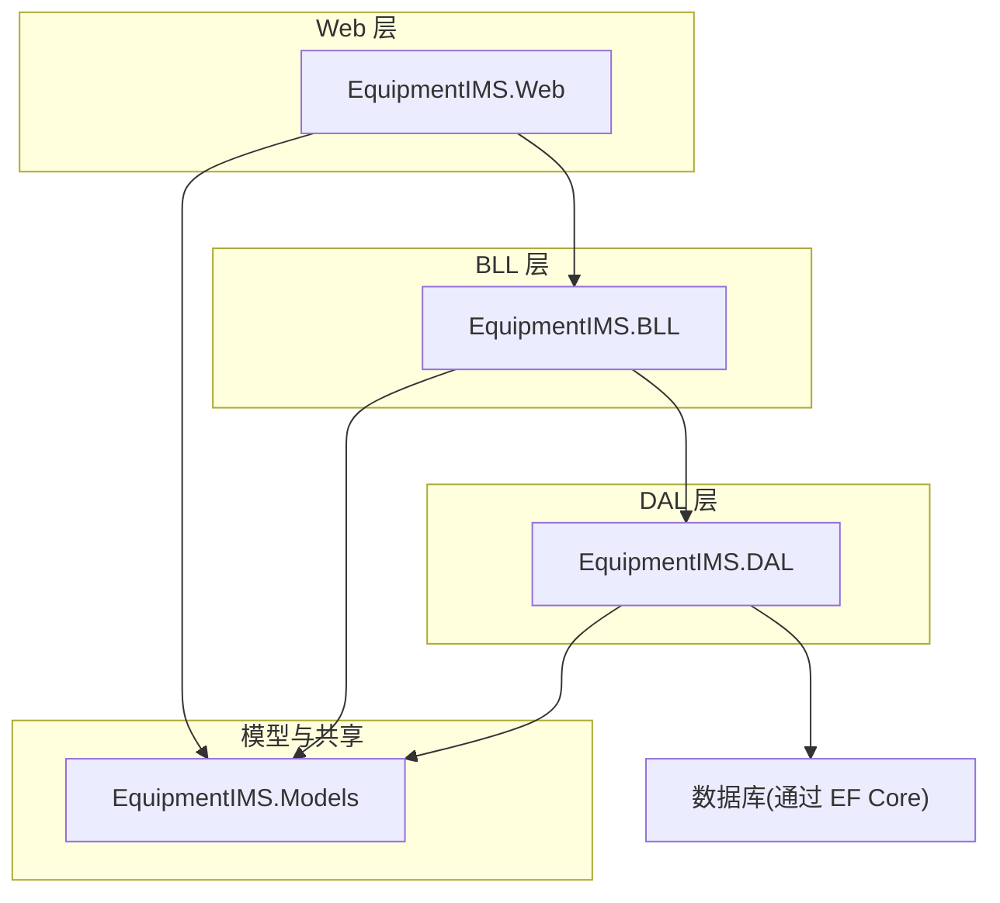
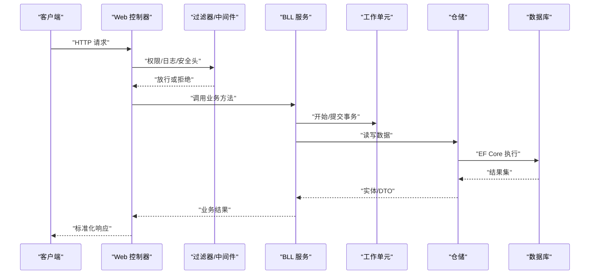
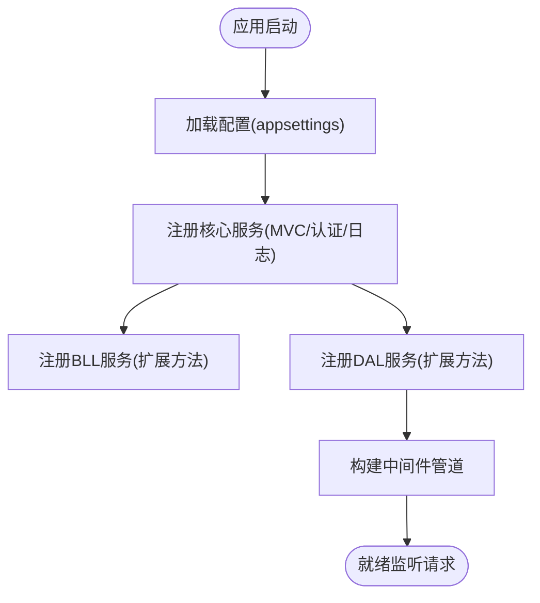
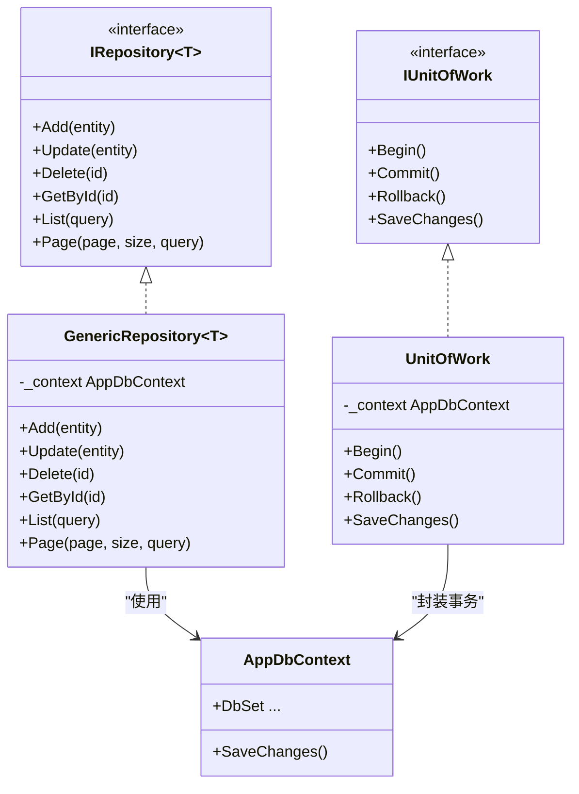
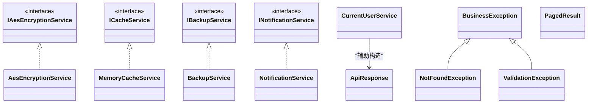
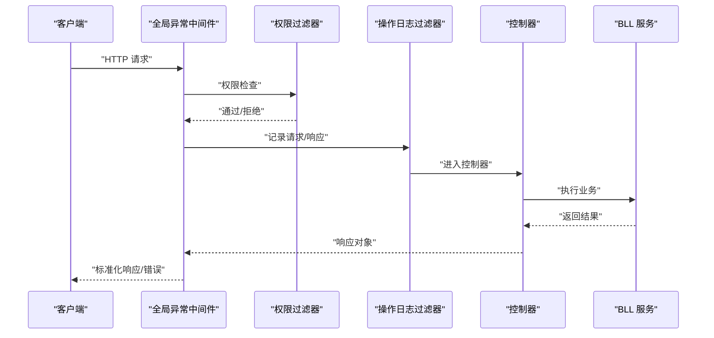
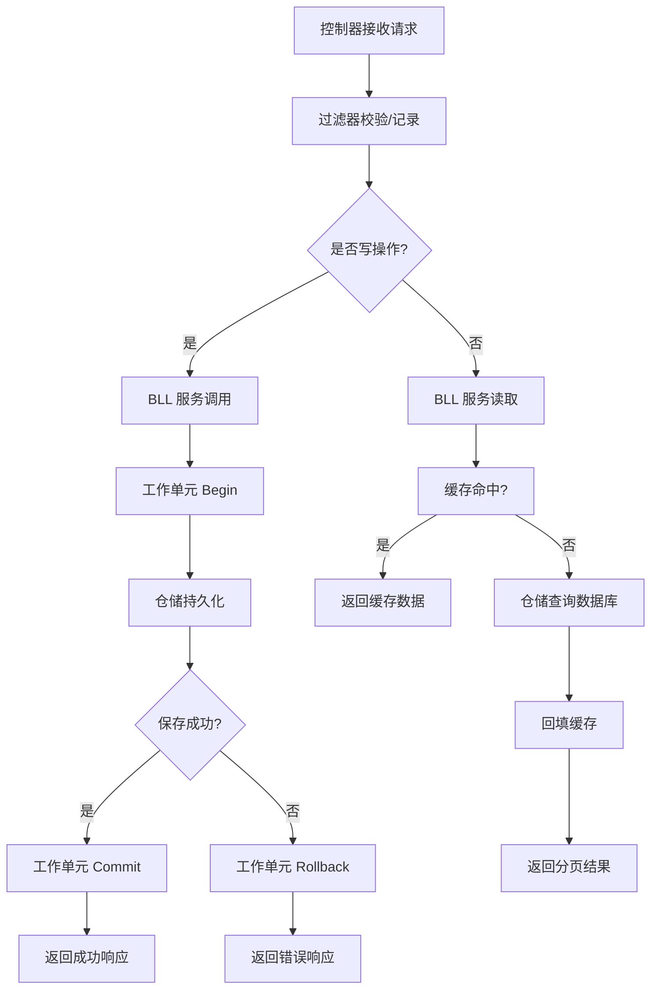
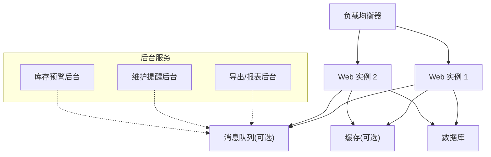
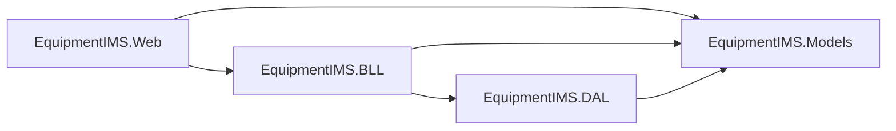

# 系统架构概览

<cite>
**本文引用的文件**   
- [Program.cs](file://EquipmentIMS.Web/Program.cs)
- [appsettings.json](file://EquipmentIMS.Web/appsettings.json)
- [ServiceCollectionExtensions.cs](file://EquipmentIMS.BLL/Extensions/ServiceCollectionExtensions.cs)
- [ServiceCollectionExtensions.cs](file://EquipmentIMS.DAL/Extensions/ServiceCollectionExtensions.cs)
- [AppDbContext.cs](file://EquipmentIMS.DAL/AppDbContext.cs)
- [GlobalExceptionMiddleware.cs](file://EquipmentIMS.Web/Filters/GlobalExceptionMiddleware.cs)
- [OperationLogActionFilter.cs](file://EquipmentIMS.Web/Filters/OperationLogActionFilter.cs)
- [PermissionFilter.cs](file://EquipmentIMS.Web/Filters/PermissionFilter.cs)
- [SecurityHeadersMiddleware.cs](file://EquipmentIMS.Web/Filters/SecurityHeadersMiddleware.cs)
- [ExportBackgroundService.cs](file://EquipmentIMS.Web/BackgroundServices/ExportBackgroundService.cs)
- [MaintenanceReminderBackgroundService.cs](file://EquipmentIMS.Web/BackgroundServices/MaintenanceReminderBackgroundService.cs)
- [ReportExportBackgroundService.cs](file://EquipmentIMS.Web/BackgroundServices/ReportExportBackgroundService.cs)
- [StockAlertBackgroundService.cs](file://EquipmentIMS.Web/BackgroundServices/StockAlertBackgroundService.cs)
- [IRepository.cs](file://EquipmentIMS.DAL/Interfaces/IRepository.cs)
- [GenericRepository.cs](file://EquipmentIMS.DAL/Repositories/GenericRepository.cs)
- [IUnitOfWork.cs](file://EquipmentIMS.DAL/Interfaces/IUnitOfWork.cs)
- [UnitOfWork.cs](file://EquipmentIMS.DAL/Repositories/UnitOfWork.cs)
- [IAesEncryptionService.cs](file://EquipmentIMS.BLL/Interfaces/IAesEncryptionService.cs)
- [AesEncryptionService.cs](file://EquipmentIMS.BLL/Services/AesEncryptionService.cs)
- [ICacheService.cs](file://EquipmentIMS.BLL/Interfaces/ICacheService.cs)
- [MemoryCacheService.cs](file://EquipmentIMS.BLL/Services/MemoryCacheService.cs)
- [IBackupService.cs](file://EquipmentIMS.BLL/Interfaces/IBackupService.cs)
- [BackupService.cs](file://EquipmentIMS.BLL/Services/BackupService.cs)
- [INotificationService.cs](file://EquipmentIMS.BLL/Interfaces/INotificationService.cs)
- [NotificationService.cs](file://EquipmentIMS.BLL/Services/NotificationService.cs)
- [CurrentUserService.cs](file://EquipmentIMS.BLL/Services/CurrentUserService.cs)
- [UserDto.cs](file://EquipmentIMS.Models/DTOs/UserDto.cs)
- [ApiResponse.cs](file://EquipmentIMS.Models/DTOs/ApiResponse.cs)
- [PagedResult.cs](file://EquipmentIMS.Models/DTOs/PagedResult.cs)
- [BusinessException.cs](file://EquipmentIMS.Models/Exceptions/BusinessException.cs)
- [NotFoundException.cs](file://EquipmentIMS.Models/Exceptions/NotFoundException.cs)
- [ValidationException.cs](file://EquipmentIMS.Models/Exceptions/ValidationException.cs)
</cite>

## 目录
1. [引言](#引言)
2. [项目结构](#项目结构)
3. [核心组件](#核心组件)
4. [架构总览](#架构总览)
5. [详细组件分析](#详细组件分析)
6. [依赖关系分析](#依赖关系分析)
7. [性能考虑](#性能考虑)
8. [故障排查指南](#故障排查指南)
9. [结论](#结论)
10. [附录](#附录)

## 引言
本文件面向架构师与开发者，提供 THMS（设备库存管理系统）的分层架构概览。系统采用 Web 层、BLL 业务逻辑层、DAL 数据访问层与 Models 模型层的清晰分层设计，结合依赖注入容器实现松耦合与可测试性。文档涵盖架构理念、职责边界、数据流转机制、关键扩展点与最佳实践，并给出架构图、组件交互图与部署拓扑图，帮助读者快速理解系统结构与演进方向。

## 项目结构
THMS 采用多项目解决方案，按职责划分为以下主要工程：
- EquipmentIMS.Web：ASP.NET Core Web 应用，承载控制器、中间件、过滤器、后台服务与视图资源。
- EquipmentIMS.BLL：业务逻辑层，定义领域服务接口与实现，编排业务流程，协调缓存、加密、备份、通知等横切能力。
- EquipmentIMS.DAL：数据访问层，基于 EF Core 的 DbContext、通用仓储与 UnitOfWork，封装数据库访问细节。
- EquipmentIMS.Models：共享模型与 DTO、枚举、异常类型，供各层复用。
- EquipmentIMS.Tests：单元测试与集成测试工程。
- EquipmentIMS.DataGen：数据生成工具，用于初始化或演示数据。

**图表来源** 
- [Program.cs](file://EquipmentIMS.Web/Program.cs)
- [ServiceCollectionExtensions.cs](file://EquipmentIMS.BLL/Extensions/ServiceCollectionExtensions.cs)
- [ServiceCollectionExtensions.cs](file://EquipmentIMS.DAL/Extensions/ServiceCollectionExtensions.cs)
- [AppDbContext.cs](file://EquipmentIMS.DAL/AppDbContext.cs)

**章节来源**
- [Program.cs](file://EquipmentIMS.Web/Program.cs)
- [appsettings.json](file://EquipmentIMS.Web/appsettings.json)

## 核心组件
- 依赖注入容器配置
  - Web 启动入口负责注册全局中间件、过滤器、MVC、Razor Pages、认证授权、日志、配置读取以及各层服务。
  - BLL 与 DAL 分别通过扩展方法集中注册其服务与仓储，便于模块化装配与替换。
- 数据访问抽象
  - 通用仓储 IRepository<T> 与具体实现 GenericRepository<T> 提供基础 CRUD 与查询能力。
  - IUnitOfWork 与 UnitOfWork 封装事务边界，确保跨仓储操作的一致性。
- 业务服务
  - 以 I*Service 接口 + Service 实现的约定组织，如用户、产品、采购、销售、库存、报表、备份、通知等。
  - 横切关注点（加密、缓存、通知、当前用户上下文）通过独立服务暴露，供业务服务组合使用。
- 模型与 DTO
  - Entities 映射数据库表；DTOs 用于 API 输入输出；ViewModels 用于前端展示；Enums 统一状态与类型；Exceptions 定义领域异常。

**章节来源**
- [ServiceCollectionExtensions.cs](file://EquipmentIMS.BLL/Extensions/ServiceCollectionExtensions.cs)
- [ServiceCollectionExtensions.cs](file://EquipmentIMS.DAL/Extensions/ServiceCollectionExtensions.cs)
- [IRepository.cs](file://EquipmentIMS.DAL/Interfaces/IRepository.cs)
- [GenericRepository.cs](file://EquipmentIMS.DAL/Repositories/GenericRepository.cs)
- [IUnitOfWork.cs](file://EquipmentIMS.DAL/Interfaces/IUnitOfWork.cs)
- [UnitOfWork.cs](file://EquipmentIMS.DAL/Repositories/UnitOfWork.cs)
- [IAesEncryptionService.cs](file://EquipmentIMS.BLL/Interfaces/IAesEncryptionService.cs)
- [AesEncryptionService.cs](file://EquipmentIMS.BLL/Services/AesEncryptionService.cs)
- [ICacheService.cs](file://EquipmentIMS.BLL/Interfaces/ICacheService.cs)
- [MemoryCacheService.cs](file://EquipmentIMS.BLL/Services/MemoryCacheService.cs)
- [IBackupService.cs](file://EquipmentIMS.BLL/Interfaces/IBackupService.cs)
- [BackupService.cs](file://EquipmentIMS.BLL/Services/BackupService.cs)
- [INotificationService.cs](file://EquipmentIMS.BLL/Interfaces/INotificationService.cs)
- [NotificationService.cs](file://EquipmentIMS.BLL/Services/NotificationService.cs)
- [CurrentUserService.cs](file://EquipmentIMS.BLL/Services/CurrentUserService.cs)
- [UserDto.cs](file://EquipmentIMS.Models/DTOs/UserDto.cs)
- [ApiResponse.cs](file://EquipmentIMS.Models/DTOs/ApiResponse.cs)
- [PagedResult.cs](file://EquipmentIMS.Models/DTOs/PagedResult.cs)
- [BusinessException.cs](file://EquipmentIMS.Models/Exceptions/BusinessException.cs)
- [NotFoundException.cs](file://EquipmentIMS.Models/Exceptions/NotFoundException.cs)
- [ValidationException.cs](file://EquipmentIMS.Models/Exceptions/ValidationException.cs)

## 架构总览
THMS 采用经典分层架构：
- Web 层：接收 HTTP 请求，进行参数校验、权限控制、记录操作日志，调用 BLL 服务，返回标准化响应。
- BLL 层：编排业务用例，组合仓储、缓存、加密、通知等能力，保证领域规则与一致性。
- DAL 层：基于 EF Core 的 DbContext 与仓储模式，屏蔽 SQL 细节，提供事务与分页、排序等通用能力。
- Models 层：实体、DTO、枚举、异常等共享契约，避免循环依赖。

**图表来源** 
- [Program.cs](file://EquipmentIMS.Web/Program.cs)
- [GlobalExceptionMiddleware.cs](file://EquipmentIMS.Web/Filters/GlobalExceptionMiddleware.cs)
- [OperationLogActionFilter.cs](file://EquipmentIMS.Web/Filters/OperationLogActionFilter.cs)
- [PermissionFilter.cs](file://EquipmentIMS.Web/Filters/PermissionFilter.cs)
- [SecurityHeadersMiddleware.cs](file://EquipmentIMS.Web/Filters/SecurityHeadersMiddleware.cs)
- [IRepository.cs](file://EquipmentIMS.DAL/Interfaces/IRepository.cs)
- [GenericRepository.cs](file://EquipmentIMS.DAL/Repositories/GenericRepository.cs)
- [IUnitOfWork.cs](file://EquipmentIMS.DAL/Interfaces/IUnitOfWork.cs)
- [UnitOfWork.cs](file://EquipmentIMS.DAL/Repositories/UnitOfWork.cs)
- [AppDbContext.cs](file://EquipmentIMS.DAL/AppDbContext.cs)

## 详细组件分析

### 依赖注入容器与服务注册
- 启动阶段
  - Program.cs 中加载配置、注册 MVC/Razor、认证授权、日志、中间件管道与过滤器。
  - 通过扩展方法将 BLL 与 DAL 的服务批量注册到容器，支持单例/作用域/瞬态生命周期管理。
- 模块化解耦
  - BLL 与 DAL 各自提供 ServiceCollectionExtensions，按功能域聚合注册，便于新增模块时仅修改对应扩展。
- 配置驱动
  - appsettings.json 提供连接字符串、缓存策略、日志级别等运行时配置，便于环境切换与灰度发布。

**图表来源** 
- [Program.cs](file://EquipmentIMS.Web/Program.cs)
- [ServiceCollectionExtensions.cs](file://EquipmentIMS.BLL/Extensions/ServiceCollectionExtensions.cs)
- [ServiceCollectionExtensions.cs](file://EquipmentIMS.DAL/Extensions/ServiceCollectionExtensions.cs)
- [appsettings.json](file://EquipmentIMS.Web/appsettings.json)

**章节来源**
- [Program.cs](file://EquipmentIMS.Web/Program.cs)
- [ServiceCollectionExtensions.cs](file://EquipmentIMS.BLL/Extensions/ServiceCollectionExtensions.cs)
- [ServiceCollectionExtensions.cs](file://EquipmentIMS.DAL/Extensions/ServiceCollectionExtensions.cs)
- [appsettings.json](file://EquipmentIMS.Web/appsettings.json)

### 数据访问层：仓储与工作单元
- 通用仓储
  - IRepository<T> 定义增删改查、分页、条件查询等通用契约；GenericRepository<T> 基于 EF Core 实现，减少样板代码。
- 工作单元
  - IUnitOfWork 与 UnitOfWork 封装 SaveChanges 的事务语义，确保跨仓储操作的原子性与一致性。
- 配置映射
  - AppDbContext 集中配置实体映射、命名策略、迁移与连接字符串，DAL 扩展方法注册仓储与工作单元。

**图表来源** 
- [IRepository.cs](file://EquipmentIMS.DAL/Interfaces/IRepository.cs)
- [GenericRepository.cs](file://EquipmentIMS.DAL/Repositories/GenericRepository.cs)
- [IUnitOfWork.cs](file://EquipmentIMS.DAL/Interfaces/IUnitOfWork.cs)
- [UnitOfWork.cs](file://EquipmentIMS.DAL/Repositories/UnitOfWork.cs)
- [AppDbContext.cs](file://EquipmentIMS.DAL/AppDbContext.cs)

**章节来源**
- [IRepository.cs](file://EquipmentIMS.DAL/Interfaces/IRepository.cs)
- [GenericRepository.cs](file://EquipmentIMS.DAL/Repositories/GenericRepository.cs)
- [IUnitOfWork.cs](file://EquipmentIMS.DAL/Interfaces/IUnitOfWork.cs)
- [UnitOfWork.cs](file://EquipmentIMS.DAL/Repositories/UnitOfWork.cs)
- [AppDbContext.cs](file://EquipmentIMS.DAL/AppDbContext.cs)

### 业务逻辑层：服务与横切能力
- 服务组织
  - 每个业务域以 I*Service 接口 + Service 实现呈现，例如用户、产品、采购、销售、库存、报表等。
- 横切能力
  - 加密：IAesEncryptionService/AesEncryptionService 提供对称加密能力，供敏感字段处理。
  - 缓存：ICacheService/MemoryCacheService 提供内存缓存，降低热点数据对数据库的压力。
  - 备份：IBackupService/BackupService 提供数据备份能力，配合后台任务定时执行。
  - 通知：INotificationService/NotificationService 提供站内消息、邮件或短信通道抽象。
  - 当前用户：CurrentUserService 从 HttpContext 解析当前登录用户信息，贯穿鉴权与审计。
- 错误与响应
  - 业务异常 BusinessException、NotFound、Validation 等统一抛出，由全局异常中间件捕获并转换为 ApiResponse。
  - PagedResult 作为分页响应的通用载体，提升前后端协作效率。

**图表来源** 
- [IAesEncryptionService.cs](file://EquipmentIMS.BLL/Interfaces/IAesEncryptionService.cs)
- [AesEncryptionService.cs](file://EquipmentIMS.BLL/Services/AesEncryptionService.cs)
- [ICacheService.cs](file://EquipmentIMS.BLL/Interfaces/ICacheService.cs)
- [MemoryCacheService.cs](file://EquipmentIMS.BLL/Services/MemoryCacheService.cs)
- [IBackupService.cs](file://EquipmentIMS.BLL/Interfaces/IBackupService.cs)
- [BackupService.cs](file://EquipmentIMS.BLL/Services/BackupService.cs)
- [INotificationService.cs](file://EquipmentIMS.BLL/Interfaces/INotificationService.cs)
- [NotificationService.cs](file://EquipmentIMS.BLL/Services/NotificationService.cs)
- [CurrentUserService.cs](file://EquipmentIMS.BLL/Services/CurrentUserService.cs)
- [BusinessException.cs](file://EquipmentIMS.Models/Exceptions/BusinessException.cs)
- [NotFoundException.cs](file://EquipmentIMS.Models/Exceptions/NotFoundException.cs)
- [ValidationException.cs](file://EquipmentIMS.Models/Exceptions/ValidationException.cs)
- [ApiResponse.cs](file://EquipmentIMS.Models/DTOs/ApiResponse.cs)
- [PagedResult.cs](file://EquipmentIMS.Models/DTOs/PagedResult.cs)

**章节来源**
- [IAesEncryptionService.cs](file://EquipmentIMS.BLL/Interfaces/IAesEncryptionService.cs)
- [AesEncryptionService.cs](file://EquipmentIMS.BLL/Services/AesEncryptionService.cs)
- [ICacheService.cs](file://EquipmentIMS.BLL/Interfaces/ICacheService.cs)
- [MemoryCacheService.cs](file://EquipmentIMS.BLL/Services/MemoryCacheService.cs)
- [IBackupService.cs](file://EquipmentIMS.BLL/Interfaces/IBackupService.cs)
- [BackupService.cs](file://EquipmentIMS.BLL/Services/BackupService.cs)
- [INotificationService.cs](file://EquipmentIMS.BLL/Interfaces/INotificationService.cs)
- [NotificationService.cs](file://EquipmentIMS.BLL/Services/NotificationService.cs)
- [CurrentUserService.cs](file://EquipmentIMS.BLL/Services/CurrentUserService.cs)
- [BusinessException.cs](file://EquipmentIMS.Models/Exceptions/BusinessException.cs)
- [NotFoundException.cs](file://EquipmentIMS.Models/Exceptions/NotFoundException.cs)
- [ValidationException.cs](file://EquipmentIMS.Models/Exceptions/ValidationException.cs)
- [ApiResponse.cs](file://EquipmentIMS.Models/DTOs/ApiResponse.cs)
- [PagedResult.cs](file://EquipmentIMS.Models/DTOs/PagedResult.cs)

### Web 层：控制器、过滤器与中间件
- 控制器
  - 按领域划分控制器，负责参数绑定、调用 BLL 服务、返回 ApiResponse/PagedResult。
- 过滤器与中间件
  - GlobalExceptionMiddleware：统一捕获未处理异常，转换为标准错误响应。
  - OperationLogActionFilter：在动作执行前后记录操作日志。
  - PermissionFilter：基于角色/权限的访问控制。
  - SecurityHeadersMiddleware：添加安全响应头，增强安全性。
- 后台服务
  - ExportBackgroundService、ReportExportBackgroundService：异步导出报表与数据。
  - MaintenanceReminderBackgroundService：维护提醒定时任务。
  - StockAlertBackgroundService：库存预警扫描与通知。

**图表来源** 
- [GlobalExceptionMiddleware.cs](file://EquipmentIMS.Web/Filters/GlobalExceptionMiddleware.cs)
- [OperationLogActionFilter.cs](file://EquipmentIMS.Web/Filters/OperationLogActionFilter.cs)
- [PermissionFilter.cs](file://EquipmentIMS.Web/Filters/PermissionFilter.cs)
- [SecurityHeadersMiddleware.cs](file://EquipmentIMS.Web/Filters/SecurityHeadersMiddleware.cs)
- [ExportBackgroundService.cs](file://EquipmentIMS.Web/BackgroundServices/ExportBackgroundService.cs)
- [MaintenanceReminderBackgroundService.cs](file://EquipmentIMS.Web/BackgroundServices/MaintenanceReminderBackgroundService.cs)
- [ReportExportBackgroundService.cs](file://EquipmentIMS.Web/BackgroundServices/ReportExportBackgroundService.cs)
- [StockAlertBackgroundService.cs](file://EquipmentIMS.Web/BackgroundServices/StockAlertBackgroundService.cs)

**章节来源**
- [GlobalExceptionMiddleware.cs](file://EquipmentIMS.Web/Filters/GlobalExceptionMiddleware.cs)
- [OperationLogActionFilter.cs](file://EquipmentIMS.Web/Filters/OperationLogActionFilter.cs)
- [PermissionFilter.cs](file://EquipmentIMS.Web/Filters/PermissionFilter.cs)
- [SecurityHeadersMiddleware.cs](file://EquipmentIMS.Web/Filters/SecurityHeadersMiddleware.cs)
- [ExportBackgroundService.cs](file://EquipmentIMS.Web/BackgroundServices/ExportBackgroundService.cs)
- [MaintenanceReminderBackgroundService.cs](file://EquipmentIMS.Web/BackgroundServices/MaintenanceReminderBackgroundService.cs)
- [ReportExportBackgroundService.cs](file://EquipmentIMS.Web/BackgroundServices/ReportExportBackgroundService.cs)
- [StockAlertBackgroundService.cs](file://EquipmentIMS.Web/BackgroundServices/StockAlertBackgroundService.cs)

### 数据流转与事务边界
- 典型写入流程
  - 控制器接收请求 -> 过滤器校验与记录 -> 调用 BLL 服务 -> 服务通过工作单元开启事务 -> 仓储执行持久化 -> 提交事务 -> 返回成功响应。
- 典型读取流程
  - 控制器接收查询 -> 过滤器放行 -> 服务优先尝试缓存命中 -> 未命中则通过仓储查询数据库 -> 回填缓存 -> 返回分页结果。

**图表来源** 
- [IUnitOfWork.cs](file://EquipmentIMS.DAL/Interfaces/IUnitOfWork.cs)
- [UnitOfWork.cs](file://EquipmentIMS.DAL/Repositories/UnitOfWork.cs)
- [IRepository.cs](file://EquipmentIMS.DAL/Interfaces/IRepository.cs)
- [GenericRepository.cs](file://EquipmentIMS.DAL/Repositories/GenericRepository.cs)
- [ICacheService.cs](file://EquipmentIMS.BLL/Interfaces/ICacheService.cs)
- [MemoryCacheService.cs](file://EquipmentIMS.BLL/Services/MemoryCacheService.cs)

**章节来源**
- [IUnitOfWork.cs](file://EquipmentIMS.DAL/Interfaces/IUnitOfWork.cs)
- [UnitOfWork.cs](file://EquipmentIMS.DAL/Repositories/UnitOfWork.cs)
- [IRepository.cs](file://EquipmentIMS.DAL/Interfaces/IRepository.cs)
- [GenericRepository.cs](file://EquipmentIMS.DAL/Repositories/GenericRepository.cs)
- [ICacheService.cs](file://EquipmentIMS.BLL/Interfaces/ICacheService.cs)
- [MemoryCacheService.cs](file://EquipmentIMS.BLL/Services/MemoryCacheService.cs)

### 部署拓扑
- 单机部署
  - Web 应用进程托管 ASP.NET Core 运行时，内嵌 IIS/Kestrel，直接访问本地数据库。
- 横向扩展
  - 多个 Web 实例前置于负载均衡器，共享外部缓存与消息队列（可选），数据库主从或集群。
- 后台任务
  - 后台服务可作为独立 Worker 进程运行，或通过宿主服务在同一进程中调度。

[此图为概念性部署拓扑，不直接映射具体源码文件]

## 依赖关系分析
- 分层依赖
  - Web 依赖 BLL 与 Models；BLL 依赖 DAL 与 Models；DAL 依赖 Models；Models 无内部依赖。
- 服务注册解耦
  - 通过扩展方法将服务注册集中在 BLL/DAL 的工程内，Web 仅引用扩展入口，降低耦合。
- 潜在循环风险
  - 严格遵循 Models 为叶节点，避免 BLL/DAL/Web 反向引用 Models 以外的其他层。

**图表来源** 
- [Program.cs](file://EquipmentIMS.Web/Program.cs)
- [ServiceCollectionExtensions.cs](file://EquipmentIMS.BLL/Extensions/ServiceCollectionExtensions.cs)
- [ServiceCollectionExtensions.cs](file://EquipmentIMS.DAL/Extensions/ServiceCollectionExtensions.cs)

**章节来源**
- [Program.cs](file://EquipmentIMS.Web/Program.cs)
- [ServiceCollectionExtensions.cs](file://EquipmentIMS.BLL/Extensions/ServiceCollectionExtensions.cs)
- [ServiceCollectionExtensions.cs](file://EquipmentIMS.DAL/Extensions/ServiceCollectionExtensions.cs)

## 性能考虑
- 缓存策略
  - 热点读路径优先走内存缓存，合理设置过期时间与失效策略，避免缓存穿透与雪崩。
- 分页与投影
  - 列表查询使用分页与必要字段投影，减少网络传输与内存占用。
- 事务粒度
  - 工作单元包裹最小必要范围，避免长事务导致锁竞争。
- 异步与后台任务
  - 耗时操作（导出、报表生成、通知发送）放入后台任务，缩短请求响应时间。
- 连接池与并发
  - 调整 EF Core 连接池大小与最大并发，匹配数据库容量与负载特征。

[本节为通用指导，不直接分析具体文件]

## 故障排查指南
- 全局异常处理
  - 通过全局异常中间件捕获未处理异常，统一转换为 ApiResponse，便于前端一致化处理。
- 常见异常类型
  - 业务异常、未找到异常、验证异常等，应在 BLL 层明确抛出，并在过滤器/中间件中统一处理。
- 日志与审计
  - 操作日志过滤器记录关键动作，结合全局异常中间件的堆栈信息，快速定位问题。
- 权限与安全
  - 权限过滤器拦截非法访问；安全头中间件加固响应头，防止常见攻击面。

**章节来源**
- [GlobalExceptionMiddleware.cs](file://EquipmentIMS.Web/Filters/GlobalExceptionMiddleware.cs)
- [OperationLogActionFilter.cs](file://EquipmentIMS.Web/Filters/OperationLogActionFilter.cs)
- [PermissionFilter.cs](file://EquipmentIMS.Web/Filters/PermissionFilter.cs)
- [SecurityHeadersMiddleware.cs](file://EquipmentIMS.Web/Filters/SecurityHeadersMiddleware.cs)
- [BusinessException.cs](file://EquipmentIMS.Models/Exceptions/BusinessException.cs)
- [NotFoundException.cs](file://EquipmentIMS.Models/Exceptions/NotFoundException.cs)
- [ValidationException.cs](file://EquipmentIMS.Models/Exceptions/ValidationException.cs)
- [ApiResponse.cs](file://EquipmentIMS.Models/DTOs/ApiResponse.cs)

## 结论
THMS 的分层架构通过清晰的职责分离与依赖注入实现了高内聚、低耦合的系统结构。仓储与工作单元保障了数据一致性，横切服务提升了系统的可复用性与可维护性。Web 层的过滤器与中间件提供了统一的鉴权、日志与安全能力。建议在生产环境中引入分布式缓存与消息队列，进一步扩展水平能力与弹性伸缩。

## 附录
- 扩展点建议
  - 新增业务域：在 BLL 增加 I*Service 与实现，在 DAL 增加仓储与配置，在 Web 增加控制器与视图。
  - 替换存储：实现新的 ICacheService 或 IBackupService，通过扩展方法注册替换默认实现。
  - 接入第三方：通过工厂或策略模式扩展通知渠道、加密算法与备份后端。
- 最佳实践
  - 保持 Models 为纯契约，避免包含行为逻辑。
  - 使用 DTO 隔离 API 契约与内部实体，避免泄露领域细节。
  - 所有写操作必须通过工作单元管理事务边界。
  - 对外部依赖（缓存、消息、存储）使用接口抽象，便于测试与替换。