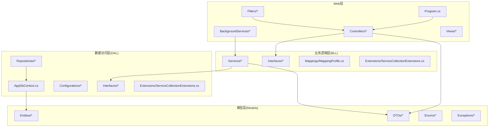
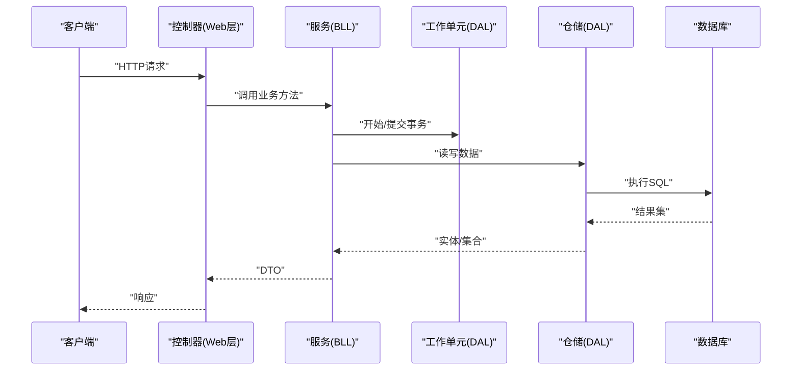
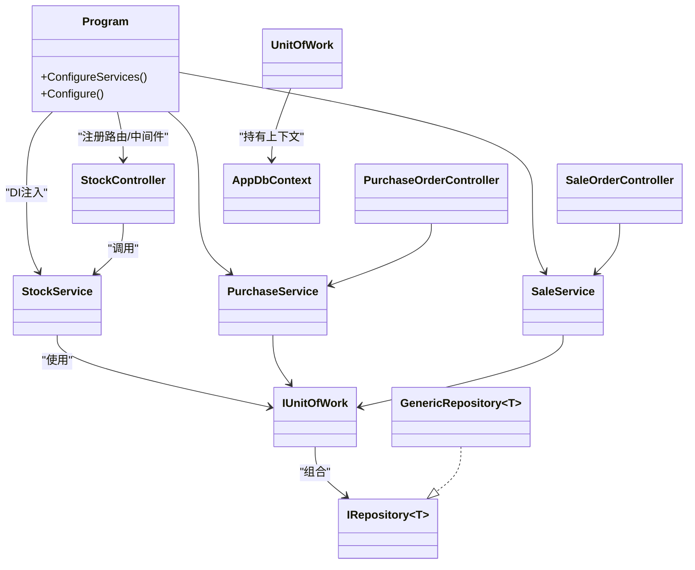
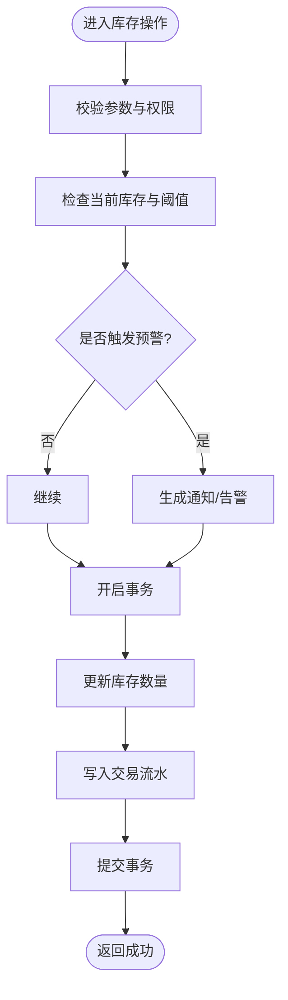
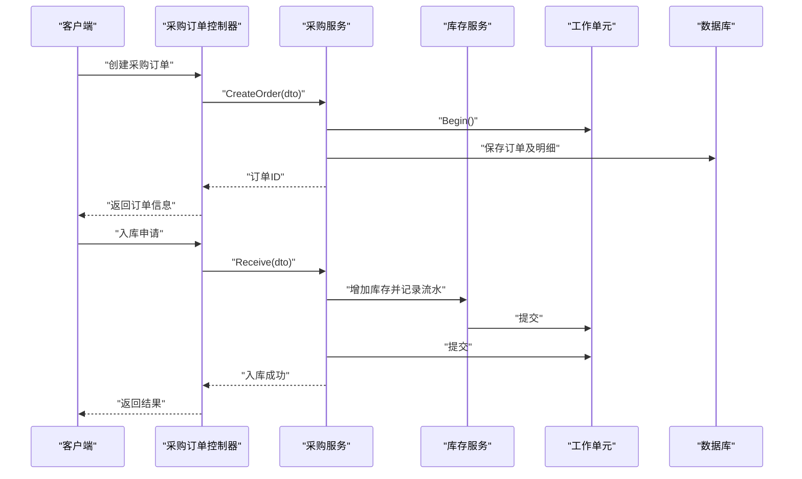
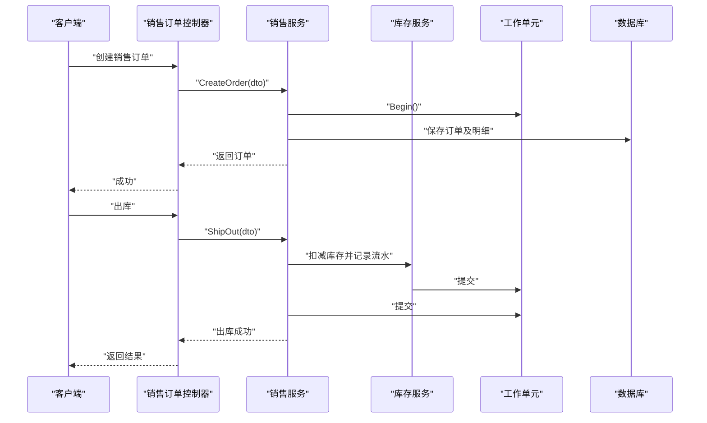
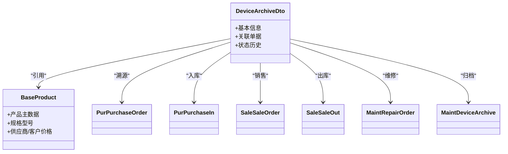
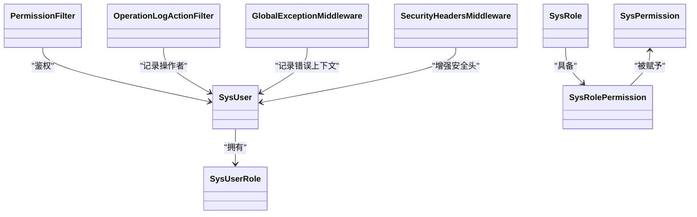
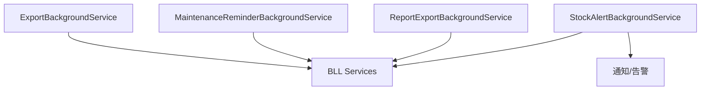
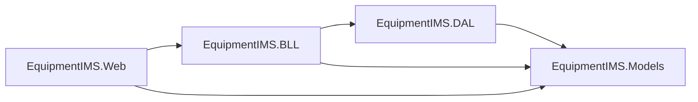

# 项目概述

<cite>
**本文引用的文件**   
- [EquipmentIMS.sln](file://EquipmentIMS.sln)
- [Program.cs](file://EquipmentIMS.Web/Program.cs)
- [appsettings.json](file://EquipmentIMS.Web/appsettings.json)
- [DataSeed.cs](file://EquipmentIMS.Web/DataSeed.cs)
- [AppDbContext.cs](file://EquipmentIMS.DAL/AppDbContext.cs)
- [ServiceCollectionExtensions.cs（BLL）](file://EquipmentIMS.BLL/Extensions/ServiceCollectionExtensions.cs)
- [ServiceCollectionExtensions.cs（DAL）](file://EquipmentIMS.DAL/Extensions/ServiceCollectionExtensions.cs)
- [MappingProfile.cs](file://EquipmentIMS.BLL/Mappings/MappingProfile.cs)
- [IRepository.cs](file://EquipmentIMS.DAL/Interfaces/IRepository.cs)
- [GenericRepository.cs](file://EquipmentIMS.DAL/Repositories/GenericRepository.cs)
- [IUnitOfWork.cs](file://EquipmentIMS.DAL/Interfaces/IUnitOfWork.cs)
- [UnitOfWork.cs](file://EquipmentIMS.DAL/Repositories/UnitOfWork.cs)
- [StockService.cs](file://EquipmentIMS.BLL/Services/StockService.cs)
- [PurchaseService.cs](file://EquipmentIMS.BLL/Services/PurchaseService.cs)
- [SaleService.cs](file://EquipmentIMS.BLL/Services/SaleService.cs)
- [StockController.cs](file://EquipmentIMS.Web/Controllers/StockController.cs)
- [PurchaseOrderController.cs](file://EquipmentIMS.Web/Controllers/PurchaseOrderController.cs)
- [SaleOrderController.cs](file://EquipmentIMS.Web/Controllers/SaleOrderController.cs)
- [GlobalExceptionMiddleware.cs](file://EquipmentIMS.Web/Filters/GlobalExceptionMiddleware.cs)
- [OperationLogActionFilter.cs](file://EquipmentIMS.Web/Filters/OperationLogActionFilter.cs)
- [PermissionFilter.cs](file://EquipmentIMS.Web/Filters/PermissionFilter.cs)
- [SecurityHeadersMiddleware.cs](file://EquipmentIMS.Web/Filters/SecurityHeadersMiddleware.cs)
- [ExportBackgroundService.cs](file://EquipmentIMS.Web/BackgroundServices/ExportBackgroundService.cs)
- [MaintenanceReminderBackgroundService.cs](file://EquipmentIMS.Web/BackgroundServices/MaintenanceReminderBackgroundService.cs)
- [ReportExportBackgroundService.cs](file://EquipmentIMS.Web/BackgroundServices/ReportExportBackgroundService.cs)
- [StockAlertBackgroundService.cs](file://EquipmentIMS.Web/BackgroundServices/StockAlertBackgroundService.cs)
- [BaseEntity.cs](file://EquipmentIMS.Models/Entities/BaseEntity.cs)
- [BaseProduct.cs](file://EquipmentIMS.Models/Entities/BaseProduct.cs)
- [BaseWarehouse.cs](file://EquipmentIMS.Models/Entities/BaseWarehouse.cs)
- [BaseCustomer.cs](file://EquipmentIMS.Models/Entities/BaseCustomer.cs)
- [BaseSupplier.cs](file://EquipmentIMS.Models/Entities/BaseSupplier.cs)
- [InvStockTransaction.cs](file://EquipmentIMS.Models/Entities/InvStockTransaction.cs)
- [PurPurchaseOrder.cs](file://EquipmentIMS.Models/Entities/PurPurchaseOrder.cs)
- [PurPurchaseIn.cs](file://EquipmentIMS.Models/Entities/PurPurchaseIn.cs)
- [SaleSaleOrder.cs](file://EquipmentIMS.Models/Entities/SaleSaleOrder.cs)
- [SaleSaleOut.cs](file://EquipmentIMS.Models/Entities/SaleSaleOut.cs)
- [SysUser.cs](file://EquipmentIMS.Models/Entities/SysUser.cs)
- [SysRole.cs](file://EquipmentIMS.Models/Entities/SysRole.cs)
- [SysPermission.cs](file://EquipmentIMS.Models/Entities/SysPermission.cs)
- [SysUserRole.cs](file://EquipmentIMS.Models/Entities/SysUserRole.cs)
- [SysRolePermission.cs](file://EquipmentIMS.Models/Entities/SysRolePermission.cs)
- [ApiResponse.cs](file://EquipmentIMS.Models/DTOs/ApiResponse.cs)
- [PagedResult.cs](file://EquipmentIMS.Models/DTOs/PagedResult.cs)
- [StockQueryDto.cs](file://EquipmentIMS.Models/DTOs/StockQueryDto.cs)
- [StockListDto.cs](file://EquipmentIMS.Models/DTOs/StockListDto.cs)
- [PurchaseOrderDto.cs](file://EquipmentIMS.Models/DTOs/PurchaseOrderDto.cs)
- [SaleOrderDto.cs](file://EquipmentIMS.Models/DTOs/SaleOrderDto.cs)
- [DeviceArchiveDto.cs](file://EquipmentIMS.Models/DTOs/DeviceArchiveDto.cs)
- [DashboardDto.cs](file://EquipmentIMS.Models/DTOs/DashboardDto.cs)
- [NotificationDto.cs](file://EquipmentIMS.Models/DTOs/NotificationDto.cs)
- [SystemConfigDto.cs](file://EquipmentIMS.Models/DTOs/SystemConfigDto.cs)
- [BusinessException.cs](file://EquipmentIMS.Models/Exceptions/BusinessException.cs)
- [NotFoundException.cs](file://EquipmentIMS.Models/Exceptions/NotFoundException.cs)
- [ValidationException.cs](file://EquipmentIMS.Models/Exceptions/ValidationException.cs)
</cite>

## 目录
1. [简介](#简介)
2. [项目结构](#项目结构)
3. [核心组件](#核心组件)
4. [架构总览](#架构总览)
5. [详细组件分析](#详细组件分析)
6. [依赖关系分析](#依赖关系分析)
7. [性能与可扩展性](#性能与可扩展性)
8. [故障排查指南](#故障排查指南)
9. [结论](#结论)
10. [附录：术语与业务场景](#附录术语与业务场景)

## 简介
THMS设备库存管理系统面向企业级设备与物料管理，覆盖“采购入库—库存流转—销售出库—盘点调拨—维修归档—报表看板”的全生命周期。系统采用分层架构与领域驱动思想，结合ASP.NET Core Web API、EF Core数据访问、统一异常处理、权限控制、操作审计与后台任务等能力，提供稳定、可维护、可扩展的企业级解决方案。

核心价值
- 全链路追溯：从订单到出入库、交易流水、库存快照，形成完整审计轨迹
- 多仓库与多角色：支持仓库维度库存隔离与细粒度权限控制
- 高可用与可观测：全局异常、操作日志、安全头、后台任务与告警
- 易扩展：通用仓储与工作单元模式，便于新增业务域与报表

## 项目结构
解决方案包含多个工程，按职责清晰分层：
- EquipmentIMS.Web：Web层（控制器、视图、过滤器、中间件、后台服务、静态资源）
- EquipmentIMS.BLL：业务逻辑层（服务接口与实现、映射配置、扩展方法）
- EquipmentIMS.DAL：数据访问层（DbContext、实体配置、仓储与工作单元）
- EquipmentIMS.Models：模型层（实体、枚举、DTO、异常）
- EquipmentIMS.DataGen：数据生成工具
- EquipmentIMS.Tests：测试工程

图表来源
- [Program.cs](file://EquipmentIMS.Web/Program.cs)
- [StockController.cs](file://EquipmentIMS.Web/Controllers/StockController.cs)
- [PurchaseOrderController.cs](file://EquipmentIMS.Web/Controllers/PurchaseOrderController.cs)
- [SaleOrderController.cs](file://EquipmentIMS.Web/Controllers/SaleOrderController.cs)
- [ServiceCollectionExtensions.cs（BLL）](file://EquipmentIMS.BLL/Extensions/ServiceCollectionExtensions.cs)
- [ServiceCollectionExtensions.cs（DAL）](file://EquipmentIMS.DAL/Extensions/ServiceCollectionExtensions.cs)
- [AppDbContext.cs](file://EquipmentIMS.DAL/AppDbContext.cs)
- [MappingProfile.cs](file://EquipmentIMS.BLL/Mappings/MappingProfile.cs)

章节来源
- [EquipmentIMS.sln](file://EquipmentIMS.sln)
- [Program.cs](file://EquipmentIMS.Web/Program.cs)

## 核心组件
- 控制器层：按领域划分（库存、采购、销售、设备档案、用户与权限、系统配置、报表等），负责请求解析、参数校验、调用服务、返回DTO
- 业务服务层：封装业务流程与事务边界，协调仓储与外部依赖，输出DTO
- 数据访问层：基于EF Core的通用仓储与工作单元，提供CRUD与复杂查询；实体配置集中管理
- 模型层：实体、DTO、枚举、异常类型，贯穿各层契约
- 横切关注点：全局异常、操作日志、权限过滤、安全头、后台任务、缓存与加密

章节来源
- [StockController.cs](file://EquipmentIMS.Web/Controllers/StockController.cs)
- [PurchaseOrderController.cs](file://EquipmentIMS.Web/Controllers/PurchaseOrderController.cs)
- [SaleOrderController.cs](file://EquipmentIMS.Web/Controllers/SaleOrderController.cs)
- [StockService.cs](file://EquipmentIMS.BLL/Services/StockService.cs)
- [PurchaseService.cs](file://EquipmentIMS.BLL/Services/PurchaseService.cs)
- [SaleService.cs](file://EquipmentIMS.BLL/Services/SaleService.cs)
- [IRepository.cs](file://EquipmentIMS.DAL/Interfaces/IRepository.cs)
- [GenericRepository.cs](file://EquipmentIMS.DAL/Repositories/GenericRepository.cs)
- [IUnitOfWork.cs](file://EquipmentIMS.DAL/Interfaces/IUnitOfWork.cs)
- [UnitOfWork.cs](file://EquipmentIMS.DAL/Repositories/UnitOfWork.cs)
- [AppDbContext.cs](file://EquipmentIMS.DAL/AppDbContext.cs)

## 架构总览
系统采用典型分层架构：Web层通过DI注入服务接口，服务层组合仓储与工作单元完成事务性操作，数据访问层使用EF Core进行持久化。DTO在Web与服务之间传递，实体仅在DAL与数据库之间交互。

图表来源
- [StockController.cs](file://EquipmentIMS.Web/Controllers/StockController.cs)
- [StockService.cs](file://EquipmentIMS.BLL/Services/StockService.cs)
- [IUnitOfWork.cs](file://EquipmentIMS.DAL/Interfaces/IUnitOfWork.cs)
- [IRepository.cs](file://EquipmentIMS.DAL/Interfaces/IRepository.cs)
- [GenericRepository.cs](file://EquipmentIMS.DAL/Repositories/GenericRepository.cs)
- [AppDbContext.cs](file://EquipmentIMS.DAL/AppDbContext.cs)

## 详细组件分析

### 分层架构与依赖注入
- Web层启动时注册服务与中间件，包括全局异常、操作日志、权限过滤、安全头等
- BLL与DAL分别通过扩展方法将接口与实现绑定至容器
- MappingProfile用于DTO与实体之间的映射

图表来源
- [Program.cs](file://EquipmentIMS.Web/Program.cs)
- [StockController.cs](file://EquipmentIMS.Web/Controllers/StockController.cs)
- [PurchaseOrderController.cs](file://EquipmentIMS.Web/Controllers/PurchaseOrderController.cs)
- [SaleOrderController.cs](file://EquipmentIMS.Web/Controllers/SaleOrderController.cs)
- [StockService.cs](file://EquipmentIMS.BLL/Services/StockService.cs)
- [PurchaseService.cs](file://EquipmentIMS.BLL/Services/PurchaseService.cs)
- [SaleService.cs](file://EquipmentIMS.BLL/Services/SaleService.cs)
- [IRepository.cs](file://EquipmentIMS.DAL/Interfaces/IRepository.cs)
- [GenericRepository.cs](file://EquipmentIMS.DAL/Repositories/GenericRepository.cs)
- [IUnitOfWork.cs](file://EquipmentIMS.DAL/Interfaces/IUnitOfWork.cs)
- [UnitOfWork.cs](file://EquipmentIMS.DAL/Repositories/UnitOfWork.cs)
- [AppDbContext.cs](file://EquipmentIMS.DAL/AppDbContext.cs)

章节来源
- [Program.cs](file://EquipmentIMS.Web/Program.cs)
- [ServiceCollectionExtensions.cs（BLL）](file://EquipmentIMS.BLL/Extensions/ServiceCollectionExtensions.cs)
- [ServiceCollectionExtensions.cs（DAL）](file://EquipmentIMS.DAL/Extensions/ServiceCollectionExtensions.cs)
- [MappingProfile.cs](file://EquipmentIMS.BLL/Mappings/MappingProfile.cs)

### 库存管理与交易流水
库存变更通过标准化交易记录保障一致性，支持入库、出库、调拨、盘点差异等场景。

图表来源
- [StockService.cs](file://EquipmentIMS.BLL/Services/StockService.cs)
- [IRepository.cs](file://EquipmentIMS.DAL/Interfaces/IRepository.cs)
- [GenericRepository.cs](file://EquipmentIMS.DAL/Repositories/GenericRepository.cs)
- [IUnitOfWork.cs](file://EquipmentIMS.DAL/Interfaces/IUnitOfWork.cs)
- [UnitOfWork.cs](file://EquipmentIMS.DAL/Repositories/UnitOfWork.cs)
- [InvStockTransaction.cs](file://EquipmentIMS.Models/Entities/InvStockTransaction.cs)

章节来源
- [StockController.cs](file://EquipmentIMS.Web/Controllers/StockController.cs)
- [StockService.cs](file://EquipmentIMS.BLL/Services/StockService.cs)
- [StockQueryDto.cs](file://EquipmentIMS.Models/DTOs/StockQueryDto.cs)
- [StockListDto.cs](file://EquipmentIMS.Models/DTOs/StockListDto.cs)
- [InvStockTransaction.cs](file://EquipmentIMS.Models/Entities/InvStockTransaction.cs)

### 采购流程（订单—入库—退货）
采购流程涵盖订单创建、到货入库、退货处理，并与库存联动。

图表来源
- [PurchaseOrderController.cs](file://EquipmentIMS.Web/Controllers/PurchaseOrderController.cs)
- [PurchaseService.cs](file://EquipmentIMS.BLL/Services/PurchaseService.cs)
- [StockService.cs](file://EquipmentIMS.BLL/Services/StockService.cs)
- [PurPurchaseOrder.cs](file://EquipmentIMS.Models/Entities/PurPurchaseOrder.cs)
- [PurPurchaseIn.cs](file://EquipmentIMS.Models/Entities/PurPurchaseIn.cs)
- [IUnitOfWork.cs](file://EquipmentIMS.DAL/Interfaces/IUnitOfWork.cs)

章节来源
- [PurchaseOrderController.cs](file://EquipmentIMS.Web/Controllers/PurchaseOrderController.cs)
- [PurchaseService.cs](file://EquipmentIMS.BLL/Services/PurchaseService.cs)
- [PurchaseOrderDto.cs](file://EquipmentIMS.Models/DTOs/PurchaseOrderDto.cs)
- [PurPurchaseOrder.cs](file://EquipmentIMS.Models/Entities/PurPurchaseOrder.cs)
- [PurPurchaseIn.cs](file://EquipmentIMS.Models/Entities/PurPurchaseIn.cs)

### 销售流程（订单—出库—退货）
销售流程涵盖订单确认、出库扣减库存、退货回滚，确保账实相符。

图表来源
- [SaleOrderController.cs](file://EquipmentIMS.Web/Controllers/SaleOrderController.cs)
- [SaleService.cs](file://EquipmentIMS.BLL/Services/SaleService.cs)
- [StockService.cs](file://EquipmentIMS.BLL/Services/StockService.cs)
- [SaleSaleOrder.cs](file://EquipmentIMS.Models/Entities/SaleSaleOrder.cs)
- [SaleSaleOut.cs](file://EquipmentIMS.Models/Entities/SaleSaleOut.cs)
- [IUnitOfWork.cs](file://EquipmentIMS.DAL/Interfaces/IUnitOfWork.cs)

章节来源
- [SaleOrderController.cs](file://EquipmentIMS.Web/Controllers/SaleOrderController.cs)
- [SaleService.cs](file://EquipmentIMS.BLL/Services/SaleService.cs)
- [SaleOrderDto.cs](file://EquipmentIMS.Models/DTOs/SaleOrderDto.cs)
- [SaleSaleOrder.cs](file://EquipmentIMS.Models/Entities/SaleSaleOrder.cs)
- [SaleSaleOut.cs](file://EquipmentIMS.Models/Entities/SaleSaleOut.cs)

### 设备档案与全生命周期
设备档案贯穿采购、入库、领用、维修、报废等阶段，支持状态跟踪与关联单据。

图表来源
- [DeviceArchiveDto.cs](file://EquipmentIMS.Models/DTOs/DeviceArchiveDto.cs)
- [BaseProduct.cs](file://EquipmentIMS.Models/Entities/BaseProduct.cs)
- [PurPurchaseOrder.cs](file://EquipmentIMS.Models/Entities/PurPurchaseOrder.cs)
- [PurPurchaseIn.cs](file://EquipmentIMS.Models/Entities/PurPurchaseIn.cs)
- [SaleSaleOrder.cs](file://EquipmentIMS.Models/Entities/SaleSaleOrder.cs)
- [SaleSaleOut.cs](file://EquipmentIMS.Models/Entities/SaleSaleOut.cs)
- [MaintDeviceArchive.cs](file://EquipmentIMS.Models/Entities/MaintDeviceArchive.cs)

章节来源
- [DeviceArchiveDto.cs](file://EquipmentIMS.Models/DTOs/DeviceArchiveDto.cs)
- [BaseProduct.cs](file://EquipmentIMS.Models/Entities/BaseProduct.cs)

### 权限与安全
- 基于角色的访问控制（RBAC）：用户-角色-权限三元组
- 过滤器与中间件：权限校验、操作日志、全局异常、安全响应头

图表来源
- [SysUser.cs](file://EquipmentIMS.Models/Entities/SysUser.cs)
- [SysRole.cs](file://EquipmentIMS.Models/Entities/SysRole.cs)
- [SysPermission.cs](file://EquipmentIMS.Models/Entities/SysPermission.cs)
- [SysUserRole.cs](file://EquipmentIMS.Models/Entities/SysUserRole.cs)
- [SysRolePermission.cs](file://EquipmentIMS.Models/Entities/SysRolePermission.cs)
- [PermissionFilter.cs](file://EquipmentIMS.Web/Filters/PermissionFilter.cs)
- [OperationLogActionFilter.cs](file://EquipmentIMS.Web/Filters/OperationLogActionFilter.cs)
- [GlobalExceptionMiddleware.cs](file://EquipmentIMS.Web/Filters/GlobalExceptionMiddleware.cs)
- [SecurityHeadersMiddleware.cs](file://EquipmentIMS.Web/Filters/SecurityHeadersMiddleware.cs)

章节来源
- [PermissionFilter.cs](file://EquipmentIMS.Web/Filters/PermissionFilter.cs)
- [OperationLogActionFilter.cs](file://EquipmentIMS.Web/Filters/OperationLogActionFilter.cs)
- [GlobalExceptionMiddleware.cs](file://EquipmentIMS.Web/Filters/GlobalExceptionMiddleware.cs)
- [SecurityHeadersMiddleware.cs](file://EquipmentIMS.Web/Filters/SecurityHeadersMiddleware.cs)

### 后台任务与提醒
- 导出任务：异步批量导出报表或清单
- 维护提醒：定期推送设备保养计划到期提醒
- 报表导出：后台生成报表并持久化
- 库存预警：定时扫描低库存并生成通知

图表来源
- [ExportBackgroundService.cs](file://EquipmentIMS.Web/BackgroundServices/ExportBackgroundService.cs)
- [MaintenanceReminderBackgroundService.cs](file://EquipmentIMS.Web/BackgroundServices/MaintenanceReminderBackgroundService.cs)
- [ReportExportBackgroundService.cs](file://EquipmentIMS.Web/BackgroundServices/ReportExportBackgroundService.cs)
- [StockAlertBackgroundService.cs](file://EquipmentIMS.Web/BackgroundServices/StockAlertBackgroundService.cs)

章节来源
- [ExportBackgroundService.cs](file://EquipmentIMS.Web/BackgroundServices/ExportBackgroundService.cs)
- [MaintenanceReminderBackgroundService.cs](file://EquipmentIMS.Web/BackgroundServices/MaintenanceReminderBackgroundService.cs)
- [ReportExportBackgroundService.cs](file://EquipmentIMS.Web/BackgroundServices/ReportExportBackgroundService.cs)
- [StockAlertBackgroundService.cs](file://EquipmentIMS.Web/BackgroundServices/StockAlertBackgroundService.cs)

## 依赖关系分析
- 模块内聚与解耦：Web仅依赖BLL接口，BLL依赖DAL接口，DAL直接依赖EF Core与模型
- 通用仓储与工作单元：减少重复代码，统一事务边界
- DTO与实体分离：避免ORM污染API契约
- 配置与初始化：应用设置、数据种子、映射配置集中管理

图表来源
- [EquipmentIMS.sln](file://EquipmentIMS.sln)
- [Program.cs](file://EquipmentIMS.Web/Program.cs)
- [ServiceCollectionExtensions.cs（BLL）](file://EquipmentIMS.BLL/Extensions/ServiceCollectionExtensions.cs)
- [ServiceCollectionExtensions.cs（DAL）](file://EquipmentIMS.DAL/Extensions/ServiceCollectionExtensions.cs)

章节来源
- [EquipmentIMS.sln](file://EquipmentIMS.sln)
- [Program.cs](file://EquipmentIMS.Web/Program.cs)

## 性能与可扩展性
- 分页与筛选：列表接口普遍支持分页与条件查询，降低网络与内存压力
- 事务边界：工作单元保证跨仓储操作的原子性
- 异步与后台任务：导出、报表、提醒等耗时操作异步化
- 缓存与加密：提供缓存与AES加密服务接口，可按需启用
- 索引与配置：实体配置集中管理，便于后续添加索引与约束优化

[本节为通用指导，不直接分析具体文件]

## 故障排查指南
- 全局异常：统一捕获并返回标准错误响应体
- 操作日志：记录关键操作上下文，便于审计与回溯
- 权限问题：检查角色-权限分配与过滤器生效顺序
- 安全头：确认响应头是否正确注入
- 常见异常类型：业务异常、未找到、参数校验失败

章节来源
- [GlobalExceptionMiddleware.cs](file://EquipmentIMS.Web/Filters/GlobalExceptionMiddleware.cs)
- [OperationLogActionFilter.cs](file://EquipmentIMS.Web/Filters/OperationLogActionFilter.cs)
- [PermissionFilter.cs](file://EquipmentIMS.Web/Filters/PermissionFilter.cs)
- [SecurityHeadersMiddleware.cs](file://EquipmentIMS.Web/Filters/SecurityHeadersMiddleware.cs)
- [BusinessException.cs](file://EquipmentIMS.Models/Exceptions/BusinessException.cs)
- [NotFoundException.cs](file://EquipmentIMS.Models/Exceptions/NotFoundException.cs)
- [ValidationException.cs](file://EquipmentIMS.Models/Exceptions/ValidationException.cs)
- [ApiResponse.cs](file://EquipmentIMS.Models/DTOs/ApiResponse.cs)

## 结论
THMS设备库存管理系统以清晰的层次化架构与完善的横切能力，支撑设备与库存的端到端管理。通过通用仓储与工作单元、统一的DTO契约、严格的权限与安全策略、以及后台任务与告警机制，系统在稳定性、可维护性与可扩展性方面具备良好的工程实践基础。

[本节为总结性内容，不直接分析具体文件]

## 附录：术语与业务场景
- 术语
  - 设备档案：设备主数据与生命周期记录
  - 库存交易：记录每一次库存变动的不可变流水
  - 工作单元：聚合多个仓储操作的事务边界
  - RBAC：基于角色的访问控制
- 典型场景
  - 新购设备入库：采购订单→到货入库→库存增加→交易流水→设备档案建立
  - 销售出库：销售订单→出库扣减→库存减少→交易流水→发货记录
  - 库存盘点：生成盘点单→录入实盘→差异调整→库存修正→交易流水
  - 设备维修：报修→派工→备件消耗→维修完成→状态更新
  - 报表与看板：库存汇总、进销存统计、设备健康度、待办提醒

[本节为概念说明，不直接分析具体文件]